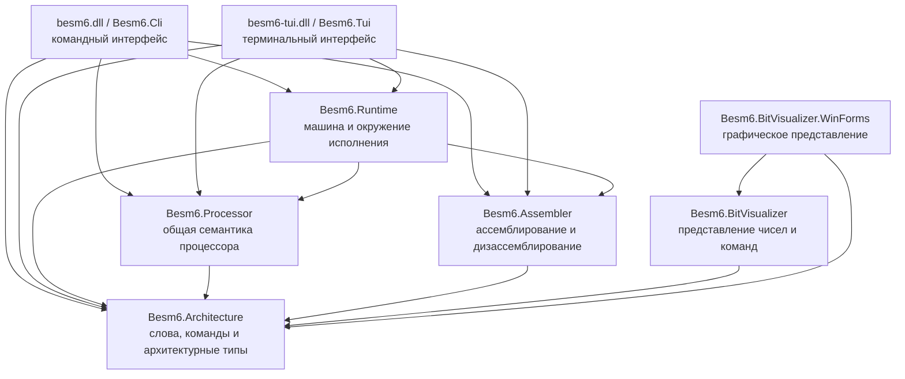
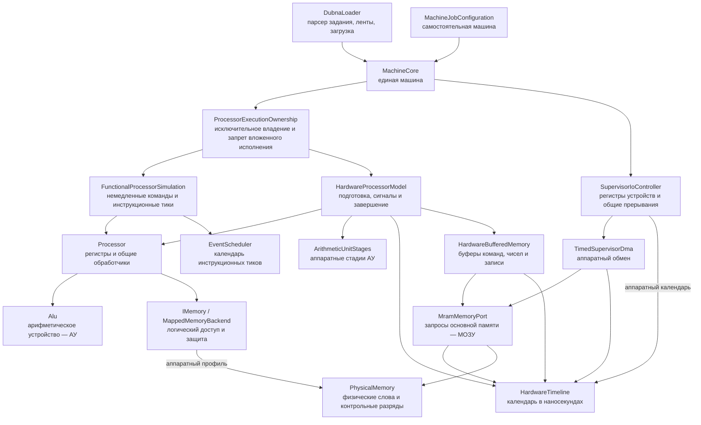
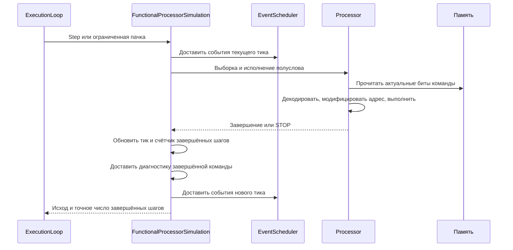
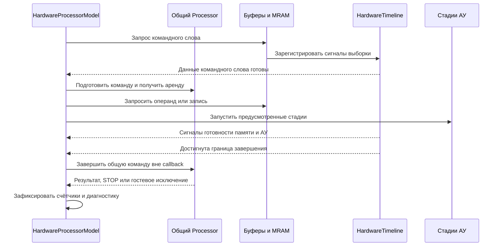

# Архитектура программной модели БЭСМ-6

## 1. Предмет и метод описания

Система реализует исполнение программ БЭСМ-6 средствами .NET 8. Объектом данного описания является программная архитектура: представление состояния машины, границы ответственности компонентов, порядок переходов состояния и организация измерений. Историческая аппаратная архитектура служит источником требований, однако наличие программного узла с соответствующим названием само по себе не доказывает воспроизведение электрических характеристик оригинала.

Описание опирается на исходный код, контрактные проверки и исторические материалы в составе репозитория. Функциональная совместимость Dubna и аппаратная модель имеют общую семантическую основу и раздельные механизмы продвижения исполнения. Конфигурации памяти, профиль процессора, модель исполнения и скорость хоста являются различными параметрами; их не следует отождествлять.

Документ развивается вместе с архитектурной консолидацией. Текущее состояние реализации и результаты приёмки фиксируются в [единственном плане симулятора](plans/SuperPlan.md). Незавершённые изменения не считаются свойствами реализованной системы.

## 2. Компонентная структура и зависимости

Стрелка на диаграмме локальных сборок означает прямую зависимость потребителя от поставщика, включая доступные через транзитивные ProjectReference ссылки CLR. Состав проверяется по метаданным собранных DLL. Обратной зависимости Processor от Runtime нет: ядро процессора исполняется без загрузчика, системных лент и устройств машины.

Границы DLL определяются зависимостями, а папки внутри сборок — предметной ответственностью. Формирование новой сборки только ради сокращения размера файла не является архитектурной целью. Учебный процессор в `src/besm-edu/` имеет отдельное назначение и не является исполнительным ядром данной машины.

| Компонент | Ответственность | Граница ответственности |
|---|---|---|
| Architecture | Представление 48-битных слов, 50-битных слов памяти, форматов команд и архитектурных состояний | Не выполняет загрузку, ввод-вывод или ожидание времени хоста |
| Processor | Выборка, декодирование, адресная модификация, диспетчеризация, АУ и фиксация результатов | Не владеет календарём устройств или системными лентами |
| Assembler | Преобразование текстовых представлений команд и машинных слов | Не запускает машину |
| Runtime | Композиция машины, владельцы исполнения, память аппаратной модели, устройства, загрузка и hosted-экстракоды | Не содержит независимой копии семантики команд |
| CLI и TUI | Ввод параметров, вызов Runtime, представление результатов и диагностики | Не подменяют вычисления гостевой программы вычислениями хоста |
| Инструменты проверки | Сравнение состояний, численные эталоны, измерение производительности и формирование отчётов | Не участвуют в обычном исполнении машины |

## 3. Единая машина и владение исполнением

`MachineCore` является корнем композиции. Он объединяет один `Processor`, выбранную память и устройства. Раздельные владельцы исполнения используют эти ресурсы без промежуточного копирования гостевого состояния между самостоятельными процессорами.

Реентерабельность ограничивается координатором владения, флагами продвижения календарей и арендой подготовленной команды. Это защита однопоточной модели, а не блокировка для параллельного исполнения одного экземпляра машины.

Переключение владельца допускается только на свободной границе CPU и календарей. Подготовленная команда, ожидающий обмен или callback не могут быть незаметно переданы другому исполнителю. Аппаратная конфигурация закрепляется за машиной; смена владельца сохраняет регистры, память и значения обоих календарей.

### 3.1. Общее архитектурное состояние

Обозначим состояние CPU через

$$
S_{CPU}=(A,Y,R,C,\operatorname{ApplyC},M,K,H),
$$

где `A` — аккумулятор, `Y` — дополнительный регистр результата, `R` — режим арифметики, `C` и `ApplyC` — отложенная модификация адреса, `M` — индексные регистры, `K` — адрес командного слова, `H` — выбор левого или правого полуслова. Внутреннее состояние дополнительно содержит эффективный адрес, признаки защиты, диагностические условия и сведения о подготовленной команде.

Обработчики вычисляют переходы состояния с учётом текущих регистров и памяти. Результат декодирования содержит статические сведения команды; эффективный адрес и значение операнда не могут быть сохранены как постоянные сведения кеша. АУ сохраняет установленные правила нормализации, округления, публикации A/Y и исключений.

## 4. Исполнительные последовательности

### 4.1. Функциональное исполнение

Один успешно завершённый функциональный шаг увеличивает `SimulationClock` на один тик, включая команду STOP. При исключении CPU дополнительный тик не начисляется. Счётчик уведомлений об исполненных командах имеет собственные точки фиксации; его нельзя автоматически приравнивать к числу успешно завершённых шагов, в частности на исключительном завершении hosted-экстракода.

Пачка ограничивается ближайшим событием и лимитами вызывающего слоя. При пустой очереди сохраняется путь без проверки очереди на каждом полуслове. После callback условия быстрого пути проверяются заново: callback вправе изменить память или диагностические hooks. Экстракоды и наблюдаемые операции сохраняют обычные границы исполнения.

### 4.2. Аппаратное исполнение

Аппаратный владелец описывает готовность ресурсов и видимость результатов во времени, а общий CPU — семантический переход. Завершение команды не переносится внутрь callback календаря. Незавершённая аренда сохраняется при допустимой остановке продвижения времени; сброс и отмена инвалидируют соответствующее подготовленное исполнение по существующему контракту.

События одного времени доставляются в порядке регистрации. Отмена идентифицируется владельцем календаря и уникальным token. Идентификаторы не переиспользуются. Переиспользуемый объект запроса не должен оставаться достижимым через старую запись очереди. Ошибка callback сохраняет исходную причину в исключении Runtime и не превращается в гостевой авост.

## 5. Память и наблюдаемость

Данные CPU представлены 48-битным словом; физическая память аппаратного профиля хранит также контрольные разряды. Математический адрес проходит выбранную приписку и проверку защиты до доступа к соответствующей физической области. Командная выборка и чтение числа могут иметь различные условия допустимости контрольных разрядов.

`CoreMemory` обслуживает функциональную память Dubna. Плоское хранение уменьшает косвенные обращения хоста. Прямой путь применяется только к точному типу этой памяти; пользовательская реализация `IMemory` сохраняет наблюдаемые вызовы и проверки. Модель с буферами и модель с припиской выбираются явно.

Буферы командных слов, операндов и записи учитывают физическую идентичность слова и установленные правила видимости. Ремап математического адреса не должен изменять физическую цель уже принятой записи. Поведение ATX/CTX, очистка командных буферов и ошибки доступа определяются выбранным профилем и существующей семантикой обработчиков.

Самомодифицирующаяся программа требует повторной выборки фактических битов перед каждым полусловом. Кеш декодирования сопоставляет эти биты с сохранённым описанием. Аппаратная буферизация при этом может намеренно сохранять старое командное слово до предусмотренного события очистки; это свойство выбранной памяти, а не разрешение кешу интерпретатора скрывать новые биты.

## 6. Устройства и hosted-окружение

`SupervisorIoController` сохраняет публичный интерфейс регистров и устройств. Его реализация сгруппирована по предметным подсистемам; соответствующее внутреннее состояние находится рядом с обработчиками. Разделение partial-файлов не создаёт новых владельцев машины и не изменяет порядок регистрации событий.

| Подсистема | Локальное состояние и операции |
|---|---|
| Exchange | Образы дисков и барабанов, каналы, принятые обмены и состояния ошибок |
| Serial | Состояния линий, входные очереди, выходные биты, стадии кадра и последовательный тактовый источник |
| Console | Подключение терминалов, входные коды и ожидающие подтверждения вывода |
| PaperTape | Подготовленный перфоленточный ввод, положение, режим и регистр считывателя |
| Printer | Подключение, движение, позиция символа, матрица ударов и ожидающие импульсы |
| Timer | Периодические события и выбранный вариант формирования сигналов |

Общие регистры готовности, маски и вычисление прерываний остаются централизованными. Аппаратный DMA использует те же физические слова и MRAM-порт, что и модель CPU. Функциональные задержки устройств выражаются в тиках; аппаратные — в наносекундах выбранной конфигурации.

`DubnaLoader` объединяет парсер задания, поиск и монтаж системных лент, загрузку слов или ассемблерного текста и запуск программы. Hosted-обработчики экстракодов предоставляют сервисы среды Dubna. Они не являются независимым процессором и не заменяют арифметическое ядро программы вычислением хоста.

## 7. Время, скорость и измерения

| Величина | Единица | Назначение |
|---|---|---|
| `SimulationClock.Tick` | Завершённый функциональный шаг | Порядок функциональных событий |
| Табличная стоимость команды | Такт по `Besm6Timing` | Детерминированная модель функционального CPU-времени |
| `HardwareTimeline.Now` | Наносекунда | Сроки сигналов, памяти, АУ и устройств аппаратного профиля |
| `Stopwatch` | Секунда хоста | Измерение фактических затрат и pacing |
| Гостевой CTIME/STIME | Секунда с разрешением 20 мс: модельная в max/original, хоста в virtual | Измерение участков внутри hosted-программы |

Для функционального табличного времени применяется

$$
T_{model}=10^{-7}\sum_i c(op_i)\quad\text{секунд}.
$$

Инструкционный тик не является табличным тактом и не пересчитывается в наносекунды аппаратного календаря. Аппаратная модель вычисляет время из последовательности готовности ресурсов, а не из указанной суммы.

`max` продвигает выбранную модель без ожиданий хоста. `original` синхронизирует хост с абсолютным модельным сроком, сохраняя переходы гостевого состояния. Если хост опаздывает, инструкции и события не пропускаются и начальный срок не переносится. Сообщение о недостаточной скорости хоста отделяется от ошибки гостевой программы.

`virtual` исполняет машину без pacing, как `max`. При явном включении гостевого таймера hosted CTIME/STIME читают квантованное фактическое время текущего исполнительного цикла, а не сумму табличных тактов. Начало отсчёта устанавливается после подключения диагностики, перед первой командой; завершение, исключение и повторный запуск освобождают прежний источник времени. Часы хоста не управляют выборкой команд, памятью или календарями событий. В аппаратном исполнении таймеры ОС остаются аппаратными модельными устройствами; hosted CTIME их не заменяет. Программы, читающие CTIME, могут менять результаты и поток управления между virtual и модельными скоростями; это явное различие сервиса времени, а не изменение семантики команд.

Внутренний учёт одного запуска принадлежит `ExecutionAccountingSession`. Runtime передаёт стоимости опкодов в `ProcessorInstructionAccounting`; Processor не зависит от таблицы времени Runtime или часов хоста. Учёт завершает начатую команду в существующей канонической точке публикации и не требует диагностической подписки. Поэтому число учтённых команд может отличаться от числа успешно завершённых шагов: исключение и перехват сохраняют действующие правила уведомлений, а дополнительный инструкционный тик при исключении не начисляется.

Цикл пачки имеет две специализации с общими обработчиками и завершением кадра: с учётом и без него. В чистом `max` с выключенным гостевым таймером и статистикой сессия не создаётся; специализация без учёта не обращается к таблице стоимости. Пачку ограничивают инструкционный лимит, ближайшее событие, проверка wall-clock и, в `original`, очередной порог pacing. Тактовый порог может быть превышен только стоимостью завершающей его инструкции. После доставки callback условия быстрого пути проверяются повторно. Диагностические hooks, watchpoints и пользовательская память сохраняют наблюдаемый путь исполнения.

Кеш декодирования допускается при всех трёх скоростях. Его применение сохраняет фактическую выборку и сравнение битов каждого полуслова; текущие адреса, модификация и операнды вычисляются обработчиком заново. Предыдущая настройка кеша восстанавливается после завершения запуска, включая ошибку.

`ExecutionStatistics` описывает исполнительный цикл; запуск процесса CLI, проверка системных образов и форматирование отчёта находятся за пределами этого интервала. Гистограмма `OpcodeProfiler` и статистика исполнения имеют разные задачи. Гостевой рейтинг определяется самой программой по её числу операций и измеренному участку, тогда как производительность хоста вычисляется внешним инструментом по фактическому времени.

Самостоятельные гостевые задания представлены файлами `dhrystone-dmips.dub`, `mpmflops-mflops.dub`, `whetstone-mwips.dub` и `memspeed-mbps.dub`. Они требуют явного `--guest-clock`; рейтинг публикуется после контроля результата и при интервале не менее 40 мс. Этот порог исключает оценку короткого тела по случайному пересечению одного кванта таймера и не устанавливает универсальную точность рейтинга. Whetstone суммирует квантованные интервалы секций; погрешности таких интервалов могут накапливаться.

Специальные параметры CLI `--passes`, `--mflops`, `--ops`, `--loop-cycles`, `--baseline-cycles` и `--baseline-instructions` удалены. Их передача отклоняется до загрузки машины. `--stats` и `--profile` остаются общими средствами диагностики. Методы рейтингов `OpcodeProfiler` изолированы в совместимой части реализации и не вызываются CLI.

Нельзя сравнивать значения DMIPS/MFLOPS, полученные по модельному времени, с показателями хоста как одну величину. Гостевой таймер также не является источником `DATE*`: воспроизводимость даты, диагностические условия, лимиты и выбор скорости независимы.

## 8. Диагностика и жизненный цикл

`RunOptions` содержит параметры вызова и применяет их к конфигурации и загрузчику. `RunCommand` организует запуск. `RunOutput` форматирует трассировку, итоговую статистику и дампы за пределами измеряемого цикла.

`ExecutionDiagnosticsSession` владеет только собственными подписками одного запуска. При завершении она снимает их, сохраняя hooks, добавленные или заменённые callback. Подписки освобождаются и при частично выполненной инициализации. Снимки регистров создаются для полной диагностики; лёгкое уведомление опкода не требует снимка.

`Processor.StartAt(address)` нормализует K и выбирает левое полуслово, не выполняя сброс остальных регистров. Этот контракт используется загрузкой программы. `MachineCore.ResetCpu()` сбрасывает CPU и сохраняет память, часы, очереди и устройства; `Reset()` является совместимым входом такого сброса. Операция не является холодным сбросом всей машины.

Повторный запуск использует новую сессию измерений и диагностики. Он не должен накапливать подписки предыдущих запусков. Переход CPU по исключению, обработка перехвата и завершение STOP сохраняют действующие точки публикации состояния и счётчиков.

## 9. Достоверность и проверка

Архитектурное равенство проверяется по регистрам A/Y/R/C/M/K, памяти, наблюдаемым счётчикам, модельному времени и порядку событий. Проверки численного вывода необходимы, но не заменяют сравнение полного состояния.

Основные контрольные области: обе половины слова, самомодификация, приписка и alias, контрольные разряды, защита, округление, исключения и перехваты, STOP, отмена событий, повторное использование запросов, ошибки callback и повторный запуск машины. Аппаратная ОС проверяется также по результату задания, дальнейшей работоспособности и состоянию носителей и обмена.

Конфигурация `Simh512K` служит экспериментальной совместимости с закреплённым вариантом SIMH; она не устанавливает историческую топологию банков или их электрическое время. Аппаратные задержки и правила перекрытия зависят от явно выбранной конфигурации. Неизвестные свойства исторического устройства не выводятся из результатов бенчмарка.

Исходные нетаймированные задания и эталоны численного поведения сохраняются для регрессии. Сравнение производительности выполняется отдельно от профилирования и полного накопления диагностической истории. Ограничения точности времени и ограничения производительности хоста фиксируются раздельно.

## 10. Источники в составе репозитория

1. [Архитектура БЭСМ-6](book/02-architecture.md): контекст структуры машины и аппаратных узлов.
2. [Система команд](book/03-instruction-set.md): форматы команд, регистры и временные характеристики.
3. [Описание БЭСМ-6 в материалах FORTRAN/Dubna](book/fortran-1976/01-besm6.md): историческая программная модель.
4. [FORTRAN и Dubna](book/fortran-1976/02-fortran-dubna.md): сервисы среды, в том числе счётное время.
5. [Границы моделей](docs/besm6-stage5-model-boundaries.md) и [жизненный цикл исполнения](docs/execution-lifecycle.md): ранее закреплённые контракты реализации.

Источники следует использовать с учётом их статуса: историческое описание, современная систематизация, спецификация реализации и экспериментальное свидетельство имеют различную доказательную силу. При изменении аппаратного поведения необходимо указать источник, конфигурацию и ожидаемый наблюдаемый результат.
