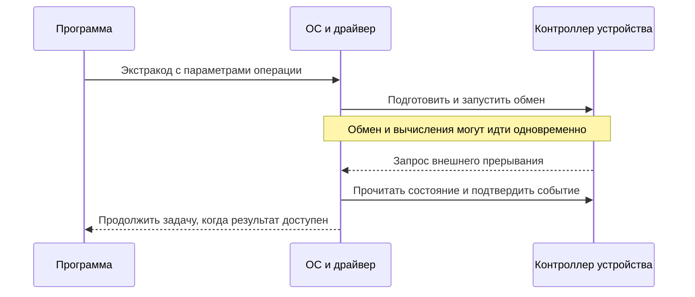

# Как процессор БЭСМ-6 выполняет программы на Мадлен

[Оглавление учебника](README.md)

Процессор выполняет программу, последовательно изменяя регистры и память. Арифметическая команда вычисляет новое значение, переход выбирает следующую команду, а цикл многократно возвращает выполнение к одному участку программы. Подпрограмма дополнительно сохраняет путь возврата. Прерывание позволяет временно передать управление операционной системе в ответ на событие.

Ниже эти действия разобраны на БЭСМ-6 в записи ассемблера **Мадлен** — `XTA`, `A+X`, `VJM` и других команд. Достаточно знать переменные, массивы, `if`, `for` и функции на любом языке программирования. Все необходимые особенности машины вводятся по мере использования.

Главы 1–8 описывают пользовательскую программу. Глава 9 объясняет работу устройств и привилегированного обработчика прерывания. Примеры рассчитаны на понимание последовательности команд; реальная БЭСМ-6 могла совмещать работу своих устройств, поэтому один шаг разбора не означает один аппаратный такт.

## 1. Что хранит процессор

### Память и регистры

**Ячейка памяти БЭСМ-6 содержит 48 информационных бит.** В ней можно хранить число, набор битов или две команды по 24 бита. Адрес указывает на целое слово. Прибавление единицы к адресу переводит нас к следующему слову, а не к следующему байту.

В базовой программной модели адрес имеет 15 бит: от `00000B` до `77777B`, всего 32768 слов. Буква `B` обозначает восьмеричную запись. Физическая организация памяти и её расширения здесь не нужны: мы рассматриваем адреса, которыми оперирует программа.

Регистры — небольшие ячейки внутри процессора, доступные командам непосредственно.

| Обозначение | Что хранит | Для чего нужен |
|---|---|---|
| `A` | 48-битный сумматор, или аккумулятор | Главный аргумент и результат большинства вычислений |
| `Y` | 48-битный регистр младших разрядов | Дополнительную часть результата некоторых операций |
| `M1`…`M15` | 15-битные индекс-регистры | Адреса, смещения, счётчики циклов, адреса возврата |
| `R` | 6-битный регистр режима АУ | Группу операции, блокировки нормализации, округления и арифметического останова |
| `K` и признак половины | Адрес слова и выбор левой или правой команды | Место продолжения выполнения |
| `C` и признак его применения | Изменение адреса следующей команды | Одноразовую модификацию адреса |

Здесь и далее номера регистров десятичные. `M15` — пятнадцатый регистр; в восьмеричной записи его номер `17B`. Нулевой номер в поле индекса обычно означает отсутствие индексной добавки: `M0` нельзя использовать как обычную переменную.

`M15` имеет специальное применение в работе с **магазином**, то есть стеком. Пока не дошли до главы 8, для счётчиков и указателей будем использовать `M1`, `M2`, `M3`.

В описании действий используем запись `Mem[p]`: содержимое слова памяти по адресу `p`. Стрелка `←` означает присваивание.

### Почему нужен аккумулятор

БЭСМ-6 имеет одноадресную систему команд: в обычной арифметической команде явно задаётся один операнд, а второй уже находится в `A`.

Например, чтобы выполнить `z = x + y`, нужны три действия:

```text
A      ← Mem[x]
A      ← A + Mem[y]
Mem[z] ← A
```

На Мадлен:

```text
          ,XTA,X
          ,A+X,Y
          ,ATX,Z
```

`X`, `Y`, `Z` в этом листинге — метки ячеек памяти. Метка `Y` здесь не обозначает аппаратный регистр `Y`: смысл имени определяется местом его употребления. В объяснениях ниже «регистр Y» всегда называется явно.

## 2. Как выбирается следующая команда

### Две команды в одном слове

При обычном ходе исполнения процессор проходит такие позиции:

```text
слово p, левая → слово p, правая → слово p+1, левая → слово p+1, правая
```

Команды перехода меняют этот порядок. Обычный переход направляет выполнение на **левую половину** слова назначения. Если переход выполнен левой командой, правая команда прежнего слова пропускается.

Поэтому состояние «где выполняется программа» нельзя полностью описать только адресом слова. Важна и половина. Это особенно заметно при пошаговой отладке и возврате из аппаратного прерывания.

### Один шаг выполнения

Для понимания программы достаточно следующей последовательности:

1. Выбрать очередную команду по адресу и признаку половины.
2. Распознать код операции, номер индекс-регистра и адресное поле.
3. Вычислить адрес или непосредственное значение, требуемое этой операцией.
4. Если нужен операнд памяти, прочитать его.
5. Выполнить действие и изменить регистры либо память.
6. Продолжить с соседней командой или с указанного адреса перехода.


Это описание архитектурного результата. Буферы, предварительная выборка и совмещение операций ускоряют работу машины, но для чтения приведённых программ не требуется воспроизводить их по тактам.

## 3. Как читать строку Мадлен и находить операнд

### Поля строки

Основная форма записи:

```text
МЕТКА: индекс,операция,адрес
```

Например:

```text
 LOOP:   1,A+X,ARRAY
```

Здесь `LOOP` — имя позиции программы, `1` — номер индекс-регистра, `A+X` — сложение, `ARRAY` — адресная часть. Пустое поле индекса обычно означает отсутствие индекса:

```text
          ,XTA,VALUE
```

Метка перед командой заставляет Мадлен расположить эту команду в левой половине слова. Если требуется, транслятор дополняет предыдущее слово. Двоеточие без имени также задаёт начало слова. Для некоторых команд, в частности после `VJM`, Мадлен обеспечивает нужное выравнивание автоматически.

Число без суффикса в адресном выражении Мадлен десятичное: `10` означает десять. `10B` означает восемь. В машинных листингах адреса и коды часто печатаются восьмеричными — это отдельное соглашение вывода.

### Адрес и содержимое по адресу

Три похожие строки делают разное:

| Строка | Действие |
|---|---|
| `,XTA,VALUE` | Прочитать содержимое ячейки `VALUE` в `A` |
| `1,VTM,VALUE` | Записать сам адрес `VALUE` в `M1` |
| `1,XTA,` | Прочитать в `A` слово по адресу из `M1` |

Первая и третья строки обращаются к данным памяти. `VTM` не читает ячейку: её адресное поле является загружаемым значением.

Для обычной команды обращения к памяти без предварительной модификации:

```text
исполнительный адрес = (адресное поле + M[индекс]) mod 32768
```

**Исполнительный адрес** — адрес, по которому команда фактически обращается к операнду. Если `ARRAY` находится по адресу 1000, а `M1 = 3`, то `1,XTA,ARRAY` читает `Mem[1003]`. Здесь адреса для удобства приведены десятичными.

Это правило нельзя механически применять ко всем командам. У `VTM` индекс обозначает регистр назначения; у `VZM`, `V1M`, `VLM` — проверяемый счётчик; у `VJM` — место сохранения адреса возврата. В этих случаях соответствующий `M` не прибавляется к цели перехода.

### Как загрузить константу

```text
          ,XTA,=R3.
```

Эта команда загружает вещественное число 3. Транслятор создаёт слово с константой и подставляет его адрес в команду. Процессор выполняет обычное чтение памяти; запись `=R3.` сама по себе не является аппаратной командой «загрузить непосредственное число».

Данные можно объявить явно:

```text
 VALUE:   ,REAL,3.
 FLAGS:   ,LOG,5
 RESULT:  ,BSS,1
```

`REAL` задаёт вещественное число. `LOG` задаёт битовый код, записанный восьмеричными цифрами. `BSS,1` резервирует слово: до чтения результата мы сами запишем туда значение. Эти строки обрабатывает транслятор, процессор их как операции не выполняет.

`NAME` и `END` также относятся к оформлению программы для транслятора. Исполнение не должно случайно проваливаться в область объявленных данных.

### Изменение адреса только следующей команды

```text
          ,UTC,3
          ,XTA,ARRAY
          ,XTA,ARRAY
```

Первое чтение берёт `ARRAY+3`, второе — `ARRAY`. `UTC` задаёт добавку через `C` для следующей команды. `WTC` получает такую добавку из младших 15 бит слова памяти. Команды не переписывают исходный текст программы.

В общем случае у индексируемого обращения адрес складывается из адресного поля, действующей добавки `C` и индекс-регистра. Ниже для простоты используется постоянная индексация через `M1`, без `UTC` и `WTC`.

Синтаксис, метки, литералы и адресные выражения подробнее описаны в [§§ 34–41 руководства по Мадлен](fortran-1976/03-madlen.md#section-34).

## 4. Загрузка аргументов и арифметика

### Вычисление выражения по шагам

Вычислим:

```text
result = (x + y) * scale / divisor
x = 9, y = 3, scale = 2, divisor = 2
```

```text
          ,NTR,0
          ,XTA,X
          ,A+X,Y
          ,A*X,SCALE
          ,A/X,DIVISOR
          ,ATX,RESULT
```

Данные:

```text
 X:       ,REAL,9.
 Y:       ,REAL,3.
 SCALE:   ,REAL,2.
 DIVISOR: ,REAL,2.
 RESULT:  ,BSS,1
```

`NTR,0` снимает блокировки нормализации и округления и задаёт исходное содержимое регистра `R`. Следующие команды устанавливают признаки своей группы. Таблица показывает числовые значения, а не сырые 48-битные коды:

| Выполненная команда | A | Что произошло |
|---|---:|---|
| `XTA,X` | 9 | Первый аргумент прочитан из памяти |
| `A+X,Y` | 12 | Второй аргумент прочитан, сумма помещена в A |
| `A*X,SCALE` | 24 | Промежуточный результат умножен на 2 |
| `A/X,DIVISOR` | 12 | Промежуточный результат разделён на 2 |
| `ATX,RESULT` | 12 | В память записан результат; A сохранился |

Процессор не видит скобки исходной формулы. Порядок действий задаёт последовательность команд. Если промежуточное значение потребуется позже, программист сохраняет его в памяти или стеке до перезаписи `A`.

### Что происходит внутри арифметического устройства

Для вещественного числа информационное слово содержит 7 бит порядка и 41 бит знаковой мантиссы. В упрощённой математической записи:

```text
число = мантисса × 2^(код порядка − 64)
```

Мантисса здесь понимается как двоичная дробь в дополнительном коде. Для положительного нормализованного числа она лежит от 1/2 включительно до 1 исключительно.

При сложении чисел с разными порядками арифметическое устройство сначала согласует порядки, сдвигая мантиссу меньшего числа. Затем складывает мантиссы, нормализует результат и выполняет округление, если соответствующие действия не заблокированы. При умножении перемножаются мантиссы и учитываются порядки; результат тоже может требовать нормализации.

Разрядность конечна: часть информации может не поместиться в `A`. Регистр `Y` участвует в хранении младшей части результата ряда операций, но его назначение и последующие изменения зависят от команды. Нельзя считать его постоянным универсальным «вторым ответом» и использовать без проверки семантики операции.

В примере все промежуточные числа малы и точно представимы. Для произвольных дробей результат может быть приближённым. Деление также требует допустимого ненулевого делителя; реакции на арифметические нарушения зависят от режима машины.

### Число и набор битов не взаимозаменяемы

`REAL 1.` и `LOG 1` имеют разные машинные представления. `LOG 1` — единица в младшем бите 48-битного слова. Это не вещественная единица для обычного сложения с плавающей запятой.

Поэтому в примерах:

- вычисляемые величины задаются через `REAL` или `=R...`;
- адреса и счётчики находятся в индекс-регистрах и меняются через `VTM`, `UTM`;
- логические коды сравниваются и обрабатываются побитово.

У Мадлен существует также `INT` со своим представлением целого числа. Его нельзя отождествлять с `LOG` или без объяснения переносить на него правила арифметики современных 32-битных целых. Подробности форматов приведены в [§ 40](fortran-1976/03-madlen.md#section-40).

Полный пример: [01-arithmetic.dub](../examples/learning-madlen/01-arithmetic.dub).

## 5. Переходы и условия

### Безусловный переход

```text
          ,UJ,NEXT
```

После этой команды процессор выполняет левую команду слова `NEXT`. Команды между текущей позицией и `NEXT` не исполняются.

Индекс позволяет вычислять цель:

```text
         1,VTM,NEXT
         1,UJ,
```

У второй команды адресное поле нулевое, поэтому цель равна содержимому `M1`. Такой переход пригодится для возврата из подпрограммы.

### Почему UZA не всегда означает проверку нуля

Условные команды `UZA` и `U1A` используют группу, записанную в `R`. Ряд команд меняет эту группу; команды без такого эффекта сохраняют её. Проверяется текущее содержимое `A` согласно текущей группе.

| Группа | Примеры устанавливающих её команд | Условие UZA | Условие U1A |
|---|---|---|---|
| Логическая | `XTA`, `AEX`, `AAX` | Все 48 бит A нулевые | Есть хотя бы один ненулевой бит |
| Сложения | `A+X`, `A-X` | Бит 41 равен 0 | Бит 41 равен 1 |
| Умножения | `A*X`, `A/X` | Бит 48 равен 1 | Бит 48 равен 0 |

После обычного вычитания вещественных чисел бит 41 показывает знак мантиссы: `UZA` соответствует неотрицательному результату, `U1A` — отрицательному. **После `A-X` команда `UZA` не проверяет равенство чисел.**

В группе умножения проверяется старший бит кода порядка, а не знак мантиссы и не нулевое значение всего слова. Для нормализованных чисел это связано с величиной порядка. Начинающему удобнее сначала освоить сравнения через вычитание и логические проверки.

Эти правила описаны в [§ 4 книги 1976 года](fortran-1976/01-besm6.md#section-4). Таблица условий также приведена в [описании совместимой пользовательской системы команд МЭСМ-6](https://github.com/besm6/mesm6/wiki/Architecture#особенности-вычисления-условий-для-команд-uza-u1a).

### Пример if и else

Вычислим максимум двух вещественных чисел:

```text
if x >= y:
    maximum = x
else:
    maximum = y
```

```text
          ,XTA,X
          ,A-X,Y
          ,UZA,GE
          ,XTA,Y
          ,UJ,READY
 GE:      ,XTA,X
 READY:   ,ATX,MAXIMUM
```

При `x=7`, `y=3` вычитание даёт `A=4`. Переход на `GE` выполняется; в `A` заново читается 7 и сохраняется как максимум. При `x=3`, `y=7` результат отрицателен: переход не выполняется, читается `Y`, после чего `UJ` пропускает ветвь `GE`.

Заново читать выбранный аргумент необходимо: после сравнения в `A` находится разность, а не один из исходных аргументов.

Между `A-X` и проверкой нельзя бездумно вставить `XTA`: она изменит и `A`, и группу в `R`. Вставка `ATX` сама по себе группу не меняет.

### Проверка равенства битовых кодов

```text
          ,XTA,FIRST
          ,AEX,SECOND
          ,UZA,EQUAL
```

`AEX` выполняет исключающее ИЛИ — XOR. Если все биты двух слов совпадают, результат нулевой. Команда устанавливает логическую группу, поэтому `UZA` здесь действительно означает «перейти, если ноль».

Это проверка одинаковых представлений. Для численных алгоритмов с округлением вопрос «равны ли два результата с заданной точностью» требует другого алгоритма, например сравнения модуля разности с допуском.

### Проверка индекс-регистра

```text
         2,VZM,DONE
         2,V1M,AGAIN
```

Первая команда переходит, если `M2=0`; вторая — если `M2≠0`. Они не проверяют `A` и не зависят от арифметической группы. Значение `M2` не добавляется к адресу `DONE` или `AGAIN`.

Полный пример: [02-branches.dub](../examples/learning-madlen/02-branches.dub).

## 6. Как выполняется цикл

### Цикл состоит из обычных команд и обратного перехода

Оператор `for` высокого уровня объединяет начальную установку, тело, изменение счётчика и проверку. В машинной программе эти действия видны отдельно.

Например, цикл по `N` элементам можно организовать со счётчиком оставшихся элементов:

```text
         1,VTM,0
         2,VTM,N
          ,XTA,=R0.
 TEST:   2,VZM,DONE
         1,A+X,ARRAY
         1,UTM,1
         2,UTM,-1
          ,UJ,TEST
 DONE:    ,ATX,SUM
```

Здесь `N` — константа времени трансляции, например объявленная строкой `N:,EQU,4`. Если длина находится в памяти, для помещения её младших 15 бит в `M2` нужна другая последовательность, например `XTA` и `ATI,2`; `VTM,N` сама по себе содержимое ячейки `N` не читает.

`M1` хранит смещение элемента, `M2` — оставшееся количество. Сначала проверяется счётчик, поэтому при `N=0` тело не выполняется. Предполагается допустимая неотрицательная длина массива.

### Специальная команда VLM

У БЭСМ-6 есть команда окончания цикла:

```text
         2,VLM,LOOP
```

Её действие удобно записать так:

```text
если M2 != 0:
    M2 ← (M2 + 1) mod 32768
    перейти на LOOP
иначе:
    продолжить следующей командой
```

Проверяется **старое** значение счётчика. Если оно равно −1, счётчик увеличится до нуля, но переход всё равно произойдёт. Выход наступит при следующем выполнении `VLM` с уже нулевым счётчиком.

Поэтому для тела, расположенного перед `VLM`, и `N≥1` повторений устанавливают счётчик в **`−(N−1)`**. Отрицательное значение хранится в 15-битном дополнительном коде: например, −1 соответствует `77777B`.

### Сумма четырёх элементов

```text
         1,VTM,0
         2,VTM,-3
          ,XTA,=R0.
 LOOP:   1,A+X,ARRAY
         1,UTM,1
         2,VLM,LOOP
          ,ATX,SUM
```

Массив содержит `1., 2., 3., 4.`. После загрузки нуля в `A` выполняются следующие итерации:

| Итерация | M1 перед чтением | M2 перед VLM | Прочитано | A после сложения | Действие VLM |
|---|---:|---:|---:|---:|---|
| 1 | 0 | −3 | 1 | 1 | M2 = −2, переход |
| 2 | 1 | −2 | 2 | 3 | M2 = −1, переход |
| 3 | 2 | −1 | 3 | 6 | M2 = 0, переход |
| 4 | 3 | 0 | 4 | 10 | Выход, M2 остаётся 0 |

`UTM,1` увеличивает указатель на одно слово. `VLM` управляет повторением. Это разные обязанности: изменение одного счётчика не перемещает автоматически другой указатель.

При начальном `M2=0` такой цикл исполнит тело **один раз**. При длине массива ноль нужно обойти тело предварительным переходом. При начальном `M2=-4` получится пять проходов и чтение за концом массива из четырёх элементов.

### Досрочный выход и пропуск части тела

Досрочный выход (`break`) — переход на метку после цикла. Пропуск остатка итерации (`continue`) — переход к части, которая изменяет указатель и счётчик. Если прыгнуть сразу на начало тела, минуя это изменение, программа может бесконечно обрабатывать один элемент.

Если `VLM` используется как счётчик остатка, начальное положительное значение не означает «столько итераций». Регистр будет увеличиваться до перехода через границу 15-битного диапазона. Для обычного учебного цикла используйте разобранное отрицательное начальное значение.

Полный пример: [03-loop.dub](../examples/learning-madlen/03-loop.dub).

## 7. Вложенные циклы

### Два цикла требуют двух независимых состояний

Пусть матрица хранится по строкам:

```text
1  2  3
4  5  6
```

В памяти это шесть соседних слов. Требуется вычислить сумму всех элементов:

```text
sum = 0
for row in 0..1:
    for col in 0..2:
        sum += matrix[row, col]
```

Выберем регистры:

| Регистр | Назначение |
|---|---|
| `M1` | Сквозное смещение в массиве: 0, 1, …, 5 |
| `M2` | Счётчик внешнего цикла по двум строкам |
| `M3` | Счётчик внутреннего цикла по трём столбцам |
| `A` | Накопленная сумма |

```text
         1,VTM,0
         2,VTM,-1
          ,XTA,=R0.
 ROW:    3,VTM,-2
 COL:    1,A+X,DATA
         1,UTM,1
         3,VLM,COL
         2,VLM,ROW
          ,ATX,SUM
```

### Пошаговое выполнение

| Строка | Столбец | M1 перед чтением | M2 в теле | M3 в теле | A после сложения |
|---|---|---:|---:|---:|---:|
| 0 | 0 | 0 | −1 | −2 | 1 |
| 0 | 1 | 1 | −1 | −1 | 3 |
| 0 | 2 | 2 | −1 | 0 | 6 |
| 1 | 0 | 3 | 0 | −2 | 10 |
| 1 | 1 | 4 | 0 | −1 | 15 |
| 1 | 2 | 5 | 0 | 0 | 21 |

После первого внутреннего цикла `M3=0`. Внешняя `VLM` увеличивает `M2` до нуля и переходит на `ROW`. Там `M3` **снова устанавливается в −2**. Без повторной установки во второй строке было бы обработано только одно число.

`M1` на границе строк не обнуляется: данные лежат подряд, и после первых трёх чисел следующий элемент находится по смещению 3. Внешний счётчик также не переустанавливается при каждом входе в `ROW`, иначе внешний цикл никогда не закончится.

В конце `A=21`, `M1=6`, `M2=0`, `M3=0`. Тело выполнено `2×3=6` раз.

Для трёх вложенных циклов добавляется ещё один независимый счётчик. При каждом новом проходе внешнего уровня заново инициализируются соответствующие внутренние уровни. Число выполнений тела равно произведению размеров, если нет досрочных выходов.

### Когда нужен расчёт адреса матрицы

При последовательном обходе достаточно сквозного указателя. Для произвольного доступа к элементу матрицы из `COLUMNS` столбцов, хранящейся по строкам, нужна формула:

```text
адрес = начало + row × COLUMNS + col
```

Это выбранный нами порядок размещения данных. Процессор не знает понятия «матрица» и не проверяет границы индексов. В языках и библиотеках, использующих размещение по столбцам, формула будет другой.

Полный пример: [04-nested-loops.dub](../examples/learning-madlen/04-nested-loops.dub).

## 8. Вызов функции и возврат

### Чем вызов отличается от обычного перехода

Чтобы вызвать подпрограмму, нужно перейти к её началу и сохранить адрес продолжения. Команда `VJM` делает оба действия:

```text
          ,XTA,=R3.
        13,VJM,TWICE
          ,ATX,RESULT
```

Подпрограмма:

```text
 TWICE:   ,A*X,=R2.
        13,UJ,
```

Здесь принято соглашение: аргумент приходит в `A`, результат возвращается в `A`, адрес возврата находится в `M13`. После вызова в `RESULT` будет 6.

При `13,VJM,TWICE` цель берётся из адресного поля, прежнее значение `M13` к ней не прибавляется. В `M13` записывается адрес **следующего слова** за словом вызова. При возврате `13,UJ,` использует этот регистр уже как добавку к нулевому адресному полю.

Мадлен размещает команду после `VJM` в левой половине следующего слова. Если вручную формировать машинные слова, нужно помнить: адрес возврата не обозначает произвольную следующую половину. Нельзя положить обязательное продолжение в правую половину слова с левой `VJM` и ожидать возврата туда.

### Передача нескольких аргументов

Возможное соглашение: первое число находится в `A`, адрес второго — в `M1`:

```text
         1,VTM,ARG
          ,XTA,=R5.
        13,VJM,ADDARG
          ,ATX,RESULT
```

```text
 ADDARG: 1,A+X,
        13,UJ,
 ARG:     ,REAL,7.
```

`1,A+X,` получает второй аргумент из `Mem[M1]`. Результат равен 12. Такой способ позволяет передавать и массив: указатель задаёт начало, ещё один регистр — длину.

Способ передачи параметров называется **соглашением вызова**. Процессор не проверяет, правильно ли вызывающий код подготовил аргументы и какие регистры обязан сохранить вызываемый код. Это обязанность автора программы, транслятора и библиотечного интерфейса.

Приведённое соглашение выбрано для обучения. Его нельзя автоматически считать стандартным соглашением вызова Фортрана или библиотек «Дубны». Для них существуют свои правила; см. [§ 46 руководства по Мадлен](fortran-1976/03-madlen.md#section-46).

### Вложенные вызовы

Пусть `OUTER(x)` вычисляет `TWICE(x+1)`. Для двух уровней вложенности можно использовать разные регистры возврата:

```text
          ,XTA,=R3.
        13,VJM,OUTER
          ,ATX,RESULT
```

```text
 OUTER:   ,A+X,=R1.
        12,VJM,TWICE
        13,UJ,
 TWICE:   ,A*X,=R2.
        12,UJ,
```

| Момент | A | Где хранится продолжение |
|---|---:|---|
| Вход в OUTER | 3 | M13 ведёт к записи RESULT |
| Перед вызовом TWICE | 4 | M13 по-прежнему нужен OUTER |
| Вход в TWICE | 4 | M12 ведёт к возврату из OUTER |
| Возврат из TWICE | 8 | Выполняется `13,UJ,` |
| Возврат из OUTER | 8 | Выполняется запись RESULT |

Если внутренний вызов тоже использует `M13`, он затрёт внешний адрес возврата. При попытке выйти из `OUTER` программа попадёт не в вызывающий код. Поэтому адрес нужно заранее сохранить и затем восстановить либо использовать отдельный регистр согласно соглашению.

### Стек и рекурсия

Регистров конечное количество. При произвольной глубине вызовов информацию каждого уровня хранят в стеке. Для каждого вызова выделяется своя запись: адрес возврата, нужные регистры и локальные данные. Возвращаясь, подпрограмма снимает именно свою запись.

БЭСМ-6 поддерживает магазинную адресацию с `M15`. Для показанных ниже команд предполагается действительный указатель стека и отсутствие добавки `C`:

```text
        15,ATX,
```

Эта команда записывает `A` в `Mem[M15]`, затем увеличивает `M15` на единицу — кладёт слово в стек.

```text
        15,XTA,
```

Эта команда сначала уменьшает `M15`, затем читает `Mem[M15]` в `A` — снимает последнее положенное слово.

Содержимое индекс-регистра можно получить командой `,ITA,13`, а восстановить из младших 15 бит `A` командой `,ATI,13`. Поэтому сохранение адреса возврата может включать `ITA,13` и магазинную запись. Но `ITA` перезаписывает `A`: если там находился аргумент, его тоже нужно предварительно сохранить. При возврате нельзя уничтожить вычисленный результат, восстанавливая адрес через `A`.

Общий порядок работы рекурсивной подпрограммы выглядит так:

```text
Вход:
    сохранить аргумент, адрес возврата и нужные регистры в своей записи стека
    проверить условие завершения рекурсии
    при необходимости подготовить аргумент и выполнить вложенный вызов
    вычислить результат
Выход:
    восстановить регистры и адрес возврата, сохранив результат
    освободить свою запись стека
    перейти по восстановленному адресу
```

Это схема алгоритма, а не готовый листинг Мадлен. Одна фиксированная ячейка `SAVE` подходит только там, где заведомо нет повторного входа: рекурсивный вызов перезапишет сохранение предыдущего уровня. `VJM` сама по себе стек не создаёт и регистры не сохраняет.

Полный пример обычных и вложенных вызовов: [05-functions.dub](../examples/learning-madlen/05-functions.dub).

## 9. Ввод и вывод, экстракоды и прерывания устройств

### Кто инициирует передачу управления

Выражение «вызвать прерывание устройства» часто смешивает два события. Программа **запрашивает операцию**, а устройство позднее **сообщает событие**, например завершение обмена. Для понимания полезно различать три механизма:

| Механизм | Кто инициирует | Что сохраняет путь продолжения | Как возвращаются |
|---|---|---|---|
| Обычная подпрограмма | Программа исполняет `VJM` | Выбранный индекс-регистр | Обычно индексируемой `UJ` |
| Экстракод | Программа исполняет специальную команду услуги | Аппаратный механизм входа в диспетчер; в аппаратной модели используются специальные регистры | Привилегированным возвратом из экстракода |
| Внешнее прерывание | Устройство или иной внешний источник выставляет запрос | Аппаратный механизм прерывания | Привилегированным возвратом из прерывания |

Экстракод выполняется в определённом месте потока команд. Внешнее событие асинхронно по отношению к пользовательской программе: оно может прийти во время вычислений, в том числе внутри цикла или подпрограммы.

### Запрос печати через экстракод

В среде «Дубна» печать можно запросить так:

```text
          ,*64,INF64
```

`*64` — экстракод печати, а `INF64` — адрес управляющей информации для услуги. Это не обязательно адрес первого символа. Сервис разбирает описание и выполняет требуемое форматирование и вывод.

В [examples/madlen.dub](../examples/madlen.dub) находится полный пример вывода строки: там показаны управляющие слова, текст `GOST` и завершение задания через `*74`. В учебных примерах этой главы такой же механизм выводит сообщение `OK` или `FAIL`.

Программа видит интерфейс услуги. Реальная ОС может внутри него подготовить обмен, поставить задачу в ожидание и переключиться на другую задачу. Конкретный экстракод и устройство определяют, когда запрос считается завершённым и когда пользовательская программа может использовать результат.

### Что делает драйвер и что делает устройство

Драйвер — часть ОС, знающая протокол конкретного контроллера. Типовая последовательность обмена:

1. Программа передаёт ОС параметры запроса: операцию, устройство, область данных.
2. ОС проверяет параметры и подготавливает буфер и состояние запроса.
3. Драйвер выдаёт контроллеру команды запуска.
4. Устройство выполняет обмен. Для устройств с прямым доступом данные передаются в память без отдельной команды процессора на каждое слово.
5. Контроллер фиксирует завершение или ошибку и выставляет запрос прерывания.
6. Процессор при разрешённых условиях принимает запрос и передаёт управление обработчику ОС.
7. Обработчик определяет причину, подтверждает событие, обновляет состояние запроса и организует продолжение работы.



Стрелка запроса прерывания на схеме обозначает событие, принимаемое аппаратурой процессора, после которого начинает исполняться обработчик ОС. Устройство не исполняет `VJM` и не выбирает произвольную функцию пользовательской программы.

### Как БЭСМ-6 входит в обработчик

В аппаратной модели БЭСМ-6 есть фиксированные адреса входа — **векторы**. Для внешнего прерывания используется `00501B`, для внутреннего — `00500B`. Внутренние прерывания связаны, например, с нарушениями при выполнении команд и доступе к памяти; это другой источник события.

Номера специальных регистров ниже **десятичные**, в отличие от восьмеричных адресов векторов:

| Событие | Сохранение адреса | Дополнительное состояние |
|---|---|---|
| Экстракод | Специальный M26 | Признаки в M23; исполнительный адрес передаётся через пользовательский M14 |
| Внешнее прерывание | Специальный M27 | Признаки в M23, в том числе сведения для восстановления половины команды |

Специальные `M23`, `M26`, `M27` принадлежат управляющему состоянию машины. Их нельзя использовать в обычном четырёхбитном поле индекса вместо `M1`…`M15`.

Для экстракодов `050B`…`077B` аппаратный адрес входа получается прибавлением кода к `00500B`. Например, для `*64` это `00564B`. При входе в управляющую программу устанавливаются предусмотренные архитектурой блокировки и режим. Это позволяет обработчику начать работу с сохранённым управляющим состоянием.

Точные правила описаны в [техническом описании системы команд, §§ 3.55, 3.60 и разделах о прерываниях](https://www.besm6.org/doc/БЭСМ6-ТО-IX-описание-системы-команд.pdf). Соответствие этим правилам в проекте изложено в [документации супервизора](../docs/besm6-supervisor.md).

### Что должен сохранить обработчик

Аппаратное сохранение адреса и управляющих признаков не означает автоматического копирования всех рабочих регистров в отдельный стек. Обработчик должен сохранить те данные прерванной программы, которые собирается изменять: `A`, регистр `Y`, режим `R`, используемые индекс-регистры и необходимое состояние модификации адреса.

Представим, что прерывание принято после `A+X` в цикле суммирования. В `A` лежит частичная сумма, в индексах — положение в массиве и счётчики. Если обработчик использует `A` как временную переменную и не восстановит его, цикл продолжится с испорченной суммой. Если он не восстановит `R`, ближайший `UZA` может проверить другое условие.

Для принятого внешнего прерывания требуется восстановить место **продолжения**, включая нужную половину слова. В функциональном последовательном исполнении проекта событие может быть принято между завершёнными командами, в том числе между левой и правой половинами. Это удобная учебная модель; реальные аппаратные моменты принятия и совмещение работы устройств рассматриваются отдельно.

### Почему нельзя вернуться обычной UJ

Команда `UJ` меняет позицию выполнения, но не восстанавливает необходимый привилегированный контекст. Для этого служит `IJ`, соответствующая команде ВЫПР.

В аппаратном соглашении, реализованном супервизором проекта, младшие три бита поля регистра выбирают источник адреса возврата: значение 2 — специальный `M26`, значение 3 — специальный `M27`. Поэтому принципиальная запись завершения выглядит так:

```text
         2,IJ,
```

для возврата из экстракода, и

```text
         3,IJ,
```

для возврата из прерывания. Здесь `2` и `3` выбирают специальный механизм, а не означают обычный переход по пользовательскому `M2` или `M3`.

Эти строки относятся к коду диспетчера после требуемого восстановления состояния. Они не составляют готовый обработчик и не предназначены для запуска как обычная пользовательская программа `.dub`.

### Маска и подтверждение события

**Маска прерываний** определяет, какие запросы могут быть приняты. Возникновение запроса и немедленный вход в обработчик — разные события: при блокировке запрос может ожидать разрешения согласно правилам источника и машины.

Обработчик должен определить причину и подтвердить или сбросить запрос так, как предписывает контроллер. Один вход в обработчик не обязательно гасит сигнал. Если оставить запрос активным, после возврата может сразу возникнуть новое прерывание по той же причине.

Схема обработчика, без привязки к конкретным портам устройства:

```text
Вход внешнего прерывания:
    сохранить рабочее состояние прерванной программы
    прочитать причины ожидающих запросов
    для обслуживаемого устройства:
        прочитать состояние завершения
        подтвердить или сбросить источник согласно его протоколу
        отметить готовность данных либо ошибку
        при необходимости разбудить ожидающую задачу
    восстановить рабочее состояние
    выполнить привилегированный возврат
```

Порядок обращения к портам зависит от устройства; эта схема не является универсальным драйвером. Если ОС разрешает вложенные прерывания, она должна сохранить также управляющее состояние предыдущего входа до разрешения следующего.

### Что происходит в симуляторе проекта

При обычном запуске `.dub` используется среда «Дубна», где экстракоды обслуживает runtime симулятора. Поэтому успешная печать через `*64` в таком задании показывает обращение к услуге, но сама по себе не демонстрирует аппаратный обмен с АЦПУ, вход в гостевой обработчик внешнего прерывания и возврат `IJ`.

Для изучения этой цепочки нужен профиль супервизора, подключённое устройство, настроенные маски, вектор и обработчик. Настройка и границы моделирования перечислены в [описании супервизора](../docs/besm6-supervisor.md). У пользовательских листингов и системного обработчика разные условия запуска.

## 10. Практикум и самопроверка

### Примеры для запуска

В каталоге [examples/learning-madlen](../examples/learning-madlen/README.md) подготовлены пять полных заданий. Фрагменты выше показывают основное действие; в файлах добавлены оформление задания, данные, сравнения с ожидаемыми значениями и вывод результата проверки.

| Файл | Что разобрать | Ожидаемый результат |
|---|---|---|
| `01-arithmetic.dub` | Загрузка, сложение, умножение, деление, запись | RESULT = 12 |
| `02-branches.dub` | Максимум, знаковые условия, сравнение кодов | MAXIMUM = 7 |
| `03-loop.dub` | Сумма, предварительная проверка нулевой длины, один проход | SUM = 10 |
| `04-nested-loops.dub` | Две строки по три элемента | SUM = 21, M1 = 6 |
| `05-functions.dub` | Два уровня вызова и аргумент по адресу | RESULT = 8; ADDARG возвращает 12 |

Сообщения успешных проверок — `OK 01`…`OK 05`, сообщения несовпадения — `FAIL01`…`FAIL05`. Ветка проверки сравнивает битовые представления специально выбранных точных результатов. Она не является общим способом проверки приближённых вычислений.

Окончательные версии этих файлов **не проверены запуском**. Они подготовлены для отдельной проверки; наличие листинга транслятора или завершение процесса с кодом 0 само по себе ещё не подтверждает, что учебная программа исполнилась и выдала ожидаемый результат.

### Как разбирать выполнение вручную

Перед каждым шагом записывайте адрес и половину команды, значение `A`, группу `R` и только те индексы, которые участвуют в примере. Затем определяйте исполнительный адрес и изменения после команды.

| Шаг | Команда | Исполнительный адрес | A после команды | Индексы после команды | Следующая позиция |
|---|---|---|---|---|---|
| 1 | … | … | … | … | … |

На первом чтении можно писать значения `A` как обычные числа. При работе с `LOG`, `AEX` и битами режима переходите к машинным кодам. Не смешивайте десятичные значения из объяснения с восьмеричными адресами листинга.

### Задания

1. Измените первый пример так, чтобы вычислялось `(9−3)×2`. Какие команды и данные потребуется заменить?
2. В примере максимума поменяйте исходные числа местами. Затем сделайте их равными. Проследите выбранную ветвь.
3. В сумме четырёх элементов замените начальное `−3` на `−4`. Сколько раз выполнится тело и какой адрес будет прочитан лишний раз?
4. Объясните, почему нулевой счётчик перед телом с завершающей `VLM` означает один проход, а предварительная `VZM` может обеспечить ноль проходов.
5. Уберите повторную установку `M3` на метке `ROW`. Сколько элементов будет обработано и чему станет равна сумма?
6. Переделайте вложенный цикл для матрицы из трёх строк по четыре элемента. Какие начальные значения счётчиков нужны?
7. Во вложенном вызове замените внутренний регистр возврата `M12` на `M13`, включая соответствующую `UJ`. Какой адрес будет потерян?
8. Опишите, что испортится, если обработчик прерывания восстановит адрес продолжения, но не восстановит использованный им аккумулятор.

### Ответы для самопроверки

1. `A+X` заменить на `A-X`, а деление убрать либо задать делитель 1; результат 12.
2. При 3 и 7 выбирается ветвь чтения `Y`. При равных нормальных числах вычитание даёт ноль и `UZA` в группе сложения выполняет переход на `GE`.
3. Пять проходов. Лишнее чтение — `ARRAY+4`; его содержимое не принадлежит объявленному массиву.
4. Нулевое состояние проверяется в разных местах: до тела или после уже выполненного тела.
5. Если `M3=-2` установлен только один раз перед внешним циклом, первая строка даст три прохода, вторая — один. Будут прочитаны 1, 2, 3, 4, сумма 10.
6. Внешний счётчик −2, внутренний −3; внутренний устанавливается заново для каждой строки. Тело выполнится 12 раз.
7. Адрес продолжения основной программы, сохранённый при входе в `OUTER`; внутренний вызов заменит его адресом внутри `OUTER`.
8. Продолжение начнётся с неправильного промежуточного значения. В примере суммирования результат станет неверным даже при правильных адресе и счётчиках.

## 11. Справочные материалы

- [Программная модель БЭСМ-6, §§ 2–6](fortran-1976/01-besm6.md#section-2): регистры, представление чисел, арифметика и экстракоды.
- [Мадлен, §§ 34–47](fortran-1976/03-madlen.md#section-34): синтаксис, константы, метки, вызовы и трансляция.
- [Таблица команд и экстракодов](fortran-1976/05-appendices.md): справочник мнемоник.
- [Функциональный супервизор и устройства](../docs/besm6-supervisor.md): векторы, возврат, устройства и границы модели проекта.
- [Реализация команд управления](../src/Besm6.Processor/Execution/ControlInstructionExecutor.cs): условия переходов, `VLM`, `VJM`, индексные операции.
- [Реализация входа и возврата супервизора](../src/Besm6.Processor/Supervisor/SupervisorControl.cs): экстракоды и прерывания.

При углублённом изучении следует различать историческое техническое описание, соглашения конкретной ОС и поведение выбранного профиля симулятора. Например, старое руководство и текущий профиль Dubna расходятся в описании побочного изменения регистра `Y` при условном переходе; в этой главе на него не опирается ни один алгоритм. Такие различия собраны в [спецификации команд и АУ](../docs/besm6-commands.md).
