# БЭСМ-6. Устройство управления

Техническое описание. Часть III, книга I. ИЫ1.700.000 ТО-2.

> Рабочая OCR-редакция. Проверка читаемости выявила многочисленные ошибки распознавания в невычитанных фрагментах. Технические обозначения и числа требуют сверки со сканами. Это не полностью вычитанное издание.

Собрано содержимое предоставленного PDF из 30 разворотов. На титуле указано «На 122 листах»; полнота относительно всего издания не подтверждена. Диаграммы находятся в блоках Mermaid. Исходные чертежи для сверки сохранены в папке figures. Для сложных схем указана степень упрощения; функциональная перерисовка не заменяет полную схему сигналов.

## Оглавление

- [I. Назначение и краткие временные характеристики УУ](#part-1)
- [II. Общее описание блок-схемы устройства управления](#part-2)
- [III. Аппаратные средства для многопрограммной работы](#part-3)
- [IV. Описание работы блоков и схем](#part-4)

## I. Назначение и краткие временные характеристики УУ

<!-- PDF-разворот 3, правая половина; идентификатор сверки 006. -->

### 1.1. Назначение

Устройство управления БЭСМ-6 обеспечивает выполнение последовательности команд в соответствии с заданной программой и сигналами с пульта управления. Выполнение последовательности команд производится с широким использованием совмещения различного рода операций для достижения высокой производительности и с возможностью прерывания по внешним и внутренним сигналам прерывания.

Для координации работы других частей машины при выполнении программы устройство управления обменивается сигналами со стойками БРУС, АУ, МОЗУ, УВУ.

### 1.2. Краткие временные характеристики

Временные характеристики работы блоков и схем УУ во многом определяют характеристики работы машины в целом. Однако ввиду сложного характера совмещения работы блоков во времени в зависимости от выполняемой программы очень трудно точно оценить быстродействие машины по времени выполнения операций в УУ и АУ. Основной параметр, характеризующий быстродействие УУ и во многом определивший его структуру и взаимодействие блоков, лучше всего характеризуется понятием «пропускной способности», т. е. количеством команд, проходящих через блоки УУ в единицу времени.

Этот параметр удобно выражать обратной величиной — периодом поступления и прохождения команд через блоки УУ в тактах. Для описываемого УУ минимальный период поступления и прохождения команд составляет 3 такта (300 нсек). С таким периодом большинство команд может выбираться и пропускаться через блоки УУ с выполнением модификации адреса и выборкой операнда. Однако некоторые типы команд требуют большего времени на обработку. В таблице 1.1 приведены минимальные периоды обработки или выполнения команд БЭСМ-6 в блоках УУ.

<!-- PDF-разворот 4, левая половина; идентификатор сверки 007. -->

## Таблица 1.1. Минимальные периоды выполнения операций

| Операции (символическое обозначение) | Код операции (восьмеричная система) | Время выполнения операции (в тактах)* | Примечание |
| :--- | :--- | :--- | :--- |
| Зп; Зпмаг; ЗпР; | 000; 000; 002; | 3 | * — минимальное время выполнения определяется от фронта сигнала ПРОп до площадки сигнала РПК в данной команде. |
| ТСч; ТНАК. | 004÷027; 030÷037 | | В режиме ПрИК время выполнения всех операций увеличивается на 6 тактов. |
| ЯКМтч; ПА; ПА+ | 004÷027; 24; 25 | 4 | |
| ЗпМ; СчМ; МС; ПМ; ПМ+ | 001; 003; 040; 044; 045; | 6 | |
| Э; БПУ; БПВ; ВП; Ост. | 050÷077; 20; 21; 30; 31; 32; 33 | 7 — при СпЧАС; 18 — при \(\overline{\mathrm{СпЧАС}}\) | |
| УОМ; У1М; КЦ. | 34; 35; 37. | 4 — при ПУС; при ПУЦ: 7 — при СпЧАС; 18 — при \(\overline{\mathrm{СпЧАС}}\) | |
| МСМ | 041 | 9 | |
| ИКА | 22 | 4 | |
| ИКЧ | 23 | 15 | |
| ИКЧмаг | 23 | 16 | |
| СМ; СММ | 042; 043. | 15 | |
| У0ω; У1ω. | 26; 27 | 15 — при ПУС; при ПУЦ: 18 — при СпЧАС; 22 — при \(\overline{\mathrm{СпЧАС}}\) | * — при отсутствии совпадения СчАС с БАС добавлено минимально возможное время (11 тактов) на выборку из МОЗУ команды, на которую передается управление |

## II. Общее описание блок-схемы устройства управления

<!-- PDF-разворот 4, правая половина; идентификатор сверки 008. -->

### 2.1. Предварительный просмотр программы

Построение блок-схемы устройства управления вытекает из основных принципов построения структурной схемы машины БЭСМ-6. Одним из основных принципов, определяющих построение блок-схемы УУ, является широкое использование совмещения выполнения операций в АУ с выполнением всех подготовительных действий, необходимых для выполнения операции в АУ. Например: выборка команды, модификация адреса, выборка операнда для операции и т. д. Для того чтобы заранее начать выполнение подготовительных операций, необходимо знать, какие операции нужно выполнить. Это осуществляется путем предварительного просмотра программы на несколько команд вперед по отношению к команде, выполняемой в АУ. Осуществление предварительного просмотра программы вперед влечет за собой введение буферных регистров и управление их заполнением и взаимодействием.

### 2.2. Основные уровни и связи между ними

Существуют различные способы организации совмещения. При синхронных способах совмещения передача с уровня на уровень и начало выполнения связанных с ними стадий обработки производится одновременно по всем уровням. В структурной схеме БЭСМ-6 принят метод глубокого асинхронного совмещения, заключающийся в следующем. Имеется достаточно большое количество буферных регистров, связанных с определенной стадией обработки и выполнения команды (выборка команды, модификация адреса, выборка операнда операции и т. д.). Эти буферные регистры с присущими им стадиями обработки команды в дальнейшем называются «уровнями». Выполнение команды заключается в прохождении команды по нескольким уровням.

<!-- PDF-разворот 5, левая половина; идентификатор сверки 009. -->

Передача команды с одного уровня на другой при асинхронном совмещении осуществляется при наличии следующих условий:

а) команда обработана на предыдущем уровне и «готова» к передаче на следующий;

б) команда на данном уровне прошла обработку и передана на следующий, т. е. данный уровень «свободен».

Практически связь между уровнями в некоторых случаях регулируется более сложным способом, учитывающим взаимные связи уровней и требования минимальной задержки при передачах с уровня на уровень. Глубина совмещения для выбранной блок-схемы характеризуется следующими цифрами: девять команд одновременно могут находиться на различных уровнях обработки и выполнения, а еще четыре могут быть выбраны и готовы к обработке. В таблице 2.1 перечислены возможные уровни с кратким пояснением выполняемых ими функций, а на рис. 2.1 представлена общая блок-схема устройства управления, на которой приведены эти уровни с их связями и основными сигналами взаимодействия этих уровней. Для некоторых сложных уровней раскрыта более детальная структура, помогающая понять выполняемые ими функции. Выделенные на блок-схеме регистры и блоки не всегда соответствуют одному уровню; одному уровню может соответствовать несколько блоков. На блок-схеме показаны основные связи между блоками по передаче команд, операндов, адресов и основные сигналы управления. Территориально большинство выделенных блоков находится в стойке УУ и БРУС. Рассмотрение взаимодействия блоков при работе машины целесообразно произвести на примере описания некоторых основных функций, выполняемых устройством управления (совместно со стойкой быстрых регистров и устройства связи БРУС).

<!-- PDF-разворот 5, правая половина; идентификатор сверки 010. -->

### Таблица 2.1. Основные уровни блок-схемы центральной части машины

| Наименование уровня | Макс. кол. команд | Основные функции уровня |
| :--- | :---: | :--- |
| **СчАС** *(Счетчик адресов слов и буферный регистр слова)* | **2** | Выработка адреса, выборка и хранение предварительно выбранного слова |
| **Упр. КШК** *(Упр. подключением команд из буфер. рег. слова к РК)* | **2** | Хранение и подключение команд к кодовым шинам команд для передачи в уровень РК. |
| **РК** *(регистр команд)* | **1** | Дешифрация кода операции, подключение модификатора и подготовка сложения |
| **РР** *(регистр результата)* | **1** | Окончательное образование исполнительного адреса, выполнение команд управления |
| **ПР** *(Промежуточный регистр)* | **1** | Промежуточное хранение, задание считывания операнда, передача адреса записи в БАЗ, выдача команды в БАК. |
| **БАЗ** *(Буфер адресов записи)* | **8** | Хранение адресов записи, пересылка самого старого результата в МОЗУ |
| **БАК** *(Буфер арифметических команд)* | **4** | Промежуточное хранение при считывании операнда из МОЗУ в буферный регистр числа (БРЧ) |
| **ВР** *(входной регистр)* | **1** | Дешифрация операции, прием операнда |
| **СМ** *(Сумматор)* | **1** | Выполнение операции, заданной кодом операции. Запись рез-та в буф. рег. записи (БРЗ) в ком. записи. |

<!-- PDF-разворот 6, левая половина; идентификатор сверки 011. -->

#### Рис. 2.1. Общая блок-схема устройства управления

Функциональная перерисовка: показаны основные тракты команд, операндов и результатов. Мелкие управляющие цепи и поразрядные соединения не воспроизведены.

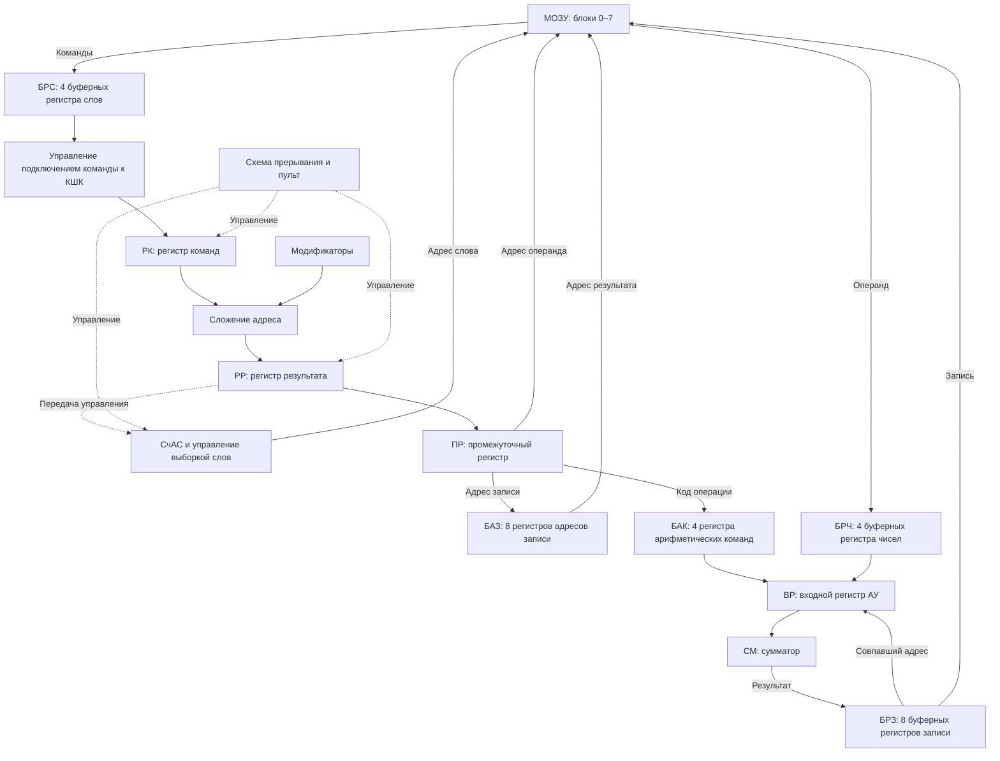

[Исходный чертеж](figures/figure-2-1.png)

<!-- PDF-разворот 6, правая половина; идентификатор сверки 012. -->

### 2.3. Общее описание выборки команд

Высокая скорость выполнения операций в АУ и большая «пропускная способность» уровней обработки команд предъявляют высокие требования к скорости выборки команд. В БЭСМ-6 принят метод предварительной выборки команд на одно слово вперед по отношению к слову, подключенному к уровню обработки РК. После первоначального пуска машины и при каждой передаче управления, изменяющей последовательность выборки команд, задается выборка двух слов (т. е. четырех команд).

Так как два последовательных адреса относятся к разным блокам МОЗУ, работающим параллельно с небольшим сдвигом по запуску, то за время цикла МОЗУ выбрано четыре команды. При цикле МОЗУ в 2 мксек среднее время выборки команды будет составлять 0,5 мксек. В дальнейшем управление выборкой команд координирует свою работу таким образом, чтобы задавать новую выборку слова после выдачи на РК каждой правой команды. Таким образом, управление выборкой команд стремится поддерживать заполненными два буферных регистра слова (БРС). Такое превышение средней скорости выборки команд над средней скоростью выполнения операций в АУ (~1 мксек) необходимо для более полной загрузки АУ, т.к. часть команд типа передач управления и изменения модификаторов не поступает в АУ, а полностью выполняется в блоках обработки УУ. Кроме того, для заполнения промежуточных буферных регистров и создания запаса команд для АУ необходимо, чтобы заполнение происходило с большей скоростью, чем освобождение.

Дальнейшее увеличение количества предварительно выбираемых команд с точки зрения увеличения средней скорости нецелесообразно по следующим причинам:

* Обращение за предварительно выбираемыми словами, которые становятся ненужными при изменении порядка выборки после выполнения передачи управления по адресу, может приводить к

<!-- PDF-разворот 7, левая половина; идентификатор сверки 013. -->

дополнительной задержке выборки команд по адресу передачи управления. Кроме того, уменьшается количество слов в программных циклах, которые можно сохранить в буфере команд с исключением обращения к МОЗУ.

В БЭСМ-6 используется буфер команд с четырьмя БРС. Функцией такого буфера является не только создание запаса при последовательной выборке команд, но и исключение обращения к МОЗУ за командой, если она уже находится в буфере команд. Это позволяет выполнять программные циклы из 6 и менее команд без обращения к МОЗУ и с еще большей скоростью выборки команд. Для выполнения этой функции, а также возможности сохранения адреса возврата, каждому БРС придается буферный регистр адреса слова (БАС), в который заносится адрес считываемого в данный БРС слова. Исключение обращения к МОЗУ определяется по совпадению адреса, образовавшегося на счетчике адресов слов (СчАС) с адресом в каком-либо БАС'е. Совпадение разрешается лишь с теми адресами, по которым было задано считывание из МОЗУ.

Порядок заполнения БАС'ов (БРС'ов) определяется специальной схемой, описываемой далее в блоке СчАС. На временной диаграмме рис. 2.2 показано взаимодействие блоков предварительной выборки и обработки команд.

### 2.4. Взаимодействие блоков при выборке команд

Описание последовательности работы отдельных блоков при выборке команд удобно пояснить на примере блок-программы, приведенной на рис. 2.3. На блок-программе выделены основные действия, выполняемые отдельными блоками и схемами, и выработка сигналов, обеспечивающих правильное взаимодействие блоков. В данной и следующих блок-программах использованы следующие условные обозначения:

а) НЦ - Логические условия, определяющие начало работы блока.

<!-- PDF-разворот 7, правая половина; идентификатор сверки 014. -->

#### Рис. 2.2. Взаимодействие блоков выборки и обработки команд

Последовательность обменов передана качественно. Масштаб временной оси, фронты и длительности исходной временной диаграммы не воспроизводятся.

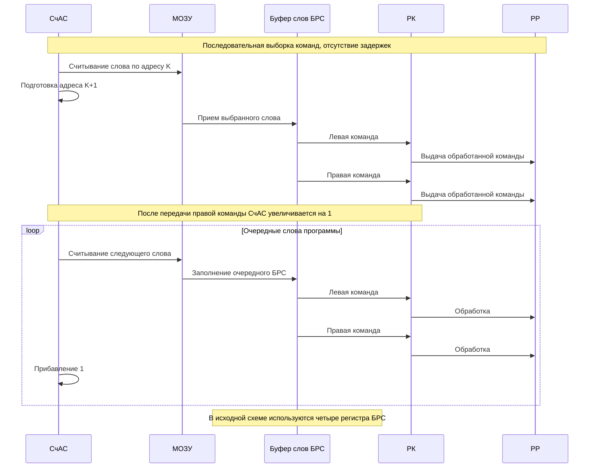

[Исходный чертеж](figures/figure-2-2.png)

<!-- PDF-разворот 8, левая половина; идентификатор сверки 015. -->

#### Рис. 2.3. Взаимодействие блоков предварительной обработки команд

Переданы основные этапы и контуры ожидания. Нечеткие на скане булевы условия заменены описаниями; это упрощенная блок-программа.

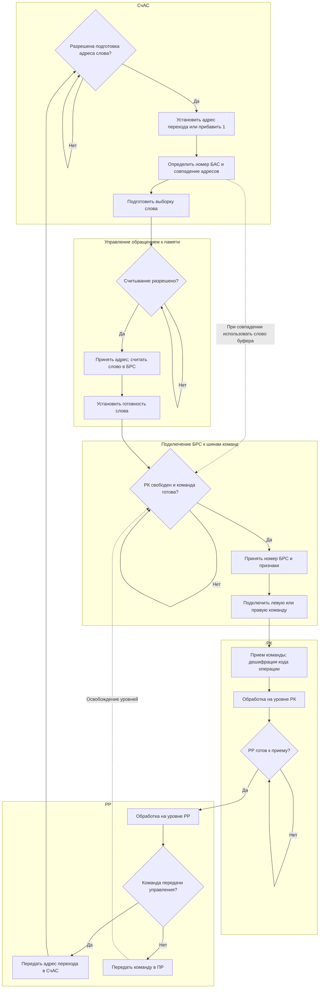

[Исходный чертеж](figures/figure-2-3.png)

<!-- PDF-разворот 8, правая половина; идентификатор сверки 016. -->

б) Основные операции, выполняемые блоком и основные сигналы, вырабатываемые блоком, и в) Некоторые логические условия, определяющие дальнейшие действия.
г) Уст. ГД - Установка в целое усилителя (установка в состояние "1").
д) Гаш. ГД - Гашение хранящего усилителя ГД (установка в состояние "0").

Блоки блок-программы, относящиеся к одному блоку блок-схемы, обведены пунктирной линией с указанием сокращенного названия блока.

Рассмотрение блок-программы целесообразно начинать с выполнения передачи управления по адресу, в блоке РР, засылающей новый адрес на СчАС и вырабатывающей сигнал ГБК и гасящей сигнал БлВК. Дальнейшее взаимодействие блоков легко проследить по блок-программе.

### 2.5. Предварительная обработка и выполнение команд. Основные функции обработки

Команды, подготовленные в буферных регистрах слов (БРС), передаются далее на обработку (блоки РК, РР, ПР - блок-схемы рис. 2.1). Эта обработка заключается либо в задании всех подготовительных операций, необходимых для выполнения команды в АУ, либо в полном выполнении команды. Команды, выполнение которых заканчивается в АУ, называются в дальнейшем «арифметическими» командами. К ним относятся почти все команды 0-й группы структуры. Команды, полностью выполняемые в блоках обработки без отсылки в АУ, или отсылаемые в АУ, но окончательное выполнение которых производится в блоках обработки, называются в дальнейшем командами управления.

На рис. 2.4 даны операции и группы операций, дешифрируемые в устройстве управления.

<!-- PDF-разворот 9, левая половина; идентификатор сверки 017. -->

#### Рис. 2.4. Операции и группы операций, дешифрируемые в УУ

Передана классификация операций. Двоичные маски и нумерация разрядов остаются в исходном изображении и этой диаграммой не заменяются.

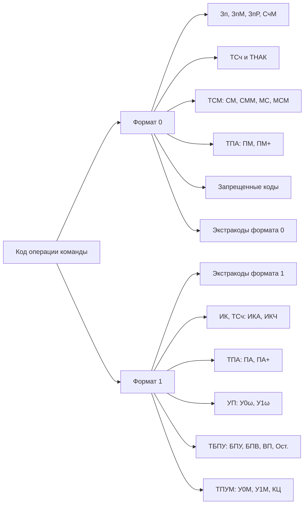

[Исходный чертеж](figures/figure-2-4.png)

<!-- PDF-разворот 9, правая половина; идентификатор сверки 018. -->

Часть операций предварительной обработки команд носит достаточно общий характер, часть операций является специфической и целиком определяется кодом операционной части команды после его дешифрации. По своему смыслу действия, выполняемые при обработке команд в блоках РК, РР, ПР, можно отнести к следующим основным функциям блоков РК, РР, ПР:

а) Выработка адресов обращения к памяти и определение необходимости такого обращения при считывании операндов и записи результатов путем сравнения с накопленными адресами результатов.
б) Выполнение команд управления.
в) Преобразование команд для выдачи в БАК стойки АУ.
г) Взаимодействие со схемой прерывания.
д) Выработка сигналов связи с другими блоками.

Рассмотрим более детально содержание этих основных функций.

### 2.6. Выработка адресов обращения к памяти

Одной из главных задач обработки является модификация адресных частей команд в соответствии с кодом операции и специальными режимами работы. Ниже рассматриваются различные способы модификации, производимые в блоках обработки для выработки исполнительного адреса обращения к МОЗУ.

**а) Простая модификация адресной части команды.**
Простая модификация адресной части команды (называемой в дальнейшем адресом) заключается в образовании исполнительного адреса путем сложения адреса с содержимым указанного в команде модификатора:

Адсп = А + (М)
Аисп = А при М = 0,
где А - адресная часть команды, М - адрес модификатора,
(М) - содержимое модификатора с адресом М.

<!-- PDF-разворот 10, левая половина; идентификатор сверки 019. -->

Схемы подключения модификатора, сумматор адресов и взаимодействие блоков построены таким образом, что могут производить такую простую модификацию каждые три такта, обеспечивая максимальную «пропускную способность» блоков обработки в 3 такта (300 нсек). Для некоторых команд модификация адресов не производится, но это не уменьшает время их обработки из-за стандартной задержки на простую модификацию.

**б) Выработка «магазинных» адресов.**
Организация «магазинного» обращения к памяти производится в блоках обработки только для команд типа считывания или записи и основана на использовании специального счетчика магазина (СчМ), определяющего первую «свободную» ячейку магазина. После каждой выработки адреса записи в «магазинную» память к нему прибавляется единица, а перед каждой выработкой адреса считывания вычитается единица.

Задание обращения к «магазинной» памяти для простых команд со считыванием и записью производится с помощью признака магазина (номер модификатора — 15 и нулевая адресная часть). Для некоторых команд существуют специальные «магазинные» варианты, при которых выполнению собственно операции предшествует запись в «магазинную» память содержимого сумматора АУ (команды СчМ и МСМ) или операция сопровождается последующим считыванием из «магазинной» памяти на сумматор команды ЗпМ, СММ. Обращение к «магазинной» памяти в этих случаях задается самим кодом операции и осуществляется путем формирования в блоке обработки дополнительной команды записи или считывания по адресу, определяемому счетчиком магазина. Для модификатора основной группы с ним должны быть произведены все действия, которые производятся над любым другим модификатором.

<!-- PDF-разворот 10, правая половина; идентификатор сверки 020. -->

**в) Многоступенчатая модификация.**
В блоках обработки предусмотрен еще один способ модификации адресной части любой команды, задаваемый специальным режимом, устанавливаемым в специальных операциях ИКА и ИКЧ. Этот способ заключается в предварительной замене адресной части команды, принятой на РК в режиме ПрИК (признак команд ИК) суммой этой адресной части и содержимого специального модификатора (16-й модификатор из дополнительной группы). После такой замены дальнейшая обработка адреса производится согласно коду операции и может представлять собой любой вид модификации. Содержимое МТ6 изменяется командами ИК. Команды ИКА и ИКЧ отличаются между собой способом установки МТ6: при ИКА туда заносится сам код исполнительного адреса команды ИКА, а при ИКЧ - содержимое пятнадцати младших разрядов, считая всех по исполнительному адресу. Так, например, исполнительный адрес команды с простой модификацией, выработанный в режиме ПрИК, будет иметь вид:

Аисп = (МТ6) + А + (М).

Режим ПрИК распространяется и на обработку адреса самих команд ИКА и ИКЧ, давая возможность осуществлять многоступенчатую модификацию адреса, определяемую цепочкой последовательно стоящих команд ИК.

**г) Формирование адреса передачи управления в Экстракодах.**
При выполнении операции экстракода адрес передачи управления на соответствующую программу экстракода (через таблицу рассылок) формируется путем наложения на некоторый фиксированный адрес, определяющий начало таблицы рассылок, кода самого экстракода, определяющего слово внутри таблицы рассылок. В этом слове должна находиться команда, которая отсылает уже непосредственно на программу экстракода (рис. 2.5). Такое задание обращения к программе помимо более рационального использования адресной части экстракода имеет еще одно

<!-- PDF-разворот 11, левая половина; идентификатор сверки 021. -->

#### Рис. 2.5. Переход на программу экстракода: первый случай

Передана последовательность переходов из исходной схемы.

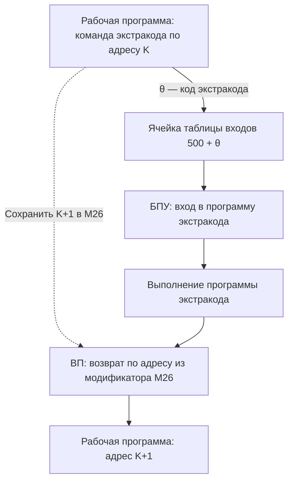

[Исходный чертеж](figures/figure-2-5.png)

<!-- PDF-разворот 11, правая половина; идентификатор сверки 022. -->

преимущество в экстракодах задания внешнего обмена (подробнее смотри описание многопрограммной работы).

### 2.7. Выполнение команд управления

Как уже упоминалось, часть команд управления полностью выполняется в блоках обработки без отсылки в АУ. К этой группе относятся команды изменения и пересылки модификаторов (ПА, ПА+, ПМ, ПМ+, МС) и большинство команд безусловной и условной передач управления (БПУ, БПВ, ВП, УОМ, У1М, КЦ). Таким образом, указанные операции по изменению и установке модификаторов и изменению последовательности выборки команд совмещаются во времени с выполнением команд, накопленных в БАК'е, что является одним из способов уменьшения времени выполнения программы. Однако в некоторых случаях невозможно осуществить полное выполнение команды управления одновременно с выполнением других команд в АУ. Так, команда СМ может выполнить пересылку старших разрядов сумматора в заданный модификатор только после того, как они выработаются, т. е. после выполнения предыдущей «арифметической» команды на АУ, а результат (модификатор) может использоваться уже в следующей за СМ команде для модификации адреса. Следовательно, иными словами, модификацию адреса следующей за СМ команды нельзя выполнить до полного выполнения команды СМ, т.к. в ней может участвовать модификатор, в который должна произойти передача из АУ. Таким образом, до полного выполнения команды СМ нельзя принимать следующую команду на РК, а полное выполнение СМ следует за выполнением всех накопленных в БАК'е команд и может вызвать задержку выполнения в АУ следующей за ней «арифметической» команды. То же самое относится и к команде ИКЧ и условным передачам управления (У0ω, У1ω). Полное выполнение команд СМ, ИКЧ, У0ω, У1ω производится в два этапа. Первый этап заключается в выдаче этих команд в АУ с блокировкой приема следующей команды на РК. При выполнении посланной команды в АУ вырабатываются сигналы, по которым в блоках РК и РР производится выполнение заключительного этапа этих команд. Такая двукратная работа блоков РК, РР (иногда только РР - в «магазинных» командах) определяется

<!-- PDF-разворот 12, левая половина; идентификатор сверки 023. -->

признаком двойного выполнения команд (ДК).

Следует особо сказать об условных передачах управления (У0ω, У1ω). Дело в том, что после их поступления в РК, РР направление передачи управления будет известно лишь после выполнения команды в АУ. Чтобы не терять это время полностью, продолжается выборка следующих команд в БРС (предпочтение передачи к следующей). Выполнение предпочтительной передачи по адресу вызвало бы осложнения с восстановлением последовательной выборки при неподтверждении предпочтительной передачи. Неподтверждение предпочтительной передачи вызывает выход из совмещенного режима и потерю времени на заполнение буферных регистров для достижения совмещения.

### 2.8. Преобразование команд для выдачи в БАК

После задания предварительного считывания и отсылки в БАЗ адреса записи с блока ПР нет необходимости транслировать в БАК полноразрядные адреса и затрачивать на это лишнее оборудование. Поэтому при передаче обработанной команды с ПР в БАК производится некоторое сокращение разрядности команды. Для большинства «арифметических» команд достаточно сохранить лишь шестиразрядный код операции и четырехразрядный адрес буфера (БРЗ, БРЧ). Однако разрядность буферных регистров БАК'а выбрана большей из-за следующих обстоятельств. Для некоторых арифметических команд, по исполнительному адресу которых не производится обращения к памяти (так называемые нестандартные арифметические команды, например, команда сдвига), необходимо транслировать вместе с кодом операции не менее 7 разрядов. Кроме того, передача кода модификатора в команде МС производится через те же цепи, что и передача команды. Задание кода операции в последнем случае производится отдельным признаком. Подробная структура выдаваемой команды для всех случаев приводится в описании блока ПР, а прохождение команд через БАК - в предложении в описании стойки АУ.

<!-- PDF-разворот 12, правая половина; идентификатор сверки 024. -->

### 2.9. Связь со схемой прерывания и пультом управления

Блоки обработки являются центральной частью блок-схемы управления, координирующими работу остальных частей при выполнении команд программы, поэтому они наиболее тесно связаны со схемой прерывания и пультом управления. В блоках обработки РК, РР выполняется одна из важных функций прерывания - блокировка дальнейшего приема команд при возникновении сигнала прерывания и выполнение собственно операции прерывания. Один из главных пультовых режимов - режим одиночного выполнения команд - осуществляется путем одиночного пропускания команд через блоки обработки при помощи установки блокировки передачи команды на РР после приема каждой команды на РР. Одиночный импульс, возникающий при нажатии на кнопку «Пуск», сбрасывает эту блокировку и разрешает передачу команды на РР. Описание прерывания и работы с пульта дается далее в соответствующих разделах.

Обработка команд производится последовательно в блоках РК, РР, ПР. Взаимодействие блоков и функции блоков РК и РР подробно рассматриваются в следующем разделе в блок-программе рис. 4.7. Блок промежуточного регистра (ПР) представляет собой промежуточный уровень, с которого производится отсылка адресов операндов в управление памятью на считывание и отсылка адресов результатов в буферные регистры записи (БАЗ). Так как эти отсылки управляются условиями разрешения приема в БАЗ, являющимися разветвлениями основной цепи передачи команд, то на уровне ПР часто происходит задержка дальнейшей передачи команды. Если бы выдача адресов происходила непосредственно с РР, то такая задержка могла бы задержать выполнение тех команд, которые полностью выполняются на РК, РР. Введение ПР освобождает блок РР для полного выполнения большинства команд управления.

<!-- PDF-разворот 13, левая половина; идентификатор сверки 025. -->

Описание самой выборки операндов и записи результатов по адресам, выданным с ПР, дается в следующих разделах.

### 2.10. Выборка операндов

Для совмещения выборки операнда из блока МОЗУ с выполнением предыдущих команд в АУ между блоками обработки и АУ введен буфер арифметических команд (БАК), находящийся в стойке АУ и состоящий из 4-х регистров для обработанных команд и соответствующих им буферных регистров чисел (БРЧ) в стойке БРУС. Как показало моделирование, такое количество буферных регистров оптимально с точки зрения выигрыша во времени и затраченного оборудования.

Различаются два случая выборки операнда в зависимости от результата сравнения адреса со всеми адресами результатов, помещенных в буфер записи. В случае несовпадения с помощью сигналов ГПР2, ТрАП задается считывание из МОЗУ и считанный операнд помещается в БРЧ, соответствующий регистру БАК'а, в который отсылается команда. Передача команды на входной регистр АУ может произойти только после выборки операнда из МОЗУ, что фиксируется установкой сигнала Готовность соответствующего БРЧ - ГБРЧ, вырабатываемого блоком УОП. В случае совпадения запрос на обращение к блоку МОЗУ (ТрАП) не возникает, а в БАК вместе с кодом операции отсылается номер совпавшего БРЗ, из которого код операнда передается на входной регистр АУ непосредственно (минуя БРЧ). Одновременно с передачей в БАК обработанной команды полный адрес передается в совпавший БАЗ для перестройки таблицы, позволяющей сохранить совпавший адрес и соответствующий ему операнд возможно дольше на случай его дальнейшего использования. Выработка сигналов связи между блоками и основные операции, выполняемые ими при считывании операндов, приведены на блок-программе рис. 2.6.

<!-- PDF-разворот 13, правая половина; идентификатор сверки 026. -->

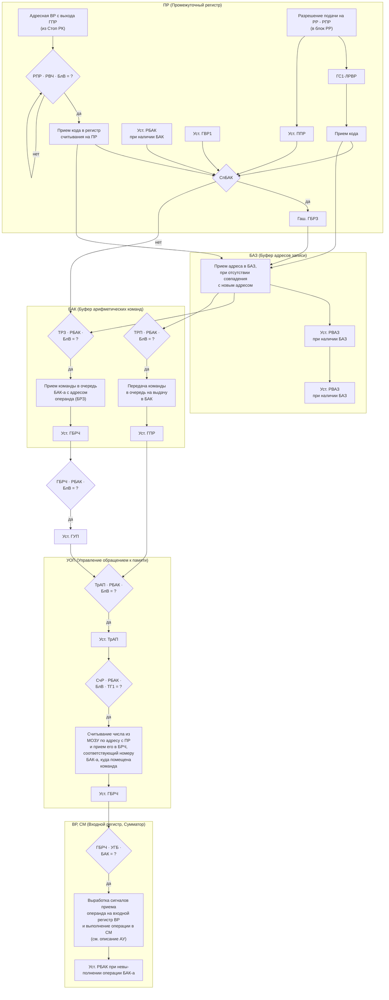
Рис. 2.6. Блок-программа взаимодействия блоков при считывании операндов.

[Исходный чертеж рис. 2.6](figures/figure-2-6.png)

<!-- PDF-разворот 14, левая половина; идентификатор сверки 027. -->

Необходимо подчеркнуть, что из-за отсутствия буферных регистров для адресов операндов сравнение производится лишь с адресами результатов, а буферные регистры операндов (чисел) - БРЧ используются лишь для операндов, считываемых из блоков МОЗУ. Поэтому, несмотря на то, что код по данному адресу может оказаться считанным в один из БРЧ, производится его повторное считывание из МОЗУ.

### 2.11. Запись результатов. Принципы совмещения записи

Более полное совмещение выполнения операций в АУ с операциями обращения к МОЗУ предполагает, естественно, совмещение не только операций считывания из МОЗУ, но также и совмещения операции записи в МОЗУ. Это в свою очередь предопределяет наличие полноразрядных буферных регистров результата (БРЗ) и буферных регистров адресов (БАЗ), на которые передается содержимое сумматора (результат) и адрес записи в МОЗУ с целью освобождения АУ для выполнения других операций во время записи результата в МОЗУ. Запись в МОЗУ может начаться только после образования записываемого результата в сумматоре АУ. Этот момент определяется выполнением команды записи в АУ. Однако к этому моменту может быть выработано уже несколько адресов операндов и произведена выборка их из блоков МОЗУ. Среди них в качестве операнда может оказаться тот результат, который еще не записался в МОЗУ или даже еще и не выработался в АУ, т.к. соответствующая команда записи может находиться в БАК'е. В этом случае мы могли бы выбрать из МОЗУ еще не изменившееся (старое) значение операнда. Поэтому введение буферных регистров для записи результата обязательно должно сопровождаться введением сравнения адресов записи с адресами считывания операндов. Таким образом, буферные регистры записи (БРЗ и БАЗ) автоматически становятся промежуточной сверхбыстродействующей памятью. Эффект использования такой сверхбыстродействующей памяти может быть

<!-- PDF-разворот 14, правая половина; идентификатор сверки 028. -->

еще более повышен за счет учета достаточно общих свойств алгоритмов программы при организации записи в МОЗУ из буферных регистров. Дело в том, что некоторые промежуточные результаты вычислений после однократного или многократного их использования в сравнительно небольшом интервале времени после их образования становятся больше ненужными. Это свойство отражается в программах наличием так называемых рабочих ячеек, и сам факт дальнейшей «ненужности» их содержимого определяется повторной записью в эти ячейки нового результата. Следовательно, нецелесообразно производить запись результата в МОЗУ сразу же после его выработки в АУ и приема в БРЗ, так как появление совпадения его адреса записи с адресом в новой команде записи может использоваться для исключения переписи этого результата в ОЗУ, т. е. сокращения количества обращений к МОЗУ по записи. Вполне естественно, что переписываться в МОЗУ должны самые «старые» по времени результаты, причем такую перепись целесообразно производить заблаговременно, стараясь дольше переписывать один из нескольких БАЗ'ов (БРЗ) для приема в буфер нового поступившего адреса записи. Максимальное сокращение количества обращений к МОЗУ при использовании буфера записи может быть получено при изменении порядка записи из буфера в МОЗУ тех результатов, которые уже использовались в качестве операндов в расчете на их повторное использование до переписи в МОЗУ. Количество обращений к буферу результатов записи зависит от емкости буфера и от программы решения задачи. Анализ эффективности буфера в зависимости от его емкости при решении наиболее распространенных типов задач показал, что целесообразная с точки зрения выигрыша и затрат оборудования емкость равна 8 ÷ 16 регистров.

### 2.12. Основные правила работы буфера записи

Буфер результатов состоит из 8 регистров и имеет такую организацию переписки из буферных регистров в МОЗУ, которая использует рассмотренные выше

<!-- PDF-разворот 15, левая половина; идентификатор сверки 029. -->

возможности сокращения количества обращений к МОЗУ. Работа буфера основана на следующих правилах:

а) Передача результатов из буфера в МОЗУ производится в порядке очередности. Существует исходная очередность.
б) Производится передача в МОЗУ только самого старшего в очереди после того, как он освобождается.
в) Прием адресов записи, если он не совпадает с ранее накопленными, производится на место переписанного и ставит его в самый конец очереди.
г) В случае совпадения адрес записи или считывания принимается на место совпавшего, ставя его в самый конец очереди (совпадение с самым старшим в очереди для адресов записи и прием в старший для адресов считывания запрещены из-за особенностей схемы).

Прием адреса записи или считывания в буфер производится из блока ПР, когда уже известен результат его сравнения с накопленными адресами (БАЗ'ами). Очередность и изменение очередности осуществляется специальной схемой в блоке БАЗ (см. описание блока БАЗ). Взаимодействие блоков и основные функции, выполняемые блоками, показаны на блок-программе рис. 2.7.

### 2.13. Организация обращения к МОЗУ. Адресация блоков

Основная оперативная память БЭСМ-6 состоит из 8 блоков емкостью 4096 родезиклов обращения в 2 мксек. Каждый блок МОЗУ имеет регистр числа, регистр адреса, автономное управление и оборудование, необходимое для автономной работы блока.

Автономность работы блоков МОЗУ позволяет совмещать обращения к памяти не только с обработкой и выполнением команд, но также и между собой при обращениях к разным блокам МОЗУ. Для того чтобы возможно большее количество обращений к памяти при выполнении программы относилось к разным

<!-- PDF-разворот 15, правая половина; идентификатор сверки 030. -->

#### Рис. 2.7. Взаимодействие блоков при записи результатов

Функциональная блок-программа. Детальные разрешающие условия и все управляющие сигналы не транскрибированы.

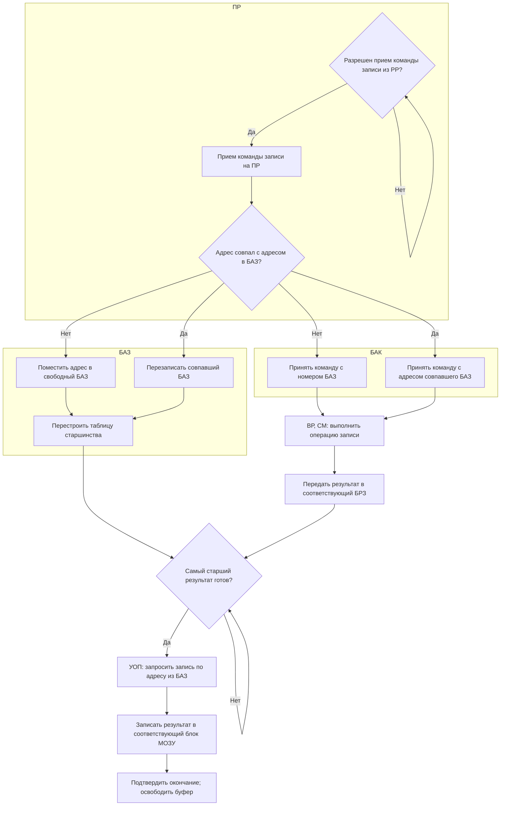

[Исходный чертеж](figures/figure-2-7.png)

<!-- PDF-разворот 16, левая половина; идентификатор сверки 031. -->

блокам МОЗУ и, следовательно, могло бы быть совмещено между собой, адресация блоков МОЗУ задается самыми младшими разрядами адресов обращений. Таким образом, адреса при последовательной выборке команд, при последовательной выборке операндов из массивов, автоматически относятся к разным блокам МОЗУ. Кроме того, адреса промежуточных результатов и констант в программах чаще различаются по самым младшим разрядам, чем по самым старшим.

Управление обращением к такой многоблочной системе памяти, выработка всех необходимых сигналов для блоков МОЗУ и управление передачей слов между буферными регистрами и блоками МОЗУ осуществляется блоком управления обращением к памяти (УОП). Рассмотрим несколько подробнее принципы построения блока УОП и его функции.

### 2.14. Основные функции управления обращением к памяти

В целях сокращения оборудования выдача адреса, выдача результата при записи и прием слова из блоков МОЗУ производятся через общие для всех блоков МОЗУ регистры (см. рис. 2.8). Наличие общих регистров предполагает последовательный характер обращения к блокам МОЗУ. Время, затраченное на подключение общих регистров к работающему блоку МОЗУ и выполнение необходимых передач с учетом задержек в цепях передач и управления, определяет минимально возможный сдвиг во времени по запуску разных блоков МОЗУ. Такой сдвиг (цикл обслуживания) составляет в принятой схеме 3 такта.

Так как все обращения к памяти задаются с одного общего выходного регистра адресов МОЗУ (ВРАМ), то все адреса обращения к памяти собираются на этот регистр со всех источников обращений. Эти источники обращений следующие:

а) Счетчик адресов слов (СчАС), задающий адреса выборки слов (команд).
б) Промежуточный регистр (ПР), задающий адреса выборки операндов.

<!-- PDF-разворот 16, правая половина; идентификатор сверки 032. -->

#### Рис. 2.8. Кольцевая цепь связей с памятью

Показаны блоки и общие регистры исходного рисунка; отдельные шины сведены в подписанные связи.

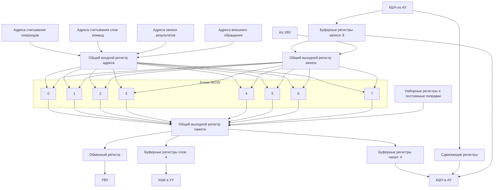

[Исходный чертеж](figures/figure-2-8.png)

<!-- PDF-разворот 17, левая половина; идентификатор сверки 033. -->

в) Выходной регистр адресов записи (БАЗ) из буфера адресов записи (БАЗ), задающий адреса записи.
г) Буферный регистр адреса внешнего обращения (БАВ), задающий адрес обращения по записи или считыванию при обмене между МОЗУ и внешними запоминающими устройствами и вырабатываемый в управлении внешними устройствами (УВУ).

Необходимость обращения по адресам этих источников задается сигналами требований обращения - ТрАК, ТрАП, ТрАЗ и ТрАВ соответственно. Следует подчеркнуть, что эти сигналы вырабатываются в том случае, если свободен блок МОЗУ, определяемый младшими разрядами адреса обращения. Так как эти сигналы вырабатываются несогласованно по отношению к работе блока ВРАМ и могут возникнуть одновременно, пуск блока МОЗУ производится с учетом приоритета между сигналами требований. Установлен следующий приоритет между сигналами: ТрАВ, ТрАП, ТрАК, ТрАЗ. Требование обращения по внешнему адресу обслуживается в первую очередь, т.к. внешние запоминающие устройства имеют свой определенный цикл работы и при принятой системе обмена не могут ждать. Обращение за выборкой операнда (ТрАП) должно иметь приоритет перед обращениями за командами и записью, т.к. относится к подготовке уже обработанной команды на ПР и нет смысла выбирать дальнейшие команды в ущерб выполнению уже обработанной. Приоритет выборки команд перед записью не столь очевиден, но, как показало моделирование, более эффективен, чем приоритет записи перед считыванием команд.

Сигналы пуска блока МОЗУ запускают автономное управление, обеспечивающее выполнение временного цикла блока МОЗУ при обращении по указанному адресу в режиме считывания или записи. Этот временный цикл определяется линией задержки в блоке МОЗУ. В случае обращения на считывание через определенную задержку после пуска блока происходит установка считанного кода на регистре числа ОЗУ. Этот сигнал установки можно было бы использовать как сигнал ГОТОВНОСТЬ при считывании из

<!-- PDF-разворот 17, правая половина; идентификатор сверки 034. -->

МОЗУ для управления приемом в соответствующие буферные регистры БРУС'а. Однако, так как управление стойки блока МОЗУ связано с центральной частью кабельными связями и не тактируется, то этот сигнал был бы несинхронным по отношению к тактированным усилителям схем управления стоек УУ и БРУС.

Синхронизация такого сигнала могла бы вызвать наложение считывания с двух блоков из-за неопределенности срабатывания схем синхронизации. Поэтому в УОП'е управление блоками МОЗУ построено на принципе одностороннего управления, основанного на фиксированности цикла МОЗУ. Определение момента считывания при этом производится на основе счета тактов после выдачи сигнала пуска в блок МОЗУ на специальных счетчиках тактов. Получаемый со счетчиков сигнал готовности (ТГ) уже не требует синхронизации. За каждым блоком МОЗУ закреплен свой счетчик тактов, и сигнал ТГ таким образом определяет номер блока МОЗУ, с которого необходимо произвести считывание.

Счетчик тактов с признаками обращения и номером буферного регистра, в который нужно принять считанный код, составляет схему управления циклом МОЗУ. Схема, осуществляющая непосредственное подключение блоков МОЗУ и передачу считанных кодов в буферные регистры, является общей для всех блоков МОЗУ. Более подробно функции каждой части управления блока УОП рассматриваются в описании блока УОП.

Перед выдачей адреса обращения в блок МОЗУ производится его преобразование, заключающееся в замене 5 старших разрядов адреса (номер программной страницы) на содержимое 5 разрядов номера физической страницы согласно таблице замены номеров страниц (схема приписки). В блоки МОЗУ отсылается уже преобразованный адрес. Необходимость замены определяется 16-м разрядом поступающего на ВРАМ адреса. Особенностью блока УОП является возможность так называемого внешнего обращения. Эта возможность обеспечивает

<!-- PDF-разворот 18, левая половина; идентификатор сверки 035. -->

прямую связь управления внешними устройствами (УВУ) с оперативной памятью при обмене с магнитными барабанами и магнитными лентами. При записи по внешнему адресу записываемый в УВУ код подается к общему выходному регистру записи, а при считывании поступает через общий выходной регистр МОЗУ в специальный буфер — обменный регистр, с которого выдается в УВУ. Таким образом, обмен с внешними запоминающими устройствами совмещается с выполнением программы и может вызвать некоторую задержку ее выполнения лишь при одновременном обращении к одному и тому же блоку МОЗУ как со стороны внешнего обращения, так и по одному из требований со стороны УУ.

### 2.15. Организация контроля

Для контроля многих цепей массовых передач используется контроль по модулю 2. Контрольная свертка образуется при выдаче результата из АУ в операциях записи. Проверка контрольной свертки производится при приеме операнда на ВР в стойке АУ и при приеме команды на РК. Таким образом, контролем охватываются следующие массовые цепи передач: кодовые шины выдачи в БРУС, буферные регистры записи (БРЗ), кодовые шины выдачи в МОЗУ, запись и считывание в блоках МОЗУ, кодовые шины выдачи из блоков МОЗУ в стойку БРУС, прием и выдача с буферных регистров БРС, БРЧ, кодовые шины выдачи в УУ, АУ и непосредственно регистры РК и ВР, на которых производится контрольная свертка. Контроль внешнего обмена описывается в описании УВУ.

Свертка производится отдельно для каждой половины 48-разрядного кода и для каждой половины имеется свой контрольный разряд. Это вызвано в основном тем, что прием на РК производится по одной команде и в случае, если левая команда является передачей управления, то правая команда не поступает на РК. Поэтому удобно иметь независимый контроль каждой команды. Проверка в АУ при считывании производится по нечетности всего кода (включая оба контрольных разряда). При считывании из некоторых специальных регистров проверка контроля блокируется.

<!-- PDF-разворот 18, правая половина; идентификатор сверки 036. -->

### 2.16. Маркировка слов и чисел

Наличие двух контрольных разрядов используется не только для независимого контроля отдельных половин слова. Во позволило выполнять еще одну важную функцию. Как уже отмечалось выше, наличие буфера записи и отсутствие сравнения адресов слов с накопленными адресами может привести к неповторяемости работы программы в условиях внешних и внутренних прерываний. Такой случай может возникнуть при формировании команд в АУ и их выполнения без принятия определенных мер. Для определения такого случая неправильного использования сформированных команд вводится специальная маркировка слов и чисел. Устройство управления может использовать в качестве команд только слова. Арифметическое устройство может считывать и слова и числа. При попытке использовать число в качестве команды, вырабатывается сигнал прерывания. Для маркировки слов и чисел используется следующий принцип. Левая половина слов свертывается и контролируется по четности, а правая - по нечетности. Для чисел левая половина свертывается по нечетности, а правая по четности. Выработка контрольных разрядов в зависимости от типа свертки производится в АУ под управлением признаков, устанавливаемых командой УРЖ в режиме супервизора. Установка нуля машины задает комбинированную свертку. Программное изменение признаков может использоваться в специальных экстракодах записи команд, в качестве тестовой проверки схем контроля.

## III. Аппаратные средства для многопрограммной работы

<!-- PDF-разворот 19, левая половина; идентификатор сверки 037. -->

### 3.1. Принцип организации многопрограммной работы

В предыдущем разделе описывалось взаимодействие блоков управления для совмещения обращений к памяти и выполнения операций управления с выполнением операций в АУ. Такое совмещение производится в пределах выполнения сравнительно небольшого количества команд по отношению к команде, выполняемой в АУ, т. е. носит локальный характер. Другим значительным источником сокращения времени выполнения программ является совмещение более крупных операций, таких как обращение к внешним запоминающим устройствам и устройствам ввода-вывода, с выполнением программы на центральной машине. Организация такого совмещения в БЭСМ-6 основана на сочетании аппаратных и программных методов. Задачей аппаратных средств является выработка сигналов о состоянии операций по внешнему обмену, прерывание выполнения текущей программы и обращение к специальной управляющей программе. Эти функции выполняет схема прерывания. Все дальнейшие действия, связанные с оценкой и выбором более оптимальной организации операций внешнего обмена, производятся под управлением специальной управляющей программы. Такое сочетание аппаратного и программного способов позволяет, с одной стороны, построить более гибкую систему организации внешнего обмена и менять её в зависимости от требований, с другой стороны - взять некоторую часть операций непосредственного управления медленными внешними устройствами на программу с упрощением схем во внешних устройствах.

Таким образом, аппаратно-программная организация внешнего обмена уже приводит к работе машины по двум программам - рабочей и управляющей и является по существу основой многопрограммной работы, так как количество выполняемых

<!-- PDF-разворот 19, правая половина; идентификатор сверки 038. -->

программ и их принципы переключения могут целиком определяться управляющей программой.

Важнейшим требованием многопрограммной работы является обеспечение независимости выполнения одной рабочей программы от другой и управляющей программы от выполнения рабочих программ при наличии ошибок в рабочих программах.

### 3.2. Основные режимы работы машины

Существуют два основных режима выполнения программы:

а) рабочий режим, в котором выполняются рабочие программы; обращение к памяти производится с заменой номеров математических страниц на номера физических страниц в соответствии с таблицей замены (приписки).
б) «режим супервизора», в котором могут выполняться управляющая программа и экстракоды (микрокоманды). Основное отличие этих режимов заключается в ограничении ряда действий и операций для рабочего режима, которые могут вызвать неправильную работу других рабочих программ или управляющей программы. Эти ограничения сводятся к следующим:

а) Для данной рабочей программы допускается обращение только к тем физическим страницам памяти, которые выделены управляющей программой в данный момент,

<!-- PDF-разворот 20, левая половина; идентификатор сверки 039. -->

б) Блокируется выполнение некоторых операций и обращений к специальным регистрам и модификаторам, которые могут нарушить правильную работу управляющей программы.

В режиме супервизора эти ограничения снимаются, так как предполагается, что управляющая программа и экстракоды не содержат ошибок и построены так, что программная ошибка в одной рабочей программе не может повлиять на работу другой рабочей программы.

Следует отметить, что рабочая программа может обратиться к управляющей программе только через экстракод, а обращение через экстракод производится аппаратно всегда на начало соответствующей программы экстракода. Это означает, что ошибка в программе не может вызвать неправильной работы программы экстракода, а вызовет правильное выполнение экстракода по неправильной информации, задаваемой исполнительным адресом. Исключение влияния такой ошибки на работу управляющей и других рабочих программ - задача программной защиты в управляющей программе.

### 3.3. Защита памяти

Аппаратная организация защиты памяти основана на листовой (страничной) структуре памяти и заключается в блокировке обращения к закрытым математическим страницам для операндов и блокировке выполнения команды из закрытых математических страниц. Первое фиксируется схемой защиты, связанной с блоками РР и ПР, а второе - схемой замены (приписки).

Стремление как можно раньше обнаружить прерывание по защите адресов чисел определило проверку защиты по адресам чисел на регистре РР (т. е. защиту математических страниц). Это гарантирует блокировку обращения по считыванию и по записи чисел в запрещенный лист. Произвольное относительно друг друга появление адресов чисел и команд затрудняет проверку их защиты на одном регистре, который обеспечил бы преимущества такого более раннего обнаружения прерывания по защите адресов чисел и не зависел бы от времени их одновременного

<!-- PDF-разворот 20, правая половина; идентификатор сверки 040. -->

появления адресов чисел и команд. Поэтому проверка защиты по адресам команд производится на регистре ВРАМ и признаком защиты является нулевое состояние выбираемого регистра приписки. Отключение схемы приписки по адресам слов, происходящее только в программах супервизора, отключает и проверку защиты.

Схемы определяют факт обращения к закрытой странице и на их основе вырабатываются сигналы прерывания. Постраничная защита памяти используется в следующих основных целях:

а) для защиты памяти других программ (в том числе и памяти управляющей программы) от записи из рабочей программы;
б) для защиты страниц самой рабочей программы во время внешнего обмена и считывания из памяти других программ во избежание возможной неповторяемости результатов;
в) для выработки сигналов прерывания при обращении к тем математическим страницам, которые не находятся в оперативной памяти, с тем, чтобы организовать их пересылку через управляющую программу.

Установка защиты страниц производится программно в режиме супервизора.

### 3.4. Замена номеров страниц

Замена номеров математических страниц на номера физических страниц осуществляется схемой замены (приписки). Каждой математической странице памяти, определяемой 5-разрядными разрядами адреса обращения, поставлен в соответствие 5-разрядный регистр, содержимое которого заменяет 5 старших разрядов адреса при отсылке адреса в блок МОЗУ. Смена состояния регистров производится программно в режиме супервизора. Необходимость приписки в адресах операндов и результатов задается специальным признаком 0-го модификатора, а приписка в адресах слов определяется рабочим режимом (отсутствие в режиме супервизора). Обращение по адресам во время внешнего обмена происходит без замены и защиты. Засылка нулевого кода в регистры приписки означает запрещение обращения к ОЗУ по адресам команд. Схема приписки выполняет очень важ-

<!-- PDF-разворот 21, левая половина; идентификатор сверки 041. -->

ную для многопрограммной работы функцию, а именно: позволяет помещать любую из 32-х математических страниц рабочей программы на место любой физической страницы в оперативной памяти. Такое помещение производится путем засылки кода в регистры приписки и не требует более никаких дополнительных операций по обработке программы перед помещением или дополнительной модификации адресов в процессе выполнения программы.

### 3.5. Организация прерывания. Сигналы прерывания

Организация прерывания заключается в определении моментов возникновения некоторых условий, на которые должна реагировать управляющая программа, и осуществлении прерывания выполнения текущей программы и перехода на программу прерывания. Рассмотрим подробнее первую часть - выработку сигналов прерывания.

Различаются две типа сигналов прерывания: внешние и внутренние. Внешние сигналы прерывания отражают состояние внешних устройств и вырабатываются схемами управления внешними устройствами. Они фиксируются в старшей половине регистра прерывания и их распределение по разрядам отражает их приоритет между собой. На основе этих сигналов вырабатывается синхронизированный сигнал прерывания, который поступает непосредственно в схему прерывания. Выработка этого синхронизированного сигнала от отдельных сигналов прерывания может быть разрешена или запрещена в зависимости от состояния соответствующих разрядов регистра маски, устанавливаемых программно. Поэтому порядок реакции на прерывание может регулироваться программой.

<!-- PDF-разворот 21, правая половина; идентификатор сверки 042. -->

Внутренние сигналы прерывания вырабатываются при возникновении определенных условий во время выполнения программы в стойках УУ, БРУС, АУ (сигнал защиты, контроля и другие). Выработка некоторых сигналов внутреннего прерывания может быть программно замаскирована. Сигналы внутреннего прерывания вырабатываются синхронно, имеют приоритет перед сигналами внешнего прерывания, вызывают немедленную блокировку дальнейшего выполнения программы и уже после этого фиксируются в младшей половине регистра прерывания.

### 3.6. Прерывание программы и организация возврата

При организации непосредственного прерывания необходимо выполнять следующие действия:

а) блокировать дальнейшее выполнение прерываемой программы;
б) осуществить передачу управления на программу прерывания;
в) сохранять информацию о состоянии машины и программы, достаточную для выявления причин прерывания и продолжения выполнения прерванной программы.

Необходимо отметить, что из-за большой глубины совмещения очень трудно выполнять эти требования, особенно последнее. Дело в том, что сигналы прерывания могут возникнуть на различных уровнях прохождения команды, а также при выполнении операции АУ. Возникновение многих сигналов по своей сути предполагает повторение выполнения команды, давшей прерывание (сигнал прерывания при обращении к защищенному листу), либо продолжение выполнения (как это становится известно после работы программы прерывания). В обоих случаях требуется знать адрес команды, давшей прерывание. К моменту возникновения, например, сигнала прерывания

<!-- PDF-разворот 22, левая половина; идентификатор сверки 043. -->

в АУ в блоках обработки и предварительной выборки может быть обработано и подготовлено уже несколько команд. Поэтому в некоторых случаях определение адреса команды вызывает большие трудности и требует сохранения большого количества информации об обработанных командах, приводящего либо к значительному увеличению оборудования, либо к усложнению запоминания и восстановления состояния машины. В описываемой системе прерывания выбран компромиссный вариант. Для сигналов внутреннего прерывания, возникающих в блоках обработки и при выборке команд, обеспечивается возможность определения адреса команды, давшей прерывание и возврата на ее повторное выполнение. Это достигается путем блокировки по сигналу прерывания тех действий, которые затрудняют восстановление (например, изменение модификатора) и сохранения нескольких признаков, позволяющих программно определить адрес команды по запомненному адресу возврата.

Для сигналов прерывания из АУ такая возможность в общем случае исключена, так как полностью выполняются все команды, поступившие на РК до момента блокировки по сигналу прерывания из АУ. Однако введен специальный программно устанавливаемый режим (АвтБ) с частичной блокировкой совмещения, который позволяет в случае необходимости определять адрес команды, дающей прерывание по АУ. Использование этого режима снижает скорость работы машины.

Другие особенности, определяемые совмещенным характером выполнения программы, связаны с определением момента перехода на программу прерывания. После возникновения внешнего или внутренних сигналов прерывания с уровней РК, РР, ПР могут возникнуть сигналы внутренних прерываний при выполнении уже накопленных команд в АУ. Поэтому выполнение операции прерывания производится после полного выполнения всех накопленных команд. Этот промежуток времени довольно неопределенный в силу зависимости времени выполнения операций в АУ от кодов операндов и количества накопленных команд и

<!-- PDF-разворот 22, правая половина; идентификатор сверки 044. -->

может колебаться от нескольких тактов до нескольких сотен тактов, что необходимо учитывать при реакции на прерывания от внешних устройств.

После выполнения команд, предшествовавших команде, давшей прерывание (кроме случая прерывания по сигналам из АУ), производится выполнение операции прерывания в блоках РК, РР. Ее выполнение заключается в сохранении признаков о прерванном режиме выполнения программы, сохранении «опорного» адреса возврата и признаков для определения адреса возврата и выполнении передачи управления по фиксированному адресу с установкой соответствующих режимов. В зависимости от источника прерывания различаются операции внутреннего и внешнего прерывания, отличающиеся адресами передачи управления и устанавливаемыми режимами. В режиме внешнего прерывания допускается внутреннее прерывание. Возникновение внутреннего прерывания в режиме внутреннего прерывания, что может иметь место лишь при прерывании по контролю, приводит к остановке машины. В обеих операциях прерывания устанавливается общая блокировка внешних прерываний, которая может быть снята программным путем. Для сохранения «опорного» адреса возврата в операции прерывания используется один из дополнительных модификаторов (№27), а для сохранения признаков - №23.

В ячейках, на которые производится передача управления в операциях прерывания, могут быть команды безусловной передачи управления непосредственно на программы внутреннего и внешнего прерывания. В этих программах должен производиться опрос регистра прерывания и формирование передачи управления на программы, реагирующие на конкретные сигналы прерывания. При реакции на конкретный сигнал прерывания он должен быть программным способом погашен на регистре прерывания. Для облегчения возврата, главным образом, при непродолжительных внешних прерываниях, введена специальная команда возврата

<!-- PDF-разворот 23, левая половина; идентификатор сверки 045. -->

(ВП), которая восстанавливает режимы по содержимому №23 и осуществляет передачу управления по адресу в №27. В случае внешних прерываний никакой программной коррекции адреса возврата не требуется, так как внешнее прерывание может вклиниваться только между командами из разных слов. При необходимости разрешения других внешних прерываний в программе реакции на конкретное внутреннее прерывание необходимо программным способом переслать в память содержимое №23 и №27.

## IV. Описание работы блоков и схем

<!-- PDF-разворот 23, правая половина; идентификатор сверки 046. -->

### Блок счетчика адресов слов

#### 4.1. Описание принципов работы блока СчАС

В состав блока СчАС входят счетчик адресов слов, схемы управления буфером команд и регистра БАС.

Счетчик адресов задает последовательность выборки слов из памяти. Порядок заполнения регистров буфера команд указывается специальной схемой (таблицей «старшинства») блока СчАС, обеспечивающей при отсутствии совпадения адресов циклическое изменение номера очередного регистра, принимающего новое слово.

Управление считыванием слова из памяти и приемом слова в регистры БРС осуществляется блоком УОП, в который выдается адрес слова и номер очередного буферного регистра.

Пересылка команд из регистров БРС в блок РК возможна при подключении соответствующей половины регистра к кодовым шинам команд. Порядок подключения БРС к блоку РК соответствует порядку регистров БАС при приеме адресов слов. Переключение команд одного слова определяется усилителем ПрК.

Рассмотрим возможные ситуации в буфере команд при выполнении участка программы без операций передачи управления.

Используемая в машине система предварительной выборки команд обеспечивает возможность подготовки наперед только одного слова. Это означает, что если к РК подключен регистр, в котором находится слово, выбранное по адресу \(j\), то в следующем регистре может находиться слово, выбранное по адресу \(j+1\). В дальнейшем регистр, который в данный момент подключен к РК, будет называться буферным регистром выполняемой команды, а регистр, в который поступает следующее слово, будет называться предварительным буферным регистром команды.

<!-- PDF-разворот 24, левая половина; идентификатор сверки 047. -->

Выборка команд из памяти регулируется блоками РК и УОП.

Блок РК, принимая команды из буферных регистров слов, вырабатывает сигнал (ГБК) о закончившемся приеме команд из подключенного регистра.

При изменении адреса на счетчике адресов слов запускается цепочка полутактов (ЦПС). Сигналы этой цепочки вызывают безусловное выполнение таких операций, как установка усилителя готовности адреса СчАС для передачи на ВРАМ; опрос таблицы старшинства для определения номера регистра, принимающего новый адрес и слово по этому адресу; опрос схем сравнения адресов и запись адреса в регистры БАС. Последний сигнал цепочки гасит усилитель РБК, нулевое состояние которого говорит о том, что определен номер регистра для следующего слова, т. е. номер регистра, являющегося в этот момент предварительным буферным регистром команды. При происшедшем обращении блок УОП поставит усилитель готовности слова для указанного регистра.

При совпадении условий окончания приема команд (ГБК) из регистра БРС, подключенного к РК и готовности номера регистра для следующего слова (РБК) происходит подключение к РК предварительного буферного регистра команды. Подключение регистра БРС к РК будем называть превращением предварительного буферного регистра команд в буферный регистр выполняемой команды. Готовность слова в регистре выполняемой команды определяет условия готовности команды для блока РК. Сигнал подключения (ПБК) регистра к РК устанавливает усилитель РБК.

Что является одним из условий начала процесса определения и заполнения следующего регистра буфера команд новым словом и адресом. Этот процесс заполнения, начинающийся изменением состояния СчАС, возможен после передачи предыдущего адреса на ВРАМ. Блок УОП при приеме адреса команды на ВРАМ устанавливает усилитель РСчАС, который сбрасывается сигналом изменения адреса. Таким образом, в условие выработки сигнала прибавления единицы к адресу на СчАС входят условия РБК и РСчАС.

<!-- PDF-разворот 24, правая половина; идентификатор сверки 048. -->

Такая организация накопления команд, когда выборка слов из памяти регулируется темпом приема команд в блок РК и занятостью памяти, может привести к следующим ситуациям.

Если время обработки команд в блоках обработки достаточно велико, то в буфере команд может быть накоплено два слова: одно в регистре выполняемой команды, а другое - в предварительном буферном регистре команды. Дальнейшая выборка команд будет организована только после приема команд из первого регистра и последующего превращения предварительного регистра в регистр выполняемой команды.

Если выборку команд задерживает память, то может оказаться, что в подключенном к РК регистре слово отсутствует, а изменение адреса на СчАС и определение предварительного буферного регистра невозможно из-за отсутствия сигнала РСчАС для адреса слова регистра выполняемой команды. Освобождение нужного блока памяти и происшедшая передача адреса команды на ВРАМ обеспечат считывание слова в регистр выполняемой команды, изменение адреса и определение предварительного буферного регистра команды.

Рассмотрим некоторые особенности работы блока СчАС при передачах управления.

В слове находятся две команды: левая, являющаяся началом слова, и правая. Передачи управления, за исключением команды ВП, передают управление на начало слова. Передача управления на правую команду может быть осуществлена командой ВП, используемой только в управляющей программе.

При передаче управления необходимо исключить выполнение накопленных команд и заблокировать возможные запуски памяти по адресу СчАС до засылки на него адреса перехода. Пропуск накопленных команд обеспечивается тем, что засылка адреса перехода принудительно запускает цепочку полутактов

<!-- PDF-разворот 25, левая половина; идентификатор сверки 049. -->

(ЦПС) и тем, что в операциях передачи управления в определенный момент вырабатывается сигнал ГБК. Цепочка полутактов обычным образом определяет номер регистра для слова по адресу перехода, после чего сигнал ГБК обеспечит подключение этого регистра к РК. Сигнал подключения регистра к РК выработает сигнал РБК, т. е. передача адреса перехода на ВРАМ сразу же определит выработку следующего адреса и требования его передачи на ВРАМ. Если нужные блоки памяти свободны, то запуски двух блоков памяти по последовательным адресам команд могут пройти с интервалом в четыре такта.

Предварительная выборка и очередность регистров по приему новой информации приводит к тому, что в регистрах БАС могут находиться следующие адреса:

\(j, j+1, j+2, j+3\)

где \(j\) - адрес слова в регистре выполняемой команды. При передаче управления возможно совпадение адреса перехода с одним из накопленных адресов. В этом случае в качестве предварительного буферного регистра команды указывается совпавший регистр, а обращение в память оказывается ненужным. После совпадения, происшедшего в операции передачи управления, могут произойти дальнейшие совпадения, что позволяет организовывать циклы из команд, накопленных в буфере команд.

Из сказанного выше следует, что в функции блока СчАС входят:

а) Управление приемом слов в буфер команд
б) Организация работы СчАС и выработка требования обращения к МОЗУ
в) Подключение регистров БРС к РК

Рассмотрим более подробно работу отдельных узлов при выполнении перечисленных функций.

<!-- PDF-разворот 25, правая половина; идентификатор сверки 050. -->

#### 4.2. Таблица старшинства

Важным моментом в управлении работой буфера команд является определение порядка заполнения регистров БРС и использование имеющихся в буферных регистрах команд. Запись новой информации производится в регистр, в котором находится самое старое по времени засылки адреса слово. При дальнейшем описании принципа определения регистра, который указывается блоку УОП, используется понятие старшинства регистров. Предположим, что в буферных регистрах находятся слова, соответствующие следующим по порядковому номеру обращениям:

\(j\) — БРС 0; \(j+1\) — БРС 1; \(j+2\) — БРС 2; \(j+3\) — БРС 3

Рис. 4.1 (\(j\) - адрес слова; \(i\) — порядковый номер обращения).

Старшинство регистров в данном случае такое: БРС 1, БРС 0, БРС 3, БРС 2, где БРС 1 - самый старший, а БРС 2 - самый младший.

В такой ситуации считываемое слово будет записано в БРС 1, который станет самым младшим:

БРС 0, БРС 3, БРС 2, БРС 1, повышая тем самым старшинство остальных регистров.

\(j+1\) — БРС 0; \(j+3\) — БРС 1; \(j+2\) — БРС 2; \(j\) — БРС 3

Рис. 4.2

<!-- PDF-разворот 26, левая половина; идентификатор сверки 051. -->

Очевидно, что следующее считывание произойдет в БРС 0.

Такое общее передвижение регистров по старшинству нарушается, если при очередном обращении произойдет совпадение адреса СчАС с адресом слова одного из регистров.

Допустим, что в последней ситуации очередное обращение должно было произойти по адресу \(j\), который находится в БАС 0. В подобных случаях блокируется обращение в МОЗУ и используется содержимое регистра, соответствующего совпавшему регистру БАС. После определения совпадения для нашего случая старшинство регистров будет: БРС 3, БРС 2, БРС 1, БРС 0.

То есть БРС 0, используемый по совпадению, стал самым младшим; регистры, бывшие моложе его, передвинулись по старшинству на позицию выше, а положение более старших регистров не изменилось.

Перестройка старшинства при совпадении гарантирует слово, соответствующее совпавшему БАС, от возможного затирания новой информацией на время полного цикла очередности регистров. Наличие сравнения позволяет организовать короткие циклы в 3 слова, которые, будучи выбраны в буфер, не требуют обращения в МОЗУ за командой. Невозможность использования в циклах всех четырех регистров БРС объясняется наличием предварительной выборки слов.

Перестройка старшинства схемно осуществляется моделированием таблицы, которая следующим образом отображает старшинство регистров в исходном положении.

### Рис. 4.3. Таблица старшинства

| № строки / № столбца | 0 | 1 | 2 | 3 | Регистр |
| --- | --- | --- | --- | --- | --- |
| 0 | — | 0 | 1 | 1 | БРС 0 |
| 1 | 1 | — | 1 | 1 | БРС 1 |
| 2 | 0 | 0 | — | 0 | БРС 2 |
| 3 | 0 | 0 | 1 | — | БРС 3 |

Знак — передает заштрихованную диагональную клетку, не участвующую в сравнении.

<!-- PDF-разворот 26, правая половина; идентификатор сверки 052. -->

Старшинство каждого регистра определяется количеством единиц в соответствующей строке.

Так как аппаратно клетка таблицы моделируется усилителем, имеющим парафазный выход, таблица старшинства составляется из шести усилителей: УТК01, УТК02, УТК03, УТК12, УТК13, УТК23.

### Рис. 4.4. Усилители таблицы команд

| № строки / № столбца | 0 | 1 | 2 | 3 | Регистр |
| --- | --- | --- | --- | --- | --- |
| 0 | — | УТК01 | УТК02 | УТК03 | БРС 0 |
| 1 | \(\overline{\mathrm{УТК01}}\) | — | УТК12 | УТК13 | БРС 1 |
| 2 | \(\overline{\mathrm{УТК02}}\) | \(\overline{\mathrm{УТК12}}\) | — | УТК23 | БРС 2 |
| 3 | \(\overline{\mathrm{УТК03}}\) | \(\overline{\mathrm{УТК13}}\) | \(\overline{\mathrm{УТК23}}\) | — | БРС 3 |

УТК — усилитель таблицы команд. Регистр является самым старшим при совпадении условия:

$$
\begin{aligned}
\text{БРС 0: }&\mathrm{УТК01}\,\mathrm{УТК02}\,\mathrm{УТК03},\\
\text{БРС 1: }&\overline{\mathrm{УТК01}}\,\mathrm{УТК12}\,\mathrm{УТК13},\\
\text{БРС 2: }&\overline{\mathrm{УТК02}}\,\overline{\mathrm{УТК12}}\,\mathrm{УТК23},\\
\text{БРС 3: }&\overline{\mathrm{УТК03}}\,\overline{\mathrm{УТК13}}\,\overline{\mathrm{УТК23}}.
\end{aligned}
$$

Отсутствующие относительно полной таблицы элементы заменены нулевыми выходами усилителей соответствующего столбца.

Случаи, соответствующие рис. 4.1 и 4.2, отображаются следующими состояниями таблицы команд:

| Случай | УТК01 | УТК02 | УТК03 | УТК12 | УТК13 | УТК23 |
| --- | --- | --- | --- | --- | --- | --- |
| Первый | 0 | 1 | 1 | 0 | 0 | 0 |
| Второй | 1 | 1 | 1 | 0 | 0 | 0 |

Рукописные поправки в первом случае не интерпретированы как новые значения.

<!-- PDF-разворот 27, левая половина; идентификатор сверки 053. -->

Из примеров видно, что запись информации в \(k\)-й буферный регистр должна отображаться гашением усилителей \(k\)-й строки и установкой в "1" \(k\)-го столбца таблицы. Следовательно, состояние усилителя таблицы должно определяться двумя условиями:

УТК\(_{ij}\) = [УТК\(_{ij}\)] · \(\overline{ХБАС_i}\) \(\lor\) \(ХБАС_j\)

где УТК\(_{ij}\) соответствует элементу таблицы на пересечении \(i\)-й строки и \(j\)-го столбца; \(ХБАС_i\), \(ХБАС_j\) - сигналы, вырабатываемые при записи нового адреса в соответственно БАС\(_i\) или БАС\(_j\).

Дешифрация номера старшего БРС для выдачи в блок УОП производится на входе усилителей ШВТК 1 и ШВТК 2.

Каждый адрес счетчика адресов слов проходит сравнение с содержимым регистров БАС, ТРОК и №28. На срабатывание схем сравнения отводится один такт.

При совпадении с БАС блокируется обращение в МОЗУ и фиксируется номер совпавшего регистра. Блокировка выборки команд при передачах управления может привести к тому, что в регистрах БАС могут оказаться адреса, по которым не произойдет выборка слов и, следовательно, в БРС находятся несоответствующие адресам слова. Необходимую блокировку совпадения в таких случаях обеспечивают усилители РСчАС.

Номер предварительного регистра команды указывается усилителями БКП 1 и БКП 2. Состояние усилителей БКП 1 и БКП 2 определяется либо усилителями ШВТК 1 и ШВТК 2, либо, в случае совпадения, номером совпавшего регистра.

Для предварительного буферного регистра собирается следующая информация о слове:
а) БКП 5 - признак совпадения адреса слова с содержимым №28.
б) БКП 6 - признак пропуска левой команды слова.

<!-- PDF-разворот 27, правая половина; идентификатор сверки 054. -->

в) БКП 7 - признак защиты по адресу слова.
г) БКП 8 - признак совпадения адреса слова с регистром ТРОК.

Работу блока счетчика адресов слов при прибавлении единицы и в операциях передачи управления можно проследить по блок-программе, приведенной на рис. 4.5.

<!-- PDF-разворот 28, левая половина; идентификатор сверки 055. -->

#### Рис. 4.5. Блок-программа блока СчАС

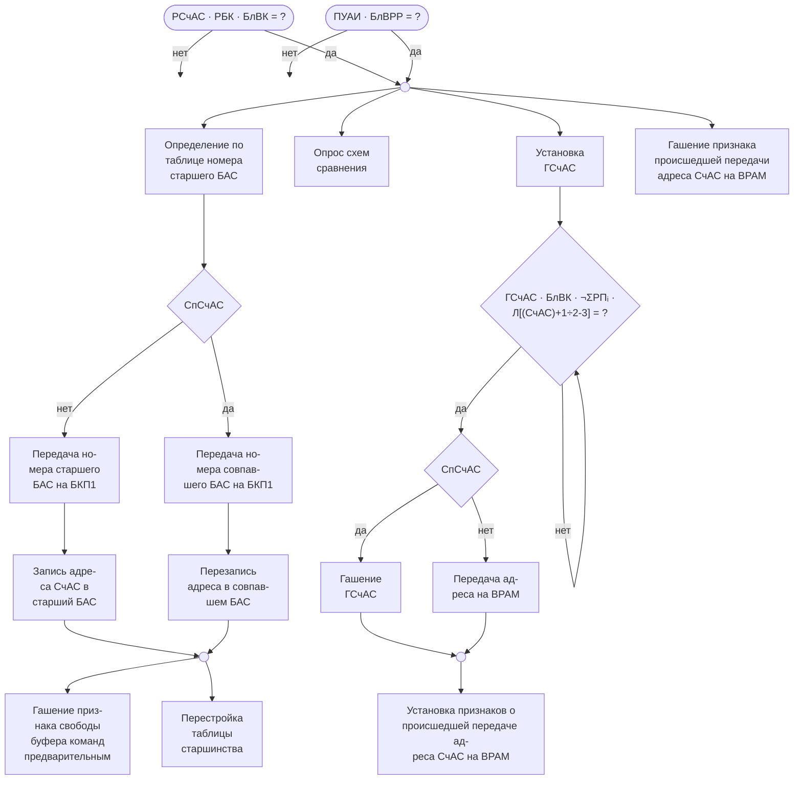

[Исходный чертеж рис. 4.5](figures/figure-4-5.png)

<!-- PDF-разворот 28, правая половина; идентификатор сверки 056. -->

#### Рис. 4.6. Два младших разряда счетчика адресов слов

Функциональное представление счета и переноса. Вентильная схема, парафазные выходы и форма импульсов в Mermaid не воспроизведены.

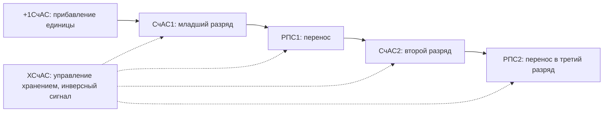

[Исходный чертеж](figures/figure-4-6.png)

#### 4.3. Счетчик адресов слов

Схема СчАС включает в себя хранящий регистр - СчАС, с которого адрес поступает на ВРАМ, и регистр переносов - РПС. Прибавление единицы отрабатывается за полтакта, но схема СчАС не позволяет считать импульсы синхронизирующей серии, т.к. сигналы переноса в старшие разряды вырабатываются двухступенчатой схемой. Некоторое понижение частоты работы СчАС относительно счетчиков тактов схемы УОП допустимо, т.к. частота поступления сигналов +1СчАС не превышает одного импульса в 3 такта. Шестнадцатый разряд СчАС не принимает участия в счете и является признаком блокировки К адресу слова. Установка этого разряда осуществляется при приеме адреса перехода в операциях передачи управления. Смена кода на счетчике адресов слов при передаче управления происходит независимо от работы блока УОП благодаря сигналу БлВК, который исключает передачу адреса на ВРАМ в момент смены кода. Запись в регистры БАС производится после опроса схем сравнения; при совпадении необходимо перезаписать адрес в совпавшем БАС для перестройки таблицы. Для каждого регистра БАС имеется усилитель - 16рБАС, в который засылается значение СчАС 16. Засылка нового адреса в регистры БАС сопровождается гашением усилителей ГС для соответствующих регистров БРС.

Сигнал готовности адреса СчАС - ГСчАС устанавливается на такт позже возможного момента, чтобы условие СпСчАС успело заблокировать обращение в память по совпавшему адресу. Требование передачи адреса команды включает в себя условие готовности адреса на СчАС, отсутствия блокировки выборки команд и свободного нужного блока памяти.

<!-- PDF-разворот 29, левая половина; идентификатор сверки 057. -->

#### 4.4. Схема подключения регистров БРС к РК

Подключение регистров БРС к кодовым шинам команд осуществляется усилителями ПКБ(Б), состояния которых определяются усилителями БКВ0 ÷ БКВ5 и ПрК. Усилители БКВ0 ÷ БКВ5 дешифрируют состояние усилителей БКП 1 и БКП 2. Прием кода на усилители БКВ0 ÷ БКВ5 происходит по сигналу ГБК, а хранение осуществляется сигналом ТБК. Т.о. происшедший прием левой команды подключает правую команду, а подключение правой команды разрешает подключить левую команду следующего слова. В первом случае момент появления сигнала подключения обеспечивает два такта на распространение сигналов до стойки БРУС и обратно.

Во втором случае при готовности слова в подключаемом БРС гарантируются те же два такта на распространение сигналов, при отсутствии же слова момент приема кода на РК определяется появлением сигнала готовности команды. Такая организация схемы подключения обеспечивает 3-х тактный цикл поступления команд в блок РК.

При подключении к РК регистра БРС с соответствующих усилителей БКП происходит передача признаков на усилители БКВ5, БКВ7, БКВ8. Состояния этих усилителей опрашиваются схемой прерывания.

Отметим, что установка усилителя БКВ7 может происходить и независимо от состояния усилителя БКП. Это объясняется тем, что сигнал защиты, вырабатываемый в момент нахождения адреса команды на ВРАМ, может появиться тогда, когда предварительный регистр команды уже превратился в буфер выполняемой команды.

Среди усилителей БКВ нет усилителя БКВ6, т.к. состояние усилителя БКП6 в команде ВП передается на усилитель СрА, что позволяет пропустить выполнение левой команды слова из подключенного к РК регистра БРС.

<!-- PDF-разворот 29, правая половина; идентификатор сверки 058. -->

Усилители БКВ0 ÷ БКВ5 подключают к выходному регистру буфера адресов команд (РАС) соответствующий регистр БАС. Это необходимо для фиксации адреса возврата в операции прерывания и в операциях БПВ, Э.

В операциях БПВ, Э зафиксированный адрес возврата является адресом следующего слова. В операции прерывания адрес возврата в общем случае требует коррекции.

### Блоки предварительной обработки команд - РК, РР

#### 4.5. Принципы связи блоков

В связи с асинхронным принципом работы узлов машины в отношении каждого логически целого блока (в данном случае блоки РК и РР) устройства управления могут быть рассмотрены три управляющих сигнала:

а) сигнал на входе блока (РПК - для блока РК, РПР - для блока РР), разрешающий прием в блок новой информации. Этот сигнал приходит от следующего блока - более низкого уровня, обеспечивающего последовательное прохождение команды по блокам. Понятно, что сигнал разрешения приема новой информации действует совместно с сигналом (сигналами) наличия этой новой информации (ТБК - для блока РК, ГД - для блока РР).
б) сигнал на выходе блока, указывающий, что информация в блоке обработана или будет обработана к тому моменту, когда она должна будет поступить в следующий блок - блок более низкого уровня (ГД - для блока РК, ГРР - для блока РР).
в) сигнал на выходе блока, аналогичный (б), но предназначенный для предыдущего блока - более высокого уровня (ТБК - для блока РК, РПК - для блока РР).

Управляющий сигнал (б) в некоторых случаях может и не быть, если в данном блоке выполнение команды заканчивается. Так, например, в некоторых операциях «единичного» формата не вырабатывается сигнал ГРР, т. е. информация в следующий блок (ПР) не выдается. Это означает, что команда полностью отработана в блоках РК и РР.

<!-- PDF-разворот 30, левая половина; идентификатор сверки 059. -->

Управляющие сигналы блоков сбрасываются с хранения внутренними сигналами блока, на который действует управляющий сигнал.

#### 4.6. Блок-программа работы блоков РК и РР

С учетом сказанного блок-программа выполнения команд в блоках РК и РР может быть представлена так, как показано на рис. 4.7.

Поясним некоторые условные обозначения. Квадраты с цифрами внутри соответствуют тем частям операции, которые обозначены такими же цифрами в сводной таблице выполнения операций. Минимальное число частей равно двум, так как все команды обрабатываются в блоках РК и РР.

Большее число частей (3 или 4) зависит от специфики выполнения каждой отдельной операции.

Символы, заключенные в круглые скобки, обозначают содержимое соответствующего регистра.

Сокращения "Уст.", "Гаш.", "ДК", "Доп.Опер." обозначают соответственно:
а) установку сигнала или признака;
б) гашение;
в) признак двойной команды - в командах СчМ, ЗпМ, СМ, СММ, МОМ, У1М дважды работают блоки РК и РР;
г) дополнительные операции - после команд типа ИК происходит предварительная обработка адреса следующей команды под управлением режима ПрИК.

Разбиение операций и типов операций на части, выполняемые в блоке РК, и на части, выполняемые в блоке РР, сделано относительно управляющих сигналов этих блоков: ГБК в блоке РК и ГРР, РПК, ДК в блоке РР.

Эти части, относящиеся к соответствующим блокам, на блок-программе рис. 4.7 обведены пунктиром.

<!-- PDF-разворот 30, правая половина; идентификатор сверки 060. -->

#### Рис. 4.7. Блок-программа работы блоков РК и РР

Обзорная блок-программа: сохранены этапы, группы операций и повторное выполнение при ДК. Полная матрица сигналов и ветвлений исходного чертежа не восстановлена.

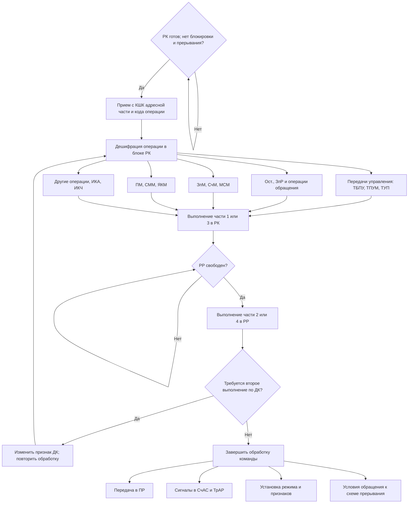

[Исходный чертеж](figures/figure-4-7.png)
