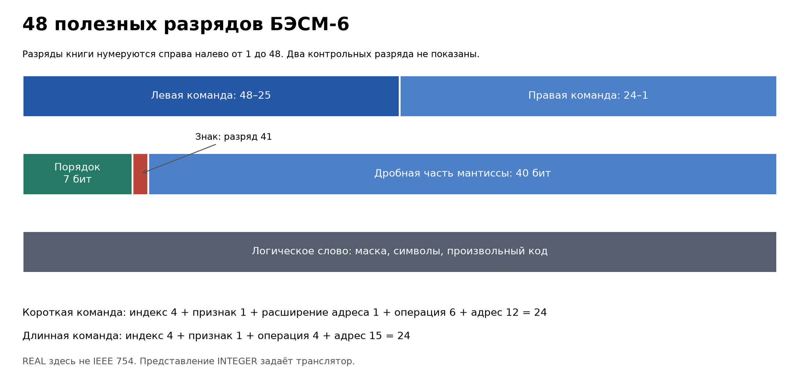

# Исследование производительности исторической машины БЭСМ-6: что можно измерить на симуляторе

**Аннотация.** БЭСМ-6 принято описывать числом «миллион операций в секунду». Но какие операции имеются в виду? Разберём устройство машины, запустим исторический Фортран в Besm6.Net и сравним четыре семейства тестов. Заодно выясним, почему скорость эмулятора, модель времени оригинальной машины и паспортное быстродействие отвечают на разные вопросы.

**Оценка времени чтения:** около 33–35 минут при темпе 160 слов/мин, с учётом кода и таблиц.

**Теги:** БЭСМ-6, эмуляция, ретрокомпьютинг, бенчмарки, СССР, суперкомпьютеры.

## Зачем измерять машину, к которой нет доступа

Программу для БЭСМ-6 сегодня можно хранить в текстовом файле. Она запускается на обычном Linux, печатает знакомый `Hello, World!`, а затем — результаты вычислений. За этим удобством скрывается машина, у которой одно слово занимало 48 полезных разрядов, в слове помещались две команды, а программы приносили в вычислительный центр на перфокартах.

Физическая БЭСМ-6 для этого исследования недоступна. Все практические результаты ниже получены на **симуляторе Besm6.Net**. Поэтому вопрос состоит из двух частей: насколько быстро современный компьютер исполняет гостевые программы и какое время этим программам назначает модель исторического процессора.

Это различие особенно заметно в бенчмарках. Можно точно воспроизвести арифметику и получить правильный ответ, но ошибиться во времени в несколько раз. Можно подобрать параметры времени так, чтобы один известный тест совпал с опубликованным результатом, но получить другие времена отдельных секций. Наконец, можно просто ускорить цикл интерпретации на современном процессоре: гостевой алгоритм останется тем же, а показания часов хоста изменятся.

В статье мы пройдём путь от устройства БЭСМ-6 до этих часов. Исходники заданий, конфигурация, журналы прогонов и таблица измерений сопровождают текст, чтобы опыт можно было повторить.

## От МЭСМ к БЭСМ-6

История начинается с МЭСМ, запущенной в эксплуатацию в 1951 году. За ней последовала первая БЭСМ: изготовление завершили в 1952 году, государственная приёмка состоялась в 1953-м. БЭСМ-2 стала серийным развитием первой машины; музейная карточка указывает начало выпуска в 1958 году. Это была ещё ламповая техника. БЭСМ-4 представляла другую ветвь развития: её система команд продолжала линию М-20, а элементная база была полупроводниковой. Номера в названии не означают последовательные версии одной совместимой архитектуры. [История серии](https://www.besm-6.ru/besm-series.html), [БЭСМ-2](https://computer-museum.ru/histussr/29-1.htm), [БЭСМ-4](https://www.computer-museum.ru/histussr/29-2.htm).

В начале 1960-х складывалась архитектура новой машины для крупных научных расчётов. БЭСМ-6 прошла государственную приёмку в 1967 году. Главным конструктором был Сергей Алексеевич Лебедев; среди его заместителей — Владимир Алексеевич Мельников и Леонид Николаевич Королёв. Серийное производство шло с 1968 по 1987 год, всего изготовили 355 машин. [Карточка БЭСМ-6](https://besm-6.ru/besm6.html).

Для этой машины переход к транзисторам был уже частью инженерной основы. В музейном описании указаны около 60 тысяч транзисторов и 180 тысяч диодов. Логика строилась на дискретных элементах, поэтому скорость зависела и от конструкции: длины соединений, размещения блоков, организации монтажа. Процессор здесь нельзя представить маленьким корпусом на материнской плате. Это стойки с ячейками и платами — типовыми элементами замены, или ТЭЗами. Пульт позволял оператору наблюдать состояние машины и управлять ею. [Устройство БЭСМ-6](https://www.computer-museum.ru/histussr/28-1.htm).

МЭСМ и первая БЭСМ показали, что электронная машина может выполнять расчёты; БЭСМ-6 ставила следующий вопрос: как удерживать вычислительные узлы занятыми, когда память и управление не успевают за арифметикой? Этот вопрос остаётся узнаваемым и сегодня.

## Машина с «водопроводом»

Вместо того чтобы целиком закончить одну команду и лишь затем начать следующую, БЭСМ-6 совмещала работу устройства управления, арифметического устройства и памяти. Лебедев называл этот принцип «водопроводом». Сейчас мы сказали бы «конвейер»: пока одна операция вычисляет результат, другая может готовить адрес или получать команду. Буферы между узлами сглаживают различие в скорости их работы. [Описание архитектуры](https://besm-6.ru/besm6.html).

Но конвейер не отменяет зависимости. Если следующей команде нужен ещё не готовый результат, ей придётся ждать. Именно поэтому сумма задержек всех команд обычно не равна времени программы. Устройство управления может часть времени работать одновременно с арифметическим устройством, а конфликт обращений к памяти, наоборот, добавит ожидание.

Оперативная память была ферритовой. Базовый объём — 32 768 слов: при пересчёте только полезных 48 разрядов это 192 КиБ. В физическом слове присутствовали ещё два контрольных разряда. В расширенных конфигурациях объём достигал 128 тысяч слов. Адресное пространство программы и установленная физическая память — разные величины: механизм «приписки» преобразовывал адреса страниц и обеспечивал защиту. [Учебник 1976 года, §§ 1–3](../../../book/fortran-1976/01-besm6.md).

Расслоение памяти позволяло обращаться к разным модулям с перекрытием во времени. Быстрые буферные регистры удерживали команды и данные, чтобы не выполнять каждое обращение через медленные ферритовые сердечники. Часто встречающееся описание «кэш на 16 слов» полезно как первое приближение, но не передаёт всей организации буферов и ожидающих записей. Подробнее их роль разобрана в [главе о памяти](../../../book/fortran-1976/01-besm6.md#section-3).

Источники дают рабочую частоту около 10 МГц; для таблицы длительностей учебник определяет такт 110 нс, то есть около 9,1 МГц. Здесь лучше сохранять точность конкретного источника. Частота синхронизации, длительность одной арифметической операции и среднее число завершённых команд в секунду — три разных характеристики. [Определение такта, § 4](../../../book/fortran-1976/01-besm6.md#section-4), [таблица длительностей](../../../book/fortran-1976/05-appendices.md).

Система прерываний связывала вычисления с внешними событиями. Защита памяти и привилегированный режим давали диспетчеру возможность управлять несколькими задачами. Пользовательская программа не должна была самостоятельно распоряжаться всеми устройствами: она обращалась за обслуживанием к системному ПО.

### Откуда приходили программы и куда уходили результаты

Комплектация менялась за два десятилетия эксплуатации. Поэтому таблица ниже показывает назначение устройств и параметры конкретных описаний, а не единый обязательный комплект всех 355 экземпляров.

| Устройство | Что делало | Что существенно для программы |
|---|---|---|
| Перфокарты, в том числе устройства семейства ВУ-700 | Ввод исходного текста и данных | Обычно 80 колонок на карте; перестановка карт меняла задание |
| АЦПУ-128 | Печать листинга и результатов | 128 печатных позиций; скорость зависит от исполнения устройства |
| Телетайп | Команды и сообщения оператору, работа с текстом | Медленный последовательный обмен; не измеритель скорости процессора |
| НМЛ, магнитная лента | Библиотеки, программы, массивы данных | Учебник описывает до 32 магнитофонов; обмен зонами по 1К слов |
| НМБ, магнитный барабан | Внешняя память с адресуемыми блоками | Учебник указывает до 512К слов суммарной барабанной памяти; блок 1К или 256 слов |
| НМД, магнитный диск | Внешняя память более поздних конфигураций | В описанной комплектации блок 1К слов соответствует двум дорожкам; скорость зависит от накопителя |

Устройства и объёмы внешней памяти указаны в [описании комплектации в учебнике](../../../book/fortran-1976/01-besm6.md#section-1). Для конкретного АЦПУ-128-2 история НИИсчётмаш приводит 128 печатных позиций и скорость 380–440 строк/мин; этот диапазон нельзя автоматически переносить на остальные модификации. Для ВУ-700-2 не будем выводить число карт в минуту из названия устройства: паспорт конкретной модификации нужен отдельно. [История разработчика периферии](https://www.computer-museum.ru/histussr/niism.htm).

Наши вычислительные тесты не измеряют эту периферию. Симулятор может работать с образом ленты и выводить текст в терминал хоста, но такой путь не включает реальное движение магнитной ленты или механическую печать. Даже точная эмуляция команд процессора сама по себе не превращает файловый ввод-вывод в исторический замер устройства.

## Что помещалось в 48 разрядах

На БЭСМ-6 слово было естественной единицей хранения и адресации. Для команд оно делилось пополам; для числа использовалось целиком. Нумерация в книжной документации начинается с единицы справа. В коде симулятора часто используется нумерация от нуля — эти обозначения нужно различать.

```text
Нумерация книги:       48                         25 24                          1
Командное слово:     ┌──────────────────────────────┬──────────────────────────────┐
                     │      левая команда, 24 бита  │     правая команда, 24 бита   │
                     └──────────────────────────────┴──────────────────────────────┘

Число:                48          42 41 40                                      1
                     ┌──────────────┬──┬──────────────────────────────────────────┐
                     │ порядок, 7   │ З│     дробная часть мантиссы, 40 бит       │
                     └──────────────┴──┴──────────────────────────────────────────┘
                     Мантисса вместе со знаком З занимает 41 бит, дополнительный код.

Логическое слово:     ┌────────────────────────────────────────────────────────────┐
                     │               48 разрядов произвольного кода                │
                     └────────────────────────────────────────────────────────────┘
```



Схема показывает полезные разряды. Два контрольных разряда физической памяти находятся за её пределами. Они недоступны обычной программе как часть числа и участвуют в контроле хранения команд и данных. Форматы подтверждаются [учебником, § 2](../../../book/fortran-1976/01-besm6.md#section-2) и [перечнем команд](https://www.besm6.org/wiki/CmdSheet.html).

В плавающем формате порядок хранится со смещением 64. Мантисса содержит знак и 40 дробных разрядов; это примерно 12 десятичных значащих цифр. Такой `REAL` отличается от современных IEEE 754 `float` и `double`. При переносе теста важно сохранять не только формулу, но и учитывать округление. Логическое слово может содержать маску, текстовые символы или целочисленный код; отдельного универсального «целого формата IEEE» у него нет. Способ хранения `INTEGER` зависит от языка и транслятора.

### Аккумулятор, индексы и адреса

Арифметика строится вокруг аккумулятора, или сумматора. Одноадресная команда получает второй операнд из памяти: первый уже находится в сумматоре. Регистр младших разрядов, РМР, дополняет арифметический тракт, в частности при операциях с расширенным результатом и сдвигах. Индекс-регистры участвуют в вычислении адресов и организации циклов; номер занимает четыре бита, нулевой номер означает отсутствие индексной модификации. Счётчик команд вместе с признаком левой или правой половины определяет место исполнения. [Регистры и команды](../../../book/fortran-1976/01-besm6.md).

В 24-разрядной команде возможны два формата:

| Формат | Поля от старших разрядов к младшим | Зачем нужен |
|---|---|---|
| Короткий адрес | индекс 4; признак 0; расширение адреса 1; операция 6; адрес 12 | Больше кодов операций, ограниченный непосредственный адрес |
| Длинный адрес | индекс 4; признак 1; операция 4; адрес 15 | Полный адрес, в частности для переходов и индексных команд |

В кратких таблицах семибитное поле короткого формата иногда целиком подписано «код операции». Его старший бит задаёт дополнение адреса до 15 разрядов: тремя нулями или тремя единицами. Полный эффективный адрес затем учитывает индексный регистр и, если применён, модификатор следующей команды. [Форматы команд](https://www.besm6.org/wiki/CmdSheet.html).

Обычно говорят примерно о 50 основных командах. Подсчёт зависит от того, включать ли специальные, привилегированные формы и экстракоды, поэтому количество строк таблицы не стоит превращать в отдельный показатель мощности машины.

| Восьмеричный код | МАДЛЕН | Смысл |
|---|---|---|
| `000` | `ATX` | Записать сумматор в память |
| `004` | `A+X` | Сложить сумматор с операндом |
| `010` | `XTA` | Загрузить операнд в сумматор |
| `016` | `A/X` | Деление |
| `017` | `A*X` | Умножение |
| `24` длинного формата | `VTM` | Установить индекс-регистр |
| `30` длинного формата | `UJ` | Безусловный переход |
| `37` длинного формата | `VLM` | Команда организации цикла |

Коды приведены в восьмеричной системе; длинные и короткие формы следует читать в своих таблицах. [Система команд](https://www.besm6.org/wiki/CmdSheet.html).

Конвейер отражался на программировании: независимые операции над индексами можно совмещать с арифметикой, а немедленная запись только что вычисленного результата заставляет ждать. Но перестановка команд должна сохранять состояние сумматора, режим арифметики и адресную модификацию. В книге целая глава посвящена тому, как менять адресацию и циклы Фортрана ради скорости. [Оптимизация программ](../../../book/fortran-1976/04-optimization.md).

## Экстракоды: короткая команда, большая работа

Не каждую полезную операцию выгодно выполнять аппаратурой. Экстракод передаёт управление системной программе, которая реализует более сложное действие. Для прикладного программиста это удобная точка входа: он задаёт запрос и параметры, а подробности обслуживания остаются у системы. Аналогия с системным вызовом помогает понять механизм, хотя набор услуг и соглашения об аргументах здесь свои.

В системе «Дубна» через экстракоды выполнялись математические функции, печать, обмен с внешней памятью и служебные действия. Например, учебник перечисляет `*50` для корня, `*51` для синуса, `*52` для косинуса, `*53` для арктангенса; `*64` относится к печати. Это восьмеричные обозначения команд, а не номера функций современного API. Отладочные услуги и аварийное завершение также относятся к системному окружению. [Основные экстракоды, § 6](../../../book/fortran-1976/01-besm6.md#section-6).

Экстракод важен для измерений: одна гостевая команда может означать работу целой подпрограммы. Счётчик команд пользовательского режима тогда не показывает всей вычислительной цены услуги. В ДИСПАК и «Дубне» контракт нужно уточнять по документации конкретной системы: одинаковая архитектура не гарантирует одинаковые системные соглашения.

В исследуемом hosted-запуске Besm6.Net часть услуг выполняет код хоста. Математическая функция получает результат через реализацию симулятора, а модель отдельно назначает ей стоимость. Поэтому для Whetstone, где есть синус, косинус, логарифм и корень, цена этих услуг прямо влияет на итоговый рейтинг. Этот путь следует отличать от исполнения полного исторического диспетчера и его математических библиотек.

## Программное обеспечение: от колоды карт до задания `.dub`

У БЭСМ-6 существовало несколько операционных систем. Д-68 организовывала работу вычислительного центра; ДИСПАК развивала диспетчерское обслуживание и диалоговую работу. «Дубна» известна многоязыковой мониторной системой, средствами трансляции и библиотеками научных программ. Названия встречаются и в сочетании: мониторная система и диспетчер выполняют разные обязанности. [Исторический обзор ПО](https://besm-6.ru/besm6.html).

Путь задачи начинался до её вычислительной части. Пользователь готовил управляющие карты, исходный текст и данные. Монитор выбирал транслятор, компилировал подпрограммы, подключал библиотечные модули, формировал загрузку и передавал управление программе. Печать листинга и диагностики сопровождала эти этапы. Ошибка в карте управления могла остановить работу ещё до первой полезной операции. [Пакет задачи пользователя, § 8](../../../book/fortran-1976/01-besm6.md#section-8).

Автокоды давали доступ к командам машины; среди них — МАДЛЕН и БЕМШ. Фортран был естественным выбором для численных задач, Алгол-60 — ещё одним важным языком системы программирования. В программной экосистеме машины присутствовали также Паскаль, ЛИСП и РЕФАЛ. Их наличие в истории не означает, что любой соответствующий транслятор входит в текущую поставку симулятора. Для наших измерений выбран ФОРЕКС 4.13 из образа MONSYS; версии языка и ограничения старых компиляторов существенно влияют на перенос программы. [Воспоминания о реализации ЛИСП](https://www.computer-museum.ru/histsoft/algol60.htm), [история РЕФАЛ-компилятора](https://www.computer-museum.ru/articles/yazyki-i-sistemy-programmirovaniya/8288/), [языки в Besm6.Net](../../dubna-languages.md).

Вместо бумажной колоды используем текстовый файл:

```fortran
*name фортран
*fortran
        program hello
        print 1000
        stop
 1000   format('Hello, World!')
        end
*execute
*end file
```

Это реальный пример [examples/fortran.dub](../../../examples/fortran.dub). Строка `*fortran` выбирает трансляцию, `*execute` — выполнение. Для ФОРЕКС используется управляющая строка `*forex`. Следует сохранять фиксированный формат исходного Фортрана: первые колонки строки имеют значение, а перенос выражения оформляется по правилам языка той эпохи.

## Паспортные числа и результаты тестов

«До миллиона одноадресных команд в секунду» — историческая характеристика среднего быстродействия из музейного описания. Это не миллион произвольных выражений Фортрана, не гарантированный миллион операций с памятью и не результат Dhrystone. Одна строка программы высокого уровня может породить много команд. [Технические характеристики](https://www.computer-museum.ru/histussr/28-1.htm).

С числом **0,418 MFLOPS** есть конкретная тонкость. В публикации Leo B. 2017 года оно получено как геометрическое среднее оценок для сложения, умножения и деления: `0,820`, `0,500`, `0,180` миллиона операций в секунду. Автор той же публикации приводит Whetstone с результатом `0,809 MWIPS` и `0,295 MFLOPS`. Причём это тоже **моделирование конвейеров**, с ДИСПАК в эмуляции пользовательского режима и ФОРЕКС 4.12. Таким образом, 0,418 — расчётная сводная оценка, а таблица 2017 года — предыдущий симуляционный эксперимент, а не замер доступной нам физической БЭСМ-6. [Первичная публикация автора эксперимента](https://retrocomputing.stackexchange.com/questions/3267/how-to-compute-performance-of-a-cpu-in-flops).

| Показатель | Значение | Как получен |
|---|---:|---|
| Паспортное среднее быстродействие БЭСМ-6 | до 1 млн команд/с | Историческое описание; смесь команд здесь не задана |
| Сводная оценка арифметики | 0,418 MFLOPS | Геометрическое среднее трёх оценок пропускной способности |
| Whetstone из публикации 2017 года | 0,809 MWIPS | Симуляция конвейеров, ФОРЕКС 4.12 |
| Арифметические секции того Whetstone | 0,295 MFLOPS | Геометрическое среднее N1, N2, N6 |

Геометрическое среднее удобно для сводного рейтинга, но не задаёт конкретную смесь операций. Если задача в основном делит числа или тратит время на вызовы функций, сводная оценка арифметики не предскажет её скорость. Единицы MWIPS, MFLOPS и MIPS также нельзя подменять друг другом.

### А что было у CDC?

Для сравнения полезнее сначала зафиксировать устройство и методику, чем собрать ряд рекламных рейтингов.

| Машина | Контекст | Размер слова | Что позволяет сравнить источник |
|---|---|---:|---|
| CDC 3600 | В NCAR установлена в конце 1963 года | 48 бит | Скорость реальной эксплуатации в отчёте NCAR относительно CDC 7600 |
| CDC 6600 | В NCAR установлена в декабре 1965 года | 60 бит | Там же: рост относительной скорости после изменения системного ПО |
| БЭСМ-6 | Приёмка в 1967 году | 48 полезных бит | Паспортное быстродействие и отдельные модели; общего прогона с CDC здесь нет |

В исторической таблице NCAR CDC 6600 сначала оценена как в 1,5 раза быстрее CDC 3600, а к 1968 году — уже в 3 раза, после изменения программной системы. Это хороший пример того, что производительность вычислительного центра определяется и ПО. По этой таблице нельзя вывести отношение CDC 6600 к БЭСМ-6: для последней нет той же нагрузки. [Отчёт Lax, таблица NCAR](https://science.osti.gov/-/media/ascr/pdf/program-documents/archive/Lax_report.pdf).

Конфигуратор CDC 1966 года показывает у 6600 десять функциональных блоков центрального процессора, 60-разрядную память и десять периферийных процессоров. Это другая организация параллелизма и обслуживания устройств. Общий современный тест с зафиксированными трансляторами был бы содержательнее, но в этом исследовании CDC не запускались. [Конфигуратор производителя](https://archive.computerhistory.org/resources/text/CDC/CDC.6400_6600.1966.102646143.pdf).

## Besm6.Net: какую БЭСМ-6 мы запускаем

Практическая часть опирается на [EntityFX/besm6.net](https://github.com/EntityFX/besm6.net), C#-реализацию для .NET. Исследуем локальный коммит `190e2f6977190e42f34b33d2e56424454be89027`. Это фиксация версии эксперимента; будущая версия может иметь другой функциональный код, таймеры и рейтинги.

Проект имеет несколько слоёв. `Besm6.Architecture` описывает 48-разрядные значения, инструкции и арифметику. `Besm6.Processor` исполняет команды. `Besm6.Runtime` связывает процессор с загрузкой, памятью, экстракодами и устройствами. CLI принимает `.dub`-задание и печатает результат. Отдельно существуют интерфейс пульта и более подробная модель аппаратного исполнения. [Архитектура программной модели](../../../ARCHITECTURE.md).

В исходниках видны устройства телетайпа, консоли, диска и магнитного барабана. Образы лент содержат историческое программное обеспечение. Однако наличие класса устройства, механизма виртуальной памяти или аппаратного календаря не означает, что каждый обычный `run` использует полную модель всех узлов. В статье измеряется именно hosted-путь выполнения `.dub`, а не самостоятельная supervisor-машина с режимом `machine --execution hardware`.

Источники восстановления можно проверять предметно: учебные сканы и их транскрипции находятся в `book/`; проект [SIMH](https://github.com/simh/simh) даёт сопоставимую реализацию исторических машин, а [besm6/dubna](https://github.com/besm6/dubna) — модель мониторной системы и образы. Для поставляемых лент в репозитории указано происхождение и SHA-256. Это проверяемые связи. Личные истории автора порта и влияние воспоминаний очевидцев по одному коду восстановить нельзя — приписывать их автору не будем.

Показательный эпизод из документации: в MONSYS исправлены 18 байт, восстановленные из upstream-образа. Три повреждённых машинных слова мешали ФОРЕКС обрабатывать присваивания. Исправление образа позволило запускать настоящий транслятор; замена ФОРЕКС другим транслятором дала бы уже другой эксперимент. [Документация ресурсов](../../runtime-assets.md), [происхождение лент](../../../tapes/README.md).

### Сборка и первый запуск

В существующем checkout достаточно собрать консольный проект. В новом каталоге сначала клонируем репозиторий:

```bash
git clone https://github.com/EntityFX/besm6.net
cd besm6.net
git checkout 190e2f6977190e42f34b33d2e56424454be89027
dotnet build src/Besm6.Cli -c Release
DLL=src/Besm6.Cli/bin/Release/net8.0/besm6.dll
dotnet "$DLL" run examples/fortran.dub --no-wall-clock
```

Проект нацелен на `net8.0`; в нашем окружении установлены SDK 10.0.200 и runtime .NET 8.0.21. Для обычного запуска нужны пять поставляемых образов: `monsys.9`, `librar.12`, `librar.37`, `bemsh.739`, `b.7`. Они лежат в `tapes/` и копируются при сборке. В эксперименте путь задан явно в JSON:

```json
{
  "tapes": "/absolute/path/to/besm6.net/tapes",
  "useWallClock": false,
  "forexAsFortran": false,
  "originalTimeFactor": 0.670839,
  "originalMathFactor": 1.769005
}
```

Последние два коэффициента нужны для явной фиксации исследуемой модели. `forexAsFortran: false` сохраняет выбор настоящего ФОРЕКС. В этом запуске не требуется вручную готовить диск с ОС. Альтернативный путь поиска образов — переменная `BESM6_PATH`, которую читает `TapeImage.DefaultTapesDir()`; в нашем эксперименте каталог задан явно ключом `tapes`.

## Четыре теста и три смысла времени

В репозитории есть несколько вариантов одних тестов. Чтобы сравнение не смешивало трансляторы и упрощённые порты, выбираем задания для настоящего **ФОРЕКС 4.13**. Для Memspeed и MP-MFLOPS меняется только `data kpart/1/`: значения 1, 2, 3 выбирают разные ядра.

| Семейство | Задание | Нагрузка и показатель |
|---|---|---|
| Dhrystone 2.1 | `dhrystone-forex.dub` | 5000 проходов; процедуры, строки, целочисленные массивы; DMIPS |
| Whetstone Longbottom | `whetstone-longbottom-forex.dub` | 8 × 100 условных проходов; восемь секций; MWIPS и отдельный MFLOPS |
| Memspeed | `memspeed-forex.dub`, части 1–3 | 4096 элементов, 1000 проходов; copy, add, multiply-add; логические MB/s |
| MP-MFLOPS | `mpmflops-forex.dub`, части 1–3 | 9000 элементов, 30 проходов; 2, 8, 32 арифметические операции на элемент; MFLOPS |

Это адаптации: Dhrystone заменяет записи параллельными массивами полей, а указатели — индексами двух узлов. Строки и вызовы процедур при этом остаются в исполняемом коде. Memspeed реализует три выбранных ядра, а не весь современный пакет тестов памяти. MP-MFLOPS здесь работает на одном гостевом процессоре; его название не означает, что БЭСМ-6 вдруг стала многопроцессорной. Сравнивать такие результаты с другим портом можно только после проверки представления данных и состава операций. [Исходники Dhrystone](../../../examples/dhrystone-forex.dub), [Memspeed](../../../examples/memspeed-forex.dub), [MP-MFLOPS](../../../examples/mpmflops-forex.dub).

Whetstone взят в варианте Роя Лонгботтома 1996 года. Порт сохраняет восемь секций и их число операций, а длинные циклы разбивает на блоки для совместимости с ограничениями старого Фортрана. Эта дополнительная организация цикла попадает в измеряемое время. Первая секция выполняется десятикратно, после чего её время делится на десять, как в исходном варианте теста. Поэтому сумма нормализованных секций не равна времени всего процесса. [Исходник порта и описание изменений](../../../examples/whetstone-longbottom-forex.dub).

### Какие часы мы читаем

Во всех заданиях `CTIME` вызывается перед ядром и сразу после него. Подготовка массивов, компиляция, проверка результата и печать остаются снаружи. В выбранных заданиях интервал берётся из второго аргумента `CTIME`; надпись `GUEST CPU SECONDS` следует понимать через режим таймера, а не как автоматически измеренное физическое CPU-время БЭСМ-6.

| Режим Besm6.Net | Что показывает гостевой таймер | Для какого вопроса пригоден |
|---|---|---|
| `original` | Статистическое время модели; хост замедляется по этой модели | Сколько стоит нагрузка при выбранных допущениях о БЭСМ-6 |
| `virtual` | Прошедшее время хоста внутри гостевого интервала | Насколько быстро этот хост исполняет ядро через симулятор |
| `max` | Прежнее табличное модельное время | Совместимость быстрого режима; отдельная, более простая модель |

`--guest-clock` включает гостевые часы; без него задания отказываются выдавать рейтинг. `--no-wall-clock` фиксирует календарные сведения и не отключает измерение elapsed-времени в `virtual`. Общая статистика CLI включает и трансляцию, и обслуживание задания. Её `elapsedSeconds` не подставляется вместо интервала ядра. [Документация времени](../../original-timing.md), [реализация hosted-модели](../../../src/Besm6.Runtime/Timing/HostedOriginalTiming.cs).

Слово `virtual` здесь обозначает конкретный режим проекта, а не гарантированную независимость от хоста. На результат влияют процессор, JIT, ОС и другие процессы. Режим `original`, наоборот, старается выдержать вычисленное модельное время, даже когда хост способен исполнить гостевые команды быстрее. Дополнительное ожидание видно в полном времени запуска, но не является ещё одной операцией гостевой программы.

### Почему калибровка требует отдельного разговора

В `original` модель учитывает отдельную занятость управления и арифметики, зависимости, банки памяти, буферные попадания и записи. Исходные интервалы берутся из книжной таблицы. Но выбор политики буферов, перекрытия выборки команд и части задержек остаётся допущением модели.

Кроме того, в исследуемом коммите заданы два эмпирических коэффициента: общий масштаб времени `0.670839` и дополнительный масштаб математических функций `1.769005`. Их подбирали по опубликованному прогону Whetstone 2017 года: сумме секций и сумме секций с математическими функциями. Это документированная калибровка по данным одного теста. [Методика и параметры фита](../../original-timing.md).

Она позволяет согласовать общий MWIPS с выбранной публикацией. Но тот же Whetstone нельзя затем предъявить как независимое доказательство правильности модели. Другие бенчмарки показывают её поведение вне калибровочной нагрузки, однако без результатов с физической машины они также не проверяют историческую точность. Даже у Whetstone совпадение сводного числа не требует совпадения всех восьми времён.

Стоимость математических экстракодов в этой модели назначается отдельно. Например, исходные оценки для корня и синуса составляют 40 и 50 мкс до применения коэффициентов. В учебнике 1976 года указан общий диапазон 55–90 мкс для элементарных функций, кроме выделенного отдельно округления вниз. Это разные по детализации описания, относящиеся к программным услугам. Нельзя объявлять выбранные константы точными временами любого исторического диспетчера и любого аргумента функции. [Книжное описание экстракодов](../../../book/fortran-1976/01-besm6.md#section-6).

### Методика наших прогонов

Сборка выполнена в Release. Хост — Linux x86-64, Intel Xeon E5-2680 v3 с паспортной частотой 2,50 ГГц; используемый .NET runtime — 8.0.21. Для каждого из восьми заданий выполнены три отдельных запуска в `original` и три в `virtual`, последовательно, без конкурирующих бенчмарков. Каждый процесс заново загружает и транслирует программу. Точное окружение, хеш исполняемой сборки и хеши лент записаны в [environment.json](data/run-2026-10-13/environment.json).

Таймер имеет квант 20 мс. Для коротких интервалов это заметная погрешность: у ядра длительностью 0,3 с один квант составляет около 7%. Три повтора позволяют увидеть разброс, но не превращают результат в точную оценку до шестого знака. В статье используются медианы, а минимум и максимум остаются в сопровождающей таблице. Полного прогрева и управления частотой CPU здесь нет: это воспроизводимый запуск на доступном хосте, а не лабораторная оценка предельной скорости симулятора.

Программа должна завершиться `STOP` и пройти численные проверки, прежде чем результат попадёт в таблицу. Дополнительно внешний Python-скрипт пересчитывает формулы рейтингов и контрольные значения: для памяти — первый и последний элементы и сумму; для MP-MFLOPS — независимую последовательность арифметических выражений; для Whetstone — восемь эталонных значений с допуском. Разбор начинается после вывода компоновщика: строка `ALL VALUES MATCH` в листинге исходника сама по себе не является результатом исполнения.

Чтобы повторить весь опыт, после сборки запускаем:

```bash
python3 docs/articles/besm6-performance/measure.py \
  --output /tmp/besm6-performance-new-run --repeats 3
```

Каталог результата должен быть новым. Один тест можно выполнить отдельно:

```bash
DLL=src/Besm6.Cli/bin/Release/net8.0/besm6.dll
dotnet "$DLL" run examples/dhrystone-forex.dub \
  --guest-clock --speed virtual --stats --no-wall-clock \
  --no-hang-detect --limit 2000000000
```

Для второй части Memspeed копируем файл и заменяем одну строку `data kpart/1/` на `data kpart/2/`. Скрипт делает это автоматически и сохраняет каждую полученную колоду вместе с её SHA-256. Выбранный лимит инструкций служит защитой от незавершённой программы и не используется в формулах производительности.

### Как считаются рейтинги

В Dhrystone число проходов делится на секунды, затем на **1757** — принятую нормировку относительно VAX-11/780. Полученное значение DMIPS не равно числу миллионов гостевых машинных команд в секунду. Количество инструкций в статистике CLI включает работу транслятора и обслуживающих модулей; напрямую сопоставлять эти два числа нельзя. [Нормировка в документации Arm](https://documentation-service.arm.com/static/6331d18bda191e7fe057c931?token=).

Общий Whetstone здесь вычисляется как `80 / сумма нормализованных секунд` и выражается в MWIPS. Для арифметического MFLOPS отдельно берётся геометрическое среднее секций N1, N2 и N6. Остальные секции содержат условные переходы, целочисленную работу, присваивания и математические функции; их показатель MOPS нельзя механически складывать с MFLOPS.

Memspeed считает **логический трафик гостевого алгоритма**. Слово занимает шесть полезных байт: копирование читает и пишет слово, то есть 12 байт на элемент. Сложение и multiply-add учитывают два чтения и запись — 18 байт. При 4096 элементах и 1000 проходах получаются 49 152 000 и 73 728 000 байт. MB/s используются десятичные, по миллиону байт. Это не показания контроллера ОЗУ хоста и не чистая физическая пропускная способность ферритовой памяти: индексные команды и управление циклом тоже расходуют время, а буферизация меняет реальные обращения.

MP-MFLOPS делит `9000 × 30 × операций_на_элемент` на время и миллион. Для трёх ядер это 540 тысяч, 2,16 миллиона и 8,64 миллиона арифметических операций. Умножение и сложение считаются по отдельности; современную аппаратную FMA здесь не подразумеваем. Чем длиннее выражение, тем меньшая доля времени приходится на индексную арифметику и управление проходом. При этом длинная цепочка зависимых вычислений может сама ограничить конвейер.

### Результаты

Все 48 запусков завершились и прошли описанные проверки. Таблица показывает медианы трёх запусков для каждой пары задания и режима. Время Whetstone — сумма нормализованных секций; у остальных тестов — интервал ядра.

| Бенчмарк | Время original, с | Рейтинг original | Время virtual, с | Рейтинг virtual | Единица |
|---|---:|---:|---:|---:|---|
| Dhrystone 2.1 | 4.360 | 0.653 | 0.340 | 8.370 | DMIPS |
| Whetstone | 98.850 | 0.809 | 4.974 | 16.084 | MWIPS |
| Memspeed: copy | 8.680 | 5.663 | 0.960 | 51.200 | MB/S |
| Memspeed: add | 16.740 | 4.404 | 1.220 | 60.433 | MB/S |
| Memspeed: multiply-add | 17.640 | 4.180 | 1.480 | 49.816 | MB/S |
| MP-MFLOPS: 2 ops | 1.100 | 0.491 | 0.080 | 6.750 | MFLOPS |
| MP-MFLOPS: 8 ops | 3.340 | 0.647 | 0.240 | 9.000 | MFLOPS |
| MP-MFLOPS: 32 ops | 13.540 | 0.638 | 0.820 | 10.537 | MFLOPS |

Для Whetstone отдельное геометрическое среднее арифметических секций составило **0.389 MFLOPS** в модели и **5.187 MFLOPS** по часам хоста. Это отдельный показатель, а не перевод MWIPS в другие единицы.


У диаграммы четыре шкалы: сравнивать высоты столбцов между панелями нельзя. Полный разброс и времена каждого прогона сохранены в [отдельной таблице](benchmark-results.md).

В Dhrystone рейтинг по часам хоста выше модельного: симулятор исполняет ядро быстрее, чем время, назначенное моделью. Это различие относится к данному порту и хосту. Оно не является универсальным коэффициентом, на который можно делить любую современную программу ради оценки БЭСМ-6.

Три результата Memspeed включают управление циклами и арифметику адресов. Поэтому столбец copy — скорость всего гостевого ядра копирования. У MP-MFLOPS изменение числа операций на элемент меняет долю служебной работы; общий MFLOPS также зависит от сгенерированных команд и зависимостей между ними. Ни одна из этих строк не задаёт единую «скорость всей машины».

У самого короткого ядра MP-MFLOPS интервал `virtual` составил 0,08–0,10 с. Один квант 20 мс здесь сравним с четвертью времени: несколько десятичных знаков рейтинга не означают соответствующую точность. У Memspeed разброс также заметен. Эти результаты полезны для повторения данного опыта, но строгий анализ скорости хоста потребовал бы более длинных интервалов и контроля условий измерения. Точное повторение модельного времени в `original` показывает детерминированность модели; оно не определяет её ошибку относительно исторической машины.

### Совпавший Whetstone и несовпавшие секции

Калиброванный общий MWIPS близок к значению, по которому настраивали модель. Секционные времена при этом различаются:

| Секция | Публикация 2017, с | Наша модель original, с |
|---|---:|---:|
| N1 | 0.293 | 0.190 |
| N2 | 2.674 | 1.720 |
| N3 | 4.477 | 3.200 |
| N4 | 7.280 | 3.860 |
| N5 | 18.361 | 18.120 |
| N6 | 35.720 | 36.960 |
| N7 | 13.963 | 18.460 |
| N8 | 16.087 | 16.340 |


Здесь обе серии относятся к моделям. Версии транслятора, системное окружение и численные значения исходного эксперимента отличаются. Такую диаграмму следует читать как проверку последствий калибровки, а не как измеренную ошибку относительно физической БЭСМ-6.

### Накладные расходы симуляции

В `virtual` в интервал ядра попадают интерпретация команд, работа модели памяти и обслуживающий код хоста. Компиляция гостевой программы остаётся за пределами этого интервала, но присутствует в полном времени запуска. Сборка Release и данные окружения позволяют повторить замер; они не позволяют отдельно вычесть стоимость каждого внутреннего механизма.

В `original` к этому добавляется ожидание назначенного темпа. Поэтому полное время процесса показывает длительность нашего опыта, а гостевое модельное время — расчёт модели. Простой пересчёт «host seconds × частота БЭСМ-6» не восстанавливает историческое время: он игнорирует зависимости, память, стоимость экстракодов и различие между компиляцией и ядром.


## Что это исследование говорит о БЭСМ-6

Полученный результат следует читать вместе с происхождением его времени. `Virtual` позволяет исследовать практическую скорость Besm6.Net на современном компьютере. `Original` позволяет сравнивать нагрузки внутри одной зафиксированной модели. Историческое паспортное быстродействие описывает машину в терминах своего источника. Объединить все три величины в одну шкалу «БЭСМ-6 быстрее или медленнее» без общей методики нельзя.

Для проверки арифметики правильный результат программы и независимый численный контроль очень полезны. Для проверки времени нужен другой материал: реальные журналы запусков с указанием ОС, транслятора, исходного текста и нагрузки, либо подробные аппаратные измерения. Калибровочный Whetstone помогает настроить модель, но не заменяет такой материал.

Эмулятор возвращает возможность экспериментировать с программами БЭСМ-6. Мы можем видеть листинг настоящего Фортрана, менять представление данных и наблюдать влияние алгоритма. Он также делает явными инженерные решения модели: какие зависимости учитываются, что считается обращением к памяти, сколько стоит системная функция. Эта прозрачность важнее красивого совпадения одного рейтинга.

Если продолжать исследование, следующий содержательный шаг — испытать модель на **независимом** историческом корпусе, не участвовавшем в настройке коэффициентов. Особенно полезны задачи с разным соотношением арифметики, доступа к памяти и системных услуг. Пока такого сравнения нет, таблица наших прогонов остаётся исследованием симулятора и его временной модели. Именно так её и стоит использовать.

## Источники и материалы для повторения

1. [Besm6.Net, исходники](https://github.com/EntityFX/besm6.net/tree/190e2f6977190e42f34b33d2e56424454be89027); [архитектура](../../../ARCHITECTURE.md); [модель времени и калибровка](../../original-timing.md).
2. А. И. Салтыков, Г. И. Макаренко. «Программирование на языке Фортран», 1976: [транскрипция и сведения о проверке](../../../book/fortran-1976/README.md), [глава о БЭСМ-6](../../../book/fortran-1976/01-besm6.md), [длительности команд](../../../book/fortran-1976/05-appendices.md). Транскрипция не прошла полной независимой посимвольной сверки; в сопровождающем аудите это ограничение сохранено.
3. [«Автокод БЭСМ-6. Инструкция», ИТМиВТ, 1969, скан](https://www.computer-museum.ru/books/besm6_instruction.pdf): форматы слова, работа на уровне машинных команд, ввод и отладка.
4. [Сообщество БЭСМ-6](https://www.besm6.org/) и [краткий перечень команд](https://www.besm6.org/wiki/CmdSheet.html).
5. [Виртуальный компьютерный музей: БЭСМ-6](https://www.computer-museum.ru/histussr/28-1.htm), [история серии](https://www.besm-6.ru/besm-series.html), [карточка и программное обеспечение машины](https://besm-6.ru/besm6.html).
6. [Эмулятор мониторной системы «Дубна»](https://github.com/besm6/dubna), [SIMH](https://github.com/simh/simh). Их возможности не приравниваются к режиму нашего запуска.
7. [Leo B., собственный эксперимент с моделью БЭСМ-6, 2017](https://retrocomputing.stackexchange.com/questions/3267/how-to-compute-performance-of-a-cpu-in-flops): происхождение 0,418 MFLOPS и модельного Whetstone.
8. [Конфигуратор CDC 6400/6600, 1966](https://archive.computerhistory.org/resources/text/CDC/CDC.6400_6600.1966.102646143.pdf), [Lax report, история машин NCAR](https://science.osti.gov/-/media/ascr/pdf/program-documents/archive/Lax_report.pdf).
9. Наши материалы: [скрипт прогонов](measure.py), [исходные результаты](data/run-2026-10-13/results.json), [CSV](data/run-2026-10-13/results.csv), [окружение](data/run-2026-10-13/environment.json). Полные журналы `.out` и входные `.dub` находятся рядом с таблицами.

Архив ОИЯИ `inis.jinr.ru`, указанный в плане исследования, при проверке оказался недоступен. Сведения из него не использованы как подтверждение фактов. Исторические фотографии не перепечатывались: диаграммы в приложении построены для этой статьи, а права на сканы книг остаются у их правообладателей.
