# Машина БЭСМ-6 и оценка её производительности в эмуляторе

**Аннотация.** БЭСМ-6 часто называют «миллионником»: её быстродействие оценивают в миллион операций в секунду. Но какие операции имеются в виду (FLOPS, KIPS) и что эта цифра может нам дать? В данной статье разберём устройство машины, её архитектуру и систему команд, запустим программы на эмуляторе Besm6.Net, а также оценим производительность на следующих бенчмарках: Dhrystone, Whetstone, Memspeed и MP-MFLOPS. Отдельно рассмотрим скорость эмуляции на современном компьютере и расчётное время выполнения на БЭСМ-6.

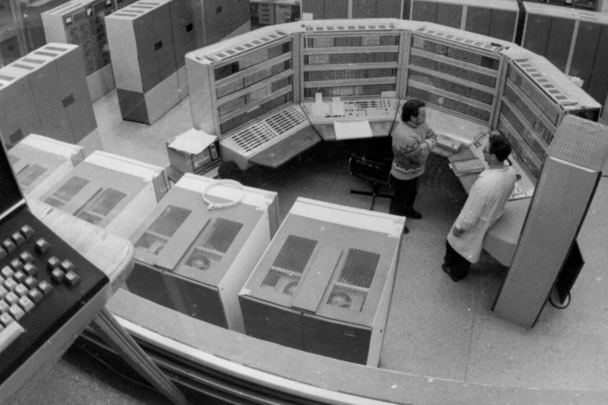

*БЭСМ-6 в машинном зале. [Источник фотографии](https://besm-6.ru/besm6.html).*

**Теги:** БЭСМ-6, эмуляция, ретрокомпьютинг, бенчмарки, ЭВМ, суперкомпьютеры.

**Содержание**

- [Зачем измерять БЭСМ-6 сегодня](#why)
- [История и устройство машины](#history)
- [Архитектура и периферия](#architecture)
- [Программное обеспечение](#software)
- [Симуляторы и первый запуск](#simulators)
- [Бенчмарки и методика измерений](#benchmarks)
- [Результаты и их интерпретация](#results)
- [Выводы](#conclusions)
- [Источники](#sources)
- [Приложение: полный листинг запуска](#listing)

<a id="why"></a>

## Зачем измерять БЭСМ-6 сегодня

Простой ответ — потому что можем. 
Сегодня программу для БЭСМ-6 можно написать в обычном текстовом файле и запустить в эмуляторе под Linux или Windows. Она напечатает знакомый `Hello, World!` или выполнит научный расчёт, всё это благодаря работе энтузиастов.

Действующая физическая машина для этого исследования недоступна, поэтому все практические результаты были получены в **Besm6.Net** — собственном эмуляторе на C# (.Net 8, на базе SIMH, Dubna Besm6 Emulator и документации), который я написал из любопытства (ну и желания попробовать агентную разработку с помощью ИИ). По ходу работы возникли два вопроса: насколько быстро современный компьютер исполняет программы БЭСМ-6 и сколько времени эти программы могли бы занять на исходной машине. Для эксперимента я выбрал мною любимые Dhrystone, Whetstone, Memspeed и MP-MFLOPS (оригиналы есть на языка C и Fortran): они нагружают разные части вычислительной системы и дают материал для сравнения.

В бенчмарках особенно заметна разница между правильным выполнением программы и точным воспроизведением её времени. Эмулятор может верно измерить скорость арифметики, но ошибиться в оценке в несколько раз, если его встроенная модель профилировки недостаточно учитывает работу конвейера и памяти. Даже совпадение одного сводного рейтинга с опубликованным результатом не гарантирует совпадения времён отдельных секций.

<a id="history"></a>

## История: от МЭСМ к БЭСМ-6

История начинается с МЭСМ, введённой в эксплуатацию в 1951 году. За ней последовала первая БЭСМ: её изготовление завершили в 1952 году, приёмка состоялась в 1953-м. БЭСМ-2 стала серийным развитием первой машины; её выпуск начался примерно в 1958 году. Это была ещё ламповая техника. БЭСМ-4 представляла другую ветвь: её система команд продолжала линию М-20, а элементная база уже стала полупроводниковой.

> Общее название серии не означает совместимости её машин: за номерами БЭСМ стояли разные архитектурные решения.

Подробнее об этой линии развития — в [истории серии](https://www.besm-6.ru/besm-series.html) и музейных описаниях [БЭСМ-2](https://computer-museum.ru/histussr/29-1.htm) и [БЭСМ-4](https://www.computer-museum.ru/histussr/29-2.htm).

В начале 1960-х разрабатывалась архитектура новой машины для крупных научных расчётов — БЭСМ-6. Она прошла государственную приёмку в 1967 году. Главным конструктором был Сергей Алексеевич Лебедев, а ключевую роль в разработке играли Владимир Алексеевич Мельников и Леонид Николаевич Королёв. Серийное производство продолжалось с 1968 по 1987 год, всего изготовили 355 машин. [Описание БЭСМ-6](https://besm-6.ru/besm6.html).

Переход к транзисторам позволял увеличить производительность, уменьшить габариты и энергопотребление. В описании БЭСМ-6 указаны около 60 тысяч транзисторов и 180 тысяч диодов. Логика строилась на дискретных элементах, поэтому скорость зависела и от конструкции: длины соединений, размещения блоков и монтажа. Процессор занимал стойки с ячейками и платами — типовыми элементами замены, или ТЭЗами. Их устройство подробно показано в [блоге 1500py470](https://1500py470.livejournal.com/314207.html).

Пульты позволяли наблюдать состояние машины и управлять её работой. Подробнее — в [музейном описании](https://www.computer-museum.ru/histussr/28-1.htm) и [технической документации на пульты](https://www.besm6.org/doc/%D0%91%D0%AD%D0%A1%D0%9C6-%D0%A2%D0%9E-IX-%D0%BF%D1%80%D0%B8%D0%BB%D0%BE%D0%B6%D0%B5%D0%BD%D0%B8%D1%8F.pdf).

### Машина с «водопроводом»

БЭСМ-6 совмещала работу устройства управления, арифметического устройства и памяти. Лебедев называл этот принцип «водопроводом». Сейчас мы сказали бы «конвейер»: пока одна операция вычисляет результат, для следующей уже можно готовить адрес или выбирать команду. Буферы между узлами сглаживали различия в скорости их работы. [Описание архитектуры](https://besm-6.ru/besm6.html).

Но конвейер не отменяет зависимости. Если следующей команде нужен ещё не готовый результат, ей придётся ждать. Именно поэтому сумма задержек всех команд обычно не равна времени программы. Устройство управления может часть времени работать одновременно с арифметическим устройством, а конфликт обращений к памяти, наоборот, добавит ожидание.

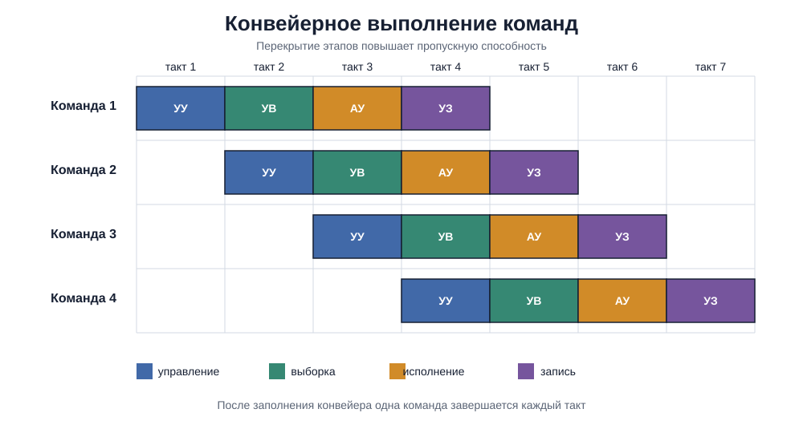

*Схема конвейерного выполнения. УУ — устройство управления, УВ — устройство выборки, АУ — арифметическое устройство, УЗ — устройство записи.*

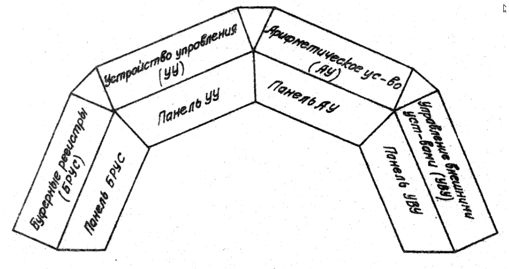

*Основные стойки машины, вид сверху.*

Оперативная память БЭСМ-6 была ферритовой: её кубы размещались в отдельных шкафах. Базовый объём — 32 768 слов по 48 бит, или 192 КиБ полезных данных. Физическое слово содержало ещё два контрольных разряда: всего 50 бит, из которых программисту доступны 48. В расширенных конфигурациях объём достигал 128 тысяч слов. Адресное пространство программы и установленная физическая память — разные величины: механизм «приписки», близкий к современной страничной виртуальной памяти, преобразовывал адреса страниц и обеспечивал защиту. [Учебник 1976 года, §§ 1–3][fortran-book].

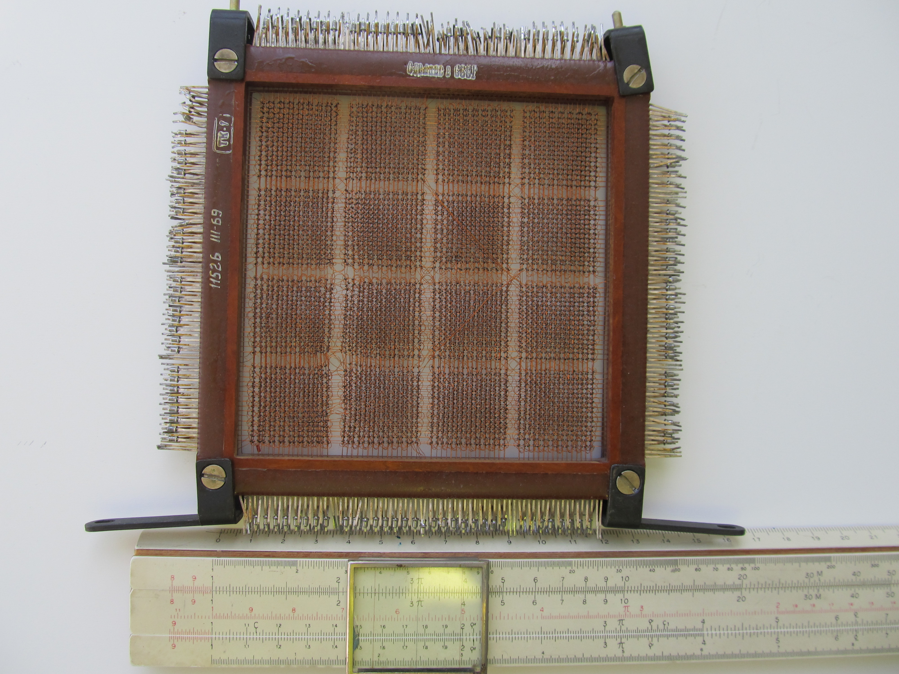

*Рамка с ферритовыми сердечниками из БЭСМ-6 предприятия VEB Kraftwerksanlagenbau Berlin. Фото: Hans Bln, [Wikimedia Commons](https://commons.wikimedia.org/wiki/File:BESM6_Ferritkernspeicher_1.JPG), [CC BY-SA 3.0](https://creativecommons.org/licenses/by-sa/3.0/). Изображение без изменений.*

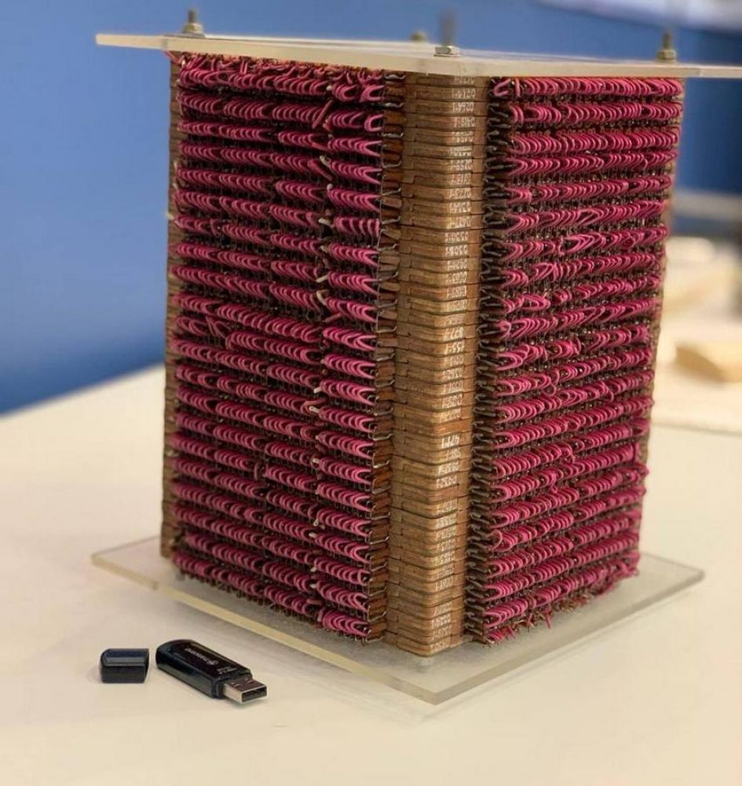

*Куб памяти БЭСМ-6 — сборка из ферритовых матриц. Экспонат Музея истории науки и техники ОИЯИ; рядом для масштаба лежит USB-накопитель. [Источник: Лаборатория ядерных проблем ОИЯИ](https://dlnp.jinr.ru/chronograph/life/1222).*

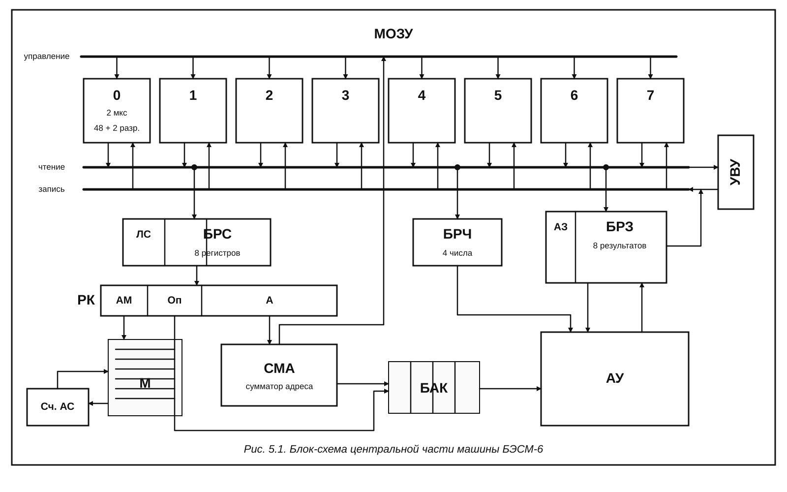

*Структурная схема процессора БЭСМ-6.*

Расслоение памяти позволяло обращаться к разным модулям с перекрытием во времени. Быстрые буферные регистры удерживали команды и данные, сокращая число обращений к ферритовой памяти. Для этого использовались четыре буферных регистра чтения чисел (БРЧ), четыре регистра командных слов (БРС) и восемь буферных регистров записи (БРЗ). Они работали автоматически, с ассоциативным поиском по адресу; программист не адресовал их как обычные регистры. По назначению эта сверхбыстрая буферная память близка к аппаратному кэшу. Подробнее — в [§ 3 учебника][fortran-book] и [описании буферов памяти](../../besm6-memory-buffers.md).

В описаниях машины встречается рабочая частота около 10 МГц. В таблице длительностей из учебника используется такт 110 нс, что соответствует примерно 9 МГц. Далее времена команд приведены именно в тактах этого источника. Частота синхронизации, длительность отдельной арифметической операции и среднее число завершённых команд в секунду — три разные характеристики. [§ 4 учебника][fortran-book].

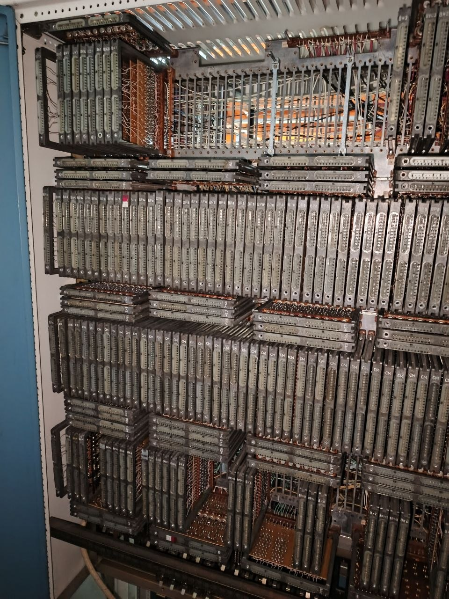

*Стойка с ТЭЗами.*

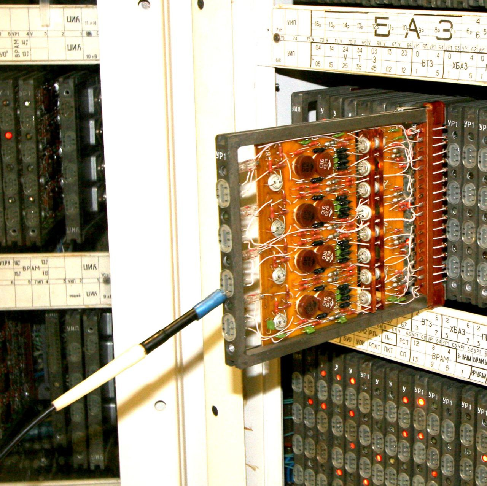

*Отладка типового элемента замены.*

Система прерываний связывала вычисления с внешними событиями. Защита памяти и привилегированный режим давали диспетчеру возможность управлять несколькими задачами. Пользовательская программа не должна была самостоятельно распоряжаться всеми устройствами: она обращалась за обслуживанием к системному ПО.

### Сравнение с аналогами

БЭСМ-6 часто сравнивают с машинами компании Control Data Corporation (CDC). С CDC 1604 её сближают, в частности, 48-разрядное машинное слово и 15-разрядная адресация. У CDC 6600 архитектура уже другая: 60-разрядное слово, десять функциональных блоков центрального процессора и десять периферийных процессоров. [Документация CDC 6400/6600, 1966](https://archive.computerhistory.org/resources/text/CDC/CDC.6400_6600.1966.102646143.pdf).

| **Параметр**                     | **БЭСМ-6**                  | **CDC 1604**                | **CDC 6600**                |
| -------------------------------- | --------------------------- | --------------------------- | --------------------------- |
| **Год начала серийного выпуска** | 1968                        | 1960                        | 1964                        |
| **Элементная база**              | Транзисторы                 | Транзисторы                 | Транзисторы                 |
| **Разрядность слова**            | 48 бит                      | 48 бит                      | 60 бит                      |
| **Разрядность адреса**           | 15 бит                      | 15 бит                      | 18 бит                      |
| **Объём ОЗУ**                    | 32 768 слов                 | 32 768 слов                 | До 131 072 слов             |
| **Потребляемая мощность**        | ~20–50 кВт                  | ~200–300 кВт                | До 300 кВт                  |
| **Занимаемая площадь**           | ~150–225 м²                 | ~150–200 м²                 | ~400 м²                     |
| **Ориентир быстродействия**      | 1 млн операций/с            | 200 тыс. операций/с         | 3 млн операций/с            |

*Объём памяти, мощность и площадь зависят от комплектации. Ориентиры быстродействия в этой таблице не получены на одной общей нагрузке.*

Роль программного обеспечения хорошо видна на примере NCAR: сначала CDC 6600 оценивали как в 1,5 раза более быструю по сравнению с CDC 3600, а к 1968 году, после изменения программной системы, — уже в три раза. Перенести это отношение на БЭСМ-6 нельзя: для неё в том же сравнении нет результатов на общей нагрузке. [Отчёт Lax, таблица NCAR](https://science.osti.gov/-/media/ascr/pdf/program-documents/archive/Lax_report.pdf).

<a id="architecture"></a>

## Архитектура БЭСМ-6

### Основная периферия машины

За два десятилетия комплектация машины менялась. В таблице собраны назначения устройств и параметры из конкретных описаний; состав оборудования отдельной БЭСМ-6 мог отличаться.

| Устройство                                                                                        | Назначение                                      | Что важно для программы                                                                           |
| ------------------------------------------------------------------------------------------------- | ----------------------------------------------- | ------------------------------------------------------------------------------------------------- |
| [Устройства чтения перфокарт семейства ВУ-700](https://www.computer-museum.ru/histussr/niism.htm) | Ввод исходного текста и данных                  | Обычно 80 колонок на карте; перестановка карт меняла задание                                      |
| [АЦПУ-128](https://www.computer-museum.ru/histussr/niism.htm)                                     | Печать листинга и результатов                   | 128 печатных позиций; скорость зависит от исполнения устройства                                   |
| Телетайп                                                                                          | Команды и сообщения оператору, работа с текстом | Медленный последовательный обмен; не измеритель скорости процессора                               |
| НМЛ, магнитная лента                                                                              | Библиотеки, программы, массивы данных           | Учебник описывает до 32 магнитофонов; обмен зонами по 1К слов                                     |
| НМБ, магнитный барабан                                                                            | Внешняя память с адресуемыми блоками            | Учебник указывает до 512К слов суммарной барабанной памяти; блок 1К или 256 слов                  |
| НМД, магнитный диск                                                                               | Внешняя память более поздних конфигураций       | В описанной комплектации блок 1К слов соответствует двум дорожкам; скорость зависит от накопителя |

Устройства и объёмы внешней памяти перечислены в [§ 1 учебника][fortran-book]. Для АЦПУ-128-2 НИИсчётмаш указывает 128 печатных позиций в строке и скорость 380–440 строк/мин. В той же [исторической справке института](https://www.computer-museum.ru/histussr/niism.htm) описано устройство ввода ВУ-700-2.

#### Печать, внешняя память и ввод

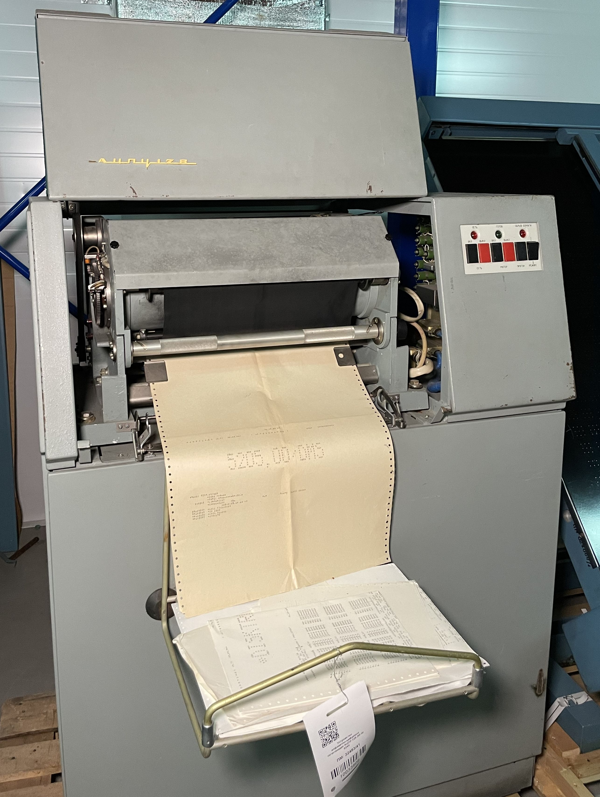

*АЦПУ-128-3 — один из вариантов печатающего устройства семейства АЦПУ-128. Фото: Radiolok, [Wikimedia Commons](https://commons.wikimedia.org/wiki/File:BESM-6_ACPY.jpg), [CC BY-SA 4.0](https://creativecommons.org/licenses/by-sa/4.0/). Изображение без изменений.*

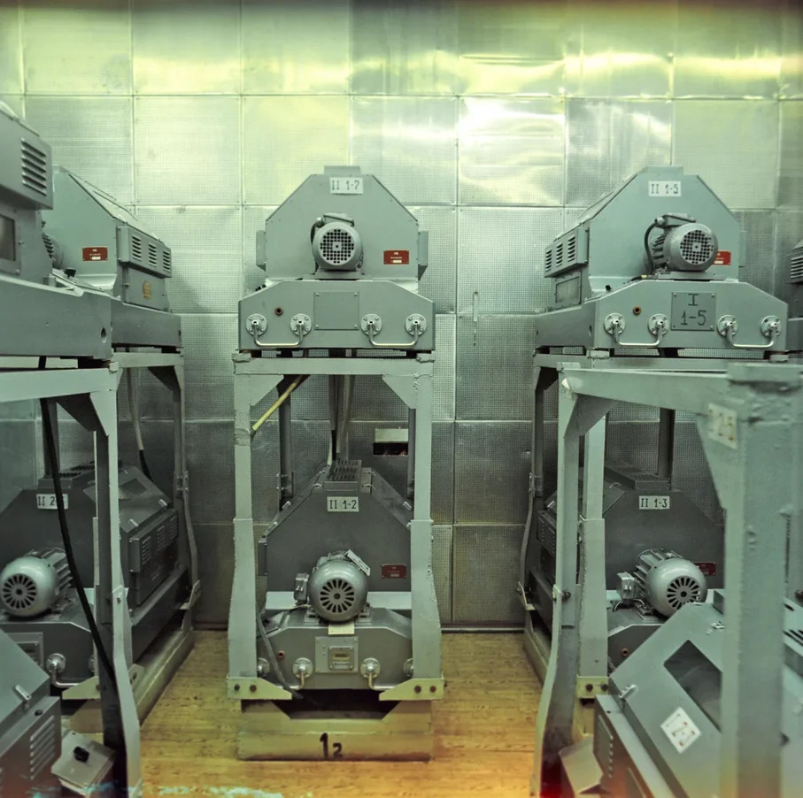

*Магнитные барабаны внешней памяти БЭСМ-6. [Источник: интервью Владимира Воробьёва, опубликованное DataArt](https://habr.com/ru/companies/dataart/articles/454968/).*

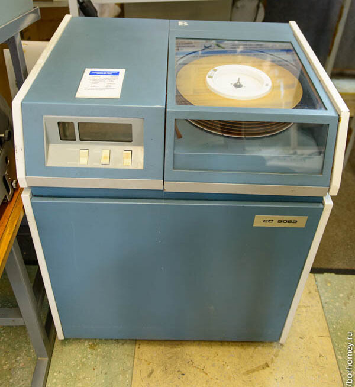

*ЕС-5052 — пример накопителя на сменных магнитных дисках того периода. Конкретная модель дискового устройства зависела от комплектации вычислительного центра. Фото из Саровского музея ядерного оружия: borhomet.ru; [источник — OldPC](https://oldpc.su/pc/es/5052/index.html).*

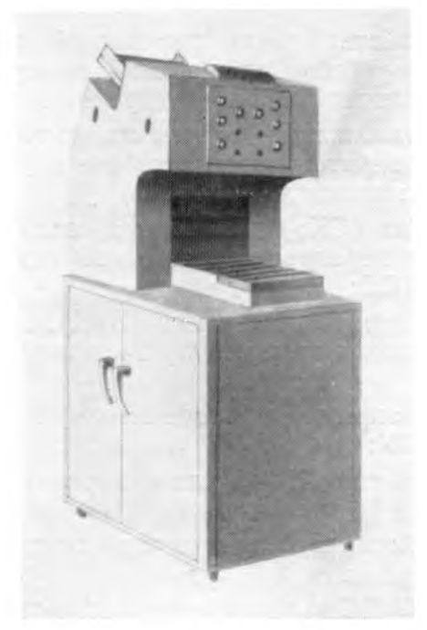

*ВУ-700-2 — устройство ввода с 80-колонных перфокарт. Иллюстрация из [каталога технических средств, 1975, с. 166](https://oldpc.su/lib/catalogs/techsred75.pdf#page=167); извлечён фрагмент страницы с фотографией.*

#### Как программа попадала в машину

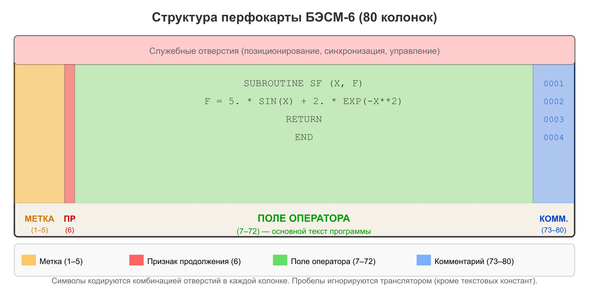

*Разметка перфокарты: строка программы превращается в набор отверстий.*

На одной перфокарте обычно размещалась одна строка программы на языке высокого уровня, запись на автокоде или порция данных. Поля карты имели разное назначение:

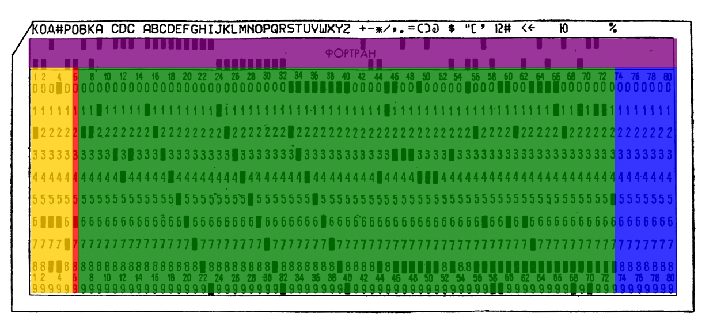

*Расположение полей исходного текста на перфокарте.*

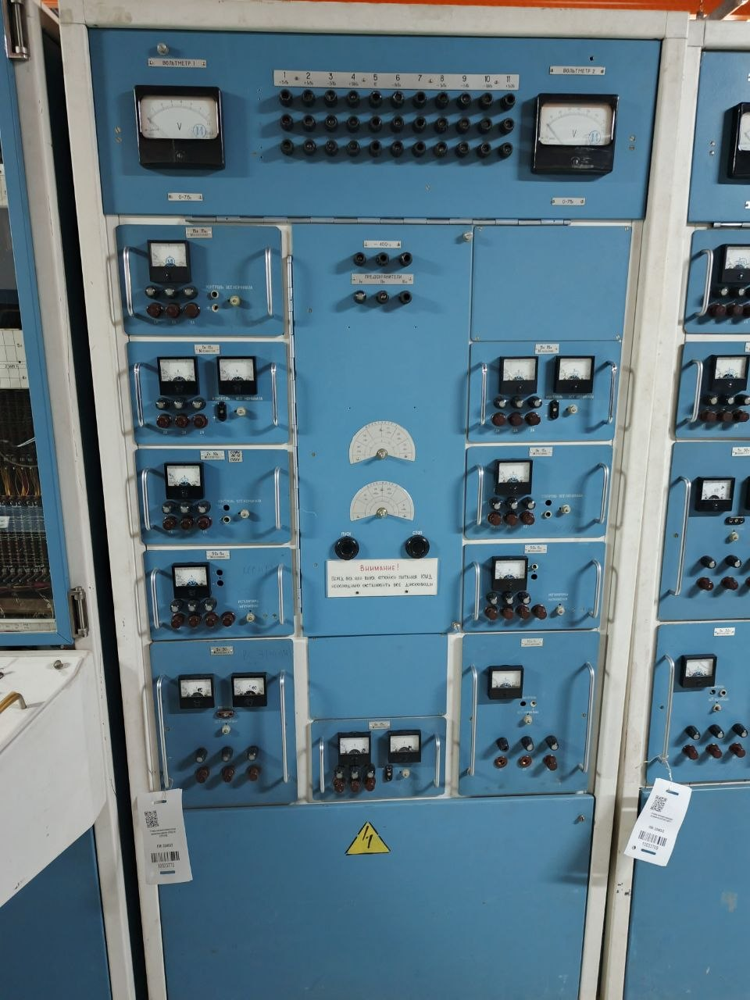

*Блок питания — ещё одна часть инфраструктуры машины, занимавшей целый зал.*

### Основные регистры

В выполнении программы участвуют сумматор, регистр младших разрядов, счётчик команд, регистры режима и изменения команд, а также индексные регистры. Их назначение описано в [§ 4 учебника][fortran-book].

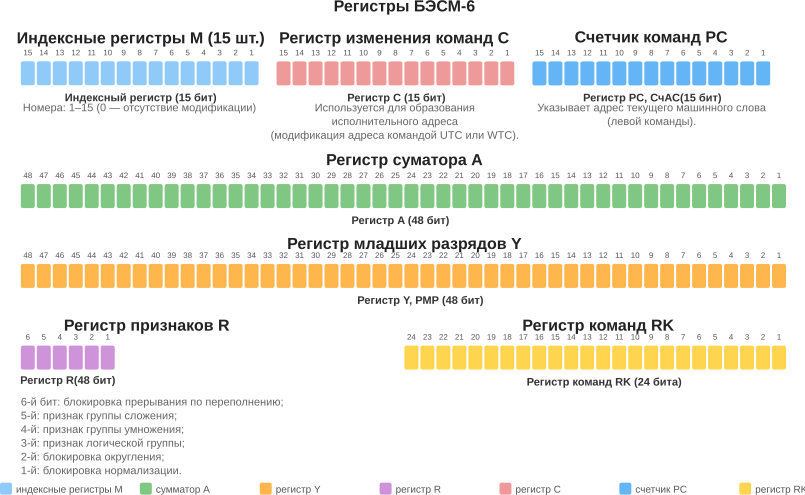

| Регистр                                | Размер | Назначение                                                              |
| -------------------------------------- | ------ | ----------------------------------------------------------------------- |
| **A**, сумматор                        | 48 бит | Основной регистр для арифметических и логических операций               |
| **Y**, регистр младших разрядов (РМР)  | 48 бит | Младшие разряды результата и данные для операций сдвига                 |
| **K**, счётчик команд (СчАК)           | 15 бит | Адрес слова с выполняемой командой; половина слова учитывается отдельно |
| **R**, регистр режима и блокировок     | 6 бит  | Режим арифметики и признаки группы операций                             |
| **C**, регистр изменения команд        | 15 бит | Модификация исполнительного адреса после `UTC` или `WTC`                |

**Регистр R** содержит шесть признаков. Здесь разряды пронумерованы справа налево, начиная с единицы, как в учебнике:

| Разряд | Назначение                            |
| ------ | ------------------------------------- |
| 1      | Блокировка нормализации               |
| 2      | Блокировка округления                 |
| 3      | Признак логической группы             |
| 4      | Признак группы умножения              |
| 5      | Признак группы сложения               |
| 6      | Блокировка прерывания по переполнению |

**Индексные регистры.** В командах БЭСМ-6 предусмотрены 16 номеров индексных регистров — M₀–M₁₅. Каждый имеет разрядность 15 бит; нулевой номер соответствует нулевому значению. Содержимое индексного регистра можно передать в 15 младших разрядов сумматора и обратно. Индексные регистры используются для:

- модификации адреса — содержимое регистра добавляется к адресной части команды;
- организации циклов — регистр хранит счётчик;
- временного хранения адресов и служебной информации.

Роли конкретных индексных регистров:

- M₀ всегда даёт нулевое значение;
- M₁–M₁₄ используются для обычной индексации;
- M₁₅ (М017 в восьмеричной записи) служит указателем стека, или «магазина». Для соответствующих команд его использование включает магазинную адресацию с автоматическим увеличением или уменьшением указателя.

В документации индексные регистры часто нумеруются в восьмеричном виде от М000 до М017.

### 48-разрядное машинное слово

48-разрядное машинное слово — естественная единица хранения и адресации в БЭСМ-6. В нём помещаются две команды по 24 бита или одно число.


В книжной документации разряды нумеруются справа налево, начиная с единицы. В коде симулятора часто используется нумерация с нуля — эти обозначения нужно различать. Для записи машинных кодов и адресов обычно применяют восьмеричную систему: одной цифре соответствуют три двоичных разряда. Суффикс `В` или `B` в исторических примерах обозначает восьмеричное число.

При размещении двух команд слово делится на левую и правую половины:


| Часть машинного слова | Разряды |
| --------------------- | ------- |
| Левая команда         | 48–25   |
| Правая команда        | 24–1    |

**Числа с плавающей запятой.** Если слово содержит число, его разряды распределяются следующим образом:

| Поле числа    | Разряды |
| ------------- | ------- |
| Знак порядка  | 48      |
| Порядок       | 47–42   |
| Знак мантиссы | 41      |
| Мантисса      | 40–1    |


Положительная мантисса записывается в прямом коде, отрицательная — в дополнительном. Порядок хранится со смещением 64: семи старшим разрядам соответствует значение $64+P$, где $P$ лежит в диапазоне от $-64$ до $+63$. В восьмеричной записи смещение 64 обозначается как `100B`.

Значение числа равно $M\cdot 2^P$. Положительная нормализованная мантисса лежит в диапазоне от $0{,}5$ до $1-2^{-40}$; модуль отрицательной нормализованной мантиссы больше $0{,}5$. Для нормализованных чисел диапазон составляет примерно от $10^{-19}$ до $10^{19}$ по модулю. Нижняя граница — $2^{-65}$, верхняя для положительных чисел — $2^{63}(1-2^{-40})$. Для ненормализованных значений нижняя граница снижается до $2^{-104}$; меньшие по модулю значения обращаются в машинный нуль. [Представление чисел в учебнике][fortran-book].

> Мантисса содержит знак и 40 дробных разрядов — примерно 12 десятичных значащих цифр. `REAL` БЭСМ-6 отличается от современных форматов IEEE 754 `float` и `double`. При переносе бенчмарка нужно учитывать эту разницу и правила округления.

**Целые числа и текст.** Логическое слово может хранить маску, текстовые символы или целочисленное значение. Представление `INTEGER` зависит от языка и транслятора. В описанном варианте Фортрана целые числа хранятся в ненормализованном виде с порядком 40: запятая оказывается после младшего разряда мантиссы. Полного отдельного набора целочисленных арифметических операций у машины нет. Вообще, целочисленные операции были исключены намеренно, т.к. БЭСМ-6 создавалась исключительно как суперкомпьютер для автоматизации сложных научно-технических расчетов. В этих вычислениях абсолютное большинство данных требовало вещественных чисел (с плавающей запятой повышенной точности). 

Понятия "байт" размером 8 бит тоже не предусмотрено. Для текста в одно слово обычно упаковывают до шести символов, а конкретная упаковка зависит от кодировки.

### Система команд

В 48 разрядное слово записываются 2 команды размерностью 24 бита.

24-разрядная команда БЭСМ-6 имеет один из двух форматов. Числа в описании полей обозначают их длину в битах:

| Формат         | Поля от старших разрядов к младшим                             | Зачем нужен                                                |
| -------------- | -------------------------------------------------------------- | ---------------------------------------------------------- |
| Короткий адрес | индекс 4; признак 0; расширение адреса 1; операция 6; адрес 12 | Больше кодов операций, ограниченный непосредственный адрес |
| Длинный адрес  | индекс 4; признак 1; операция 4; адрес 15                      | Полный адрес, в частности для переходов и индексных команд |


*Команда с коротким адресом.*


*Команда с длинным адресом.*

Ниже приведены основные команды и их характеристики из [приложения 1 к учебнику][fortran-book]. Рядом с латинскими мнемокодами МАДЛЕНа указаны русские обозначения команд БЭСМ-6 и мнемокоды БЕМШа — по [сводной таблице команд](https://www.besm6.org/wiki/CmdSheet.html). Эти обозначения относятся к разным системам записи, поэтому смешивать их в исходном тексте программы нельзя. Экстракоды рассмотрим отдельно.

> КОП — восьмеричный код операции; A — сумматор; Y — регистр младших разрядов. «Не изм.» — не изменяется, «изм.» — изменяется, «не опр.» — не определено. Время дано отдельно для устройства управления (УУ) и арифметического устройства (АУ), в тактах по 110 нс. Эти интервалы нельзя просто складывать для оценки всей программы: работа устройств перекрывается во времени. Обозначение $\omega$ в строках условных переходов — условие, определяемое группой операций и содержимым сумматора; это не отдельный разряд регистра R.

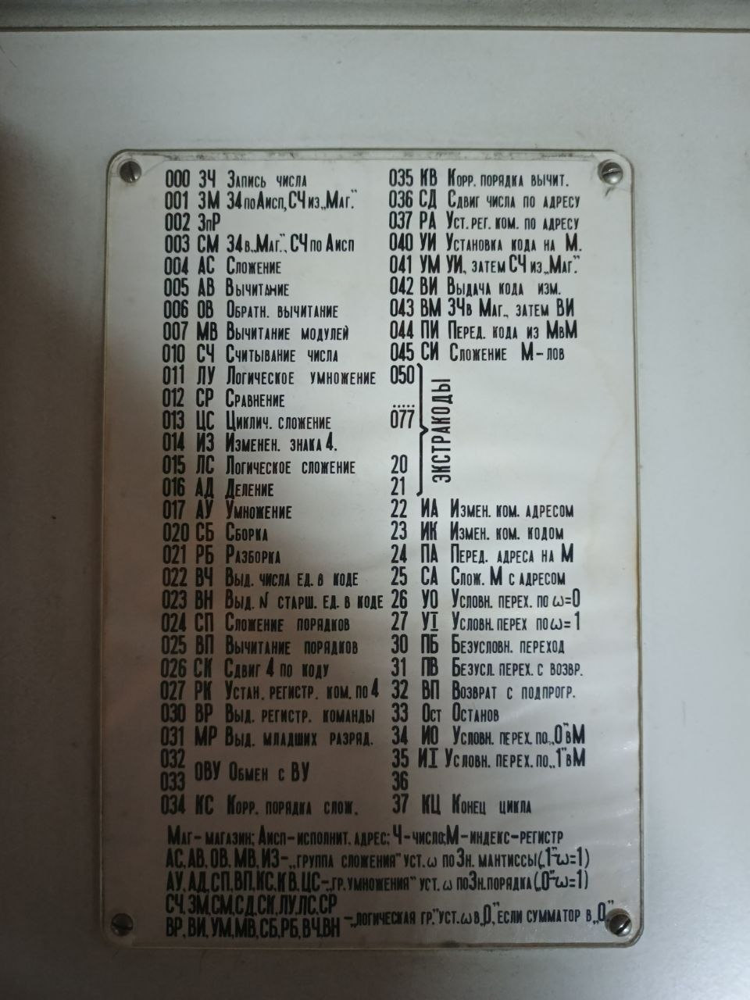

*Список кодов операций на самой машине.*

<details>
<summary>Таблицы команд: регистры, группы операций и время выполнения</summary>

#### Команды с коротким адресом

| КОП | МАДЛЕН (лат.) | БЭСМ-6 (рус.) | БЕМШ (рус.) | A       | Y       | Группа   | В УУ | В АУ: min | В АУ: средн. | В АУ: max | Содержание операции                                          |
| --- | ------------- | ------------- | ----------- | ------- | ------- | -------- | ---- | --------- | ------------ | --------- | ------------------------------------------------------------ |
| 000 | `ATX`         | `ЗЧ (ЗП)`     | `ЗП`        | не изм. | не изм. | не изм.  | 3    | 3         | 3            | 3         | Запись слова в память                                        |
| 001 | `STX`         | `ЗМ`          | `ЗПМ`       | изм.    | не изм. | логич.   | 6    | 5         | 6            | 6         | Запись и магазинное считывание                               |
| 003 | `XTS`         | `СМ`          | `СЧМ`       | изм.    | не изм. | логич.   | 6    | 5         | 6            | 6         | Магазинная запись и считывание                               |
| 004 | `A+X`         | `АС`          | `СЛ`        | изм.    | изм.    | слож.    | 3    | 5         | 11           | 280       | Сложение                                                     |
| 005 | `A-X`         | `АВ`          | `ВЧ`        | изм.    | изм.    | слож.    | 3    | 5         | 11           | 280       | Вычитание                                                    |
| 006 | `X-A`         | `ОВ`          | `ВЧОБ`      | изм.    | изм.    | слож.    | 3    | 5         | 11           | 280       | Обратное вычитание                                           |
| 007 | `AMX`         | `МВ`          | `ВЧАБ`      | изм.    | изм.    | слож.    | 3    | 5         | 11           | 280       | Вычитание модулей                                            |
| 010 | `XTA`         | `СЧ`          | `СЧ`        | изм.    | не изм. | логич.   | 3    | 2         | 2,5          | 3         | Считывание слова из памяти                                   |
| 011 | `AAX`         | `ЛУ`          | `И`         | изм.    | нуль    | логич.   | 3    | 4         | 4            | 4         | Логическое умножение                                         |
| 012 | `AEX`         | `СР (ЛВ)`     | `НТЖ`       | изм.    | изм.    | логич.   | 3    | 2         | 2,5          | 3         | Поразрядное сравнение                                        |
| 013 | `ARX`         | `ЦС`          | `СЛЦ`       | изм.    | нуль    | умнож.   | 3    | 3         | 6            | 27        | Циклическое сложение                                         |
| 014 | `AVX`         | `ИЗ`          | `ЗНАК`      | изм.    | нуль    | слож.    | 3    | 4         | 5            | 25        | Изменение знака числа                                        |
| 015 | `AOX`         | `ЛС`          | `ИЛИ`       | изм.    | нуль    | логич.   | 3    | 4         | 4            | 4         | Логическое сложение                                          |
| 016 | `A/X`         | `АД`          | `ДЕЛ`       | изм.    | не опр. | умнож.   | 3    | 47        | 50           | 174       | Деление                                                      |
| 017 | `A*X`         | `АУ`          | `УМН`       | изм.    | изм.    | умнож.   | 3    | 15        | 18           | 162       | Умножение                                                    |
| 020 | `APX`         | `СБ`          | `СБР`       | изм.    | нуль    | логич.   | 3    | 53        | 53           | 53        | Сборка                                                       |
| 021 | `AUX`         | `РБ`          | `РЗБ`       | изм.    | нуль    | логич.   | 3    | 53        | 53           | 53        | Разборка                                                     |
| 022 | `ACX`         | `ВЧ`          | `ЧЕД`       | изм.    | нуль    | логич.   | 3    | 54        | 56           | 78        | Подсчёт числа единиц                                         |
| 023 | `ANX`         | `ВН`          | `НЕД`       | изм.    | изм.    | логич.   | 3    | 7         | 32           | 78        | Определение номера старшей единицы                           |
| 024 | `E+X`         | `СП`          | `СЛП`       | изм.    | нуль    | умнож.   | 3    | 3         | 5            | 133       | Сложение порядков                                            |
| 025 | `E-X`         | `ВП`          | `ВЧП`       | изм.    | нуль    | умнож.   | 3    | 3         | 5            | 133       | Вычитание порядков                                           |
| 026 | `ASX`         | `СК`          | `СД`        | изм.    | изм.    | логич.   | 3    | 4         | нет          | 68        | Сдвиг по коду порядка                                        |
| 027 | `XTR`         | `РК`          | `РЖ`        | не изм. | не изм. | регистр. | 3    | 2         | 2,5          | 3         | Установка режима                                             |
| 030 | `RTE`         | `ВР`          | `СЧРЖ`      | изм.    | не изм. | не изм.  | 3    | 2         | 3            | 3         | Выдача содержимого регистра признаков                        |
| 031 | `YTA`         | `МР`          | `СЧМР`      | изм.    | не изм. | не изм.  | 3    | 3         | 5            | 133       | Выдача младших разрядов                                      |
| 034 | `E+N`         | `КС`          | `СЛПА`      | изм.    | нуль    | умнож.   | 3    | 3         | 5            | 133       | Сложение порядка с адресом                                   |
| 035 | `E-N`         | `КВ`          | `ВЧПА`      | изм.    | нуль    | умнож.   | 3    | 3         | 5            | 133       | Вычитание из порядка адреса                                  |
| 036 | `ASN`         | `СД`          | `СДА`       | изм.    | изм.    | логич.   | 3    | 4         | нет          | 68        | Сдвиг по адресу                                              |
| 037 | `NTR`         | `РА`          | `РЖА`       | не изм. | не изм. | регистр. | 3    | 2         | 2,5          | 3         | Установка режима по адресу                                   |
| 040 | `ATI`         | `УИ`          | `УИ`        | не изм. | не изм. | не изм.  | 14   | 3         | 3            | 3         | Запись из сумматора в индекс-регистр                         |
| 041 | `STI`         | `УМ`          | `УИМ`       | изм.    | не изм. | логич.   | 14   | 3         | 3            | 3         | Запись из сумматора в индекс-регистр и магазинное считывание |
| 042 | `ITA`         | `ВИ`          | `СЧИ`       | изм.    | не изм. | логич.   | 6    | 3         | 3            | 3         | Считывание индекс-регистра на сумматор                       |
| 043 | `ITS`         | `ВМ`          | `СЧИМ`      | изм.    | не изм. | логич.   | 9    | 5         | 6            | 6         | Магазинная запись и считывание индекс-регистра на сумматор   |
| 044 | `MTJ`         | `ПИ`          | `УИИ`       | не изм. | не изм. | не изм.  | 6    | —         | —            | —         | Передача кода из индекс-регистра в индекс-регистр            |
| 045 | `J+M`         | `СИ`          | `СЛИ`       | не изм. | не изм. | не изм.  | 6    | —         | —            | —         | Сложение кода в индекс-регистрах                             |

#### Команды с длинным адресом

| КОП | МАДЛЕН (лат.) | БЭСМ-6 (рус.) | БЕМШ (рус.) | A       | Y       | Группа  | В УУ   | В АУ: min | В АУ: средн. | В АУ: max | Содержание операции                                                  |
| --- | ------------- | ------------- | ----------- | ------- | ------- | ------- | ------ | --------- | ------------ | --------- | -------------------------------------------------------------------- |
| 22  | `UTC`         | `ИА`          | `МОДА`      | не изм. | не изм. | не изм. | 4      | —         | —            | —         | Запись адреса в регистр изменения команд                             |
| 23  | `WTC`         | `ИК`          | `МОД`       | не изм. | не изм. | не изм. | 13     | 3         | 3            | 3         | Запись 15 младших разрядов слова в регистр изменения команд          |
| 24  | `VTM`         | `ПА`          | `УИА`       | не изм. | не изм. | не изм. | 4      | —         | —            | —         | Передача адреса в индекс-регистр                                     |
| 25  | `UTM`         | `СА`          | `СЛИА`      | не изм. | не изм. | не изм. | 4      | —         | —            | —         | Сложение индекс-регистра с адресом                                   |
| 26  | `UZA`         | `У0`          | `ПО`        | не изм. | нуль    | не изм. | 15; 12 | 3         | 3            | 3         | Условный переход при $\omega=0$                                      |
| 27  | `U1A`         | `У1`          | `ПЕ`        | не изм. | нуль    | не изм. | 15; 12 | 3         | 3            | 3         | Условный переход при $\omega=1$                                      |
| 30  | `UJ`          | `ПБ`          | `ПБ`        | не изм. | не изм. | не изм. | 7      | —         | —            | —         | Безусловный переход                                                  |
| 31  | `VJM`         | `ПВ`          | `ПВ`        | не изм. | не изм. | не изм. | 7      | —         | —            | —         | Безусловный переход с запоминанием адреса возврата в индекс-регистре |
| 34  | `VZM`         | `И0`          | `ПИО`       | не изм. | не изм. | не изм. | 7; 4   | —         | —            | —         | Условный переход по нулевому коду в индекс-регистре                  |
| 35  | `V1M`         | `И1`          | `ПИНО`      | не изм. | не изм. | не изм. | 7; 4   | —         | —            | —         | Условный переход по ненулевому коду в индекс-регистре                |
| 37  | `VLM`         | `КЦ`          | `ЦИКЛ`      | не изм. | не изм. | не изм. | 7; 4   | —         | —            | —         | Конец цикла                                                          |
| 32  | `IJ`          | `Э32`         | `ВЫПР`      | не изм. | не изм. | не изм. | 7      | —         | —            | —         | Выход из прерывания (только в режиме диспетчера)                     |

</details>

### Арифметика и адресация

Арифметика строится вокруг сумматора `A`. Одноадресная команда получает второй операнд из памяти, а первый уже должен находиться в сумматоре. Регистр младших разрядов `Y` дополняет арифметический тракт при операциях с расширенным результатом и сдвигах. Индексные регистры участвуют в вычислении адресов и организации циклов. Счётчик команд `K` вместе с признаком левой или правой половины слова определяет место исполнения. [Регистры и команды][fortran-book].

При выполнении арифметических операций машинное слово рассматривается как число с плавающей запятой. Целочисленные значения также обрабатываются с учётом принятого способа представления.

Арифметические операции могут выполняться в одном из четырёх режимов:

- с нормализацией и с блокировкой округления;
- с нормализацией и с округлением;
- с блокировкой нормализации и с округлением;
- с блокировкой нормализации и с блокировкой округления.

После выполнения операций `A+X`, `A-X`, `X-A`, `AMX`, `A*X` мантисса результата состоит из 80 разрядов, причём младшие 40 разрядов располагаются в регистре `Y`. Их можно передать в сумматор командой `YTA`. [Особенности арифметических операций][fortran-book].

### Экстракоды

Через [экстракоды][fortran-book] пользовательская задача обращается к диспетчеру: запрашивает обмен с внешними устройствами, вычисление элементарной функции или другую системную услугу. Ближайшая современная аналогия — системный вызов, например `syscall`, или программное прерывание вроде `int 21h` в DOS.

Экстракод передаёт управление системной программе. Прикладной программист задаёт запрос и параметры, а подробности обслуживания остаются у системы. Набор услуг и соглашения об аргументах зависят от программного окружения.

В системе «Дубна», например, `*50` вычисляет `sqrt`, `*51` — `sin`, `*52` — `cos`, `*53` — `arctan`, а `*64` используется для печати. Для оценки производительности это существенная деталь: один экстракод может скрывать работу целой подпрограммы.

<a id="software"></a>

## Программное обеспечение БЭСМ-6

### Операционные системы БЭСМ-6

Программу исполняла целая система: диспетчер распределял ресурсы и обслуживал устройства, транслятор переводил исходный текст в машинные команды, библиотеки предоставляли готовые подпрограммы. Выбор этого окружения влиял и на удобство работы, и на быстродействие.

**«Диспетчер-68» (Д-68).** Первую ОС для БЭСМ-6 разработали в ИТМиВТ под руководством Л. Н. Королёва. [История программного обеспечения машины](https://besm-6.ru/besm6.html).

Возможности системы:

- мультипрограммная работа — обслуживание нескольких задач;
- управление внешней памятью и устройствами ввода-вывода;
- совмещение вычислений с работой периферии;
- динамическое распределение оперативной и внешней памяти;
- многотерминальная работа в диалоговом режиме.

Средства работы в реальном времени и построения многомашинных комплексов развивались уже в последующих системах.

**ДИСПАК.** Одна из наиболее известных систем БЭСМ-6, созданная под руководством В. Ф. Тюрина. История её развития описана в материалах [об операционной системе ДИСПАК](https://www.iis.nsk.su/files/page/balakirev_n.e._bartenev_yu.g._zeldinova_s.a.pdf).

Возможности системы:

- пакетная и диалогово-пакетная обработка заданий;
- автоматизация запуска пользовательских задач и многозадачность;
- буферизация ввода-вывода;
- работа в составе многомашинных вычислительных комплексов (МВК): с 1972 года — общая внешняя память на магнитных дисках и автоматическое перераспределение задач между машинами.

Развитием этого направления стала диалогово-пакетная система ДИАПАК. Работа подобных комплексов требовала настройки под конкретную аппаратную конфигурацию и набор задач.

**Мониторная система «Дубна».** Для наших экспериментов особенно важна система, использовавшаяся в ОИЯИ. Она обеспечивала обработку пакетов заданий, вызов трансляторов, подключение библиотек и запуск программ. Её устройство описано в [§ 7 учебника][fortran-book]. Именно с её заданиями в формате `.dub` мы будем работать ниже.

### Процесс разработки ПО

1. **Алгоритм.** Программист разбивал задачу на шаги, строил блок-схему, определял входные данные и промежуточные результаты.
2. **Исходный текст.** Программу записывали в тетради или на бланках. В зависимости от задачи и доступного ПО выбирали машинные коды, автокод или язык высокого уровня.
3. **Ввод и трансляция.** Текст переносили на перфокарты либо перфоленту с помощью специального оборудования. Транслятор проверял синтаксис и выдавал листинг с диагностикой.
4. **Отладка.** Программу запускали на тестовых данных. Для поиска ошибок печатали промежуточные значения на АЦПУ, использовали трассировку и контрольные точки — в пределах возможностей выбранной системы.
5. **Работа с ОС и аппаратурой.** Нехватка памяти, ошибки обмена и аппаратные сбои могли потребовать совместной работы программиста и инженера.
6. **Проверка результата.** Выходные данные сопоставляли с теоретическими расчётами и проверяли на граничных случаях. При расхождениях исправляли алгоритм или код и повторяли запуск.

### Языки программирования

На низком уровне использовались автокоды — языки ассемблера с мнемоническими обозначениями команд. Пример такого языка описан в [инструкции «Автокод БЭСМ-6» 1969 года](https://www.computer-museum.ru/books/besm6_instruction.pdf). Среди известных автокодов машины — [МАДЛЕН][fortran-book] и [БЕМШ](../../dubna-languages.md). В системе «Дубна» МАДЛЕН служил и самостоятельным языком, и промежуточным представлением при трансляции подпрограмм с Фортрана.

Пример программы на МАДЛЕНе:

```asm
*name мадлен
*madlen
 program: ,name,
          ,*64 , inf64
          ,*74 ,
 inf64:   ,    , text
          ,    , text
          ,001 ,
         8,    ,
 text:    ,gost, 18h Hello, World!'214'
          ,gost, 6h'231'
          ,end ,
*execute
*end file
```

Пример программы на БЕМШе:

```asm
*name бемш
*bemsh
ввд$$$
prog    старт   512
        э64     инф64
        пб      (13)
инф64   мода    текст
        мода    текст
        конк    к'000010000'
        конк    к'100000000'
текст   текст   п'Приветик! Это автокод БЕМШ.'
        конд    м40b'231'
        финиш
квч$$$
трн$$$
0-0
блмак
бтмалф
кнц$$$
*main prog
*execute
*end file
```

Для научных задач часто выбирали Фортран; широко применялся и Алгол-60. На БЭСМ-6 также использовались Паскаль, ЛИСП и РЕФАЛ. Для Фортрана существовало несколько трансляторов и вариантов языка, в том числе Фортран-Дубна, Фортран-ГДР и ФОРЕКС.

Простая программа на Фортране:

```fortran
*name фортран
*fortran
        program hello
        print 1000
        stop
 1000   format('Hello, World!')
        end
*execute
*end file
```

<a id="simulators"></a>

## Симуляторы БЭСМ-6

Запускать программы БЭСМ-6 на современных компьютерах позволяют несколько проектов.

**SIMH.** В проекте Simulator of Historical Computers реализована поддержка БЭСМ-6. Симулятор позволяет запускать ДИСПАК и прикладные программы. Исполняемый файл называется `b6`; при запуске без параметров он переходит в диалоговый режим. [Руководство по SIMH для БЭСМ-6](https://www.besm6.org/wiki/SIMH-manual.html).

**Dubna BESM-6 Emulator.** Проект воссоздаёт окружение мониторной системы «Дубна», использовавшейся в ОИЯИ. Он обрабатывает исторические файлы заданий и воспроизводит характерный вывод: кириллические заголовки, листинги Фортрана, графику плоттера. [Репозиторий besm6/dubna](https://github.com/besm6/dubna).

**Besm6.Net.** Для исследования архитектуры и запуска прикладного кода я разработал симулятор на C# с помощью ИИ. При работе опирался на SIMH, Dubna BESM-6 Emulator и документацию машины. [Репозиторий EntityFX/besm6.net](https://github.com/EntityFX/besm6.net).

Архитектурно проект разбит на несколько слоёв:

- `Besm6.Architecture` описывает 48-разрядное слово, арифметику и контракты процессора.
- `Besm6.Processor` реализует логику процессора.
- `Besm6.Runtime` связывает процессор, память, загрузчик, экстракоды и устройства.
- `Besm6.Cli` предоставляет интерфейс командной строки: загружает задание `.dub`, запускает трансляцию и выполнение, выводит результат.

Симулятор работает с образами лент и выводит текст в терминал хоста. В описанных опытах механическое движение ленты и печать на АЦПУ не моделируются.

### Сборка Besm6.Net и первый запуск

Проект ориентирован на `net8.0`; для сборки нужен SDK .NET 8. Клонируем репозиторий, собираем CLI и запускаем пример. Команды ниже записаны для Bash:

```bash
git clone https://github.com/EntityFX/besm6.net
cd besm6.net

# Сборка
dotnet build src/Besm6.Cli -c Release
DLL=src/Besm6.Cli/bin/Release/net8.0/besm6.dll

# Запуск
dotnet "$DLL" run examples/fortran.dub --no-wall-clock
```

Для запуска используются пять образов лент с оригинальным ПО: `monsys.9`, `librar.12`, `librar.37`, `bemsh.739` и `b.7`. 
Они находятся в `tapes/` и копируются при сборке. 

Состав образов этих лент:

- `monsys.9` — образ системной магнитной ленты, содержащий саму мониторную систему (MONITOR SYSTEM). По умолчанию эмуляторы БЭСМ-6 подключают этот файл для загрузки базовой программной среды ОС «Дубна».
• `librar.12` и `librar.37` — файлы библиотек (LIBRARY). На БЭСМ-6 в таких файлах хранились стандартные математические подпрограммы, компиляторы (например, Фортран) и системные утилиты.
• `bemsh.739` — образ компилятора автокода БЕМШ.
• `b.7` — образ с компилятором языка B.

Путь можно задать явно в JSON вместе с параметрами временной модели:

```json
{
  "tapes": "/absolute/path/to/besm6.net/tapes",
  ...
}
```

Сохраните конфигурацию, например, в `article-config.json`, заменив путь к лентам своим. При запуске передайте `--config article-config.json`.

<a id="benchmarks"></a>

## Бенчмарки и методика измерений

Исходные задания находятся в каталоге [`examples`](../../../examples). Всего используются восемь заданий: по одному для Dhrystone и Whetstone, по три для Memspeed и MP-MFLOPS.

| Семейство                                                                                          | Задание                          | Нагрузка и показатель                                                             |
| -------------------------------------------------------------------------------------------------- | -------------------------------- | --------------------------------------------------------------------------------- |
| [Dhrystone 2.1](https://www.netlib.org/performance/papers/dhrystone/)                              | `dhrystone-forex.dub`            | 5000 проходов; процедуры, строки, целочисленные массивы; DMIPS                    |
| [Whetstone, вариант Роя Лонгботтома](https://roylongbottom.github.io/royRepository/#anchorClassic) | `whetstone-longbottom-forex.dub` | 8 × 100 условных проходов; восемь секций; MWIPS и отдельный MFLOPS                |
| [Memspeed](https://roylongbottom.github.io/royRepository/#anchorMemory)                            | `memspeed-forex.dub`, части 1–3  | 4096 элементов, 1000 проходов; copy, add, multiply-add; логические MB/s           |
| [MP-MFLOPS](https://roylongbottom.github.io/royRepository/#anchorThread)                           | `mpmflops-forex.dub`, части 1–3  | 9000 элементов, 30 проходов; 2, 8 и 32 арифметические операции на элемент; MFLOPS |

При переносе потребовались адаптации кода, чтобы старые компиляторы могли собрать код.

- В Dhrystone записи заменены параллельными массивами полей, а указатели — индексами двух узлов. Строки и вызовы процедур сохранены.
- Из Memspeed перенесены три ядра: копирование, сложение и умножение со сложением.
- В MP-MFLOPS используется 48-разрядный тип `REAL`. Название семейства сохранено, но здесь выполняется последовательный вариант вычислительных ядер.
- Whetstone взят в варианте Роя Лонгботтома 1996 года. Порт сохраняет восемь секций и их число операций, а длинные циклы разбивает на блоки для совместимости с ограничениями старого Фортрана.

### Настроки запуска эмулятора Besm6.Net

Во всех заданиях системная функция `CTIME` вызывается перед вычислительным ядром бенчмарка и сразу после него. Подготовка массивов, компиляция, проверка результата и печать находятся за пределами измеряемого интервала. В этих заданиях счётное время берётся из второго аргумента `CTIME`.

Источник времени зависит от режима симулятора:

| Режим Besm6.Net | Источник гостевого времени           | Темп выполнения                                                       |
| --------------- | ------------------------------------ | --------------------------------------------------------------------- |
| `original`      | Статистическая модель времени БЭСМ-6 | Симулятор при необходимости ожидает, чтобы выдержать модельный темп   |
| `virtual`       | Реальное прошедшее время на хосте    | Выполнение с доступной скоростью хоста                                |
| `max`           | Счётчик модельных тактов             | Выполнение с доступной скоростью хоста, без ожидания модельного темпа |

Параметр `--guest-clock` включает гостевой таймер. Часы хоста используются именно в режиме `virtual`; в других режимах таймер получает модельное время. Подробности реализации приведены в [описании временной модели](../../original-timing.md) и [режимов выполнения](../../execution-speed.md).

На результат `virtual` влияют процессор хоста, среда выполнения .NET, JIT-компиляция, ОС и другие процессы. В `original` гостевое время определяется моделью, даже если хост способен выполнить команды быстрее.

### Точная модель исполнения и её калибровка

В режиме `original` симулятор учитывает задержки устройства управления и арифметического устройства, зависимости между командами, обращения к банкам памяти, попадания в буферы и запись результатов. Исходные интервалы взяты из [учебника 1976 года][fortran-book] и [таблиц команд][fortran-book]. Часть задержек при этом остаются предполагаемыми.

Используются два эмпирических коэффициента: общий масштаб времени `0.670839` и дополнительный масштаб математических функций `1.769005`. Их подобрали по [опубликованному эксперименту Leo B. с Whetstone в 2017 году](https://retrocomputing.stackexchange.com/questions/3267/how-to-compute-performance-of-a-cpu-in-flops): по сумме времён секций и отдельно по сумме секций с математическими функциями. Этот эксперимент также выполнен на модели БЭСМ-6; это прямо указано в его выводе.

Калибровка согласует общий MWIPS с выбранной публикацией. Сам Whetstone после этого не может служить независимой проверкой точности. Остальные тесты показывают поведение модели за пределами калибровочной нагрузки, но для проверки исторического времени всё равно нужны результаты физической машины. Даже совпадение общего MWIPS не означает совпадения всех восьми секционных времён.

Задержки математических экстракодов задаются отдельно. Например, исходные оценки для квадратного корня и синуса составляют 40 и 50 мкс до применения коэффициентов. В [§ 6 учебника][fortran-book] для элементарных функций указан диапазон 55–90 мкс; отдельно оговорено округление вниз.

### Среда запуска эмулятора и проверка нескольких прогонов

Сборка выполнена в конфигурации Release. Хост — Linux x86-64 с Intel Xeon E5-2680 v3, паспортная частота 2,50 ГГц; версия среды выполнения .NET — 8.0.21. Для каждого из восьми заданий выполнено по три отдельных запуска в `original` и `virtual` — всего 48, последовательно, без конкурирующих бенчмарков. Каждый процесс заново загружает и транслирует программу.

Шаг гостевого таймера — 20 мс. Для коротких интервалов существенный разброс: при длительности 0,3 с один шаг составляет около 7%. Три повтора позволяют увидеть разброс, но не обеспечивают точности до шестого знака. В основной таблице приведены медианы, а минимум и максимум — в подробной. Полный прогрев и управление частотой процессора в методику не входили, поэтому эти результаты характеризуют запуск на доступном хосте.

Результат включался в таблицу только после завершения программы инструкцией `STOP` и прохождения численных проверок. Дополнительно внешний Python-скрипт пересчитывал рейтинги и контрольные значения: для Memspeed — первый и последний элементы и сумму, для MP-MFLOPS — последовательность арифметических выражений, для Whetstone — восемь эталонных значений с допуском. Анализировался вывод после компоновщика: строка `ALL VALUES MATCH`, напечатанная в листинге исходного текста, ещё не подтверждает успешного выполнения.

Каждый тест можно выполнить отдельно:

```bash
DLL=src/Besm6.Cli/bin/Release/net8.0/besm6.dll
dotnet "$DLL" run examples/dhrystone-forex.dub \
  --guest-clock --speed virtual --stats --no-wall-clock \
  --no-hang-detect --limit 2000000000
```

### Как считаются результаты

**Dhrystone.** Число проходов делится на время в секундах, затем на **1757** — принятую нормировку относительно VAX-11/780. DMIPS не равно числу миллионов гостевых машинных команд в секунду. Счётчик инструкций CLI включает работу транслятора и обслуживающих модулей, поэтому напрямую сопоставлять его с DMIPS нельзя. [Описание нормировки в архиве Netlib](https://www.netlib.org/performance/papers/dhrystone/).

**Whetstone.** Для выбранной нагрузки общий рейтинг вычисляется как `80 / сумма нормализованных секунд` и выражается в MWIPS. Отдельный показатель MFLOPS — геометрическое среднее рейтингов арифметических секций N1, N2 и N6. Остальные секции включают условные переходы, целочисленные операции, присваивания и математические функции; их MOPS нельзя складывать с MFLOPS.

**Memspeed.** Здесь измеряется логическая скорость обработки данных в памяти. Слово содержит шесть полезных байт: копирование читает и записывает слово, то есть учитывает 12 байт на элемент. Сложение и multiply-add учитывают два чтения и одну запись — 18 байт. При 4096 элементах и 1000 проходах получаются 49 152 000 и 73 728 000 байт. MB/s — десятичные мегабайты в секунду, по миллиону байт.

**MP-MFLOPS.** Число `9000 × 30 × операций_на_элемент` делится на время в секундах и миллион. Три подтеста выполняют 540 тысяч, 2,16 миллиона и 8,64 миллиона арифметических операций. Умножение и сложение считаются отдельно. С ростом числа операций на элемент уменьшается доля индексной арифметики и управления циклом, но длинная цепочка зависимых вычислений может ограничивать работу конвейера.

<a id="results"></a>

## Результаты

Таблица показывает медианы трёх запусков для каждой пары задания и режима. Время Whetstone — сумма нормализованных секционных времён; для остальных тестов указан интервал выполнения ядра. Во всех строках `original` используется одна и та же настроенная временная модель.

| Бенчмарк               | Время original, с | Рейтинг original | Время virtual, с | Рейтинг virtual | Единица |
| ---------------------- | ----------------: | ---------------: | ---------------: | --------------: | ------- |
| Dhrystone 2.1          | 4,360             | 0,653            | 0,340            | 8,370           | DMIPS   |
| Whetstone              | 98,850            | 0,809            | 4,974            | 16,084          | MWIPS   |
| Memspeed: copy         | 8,680             | 5,663            | 0,960            | 51,200          | MB/s    |
| Memspeed: add          | 16,740            | 4,404            | 1,220            | 60,433          | MB/s    |
| Memspeed: multiply-add | 17,640            | 4,180            | 1,480            | 49,816          | MB/s    |
| MP-MFLOPS: 2 операции  | 1,100             | 0,491            | 0,080            | 6,750           | MFLOPS  |
| MP-MFLOPS: 8 операций  | 3,340             | 0,647            | 0,240            | 9,000           | MFLOPS  |
| MP-MFLOPS: 32 операции | 13,540            | 0,638            | 0,820            | 10,537          | MFLOPS  |

<details>
<summary>Подробные рейтинги: медиана, минимум и максимум трёх прогонов</summary>

| Бенчмарк               | Режим    | Число прогонов | Медиана   | Минимум   | Максимум  | Единица |
| ---------------------- | -------- | -------------: | --------: | --------: | --------: | ------- |
| Dhrystone 2.1          | original | 3              | 0,652697  | 0,652697  | 0,652697  | DMIPS   |
| Dhrystone 2.1          | virtual  | 3              | 8,369882  | 8,369882  | 8,369882  | DMIPS   |
| Whetstone              | original | 3              | 0,809307  | 0,809307  | 0,809307  | MWIPS   |
| Whetstone              | virtual  | 3              | 16,083635 | 16,083635 | 16,474465 | MWIPS   |
| Memspeed: copy         | original | 3              | 5,662673  | 5,662673  | 5,662673  | MB/s    |
| Memspeed: copy         | virtual  | 3              | 51,200000 | 39,638710 | 54,613333 | MB/s    |
| Memspeed: add          | original | 3              | 4,404301  | 4,404301  | 4,404301  | MB/s    |
| Memspeed: add          | virtual  | 3              | 60,432787 | 49,816216 | 62,481356 | MB/s    |
| Memspeed: multiply-add | original | 3              | 4,179592  | 4,179592  | 4,179592  | MB/s    |
| Memspeed: multiply-add | virtual  | 3              | 49,816216 | 39,638710 | 51,200000 | MB/s    |
| MP-MFLOPS: 2 операции  | original | 3              | 0,490909  | 0,490909  | 0,490909  | MFLOPS  |
| MP-MFLOPS: 2 операции  | virtual  | 3              | 6,750000  | 5,400000  | 6,750000  | MFLOPS  |
| MP-MFLOPS: 8 операций  | original | 3              | 0,646707  | 0,646707  | 0,646707  | MFLOPS  |
| MP-MFLOPS: 8 операций  | virtual  | 3              | 9,000000  | 9,000000  | 9,818182  | MFLOPS  |
| MP-MFLOPS: 32 операции | original | 3              | 0,638109  | 0,638109  | 0,638109  | MFLOPS  |
| MP-MFLOPS: 32 операции | virtual  | 3              | 10,536585 | 10,536585 | 11,076923 | MFLOPS  |

</details>

Для Whetstone геометрическое среднее результатов арифметических секций составило **0,389 MFLOPS** в модели и **5,187 MFLOPS** в ускоренном варианте. Это отдельный показатель, а не пересчёт MWIPS в другие единицы.

На диаграмме результаты разделены по семействам тестов:

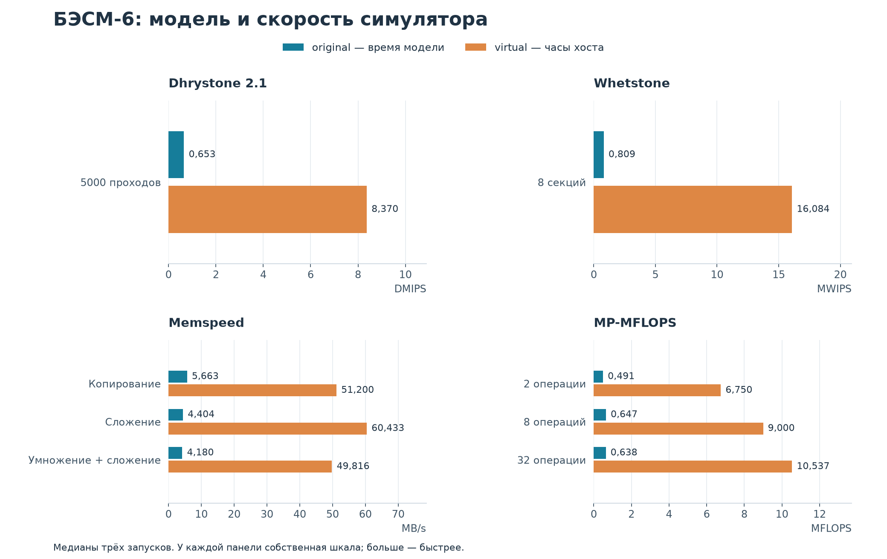

*У каждой панели собственная шкала: длины столбцов между панелями несопоставимы. Медианы и диапазоны рейтингов также приведены в [отдельной таблице](benchmark-results.md).*

### Dhrystone

Ниже — пример вывода отдельного запуска порта на Фортране. Его результат, 0,571 DMIPS за 4,98 с. Полный листинг этого примера сохранён в [приложении](#listing).

```txt
DHRYSTONE BENCHMARK 2.1 (FORTRAN-GDR FOR BESM-6)
RUNNING   5000 PASSES...
EXECUTION ENDS
IGLOB:            5 (SHOULD BE 5)
BLOB:           T (SHOULD BE TRUE)
C1GLB:           65 (SHOULD BE 65 = A)
C2GLB:           66 (SHOULD BE 66 = B)
A1GLOB 8:         7 (SHOULD BE 7)
A2GLOB 8/7:    5010 (SHOULD BE   5010)
PGLB.DISCR:      0 (SHOULD BE 0)
PGLB.ENUM:       2 (SHOULD BE 2)
PGLB.INT:       17 (SHOULD BE 17)
NEXTP.DISCR:        0 (SHOULD BE 0)
NEXTP.ENUM:         1 (SHOULD BE 1)
NEXTP.INT:         18 (SHOULD BE 18)
I1LOC:            5 (SHOULD BE 5)
I2LOC:           13 (SHOULD BE 13)
I3LOC:            7 (SHOULD BE 7)
ELOC:            1 (SHOULD BE 1)
ALL 18 CONTROL VALUES MATCH THE DHRYSTONE 2.1 SPEC
GUEST CPU SECONDS:       4.9800
GUEST DMIPS:     0.571438
```

### Whetstone

Вывод нашего запуска:

```txt
ROY LONGBOTTOM WHETSTONE - BESM-6 FOREX
8 PASSES USED (X 100); REAL IS 48 BITS
LOOP CONTENT              RESULT                 MFLOPS       MOPS    SECONDS
N1 FLOATING POINT        -1.13333352534209    0.808421                  0.1900
N2 FLOATING POINT        -1.13333356774819    0.625116                  1.7200
N3 IF THEN ELSE           1.00000000000000                0.258750      3.2000
N4 FIXED POINT           11.99999999998908                0.652850      3.8600
N5 SIN,COS ETC.           0.50000004814501                0.036733     18.1200
N6 FLOATING POINT         0.99999778767669    0.116753                 36.9600
N7 ASSIGNMENTS            3.00000000000000                0.080087     18.4600
N8 EXP,SQRT ETC.          0.75792038854851                0.018213     16.3400
BAD CONTROL VALUES=     0
ALL 8 CONTROL VALUES MATCH: YES
GUEST CPU SECONDS:      98.8500
GUEST MWIPS:     0.809307
GUEST MFLOPS GEOMEAN N1 N2 N6:     0.389304
Halted by STOP at 0118 after 105244035 instructions
```

Для исторического сопоставления ниже сохранён результат Whetstone на Pentium 100 МГц. Сравнивать следует рейтинги, учитывая язык, транслятор и точность вычислений: абсолютные времена секций зависят ещё и от числа проходов. [Материалы Роя Лонгботтома о Whetstone](https://roylongbottom.github.io/royRepository/#anchorClassic).

<details>
<summary>К примеру, Whetstone на Pentium 100 МГц</summary>

```txt
Loop content                 Result            MFLOPS     MOPS   Seconds

N1 floating point    -1.12475025653839100      19.971              0.274
N2 floating point    -1.12274754047393800      11.822              3.240
N3 if then else       1.00000000000000000               11.659     2.530
N4 fixed point       12.00000000000000000               13.962     6.430
N5 sin,cos etc.       0.49904659390449520                2.097    11.310
N6 floating point     0.99999988079071040       3.360             45.750
N7 assignments        3.00000000000000000                2.415    21.810
N8 exp,sqrt etc.      0.75110864639282230                1.206     8.790

MWIPS                                          28.462            100.134
```

</details>

Для калибровки использован [результат модели БЭСМ-6, опубликованный Leo B. в 2017 году](https://retrocomputing.stackexchange.com/questions/3267/how-to-compute-performance-of-a-cpu-in-flops). В строке `Chipset/options` прямо указана эмуляция конвейеров УУ и АУ.

<details>
<summary>Whetstone на модели БЭСМ-6, июль 2017 года</summary>

```txt
WHETSTONE BENCHMARK FOR  100.00 SECONDS DURATION

      8 PASSES USED (X 100)

 FORTRAN WHETSTONE BENCHMARK - SINGLE PRECISION
Month run         7/2017
Supplier/model    IPMCE, USSR                                
CPU chip type     BESM-6                               
Clock MHz         9                                   
Cache size        16 words                                 
Chipset/options   CU/ALU pipes emulated using interlocks and ave. timings from the manual                        
OS/DOS            DISPAK (user mode emulated)
Compiler          F O R E X ИПM AH CCCP 4.12 OT 25.06.85           
Options           default

 LOOP CONTENT                   RESULT                MFLOPS      MOPS   SECONDS

 N1 FLOATING POINT       -1.12398256285086973          0.524               0.293
 N2 FLOATING POINT       -1.12187081181764370          0.402               2.674
 N3 IF THEN ELSE          1.00000000000000000                    0.185     4.477
 N4 FIXED POINT          12.00000000000000000                    0.346     7.280
 N5 SIN,COS ETC.          0.49902906717352380                    0.036    18.361
 N6 FLOATING POINT        0.99999958804255584          0.121              35.720
 N7 ASSIGNMENTS           3.00000000000000000                    0.106    13.963
 N8 EXP,SQRT ETC.         0.75100162294984329                    0.018    16.087

 MWIPS                                                 0.809              98.856
```

</details>

Сводные MWIPS двух моделей близки, но секции некоторых различаются:

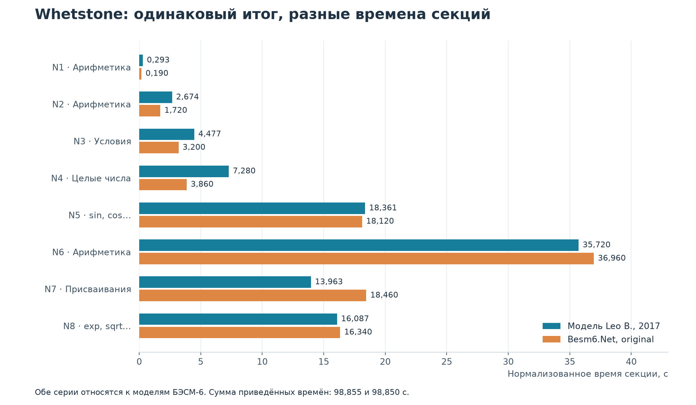

*Обе серии относятся к моделям. Диаграмма показывает результат калибровки, а не измеренную ошибку относительно физической БЭСМ-6. Отличаются также программное окружение и контрольные численные значения.*

### Memspeed

Все три результата Memspeed включают управление циклами и арифметику адресов. Поэтому строка copy характеризует скорость всего гостевого ядра копирования, а не пропускную способность отдельного аппаратного узла.

Вывод первого подтеста — копирования:

```txt
MEMSPEED PART  1
WORDS=  4096
REPEAT PASSES=  1000
BYTES/ELEMENT= 12
DATA TRAFFIC BYTES=   49151999.999958206899
FIRST RESULT=          0.000244140625
LAST RESULT=          1.000000000000
CHECKSUM=       2048.499999997147
BAD ELEMENTS=     0
ALL VALUES MATCH: YES
GUEST CPU SECONDS:       8.6800
GUEST MB/S:     5.662673
Halted by STOP at 0118 after 24959421 instructions
```

### MP-MFLOPS

Первый подтест выполняет две арифметические операции на элемент. Для 9000 элементов и 30 проходов это 540 000 операций. При гостевом времени 1,1 с получается **0,490909 MFLOPS**, что соответствует строке сводной таблицы.

```text
MP-MFLOPS PART  1
WORDS=  9000
OPS/WORD=  2
REPEAT PASSES=    30
FLOPS=     539999.999998690327
FIRST RESULT=          0.999099623640
BAD CONTROL VALUES=     0
CALCULATIONS PERFORMED
ALL SAME: YES
GUEST CPU SECONDS:       1.1000
GUEST MFLOPS:     0.490909
Halted by STOP at 0118 after 6893148 instructions
```

Контрольные значения сошлись, программа завершилась инструкцией `STOP`. Небольшое отклонение напечатанного `FLOPS` от целого числа 540 000 связано с численным представлением в гостевой программе; для подсчёта операций используется выражение `9000 × 30 × 2`.

При переходе от двух операций на элемент к восьми или 32 меняется доля служебной работы. Итоговый MFLOPS зависит и от команд, сгенерированных транслятором, и от зависимостей между ними.

### Точность измерений

У самого короткого ядра MP-MFLOPS интервал в режиме `virtual` составил 0,08–0,10 с. Шаг таймера 20 мс сопоставим с четвертью этого времени: несколько десятичных знаков в выводе не означают соответствующей точности. У Memspeed разброс тоже заметен. Повторение модельного времени в `original` показывает детерминированность модели, но не её точность относительно исторической машины.

<a id="conclusions"></a>

## Выводы

В выбранной модели Dhrystone даёт около **0,653 DMIPS**, Whetstone — **0,809 MWIPS**, а арифметические ядра MP-MFLOPS — **0,491–0,647 MFLOPS**. Эти числа отвечают на разные вопросы: универсального перевода между ними и паспортным «миллионом операций в секунду» нет.

Результат нужно читать вместе с указанием источника времени. Режим `virtual` показывает практическую скорость Besm6.Net на конкретном современном компьютере. Режим `original` позволяет сравнивать нагрузки внутри зафиксированной временной модели. Паспортное быстродействие описывает историческую машину в терминах своего источника. Для прямого сравнения нужна общая методика.

Правильный результат программы и независимый численный контроль помогают проверить арифметику. Для проверки времени нужны журналы запусков на физической машине с указанием ОС, транслятора, исходного текста и нагрузки либо подробные аппаратные измерения. Калибровочный Whetstone помогает настроить модель, но не заменяет этих данных.

Симулятор возвращает возможность экспериментировать с программами БЭСМ-6: читать листинг исторического Фортрана, менять представление данных и наблюдать влияние алгоритма. Его исходный код позволяет проследить, какие зависимости учитывает модель, что считается обращением к памяти и сколько времени назначено системной функции.

Следующий шаг — испытать модель на независимом историческом наборе программ, не участвовавшем в настройке коэффициентов. Особенно полезны задачи с разным соотношением арифметики, обращений к памяти и системных услуг. Пока такого сравнения нет, приведённые измерения характеризуют симулятор и его временную модель.

<a id="sources"></a>

## Источники и материалы

### Книги и техническая документация

1. **Салтыков А. И., Макаренко Г. И. [Программирование на языке Фортран][fortran-book]** / под ред. Н. Н. Говоруна. М.: Наука, 1976. 256 с. Серия «Библиотечка программиста». Основной источник по архитектуре, арифметике, системе «Дубна» и МАДЛЕНу. [Скан книги, PDF в ZIP-архиве][fortran-scan].
2. **[Автокод БЭСМ-6. Инструкция](https://www.computer-museum.ru/books/besm6_instruction.pdf).** ИТМиВТ АН СССР, 1969. Форматы команд и чисел, ввод и отладка программ.
3. **[Краткий перечень команд БЭСМ-6](https://www.besm6.org/wiki/CmdSheet.html).** Сопоставление машинных кодов, русских обозначений, мнемокодов БЕМШа и МАДЛЕНа.
4. **[Электронные цифровые вычислительные машины общего назначения](https://oldpc.su/lib/izdradioprom/68-ecvm.pdf).** Каталог, 1968.
5. **[Техническая документация БЭСМ-6](https://www.besm6.org/doc/).** Сканированные описания устройств, системы команд и пультов.

### История машины и программного обеспечения

6. **[БЭСМ-6 в Виртуальном компьютерном музее](https://www.computer-museum.ru/histussr/28-1.htm)**, [история серии БЭСМ](https://www.besm-6.ru/besm-series.html) и [описание архитектуры и ПО БЭСМ-6](https://besm-6.ru/besm6.html).
7. **[НИИсчётмаш: историческая справка](https://www.computer-museum.ru/histussr/niism.htm).** Разработка устройств семейства АЦПУ-128 и ВУ-700.
8. **[Материалы об операционной системе ДИСПАК](https://www.iis.nsk.su/files/page/balakirev_n.e._bartenev_yu.g._zeldinova_s.a.pdf)** и [«Четыре поколения операционных систем», SORUCOM 2020](https://www.sorucom.org/articles/materialy-mezhdunarodnoy-konferentsii-sorucom-2020/5216/).
9. **[Control Data 6400/6600 Computing Systems’ Configurator](https://archive.computerhistory.org/resources/text/CDC/CDC.6400_6600.1966.102646143.pdf).** CDC, 1966. [Отчёт Lax](https://science.osti.gov/-/media/ascr/pdf/program-documents/archive/Lax_report.pdf) содержит историческую таблицу производительности систем NCAR.

### Симуляторы, бенчмарки и результаты

10. **[Besm6.Net](https://github.com/EntityFX/besm6.net)** — исходный код исследуемого симулятора; [задания бенчмарков](../../../examples) и [таблица измерений](benchmark-results.md).
11. **[Dubna BESM-6 Emulator](https://github.com/besm6/dubna)** и **[SIMH](https://github.com/simh/simh)**; [руководство по SIMH для БЭСМ-6](https://www.besm6.org/wiki/SIMH-manual.html).
12. **[Dhrystone 2.1: материалы Netlib](https://www.netlib.org/performance/papers/dhrystone/).** Происхождение теста и нормировка относительно VAX-11/780.
13. **[Коллекция бенчмарков Роя Лонгботтома](https://roylongbottom.github.io/royRepository/).** История и результаты Whetstone, Memspeed и MP-MFLOPS; ссылки на архивные материалы и исходные тексты.
14. **[Leo B. How to compute performance of a CPU in FLOPS?](https://retrocomputing.stackexchange.com/questions/3267/how-to-compute-performance-of-a-cpu-in-flops)** Эксперимент с временной моделью БЭСМ-6, 2017. Источник калибровочного Whetstone.

Источники добавленных фотографий и условия лицензий, если они указаны владельцем, приведены непосредственно в подписях к изображениям.

<a id="listing"></a>

## Приложение: полный листинг запуска

Листинг компиляции и выполнения примера Dhrystone для Фортрана-ГДР. Машинный вывод сохранён без редакторских изменений; этот запуск отличается от серии измерений в основной таблице.

<details>
<summary>Открыть полный листинг Dhrystone</summary>

```txt
                                             04 ИЮЛ 24 23.45
 ЙOKCEЛ      БЭCM-6/5     ШИФP-12
 MOHИTOPHAЯ CИCTEMA  ′Д Y Б H A′  -  20/10/88


            ЖЖЖ   Ж   Ж ЖЖЖЖ  Ж   Ж  ЖЖЖ  ЖЖЖЖЖ  ЖЖЖ  Ж   Ж ЖЖЖЖ        ЖЖЖ   Ж   Ж  ЖЖЖ  ЖЖЖЖ   ЖЖЖ
            Ж  Ж  Ж   Ж Ж   Ж Ж   Ж Ж       Ж   Ж   Ж ЖЖ  Ж Ж           Ж  Ж  ЖЖ ЖЖ   Ж   Ж   Ж Ж
            Ж   Ж ЖЖЖЖЖ Ж   Ж Ж   Ж  ЖЖЖ    Ж   Ж   Ж Ж Ж Ж ЖЖЖ         Ж   Ж Ж Ж Ж   Ж   Ж   Ж  ЖЖЖ
            Ж   Ж Ж   Ж ЖЖЖЖ   Ж Ж      Ж   Ж   Ж   Ж Ж  ЖЖ Ж      ЖЖЖ  Ж   Ж Ж Ж Ж   Ж   Ж   Ж     Ж
            Ж   Ж Ж   Ж Ж Ж     Ж       Ж   Ж   Ж   Ж Ж   Ж Ж           Ж   Ж Ж   Ж   Ж   ЖЖЖЖ      Ж
            Ж   Ж Ж   Ж Ж  Ж    Ж   Ж   Ж   Ж   Ж   Ж Ж   Ж Ж           Ж   Ж Ж   Ж   Ж   Ж     Ж   Ж
            ЖЖЖЖ  Ж   Ж Ж   Ж   Ж    ЖЖЖ    Ж    ЖЖЖ  Ж   Ж ЖЖЖЖЖ       ЖЖЖЖ  Ж   Ж  ЖЖЖ  Ж      ЖЖЖ


*NAME DHRYSTONE-DMIPS
*FTN
                                                 04 ИЮЛ 24 23.45
 Ф O P T P A H - Г Д P                                                                                 THE WAY OUT WAS
      (09.07.81)                                                               C     RUNTIME TRACING (BESM6 RUN --TRACE): THE H
  001               PROGRAM DHRY                                                                       OT ADDRESSES POINTED
              C     ==========================================                 C     AT THE COMPARE LOOP, AND A PRINT OF THE LO
                                      ========================                                         OP COUNTER SHOWED IT
              C     DHRYSTONE 2.1 -- PORT TO BESM-6, FORTRAN-G                 C     PINNED AT ZERO.
                                      DR DIALECT (*FTN)                        C
              C                                                                C     METHODOLOGICAL NOTE: A WRONG-ANSWER-OR-HAN
              C     GUEST DMIPS: THIS DECK USES THE CTIME CPU                                          G SYMPTOM IS NOT
                                      TIMER, ENABLED BY                        C     EVIDENCE OF A COMPILER FAULT. INSTRUMENT F
              C     --GUEST-CLOCK (JSON GUESTCLOCK=TRUE). RESO                                         IRST.
                                      LUTION IS 0.02 SECONDS.                  C
              C     DMIPS = PASSES / CPU SECONDS / 1757. THE S                 C     LANGUAGE NOTES (ESTABLISHED BY PROBES, SEE
                                      IMULATED CLOCK HAS THE                                            REPORT):
              C     SAME VALUE IN MAX AND ORIGINAL; VIRTUAL US                 C       * IDENTIFIERS ARE LIMITED TO 6 CHARACTER
                                      ES HOST ELAPSED TIME.                                            S (ERROR 035)
              C     SOURCE: BOOK/FORTRAN-1976/02-FORTRAN-DUBNA                 C       * BLOCK IF/THEN/ENDIF IS NOT SUPPORTED (
                                      .MD, TIME ACCOUNTING.                                            ERROR 021);
              C     THE ORIGINAL UNTIMED BENCHMARK REMAINS UNC                 C         ONLY SINGLE-STATEMENT IF ... GO TO WOR
                                      HANGED FOR COMPARISONS.                                          KS
              C                                                                C       * ARRAY ELEMENTS CANNOT BE USED AS PRINT
              C     STATUS: WORKS. ALL 18 DHRYSTONE 2.1 CONTRO                                          ITEMS: AN ELEMENT
                                      L VALUES MATCH THE                       C         PRINTS AS COMMAS. EVERY PRINTED ARRAY
              C     SPECIFICATION AT NUMBER = 5000. SETTING NU                                         VALUE IS THEREFORE
                                      MBER = 0 PRODUCES A                      C         COPIED TO A SCALAR TEMPORARY FIRST
              C     ZERO-WORK BASELINE WITHOUT A DMIPS RATING.                 C       * ARRAYS CANNOT BE PASSED TO SUBPROGRAMS
              C                                                                                        , AND COMMON INSIDE
              C     THIS IS THE FORTRAN-GDR COUNTERPART OF THE                 C         A CALLED SUBPROGRAM FAILS TO ASSEMBLE,
                                       PASCAL PORT                                                      SO ALL STATE LIVES
              C       EXAMPLES/DHRYSTONE-BASELINE.DUB                          C         IN THIS SINGLE PROGRAM UNIT
              C     ORIGINAL: R. WEICKER, CACM 27(10), 1984.                   C       * RECORDS, POINTERS AND ENUMERATIONS DO
              C                                                                                        NOT EXIST IN FORTRAN,
              C     HISTORY OF THIS FILE (KEPT BECAUSE IT IS I                 C         SO THEY ARE EMULATED: A RECORD IS A SE
                                      NSTRUCTIVE)                                                      T OF PARALLEL INTEGER
              C     ------------------------------------------                 C         ARRAYS INDEXED BY A NODE NUMBER, A POI
                                      -----------                                                      NTER IS AN INTEGER
              C     AN EARLIER REVISION OF THIS PORT LOOPED FO                 C         NODE INDEX, AN ENUMERATION IS AN INTEG
                                      REVER FOR NUMBER >= 1                                            ER CONSTANT
              C     AND THE FAULT WAS FIRST ATTRIBUTED TO THE                  C       * HOLLERITH CONSTANTS ARE REJECTED (ERRO
                                      FORTRAN-GDR CODE                                                 R 123), SO STRINGS ARE
              C     GENERATOR. THAT DIAGNOSIS WAS WRONG. THE R                 C         INTEGER ARRAYS FILLED WITH CHARACTER C
                                      EAL CAUSE WAS THREE                                              ODES
              C     SEPARATE DEFECTS IN THE PORT ITSELF, EACH                  C       * ONLY THE FIRST 3 NAMES OF A DECLARATIO
                                      OF WHICH THE COMPILER                                            N ARE HONOURED, SO
              C     ACCEPTED SILENTLY:                                         C         EVERY DECLARATION LISTS AT MOST 3 IDEN
              C                                                                                        TIFIERS
              C       1. IN THE STRING-COMPARE LOOP THE STATEM                 C       * FORMAT LABELS BELONG TO THE PROGRAM UN
                                      ENT "C2 = 0" SAT ON                                              IT, SO ALL FORMATS
              C          THE LOOP LABEL ITSELF, SO EVERY PASS                  C         ARE PLACED AFTER THE LAST STATEMENT AN
                                      THROUGH "GO TO 55"                                               D BEFORE END
              C          RE-INITIALISED THE COUNTER AND THE LO                 C     ------------------------------------------
                                      OP NEVER TERMINATED.                                             ------------------------
              C       2. PROC1 AND PROC3 HAD LOST THE CALLS TO                 C
                                       PROC7, AND PROC2                        C     ---- ENUMERATIONS (IDENT1..IDENT5 = 0..4)
              C          WROTE ITS RESULT TO A LOCAL INSTEAD O                                         ----
                                      F BACK INTO ITS              002               INTEGER IDENT1, IDENT2, IDENT3
              C          VAR PARAMETER INT1LOC.                    003               INTEGER IDENT4, IDENT5
              C       3. THE PROC6 CALL IN PROC1 WAS BOUND TO      004               DATA IDENT1/0/, IDENT2/1/, IDENT3/2/
                                      THE WRONG ENUM VALUE.        005               DATA IDENT4/3/, IDENT5/4/
              C                                                    006               DATA T2( 1)/68/
              C     BECAUSE EVERY ONE OF THESE IS A PLAIN LOGI     007               DATA T2( 2)/72/
                                      C ERROR THAT HAPPENS         008               DATA T2( 3)/82/
              C     TO EXPRESS ITSELF AS A NON-TERMINATING LOO     009               DATA T2( 4)/89/
                                      P, THE SYMPTOM WAS           010               DATA T2( 5)/83/
              C     INDISTINGUISHABLE FROM A COMPILER DEFECT.      011               DATA T2( 6)/84/
  012               DATA T2( 7)/79/                                            C
  013               DATA T2( 8)/78/                                            C     ---- GLOBAL SCALARS ----
  014               DATA T2( 9)/69/                                071               INTEGER IGLOB
  015               DATA T2(10)/80/                                072               LOGICAL BLOB
  016               DATA T2(11)/32/                                073               INTEGER C1GLB, C2GLB
  017               DATA T2(12)/80/                                074               DATA C1GLB/65/, C2GLB/66/
  018               DATA T2(13)/82/                                075               DIMENSION A1GLOB(50)
  019               DATA T2(14)/79/                                076               DIMENSION A2GLOB(2500)
  020               DATA T2(15)/71/                                            C
  021               DATA T2(16)/82/                                077               INTEGER RINDX, I1LOC, I2LOC
  022               DATA T2(17)/65/                                078               INTEGER I3LOC, CHIDX, ELOC
  023               DATA T2(18)/77/                                079               LOGICAL F2RES, BLOC
  024               DATA T2(19)/32/                                080               INTEGER NBAD, F1RES
  025               DATA T2(20)/50/                                081               REAL CT0, RT0, CT1
  026               DATA T2(21)/78/                                082               REAL RT1, SECS, DMIPS
  027               DATA T2(22)/68/                                083               DIMENSION SA1(30), SA2(30)
  028               DATA T2(23)/32/                                084               DIMENSION T2(30), T3(30)
  029               DATA T2(24)/83/                                            C
  030               DATA T2(25)/84/                                            C     ---- WORKING STATE FOR THE INLINED PROCEDU
  031               DATA T2(26)/82/                                                                    RES ----
  032               DATA T2(27)/73/                                085               INTEGER INTLOC, ELOC2, IINDX
  033               DATA T2(28)/78/                                086               INTEGER CHLOC, CH1LOC, CH2LOC
  034               DATA T2(29)/71/                                087               INTEGER CH2PAR
  035               DATA T3( 1)/68/                                088               INTEGER CIDX, CMPV, IPREF
  036               DATA T3( 2)/72/                                089               INTEGER LIM, I, C1, C2
  037               DATA T3( 3)/82/                                090               INTEGER IPV1, IPV2, PPREF
  038               DATA T3( 4)/89/                                091               INTEGER NREC, EVPAR, EREFP
  039               DATA T3( 5)/83/                                            C
  040               DATA T3( 6)/84/                                            C     ---- STRING CONSTANTS AS CHARACTER CODES -
  041               DATA T3( 7)/79/                                                                    ---
  042               DATA T3( 8)/78/                                            C     PTRGLOB.STRCOMP := ′DHRYSTONE PROGRAM, SOM
  043               DATA T3( 9)/69/                                                                    E STRING′
  044               DATA T3(10)/80/                                092               DATA RSTRC(1, 1)/68/, RSTRC(1, 2)/72/, RST
  045               DATA T3(11)/32/                                                                    RC(1, 3)/82/
  046               DATA T3(12)/80/                                093               DATA RSTRC(1, 4)/89/, RSTRC(1, 5)/83/, RST
  047               DATA T3(13)/82/                                                                    RC(1, 6)/84/
  048               DATA T3(14)/79/                                094               DATA RSTRC(1, 7)/79/, RSTRC(1, 8)/78/, RST
  049               DATA T3(15)/71/                                                                    RC(1, 9)/69/
  050               DATA T3(16)/82/                                095               DATA RSTRC(1,10)/80/, RSTRC(1,11)/32/, RST
  051               DATA T3(17)/65/                                                                    RC(1,12)/80/
  052               DATA T3(18)/77/                                096               DATA RSTRC(1,13)/82/, RSTRC(1,14)/79/, RST
  053               DATA T3(19)/32/                                                                    RC(1,15)/71/
  054               DATA T3(20)/51/                                097               DATA RSTRC(1,16)/82/, RSTRC(1,17)/65/, RST
  055               DATA T3(21)/82/                                                                    RC(1,18)/77/
  056               DATA T3(22)/68/                                            C     STR1LOC := ′DHRYSTONE PROGRAM, 1ST STRING′
  057               DATA T3(23)/32/                                098               DATA SA1( 1)/68/, SA1( 2)/72/, SA1( 3)/82/
  058               DATA T3(24)/83/                                099               DATA SA1( 4)/89/, SA1( 5)/83/, SA1( 6)/84/
  059               DATA T3(25)/84/                                100               DATA SA1( 7)/79/, SA1( 8)/78/, SA1( 9)/69/
  060               DATA T3(26)/82/                                101               DATA SA1(10)/80/, SA1(11)/32/, SA1(12)/80/
  061               DATA T3(27)/73/                                102               DATA SA1(13)/82/, SA1(14)/79/, SA1(15)/71/
  062               DATA T3(28)/78/                                103               DATA SA1(16)/82/, SA1(17)/65/, SA1(18)/77/
  063               DATA T3(29)/71/                                104               DATA SA1(19)/32/, SA1(20)/49/, SA1(21)/83/
              C                                                    105               DATA SA1(22)/84/, SA1(23)/32/, SA1(24)/83/
              C     ---- NUMBER OF RUNS ----                       106               DATA SA1(25)/84/, SA1(26)/82/, SA1(27)/73/
  064               INTEGER NUMBER                                 107               DATA SA1(28)/78/, SA1(29)/71/
  065               DATA NUMBER/5000/                                          C
              C                                                    108               PRINT 900
              C     ---- RECORD EMULATION ----                     109               PRINT 910, NUMBER
              C     PTRGLOB AND NEXTPTRGLOB ARE NODE INDICES 1                 C
                                       AND 2; THE FIELD                        C     ---- INITIALISE PTRGLOB ----
              C     ARRAYS ARE PARALLEL TO THE NODE INDEX.         110               RPTRC(1) = NPTG
  066               INTEGER PGLB, NPTG                             111               RDISC(1) = IDENT1
  067               DATA PGLB/1/, NPTG/2/                          112               RENUM(1) = IDENT3
  068               DIMENSION RPTRC(3), RDISC(3), RENUM(3)         113               RINTC(1) = 40
  069               DIMENSION RINTC(3)                             114               I = 1
  070               DIMENSION RSTRC(3,30)                          115           200 IF (I .GT. 30) GO TO 201
  116                 RSTRC(1,I) = 32                              151               CH1LOC = CIDX
  117                 I = I + 1                                    152               CH2LOC = CH1LOC
  118                 GO TO 200                                    153               CH2PAR = SA2(INTLOC+1)
  119           201 CONTINUE                                       154               F1RES = IDENT1
  120               I = 1                                          155               IF (CH2LOC .NE. CH2PAR) GO TO 41
  121           190 IF (I .GT. 2500) GO TO 191                     156               C1GLB = CH1LOC
  122                 A2GLOB(I) = 0                                157               F1RES = IDENT2
  123                 I = I + 1                                    158            41 IF (F1RES .EQ. IDENT1) GO TO 42
  124                 GO TO 190                                    159               GO TO 40
  125           191 CONTINUE                                       160            42 CHLOC = 65
  126               A2GLOB(308) = 10                               161               INTLOC = INTLOC + 1
              C                                                    162               GO TO 40
              C     ---- MAIN LOOP ----                            163            43 IF (CHLOC .LT. 87) GO TO 45
              C                                                    164               IF (CHLOC .GE. 90) GO TO 45
              C     ==========================================     165               INTLOC = 7
                                      ========================     166            45 IF (CHLOC .EQ. 82) GO TO 50
              C     THE BENCHMARK BODY IS FULLY INLINED. FORTR     167               CMPV = 0
                                      AN-GDR IS UNRELIABLE         168               C2 = 0
              C     WHEN A SUBROUTINE DECLARES MANY NAMES, SO      169               GO TO 55
                                      EVERY PROCEDURE BELOW        170            50 F2RES = .TRUE.
              C     IS WRITTEN AS STRAIGHT-LINE CODE INSIDE TH     171               GO TO 58
                                      E MAIN LOOP.                             C
              C     ==========================================                 C     ---- COMPARE STR1LOC / STR2LOC LEXICOGRAPH
                                      ========================                                         ICALLY ----
              C     CTIME CPU SECONDS BRACKET ONLY THE BENCHMA                 C     NB: THE C2 = 0 INITIALISATION MUST SIT BEF
                                      RK BODY. RUN THIS DECK                                           ORE THE LOOP HEAD.
              C     WITH --GUEST-CLOCK; DATE* AND HOST PACING                  C     PLACING IT AT LABEL 55 (INSIDE THE LOOP) M
                                      DO NOT AFFECT ITS SCORE.                                         ADE GO TO 55 RESET THE
  127               CALL CTIME(CT0,RT0)                                        C     COUNTER ON EVERY PASS, SO THE LOOP NEVER T
  128               DO 100 RINDX = 1, NUMBER                                                           ERMINATED.
              C                                                    172            55 IF (C2 .GE. 30) GO TO 58
              C     ---- PROC5 ----                                173               C1 = SA1(C2+1)
  129               C1GLB = 65                                     174               IF (C1 .LT. SA2(C2+1)) CMPV = -1
  130               BLOB = .FALSE.                                 175               IF (C1 .GT. SA2(C2+1)) CMPV = 1
              C                                                    176               IF (CMPV .NE. 0) GO TO 58
              C     ---- PROC4: BOOLGLOB := BOOLGLOB OR (CH1GL     177               C2 = C2 + 1
                                      OB = ′A′) ----               178               GO TO 55
  131               BLOC = .FALSE.                                             C
  132               IF (C1GLB .EQ. 65) GO TO 30                                C     PASCAL: IF STR1LOC > STR2LOC THEN (INTLOC
  133               GO TO 32                                                                           += 7; TRUE) ELSE FALSE
  134            30 BLOC = .TRUE.                                  179               IF (CMPV .GT. 0) GO TO 56
  135            32 IF (BLOC) GO TO 33                             180               GO TO 58
  136               GO TO 34                                       181            56 INTLOC = INTLOC + 7
  137            33 BLOB = .TRUE.                                  182               F2RES = .TRUE.
  138            34 C2GLB = 66                                     183               GO TO 58
              C                                                    184            58 F2RES = .FALSE.
  139               I1LOC = 2                                                  C
  140               I2LOC = 3                                      185               IF (F2RES) GO TO 141
  141               ELOC = IDENT2                                  186               GO TO 142
              C                                                    187           141 BLOB = .FALSE.
              C     ---- STR2LOC := ′DHRYSTONE PROGRAM, 2ND ST     188               GO TO 142
                                      RING′ ----                   189           142 BLOB = .TRUE.
  142               I = 1                                                      C
  143           660 IF (I .GT. 29) GO TO 661                                   C     ---- WHILE INT1LOC < INT2LOC DO ... ----
  144                 SA2(I) = T2(I)                               190            60 IF (I1LOC .LT. I2LOC) GO TO 61
  145                 I = I + 1                                    191               GO TO 70
  146                 GO TO 660                                    192            61 I3LOC = 5 * I1LOC - I2LOC
  147           661 CONTINUE                                       193               INTLOC = I1LOC + 2
              C                                                    194               IPV1 = I1LOC
              C     ---- FUNC2: BOOLGLOB := NOT FUNC2(STR1LOC,     195               IPV2 = I2LOC
                                       STR2LOC) ----               196               IPREF = IPV2 + INTLOC
  148               INTLOC = 2                                     197               I3LOC = IPREF
  149            40 IF (INTLOC .GT. 2) GO TO 43                    198               I1LOC = I1LOC + 1
              C     FUNC1(STR1LOC[INTLOC], STR2LOC[INTLOC+1]):     199               GO TO 60
                                       COMPARE WITH ′C′            200            70 CONTINUE
  150               CIDX = SA1(INTLOC)                                         C
              C     ---- PROC8 ----                                248               GO TO 88
  201               IPV1 = I1LOC                                   249            82 EREFP = IDENT1
  202               IPV2 = I3LOC                                   250               ELOC = EREFP
  203               INTLOC = IPV1 + 5                                          C     ---- STR2LOC := ′DHRYSTONE PROGRAM, 3RD ST
  204               A1GLOB(INTLOC) = IPV2                                                              RING′ ----
  205               A1GLOB(INTLOC+1) = A1GLOB(INTLOC)              251               I = 1
  206               A1GLOB(INTLOC+30) = INTLOC                     252           770 IF (I .GT. 29) GO TO 771
  207               IINDX = INTLOC                                 253                 SA2(I) = T3(I)
  208               IINDX = INTLOC + 1                             254                 I = I + 1
  209               IINDX = INTLOC                                 255                 GO TO 770
  210           180 IF (IINDX .GT. INTLOC+1) GO TO 181             256           771 CONTINUE
  211                 A2GLOB(INTLOC + 50*(IINDX-1)) = INTLOC       257               I2LOC = RINDX
  212                 IINDX = IINDX + 1                            258               IGLOB = RINDX
  213                 GO TO 180                                    259            88 CHIDX = CHIDX + 1
  214           181 CONTINUE                                       260               GO TO 80
  215               A2GLOB(INTLOC + 50*(INTLOC-2)) =               261            90 CONTINUE
                   + A2GLOB(INTLOC + 50*(INTLOC-2)) + 1                        C
  216               A2GLOB(INTLOC+20 + 50*(INTLOC-1)) = A1GLOB                 C     ---- TAIL ARITHMETIC ----
                                      (INTLOC)                     262               I2LOC = I2LOC * I1LOC
  217               IGLOB = 5                                      263               I1LOC = I2LOC / I3LOC
              C                                                    264               I2LOC = 7 * (I2LOC - I3LOC) - I1LOC
              C     ---- PROC1(PTRGLOB) ----                                   C
  218               NREC = RPTRC(PGLB)                                         C     ---- PROC2(VAR INT1LOC) ----
  219               RPTRC(PGLB) = RPTRC(NPTG)                                  C     INTPARREF IS A VAR PARAMETER IN THE ORIGIN
  220               RINTC(PGLB) = 5                                                                    AL, SO THE ASSIGNMENT
  221               RINTC(NREC) = RINTC(PGLB)                                  C     BELOW WRITES BACK INTO INT1LOC ITSELF.
  222               RPTRC(NREC) = RPTRC(PGLB)                      265               INTLOC = I1LOC + 10
              C     ---- PROC3: PROC7(10, INTGLOB, PTRGLOB.INT     266               ELOC2 = IDENT5
                                      COMP) ----                   267           150 IF (C1GLB .EQ. 65) GO TO 151
  223               PPREF = RPTRC(PGLB)                            268               GO TO 152
  224               INTLOC = 10 + 2                                269           151 INTLOC = INTLOC - 1
  225               IPV1 = 10                                      270               I1LOC = INTLOC - IGLOB
  226               IPV2 = IGLOB                                   271               ELOC2 = IDENT1
  227               RINTC(PGLB) = IPV2 + INTLOC                    272           152 IF (ELOC2 .EQ. IDENT1) GO TO 155
              C                                                    273               GO TO 150
  228               IF (RDISC(NREC) .EQ. IDENT1) GO TO 72          274           155 CONTINUE
  229               GO TO 75                                       275           100 CONTINUE
  230            72 RINTC(NREC) = 6                                276               CALL CTIME(CT1,RT1)
              C     ---- PROC6(PTRGLOB.ENUMCOMP, NEXTPTR.ENUMC     277               SECS = RT1-RT0
                                      OMP) ----                    278               DMIPS = 0.
              C     PTRGLOB.ENUMCOMP IS IDENT3, SO THE CASE BR     279               IF (SECS .LE. 0.) GO TO 1400
                                      ANCH "IDENT3" FIRES          280               DMIPS = FLOAT(NUMBER)/(1757.*SECS)
              C     AND ENUMCOMP BECOMES IDENT2.                   281          1400 CONTINUE
  231               EREFP = IDENT2                                             C
  232               RENUM(NREC) = EREFP                                        C     ==========================================
              C     ---- PROC7(NEXTPTR.INTCOMP, 10, NEXTPTR.IN                                         ========================
                                      TCOMP) ----                              C     ---- REPORT ----
  233               INTLOC = RINTC(NREC) + 2                       282               PRINT 920
  234               RINTC(NREC) = 10 + INTLOC                      283               PRINT 930
              C     ---- NEXTPTR.PTRCOMP := PTRGLOB.PTRCOMP --     284               NBAD = 0
                                      --                           285               LIM = NUMBER + 10
  235               RPTRC(NREC) = RPTRC(PGLB)                                  C
  236               GO TO 75                                                   C     ARRAY ELEMENTS CANNOT BE PRINT ITEMS, SO E
  237            75 CONTINUE                                                                           VERY VALUE IS FIRST
              C                                                                C     COPIED INTO A SCALAR TEMPORARY (IPREF).
              C     ---- FOR CHINDEX := ′A′ TO CH2GLOB ----        286               IPREF = IGLOB
  238               CHIDX = 65                                     287               IF (IPREF .NE. 5) NBAD = NBAD + 1
  239            80 IF (CHIDX .GT. C2GLB) GO TO 90                 288               PRINT 940, IPREF
  240               CH1LOC = CHIDX                                 289               IF (.NOT. BLOB) NBAD = NBAD + 1
  241               CH2LOC = CH1LOC                                290               PRINT 950, BLOB
  242               CH2PAR = 67                                    291               IPREF = C1GLB
  243               F1RES = IDENT1                                 292               IF (IPREF .NE. 65) NBAD = NBAD + 1
  244               IF (CH2LOC .NE. CH2PAR) GO TO 81               293               PRINT 960, IPREF
  245               C1GLB = CH1LOC                                 294               IPREF = C2GLB
  246               F1RES = IDENT2                                 295               IF (IPREF .NE. 66) NBAD = NBAD + 1
  247            81 IF (ELOC .EQ. F1RES) GO TO 82                  296               PRINT 970, IPREF
  297               IPREF = A1GLOB(8)                                                                  HIS PROGRAM UNIT) ----
  298               IF (IPREF .NE. 7) NBAD = NBAD + 1              355           900 FORMAT (′DHRYSTONE BENCHMARK 2.1 (FORTRAN-
  299               PRINT 980, IPREF                                                                   GDR FOR BESM-6)′)
  300               IPREF = A2GLOB(308)                            356           910 FORMAT (′RUNNING ′, I6, ′ PASSES...′)
  301               IF (IPREF .NE. LIM) NBAD = NBAD + 1            357           920 FORMAT (′ ′)
  302               PRINT 990, IPREF, LIM                          358           930 FORMAT (′EXECUTION ENDS′)
  303               IPREF = RDISC(PGLB)                            359           940 FORMAT (′IGLOB:       ′, I6, ′ (SHOULD BE
  304               IF (IPREF .NE. 0) NBAD = NBAD + 1                                                  5)′)
  305               PRINT 1000, IPREF                              360           950 FORMAT (′BLOB:      ′, L6, ′ (SHOULD BE TR
  306               IPREF = RENUM(PGLB)                                                                UE)′)
  307               IF (IPREF .NE. 2) NBAD = NBAD + 1              361           960 FORMAT (′C1GLB:       ′, I6, ′ (SHOULD BE
  308               PRINT 1010, IPREF                                                                  65 = A)′)
  309               IPREF = RINTC(PGLB)                            362           970 FORMAT (′C2GLB:       ′, I6, ′ (SHOULD BE
  310               IF (IPREF .NE. 17) NBAD = NBAD + 1                                                 66 = B)′)
  311               PRINT 1020, IPREF                              363           980 FORMAT (′A1GLOB 8:    ′, I6, ′ (SHOULD BE
  312               IPREF = RDISC(NPTG)                                                                7)′)
  313               IF (IPREF .NE. 0) NBAD = NBAD + 1              364           990 FORMAT (′A2GLOB 8/7:  ′, I6, ′ (SHOULD BE
  314               PRINT 1030, IPREF                                                                  ′, I6, ′)′)
  315               IPREF = RENUM(NPTG)                            365          1000 FORMAT (′PGLB.DISCR: ′, I6, ′ (SHOULD BE 0
  316               IF (IPREF .NE. 1) NBAD = NBAD + 1                                                  )′)
  317               PRINT 1040, IPREF                              366          1010 FORMAT (′PGLB.ENUM:  ′, I6, ′ (SHOULD BE 2
  318               IPREF = RINTC(NPTG)                                                                )′)
  319               IF (IPREF .NE. 18) NBAD = NBAD + 1             367          1020 FORMAT (′PGLB.INT:   ′, I6, ′ (SHOULD BE 1
  320               PRINT 1050, IPREF                                                                  7)′)
  321               IPREF = I1LOC                                  368          1030 FORMAT (′NEXTP.DISCR:   ′, I6, ′ (SHOULD B
  322               IF (IPREF .NE. 5) NBAD = NBAD + 1                                                  E 0)′)
  323               PRINT 1060, IPREF                              369          1040 FORMAT (′NEXTP.ENUM:    ′, I6, ′ (SHOULD B
  324               IPREF = I2LOC                                                                      E 1)′)
  325               IF (IPREF .NE. 13) NBAD = NBAD + 1             370          1050 FORMAT (′NEXTP.INT:     ′, I6, ′ (SHOULD B
  326               PRINT 1070, IPREF                                                                  E 18)′)
  327               IPREF = I3LOC                                  371          1060 FORMAT (′I1LOC:       ′, I6, ′ (SHOULD BE
  328               IF (IPREF .NE. 7) NBAD = NBAD + 1                                                  5)′)
  329               PRINT 1080, IPREF                              372          1070 FORMAT (′I2LOC:       ′, I6, ′ (SHOULD BE
  330               IPREF = ELOC                                                                       13)′)
  331               IF (IPREF .NE. 1) NBAD = NBAD + 1              373          1080 FORMAT (′I3LOC:       ′, I6, ′ (SHOULD BE
  332               PRINT 1090, IPREF                                                                  7)′)
              C                                                    374          1090 FORMAT (′ELOC:       ′, I6, ′ (SHOULD BE 1
              C     ---- PTRGLOB.STRCOMP, ONE CHARACTER PER LI                                         )′)
                                      NE ----                      375          1110 FORMAT (′PGLB.STR:  ′, A1)
  333               I = 1                                          376          1200 FORMAT (′ALL 18 CONTROL VALUES MATCH THE D
  334          1300 IF (I .GT. 30) GO TO 1301                                                          HRYSTONE 2.1 SPEC′)
  335                 CHLOC = RSTRC(PGLB,I)                        377          1210 FORMAT (′MISMATCHES: ′, I6, ′ - PORT FAILE
  336                 IF (CHLOC .NE. 32) PRINT 1110, CHLOC                                             D VERIFICATION′)
  337                 I = I + 1                                    378          1220 FORMAT (′GUEST CPU SECONDS: ′, F12.4)
  338                 GO TO 1300                                   379          1230 FORMAT (′GUEST DMIPS: ′, F12.6)
  339          1301 CONTINUE                                       380          1240 FORMAT (′DMIPS UNAVAILABLE: ENABLE --GUEST
              C                                                                                        -CLOCK OR RUN LONGER′)
  340               IF (NBAD .EQ. 0) PRINT 1200                    381          1250 FORMAT (′DMIPS UNAVAILABLE: CONTROL VALUES
  341               IF (NBAD .NE. 0) PRINT 1210, NBAD                                                   DO NOT MATCH′)
  342               IF (NUMBER .LE. 0) GO TO 1403                  382          1260 FORMAT (′DMIPS UNAVAILABLE: ZERO PASSES′)
  343               IF (NBAD .NE. 0) GO TO 1402                    383               END
  344               IF (SECS .LT. 0.04) GO TO 1401
  345               PRINT 1220, SECS
  346               PRINT 1230, DMIPS                                      BESM FORTRAN DIAGNOSTIC RESULTS
  347               GO TO 1404
  348          1401 PRINT 1240                                             ERRORS: 0     WARNINGS: 1
  349               GO TO 1404
  350          1402 PRINT 1250                                    WARN 001 IN 00179 THERE IS NO PATH TO THIS STATEMENT
  351               GO TO 1404
  352          1403 PRINT 1260
  353          1404 CONTINUE                                       STATEMENT    RELATIVE ADDRESSES OF STATEMENTS (OCTAL)
  354               STOP
              C                                                     00001        :00000   00000   00000   00000   00000
              C     ==========================================      00006         00000   00000   00000   00000   00000
                                      ========================      00011         00000   00000   00000   00000   00000
              C     ---- FORMAT STATEMENTS (MUST LIVE INSIDE T      00016         00000   00000   00000   00000   00000
   00021         00000   00000   00000   00000   00000              00351         01011  :01012  :01016  :01016  :01017
   00026         00000   00000   00000   00000   00000              00356        :01017  :01017  :01017  :01017  :01017
   00031         00000   00000   00000   00000   00000              00361        :01017  :01017  :01017  :01017  :01017
   00036         00000   00000   00000   00000   00000              00366        :01017  :01017  :01017  :01017  :01017
   00041         00000   00000   00000   00000   00000              00371        :01017  :01017  :01017  :01017  :01017
   00046         00000   00000   00000   00000   00000              00376        :01017  :01017  :01017  :01017  :01017
   00051         00000   00000   00000   00000   00000              00381        :01017  :01017  :01017
   00056         00000   00000   00000   00000   00000
   00061         00000   00000   00000   00000   00000                *** EXTERNALS ***
   00066         00000   00000   00000   00000   00000
   00071         00000   00000   00000   00000   00000               CTIME
   00076         00000   00000   00000   00000   00000
   00081         00000   00000   00000   00000   00000                *** ENTRIES ***   >LOCATION<
   00086         00000   00000   00000   00000   00000
   00091         00000   00000   00000   00000   00000               DHRY    >00000<   PROGRA  >00000<
   00096         00000   00000   00000   00000   00000
   00101         00000   00000   00000   00000   00000                *** UNREFERENCED IDENTIFIERS OR UNDEFINED ARRAYS ***
   00106         00000   00000   00000  :00004  :00011
   00111         00012  :00014   00015   00016  :00020               EVPAR
   00116         00021  :00026   00030  :00031  :00031
   00121        :00032   00033  :00036   00040  :00041            >> DHRY   <<    LENGTH: 03565 06755B   INPUT CARDS: 00531
   00126        :00041  :00042  :00045   00050   00051
   00131         00052  :00053   00054  :00055  :00056
   00136        :00057  :00060  :00061  :00062  :00063
   00141        :00064  :00065  :00066   00067   00072
   00146        :00075  :00076  :00076  :00077   00100
   00151         00103   00104   00105   00110   00111
   00156        :00113  :00114  :00115   00116  :00117
   00161        :00120   00122  :00123   00124  :00126
   00166        :00127   00130   00131  :00132  :00133
   00171        :00134  :00135   00136   00141  :00146
   00176        :00152   00153  :00156   00156  :00160
   00181        :00161   00163   00164  :00165  :00166
   00186         00166  :00167  :00170  :00170  :00171
   00191         00172  :00173   00176  :00201  :00202
   00196        :00203  :00205   00205  :00210  :00211
   00201        :00211  :00212  :00213   00215   00220
   00206         00221   00223   00224  :00227  :00230
   00211        :00233   00240  :00243  :00244  :00244
   00216        :00252  :00255  :00256   00261   00265
   00221        :00267  :00272  :00274   00275   00276
   00226         00277   00300   00303  :00307  :00310
   00231         00312   00313   00316   00321   00324
   00236         00327  :00330  :00330  :00331   00332
   00241         00333  :00334  :00335  :00336   00337
   00246         00340  :00342   00343  :00344  :00345
   00251         00345  :00347   00350   00353  :00356
   00256        :00357  :00357  :00360  :00361   00363
   00261        :00364  :00364  :00367   00373   00400
   00266        :00403  :00404   00405  :00406   00410
   00271         00412  :00414   00415  :00416  :00416
   00276        :00417  :00422   00423   00424  :00426
   00281        :00432  :00432  :00436  :00442  :00443
   00286         00445   00446  :00452  :00457  :00463
   00291        :00470  :00471  :00475  :00502  :00503
   00296        :00507  :00514   00515  :00521  :00526
   00301         00527  :00533  :00541   00544  :00551
   00306        :00556   00561  :00566  :00573   00576
   00311        :00603  :00610   00613  :00620  :00625
   00316         00630  :00635  :00642   00645  :00652
   00321        :00657  :00660  :00664  :00671  :00672
   00326        :00676  :00703  :00704  :00710  :00715
   00331        :00716  :00722  :00727  :00730   00731
   00336         00737  :00746   00750  :00751  :00751
   00341        :00756  :00764   00765  :00767   00770
   00346        :00775   01001  :01002   01005  :01006
*EXECUTE
      *LIBRA:21 = CTIME
≠
         DHRY       01000                FT*722   E 10624                ITIME    E 11636                ISOTCOSY   12752
         PROGRAM  E 01000                FT*642   E 10624                LOCF     E 11641                ISOTCOS1 E 13023
         BCDWRIT*   07755                FT*002   E 10624                XLOC     E 11641                FMRTAPE    13043
         FT*621   E 07755                FD*642   E 10625                R*TO*INT   11645                OCTTDEC    13772
         BCDENC*  E 07761                FD*722   E 10625                R*TO*I   E 11646                LUNMUN   C 14025
         FT*611   E 07761                FC*722   E 10625                STOP*      11660                JERRIO*  C 14026
         FT*571   E 07763                FC*642   E 10625                EXIT     E 11661                CARD2    C 14027
         FT*561   E 07766                FC*002   E 10625                BCDBEG*    11707                ISOICTTR   14054
         NEXTLET* E 07773                IOEND*   E 10632                FT2*     E 12214                REVCARD    14111
         RK*      E 10035                FT*643   E 10632                KONV1*   E 12227                *ICHECK* C 14136
         WSY*     E 10273                FT*723   E 10632                PRINT8     12323                *ПEPФOPA   14144
         I/O*ERR  E 10533                FT*003   E 10632                TTPRINT    12504                KOД*CDC  E 14145
         IOCONT*    10560                CTIME      11620                BCDPUN     12543                CBOБOДHO   14205
         IOAC*    E 10611                PTIME    E 11635                EBCDPUN  E 12567
≠
DHRYSTONE BENCHMARK 2.1 (FORTRAN-GDR FOR BESM-6)
RUNNING   5000 PASSES...
EXECUTION ENDS
IGLOB:            5 (SHOULD BE 5)
BLOB:           T (SHOULD BE TRUE)
C1GLB:           65 (SHOULD BE 65 = A)
C2GLB:           66 (SHOULD BE 66 = B)
A1GLOB 8:         7 (SHOULD BE 7)
A2GLOB 8/7:    5010 (SHOULD BE   5010)
PGLB.DISCR:      0 (SHOULD BE 0)
PGLB.ENUM:       2 (SHOULD BE 2)
PGLB.INT:       17 (SHOULD BE 17)
NEXTP.DISCR:        0 (SHOULD BE 0)
NEXTP.ENUM:         1 (SHOULD BE 1)
NEXTP.INT:         18 (SHOULD BE 18)
I1LOC:            5 (SHOULD BE 5)
I2LOC:           13 (SHOULD BE 13)
I3LOC:            7 (SHOULD BE 7)
ELOC:            1 (SHOULD BE 1)
ALL 18 CONTROL VALUES MATCH THE DHRYSTONE 2.1 SPEC
GUEST CPU SECONDS:       4.9800
GUEST DMIPS:     0.571438
Halted by STOP at 0118 after 17292960 instructions
```

</details>

[fortran-book]: https://publ.lib.ru/ARCHIVES/B/%27%27Bibliotechka_programmista%27%27_%28seriya%29/_BP.html#0039
[fortran-scan]: https://publ.lib.ru/ARCHIVES/B/%27%27Bibliotechka_programmista%27%27_%28seriya%29/Saltykov_A.I...__Programmirovanie_na_yazyke_Fortran.%281976%29.%5Bpdf%5D.zip
