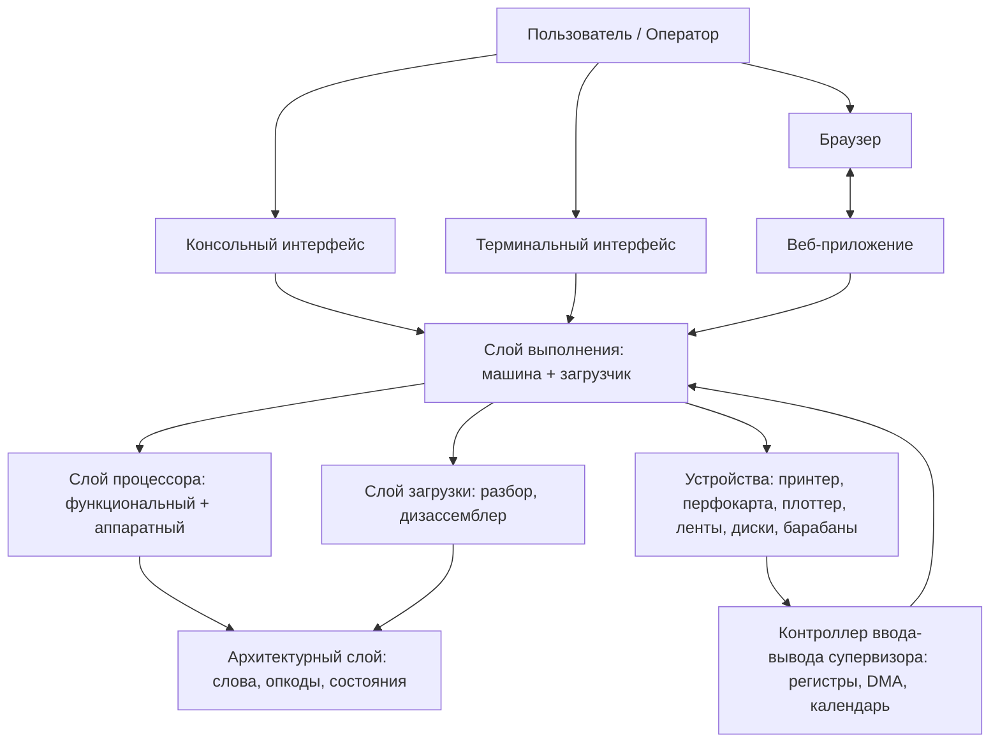
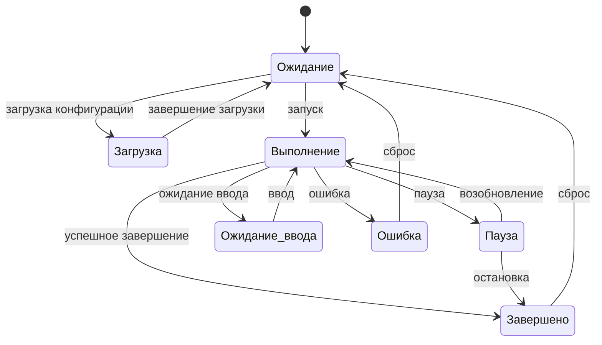
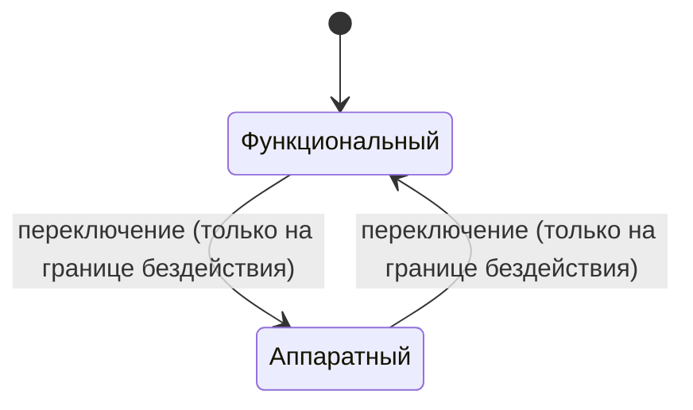

# Спецификация проектирования программного обеспечения (SDD)
# Симулятор ЭВМ БЭСМ-6

## 1. Введение

### 1.1 Назначение документа

Настоящий документ является полной спецификацией проектирования программного обеспечения симулятора ЭВМ БЭСМ-6. Документ описывает архитектуру, компоненты, интерфейсы, модели данных, порядок исполнения, режимы работы (включая режим супервизора), веб-приложение, стратегию тестирования и развертывания.

Спецификация абстрактна от конкретного языка программирования и платформы реализации. Все описания компонентов, интерфейсов и протоколов приведены в функциональной форме, не зависящей от выбранного стека технологий. Документ достаточен для независимой реализации системы на любом языке программирования.

### 1.2 Область применения

SDD охватывает все функциональные компоненты системы:

- Архитектурный слой — представление слов, команд, опкодов, состояний процессора.
- Слой процессора — семантика выполнения команд, выборка, декодирование, адресная модификация, арифметико-логическое устройство.
- Слой загрузки — ассемблирование, дизассемблирование, загрузка программ.
- Слой выполнения — композиция машины, владельцы исполнения, модель памяти, устройства, загрузка задач.
- Консольный интерфейс — интерфейс командной строки.
- Терминальный интерфейс — текстовый интерфейс пользователя.
- Веб-приложение — веб-консоль с удалённым управлением, загрузкой примеров и конфигураций.
- Графический визуализатор — представление чисел и команд.
- Инструментальные средства — бенчмарки, проверки пользовательского интерфейса, генераторы, скрипты приёмки.

### 1.3 Термины и определения

| Термин | Определение |
|--------|-------------|
| БЭСМ-6 | Большая Электронная Счетная Машина модели 6 — советская мэйнфрейм-машина 1960-х годов |
| Dubna | Программная система и язык программирования «Дубна» для БЭСМ-6 |
| Супервизор | Режим процессора с привилегированными регистрами, прерываниями и системными функциями |
| Режим исполнения | Функциональный (тактовый симулятор) или аппаратный (поэтапный драйвер с наносекундным временем) |
| Конфигурация машины | Описание образа супервизор-машины, включающее программу, параметры времени и устройства |
| Пресет веб-запуска | Набор параметров запуска с программой и режимами выполнения |
| Исполнительный цикл | Цикл выполнения с ограничением по инструкциям, статистикой и контрольными точками |
| Аппаратная модель процессора | Поэтапная модель с наносекундным календарём и устройствами |
| Функциональная симуляция | Тактовое моделирование выполнения команд |
| Dhrystone | Бенчмарк производительности 2.1, перенесённый на БЭСМ-6 |
| Модельные часы | Внутренние часы системы в тиках инструкций |
| Аппаратная временная шкала | Время в наносекундах для аппаратного режима исполнения |
| БРЗ | Буфер чтения операндов |
| БРС | Буфер чтения инструкций |
| БРЧ | Аппаратные буферы чтения устройств |
| M17 | Регистр управления режимом процессора |
| Статус управляющего устройства | Флаги блокировки и признаки состояния процессора |
| K | Счётчик команд (указатель инструкций) |
| A, Y, R, C | Арифметические регистры |
| M[0-15] | Индексные регистры |
| STOP | Команда остановки процессора |
| Экстракод | Системная команда, обрабатываемая специальным образом |

### 1.4 Источники требований

1. ТО-8, система команд БЭСМ-6. — [Энциклопедия БЭСМ-6 (besm6.org)](https://www.besm6.org/), [Документация (besm6.org)](https://www.besm6.org/doc/), [Система команд (mailcom.com)](http://www.mailcom.com/besm6/instset_ru.shtml), [Краткий перечень команд (besm6.org)](https://www.besm6.org/wiki/CmdSheet.html).
2. Салтыков А.И., Макаренко Г.И., «Программирование на языке Фортран», «Наука», 1976. — [libex.ru](https://www.libex.ru/detail/book805964.html), [sovietime.ru](https://sovietime.ru/informatika-i-vychislitelnaya-tekhnika/programmirovanie-na-yazyke-fortran-1976).
3. Документация по архитектуре БЭСМ-6, доступная в открытых источниках. — [Википедия: БЭСМ-6](https://ru.wikipedia.org/wiki/%D0%91%D0%AD%D0%A1%D0%9C-6), [Энциклопедия БЭСМ-6 (web.archive.org)](https://web.archive.org/web/20221104123210/https:/www.besm6.org/), [Музей вычислительной техники: БЭСМ-6](https://www.computer-museum.ru/biblioteka/publication/1422/), [BESM-6 Instruction Set (github.com/besm6)](https://github.com/besm6/v7besm/blob/main/doc/Besm6_Instruction_Set.md).
4. Материалы по Dhrystone 2.1 — описание бенчмарка. — [ACM: Dhrystone 2.1 rationale](https://dlnext.acm.org/doi/10.1145/47907.47911), [GitHub: dhrystone v2.1](https://github.com/Keith-S-Thompson/dhrystone/tree/master/v2.1).

---

## 2. Архитектурное описание

### 2.1 Общая схема компонентов

Система следует строгой иерархии зависимостей без циклов:

```
Архитектурный слой → Слой процессора → Слой загрузки → Слой выполнения → Интерфейсы пользователя
```

| Компонент | Назначение | Граница ответственности |
|-----------|------------|------------------------|
| Архитектурный слой | Представление 48-битных слов, 50-битных слов памяти, форматов команд, архитектурных состояний | Не выполняет загрузку, ввод-вывод или ожидание времени |
| Слой процессора | Выборка, декодирование, адресная модификация, диспетчеризация, арифметико-логическое устройство, фиксация результатов | Не владеет календарём устройств или системными лентами |
| Слой загрузки | Преобразование текстовых представлений команд и машинных слов | Не запускает машину |
| Слой выполнения | Композиция машины, владельцы исполнения, модель памяти, устройства, загрузка задач, системные обработчики | Не содержит независимой копии семантики команд |
| Консольный интерфейс | Ввод параметров, вызов слоя выполнения, представление результатов и диагностики | Не подменяет вычисления гостевой программы вычислениями хоста |
| Терминальный интерфейс | Текстовое взаимодействие поверх слоя выполнения | Аналогично консольному интерфейсу |
| Веб-приложение | Веб-консоль, удалённое управление, загрузка примеров и конфигураций, управление сессиями | Не меняет семантику исполнения |
| Графический визуализатор | Представление чисел и команд | Визуализация, не исполнение |

### 2.2 Диаграмма контейнеров



### 2.3 Основные архитектурные принципы

1. **Разделение владельцев исполнения**: одна машина поддерживает два взаимоисключающих владельца исполнения — функциональный и аппаратный. Переключение разрешено только на границе бездействия процессора.
2. **Единая семантика команд**: процессор использует общую семантику для функционального и аппаратного режимов; отличие только в механизме продвижения времени (тики против наносекунд).
3. **Изоляция загрузки**: загрузчик не смешивается с семантикой процессора; он только подготавливает состояние машины.
4. **Явное время**: функциональное время (тики инструкций) и аппаратное время (наносекунды) являются независимыми доменами.
5. **Отсутствие полного холодного сброса машины**: сброс процессора сохраняет память, часы, устройства и очередь событий.
6. **Валидация ресурсов**: ресурсы времени выполнения валидируются по контрольным суммам перед запуском процессора.


---

## 3. Детальное описание компонентов

### 3.1 Архитектурный слой

#### 3.1.1 Типы данных

**Слово 48 бит** — машинное слово с представлением мантиссы и порядка:
- Знак: 1 бит (старший)
- Порядок: 8 бит (смещённый)
- Мантисса: 39 бит (включая скрытую единицу)

**Слово памяти 50 бит**:
- Младшие 48 бит: данные или команда
- Старшие 2 бита: контрольные разряды (приписка, защита)

**Декодированная инструкция** — 24-битное полуслово:
- Регистр: номер индексного регистра M0–M15
- Операция: код операции
- Адрес: 15-битный адрес
- Формат: короткий или длинный

**Опкоды** — все коды операций БЭСМ-6 (000–0377 восьмерично):
- Короткий формат (000–037): арифметика, логика, индексные регистры
- Длинный формат (0200–0377): модификаторы, переходы, служебные команды, цикл
- Специальные: модификация индексного регистра, безусловный переход, останов, организация цикла, экстракоды 050–077

**Профили процессора**:
- Стандартный пользовательский профиль (по умолчанию)
- Профиль супервизора — с привилегированными регистрами, M17, прерываниями, экстракодами 050–077

#### 3.1.2 Интерфейсы архитектурного слоя

| Интерфейс | Назначение |
|-----------|------------|
| Процессор | Выполнение шага, старт по адресу, регистры, флаги |
| Состояние процессора | Только чтение состояния процессора |
| Регистры | Доступ к регистрам A, Y, R, C, M, K |
| Арифметико-логическое устройство | Выполнение арифметических и логических операций |
| Память хоста | Главная память системы |
| Память команд | Память для хранения команд |
| Память | Общий контракт доступа к памяти |
| Память операндов | Память для операндов |
| Управление супервизором | Специальные регистры, прерывания |
| Ввод-вывод супервизора | Регистры устройств, обмен данными |


### 3.2 Слой процессора

#### 3.2.1 Функциональная симуляция

Тактовое моделирование команд. Каждый успешный шаг соответствует одному тику (одна инструкция). Основные операции:
- Выполнение одной инструкции
- Блоковое выполнение с лимитом циклов
- Проверка границы функционального режима

#### 3.2.2 Аппаратная модель процессора

Поэтапная модель с наносекундным временем. Компоненты:
- Этапы арифметико-логического устройства с фиксированными и переменными завершениями
- Наносекундный календарь событий
- Календарь ресурсов устройств
- Порт памяти с банковым циклом и задержками
- Контроллер этапов арифметико-логического устройства

#### 3.2.3 Владелец исполнения

Механизм, гарантирующий взаимоисключение функционального и аппаратного режимов. Переключение разрешено только при:
- Отсутствии подготовленной инструкции
- Отсутствии активных обратных вызовов
- Отсутствии запущенного драйвера
- Отсутствии событий в очереди

#### 3.2.4 Исполнительный цикл

Цикл выполнения с следующими характеристиками:
- Лимит инструкций
- Лимит попыток шага (для профиля супервизора ограничивает попытки включая обработку ошибок)
- Скорость выполнения (максимальная, оригинальная, виртуальная)
- Сбор статистики
- Контрольные точки выполнения
- Лимит времени выполнения (в миллисекундах)
- Ограничение количества ошибок подряд, чтобы предотвратить бесконечное выполнение неудачных шагов


### 3.3 Слой выполнения (runtime)

#### 3.3.1 Ядро машины

Центральный компонент, Composing все части системы в единое целое.

**Публичный интерфейс:**
- Режим исполнения (функциональный / аппаратный)
- Главная память
- Память команд
- Аппаратная математическая память
- Буферная память
- Процессор
- Менеджер устройств
- Перфоратор
- Плоттер
- Контроллер ввода-вывода супервизора
- Выбор аппаратного исполнения с конфигурацией времени
- Выбор функционального исполнения
- Выполнение с лимитом инструкций, скоростью, статистикой, контрольными точками и лимитом времени
- Выполнение одной инструкции
- Непрерывное выполнение до условия остановки
- Проверка расширенного состояния машины

**Результат выполнения:**
- Итог (останов / останов по лимиту / ошибка)
- Статистика (инструкции, циклы, секунды, аллокация)

#### 3.3.2 Конфигурация автономного образа супервизор-машины

Описание образа супервизор-машины включает:
- Режим исполнения (функциональный / аппаратный)
- Скорость выполнения
- Конфигурация памяти (классическая 32K / расширенная 512K)
- Адрес входа
- Флаги управления
- Предел инструкций
- Слова памяти с адресами и исходными значениями
- Конфигурация времени (банковый цикл, задержки чтения/записи, устройства)
- Конфигурация устройств (образы дисков, перфоленты)

#### 3.3.3 Загрузчик программ

Отвечает за:
- Разбор задач в формате загрузчика (FORMAL, FORTRAN, ALGOL, ассемблер)
- Загрузку ресурсов времени выполнения (ленты, диски, барабаны)
- Установку системных обработчиков
- Выполнение скриптов с лимитами и статистикой

**Внутренняя организация загрузчика:**

- Модель загрузчика основана на пошаговом выполнении с сохранением состояния между шагами
- Загрузчик преобразует форматы задач (ассемблер, FORTRAN, FORMAL, алгол) в внутренний вид команды машин
- Экстракоды 050–077 обрабатываются специальным образом загрузчиком как системные команды
- Поддержка пресета веб-запуска: набор параметров запуска с программой и режимами выполнения
- Конфигурация памяти устанавливается при загрузке (классическая 32K или расширенная 512K)
- Адрес входа устанавливается на основе заголовка загружаемой задачи
- Системные обработчики регистрируются для устройств: терминал, принтер, перфокарты, перфолента, диски, барабаны
- Контрольные точки и статистика собираются с начала выполнения для последующего анализа

#### 3.3.4 Фабрика машин

Создание машин из конфигурации:
- Создание машины из конфигурации
- Создание загрузчика из конфигурации и машины
- Проверка ресурсов по контрольным суммам

#### 3.3.5 Конфигурация системы

Параметры конфигурации:
| Поле | Тип | По умолчанию | Описание |
|------|-----|--------------|----------|
| Каталог лент | строка | не задан | Каталог с лентами |
| Образ диска | строка | не задан | Файл образа диска |
| Образ барабана | строка | не задан | Файл образа барабана |
| Предел инструкций run | число | 20 000 000 | Лимит инструкций для команды выполнения |
| Предел инструкций check | число | 5 000 | Лимит инструкций для проверки |
| Базовый адрес загрузки | строка | "1000" | Адрес загрузки (восьмерично) |
| Объём памяти | число | 32768 | Размер ядра памяти в словах |
| Буферная память | булево | ложь | Буферная память БРЗ/БРС |
| Реальное время | булево | истинно | Использование реального системного времени |
| Скорость | перечисление | максимальная | Скорость выполнения |
| Гостевие часы | булево | ложь | Модель гостевых часов |
| Пакетная обработка точек наблюдения | булево | ложь | Пакетное выполнение с точками наблюдения |
| Коэффициент времени originale | число | по умолчанию | Масштаб времени originale |
| Коэффициент математических функций originale | число | по умолчанию | Множитель затрат элементарных функций |
| Перезапись FOREX как FORTRAN | булево | ложь | Рассматривать *forex как *fortran |


### 3.4 Консольный интерфейс

Команды интерфейса командной строки:

| Команда | Описание |
|---------|----------|
| Выполнить программу | Запуск программы из файла |
| Ассемблировать | Преобразование текста команды в машинное слово |
| Дизассемблировать | Преобразование машинного слова в текст |
| Проверить каталог | Пакетная проверка программ в каталоге |
| Запуск образа супервизора | Выполнение автономного образа из файла конфигурации |
| Перфокарты | Генерация перфокарт |

Ключи выполнения программы: скорость, статистика, гостевые часы, буферная память, состояние машины, предел инструкций, отключение реального времени, профилирование, трассировка, дамп памяти, конфигурация.

### 3.5 Веб-приложение

#### 3.5.1 Архитектура

Веб-приложение с поддержкой удалённого взаимодействия. Каждое подключение браузера получает изолированную сессию с собственным рабочим процессом.

**Компоненты:**
- Настройка приложения, endpoints API, центр взаимодействия
- Центр взаимодействия: загрузка файлов, текст, примеры, команды
- Реестр сессий: изоляция пользователей
- Хост рабочего процесса: запуск процесса выполнения
- Сессия выполнения: состояние, регистры, память, устройства
- Автономный запуск супервизор-машины из конфигурации
- Устройства: монтирование носителей, ввод-вывод
- Разрешение веб-пресетов
- Каталог примеров
- Кодирование и декодирование команд

#### 3.5.2 API endpoints

| Endpoint | Метод | Описание |
|----------|-------|----------|
| Список примеров | GET | Перечень доступных примеров |
| Исходный текст примера | GET | Текст конкретного примера |
| Каталог носителей | GET | Доступные носители |
| Шаблон конфигурации машины | GET | JSON шаблон супервизор-машины |
| Каталог опкодов | GET | Перечень операций |
| Декодирование команды | POST | Разбор команды в составные части |
| Кодирование команды | POST | Построение команды из частей |
| Кодбук перфокарт | GET | Таблица кодирования перфокарт |
| Центр взаимодействия | Соединение | Команды и события |

#### 3.5.3 Протокол команд и событий

**Команда от клиента:**
- Тип: запуск, сброс, пауза, возобновление, шаг, остановка, ввод, монтирование, размонтирование, чтение носителя, копирование в память
- Путь к задаче, Режим (отладка / полный запуск), Скорость
- Предел инструкций, Лимит времени
- Модель машины (стандартная / буферная / супервизор-функциональный / супервизор-аппаратный)
- Гостевие часы, Статистика, Декодирование памяти, Идентификатор носителя, Устройство, Единица, Том, ...

**Событие от сервера:**
- Состояние: Ожидание / Загрузка / Выполнение / Пауза / Ожидание ввода / Ошибка / Завершено
- Вывод: терминал, печать, перфокарта, плоттер
- Регистры: регистры процессора, специальные регистры супервизора
- Память: слова памяти с дизассемблированием
- Статистика: инструкции, циклы, секунды, аллокация
- Завершение: успех, останов, превышение лимита
- Ошибка: сообщение об ошибке
- Хранилище: смонтированные устройства, файлы сессии
- Плоттер: данные разных типов плоттеров

#### 3.5.4 Фронтенд

| Компонент | Назначение |
|-----------|------------|
| Разметка веб-консоли | Панель задачи, устройства, регистры, память |
| Основная логика | Взаимодействие с сервером, команды, загрузка примеров, подбор профиля |
| Каталог примеров | Фильтрация по профилю, загрузка содержимого |
| Редактор команд | Кодирование и декодирование команд |
| Подсветка кода | Отображение исходного кода |
| Носители | Монтирование, чтение, дизассемблирование |
| Плоттеры | Различные типы плоттеров |
| Перфокарты | Генерация и просмотр |
| Стили | Оформление интерфейса |

#### 3.5.5 Обработка примеров

При выборе примера в веб-интерфейсе:
1. Фильтрация примеров по совместимости с профилем машины (конфигурации для супервизора, программы для стандартного режима)
2. Загрузка исходного текста через API
3. Автоподбор профиля машины, если текущий не совпадает с типом файла
4. Автоматическая загрузка текста в сессию в фоне
5. Кнопка запуска становится активной

#### 3.5.6 Шаблон конфигурации машины

Загрузка шаблона конфигурации супервизор-машины через API. Источник — пример конфигурации. После загрузки профиль устанавливается в супервизор-аппаратный режим.

#### 3.5.7 Состояния сессии

| Состояние | Описание | Доступные команды |
|-----------|----------|-------------------|
| Ожидание | Готов к запуску | запуск, сброс, загрузка |
| Загрузка | Загрузка конфигурации | — |
| Выполнение | Процесс выполняется | пауза, останов, шаг (если отладка) |
| Ожидание ввода | Ожидание ввода терминала | ввод, останов, сброс |
| Пауза | Выполнение приостановлено | возобновление, шаг, останов, сброс |
| Ошибка | Произошла ошибка | сброс |


---

## 4. Режим супервизора (Supervisor Mode)

### 4.1 Обзор

Режим супервизора активируется через профиль процессора супервизора. Реализует системный/управляющий режим БЭСМ-6 с привилегированными регистрами, прерываниями, экстракодами 050–077 и отдельными устройствами ввода-вывода.

### 4.2 Ключевые механизмы

| Механизм | Реализованное правило | Источник |
|----------|----------------------|----------|
| Экстракоды 050–077 | Вектор 00500 + код, левая половина; Э20/Э21 = Э060/Э061 | ТО-8 §3.55 |
| Сохранение экстракода | M14 — адрес, M26 — следующее слово; A/Y/R сохраняются | ТО-8 §3.55 |
| Внутреннее/внешнее прерывание | Векторы 00500/00501, M27 и признаки в M23 | ТО-8 §6.16, §6.35 |
| Вход в управляющую программу | Установить БлП, БлЗ, БлПр, сохранив остальные M17 | ТО-8 §§6.16, 7.7–7.10 |
| ВЫПР | Три младших бита: 2/3 выбирают M26/M27 | ТО-8 §3.60 |
| Возврат | Восстановить режим, половину, модификатор; БлП/БлЗ/БлПр | ТО-8 §3.60 |
| M17 | Только гостевая запись; host-снимок допускается | ТО-8 §§7.7–7.8 |
| ПА/СА00 супервизора | Изменить лишь маску 0x403 | ТО-8 §7.8 |
| РЕГ/ОВУ | Раздельное чтение/запись регистров и устройств | ТО-8 §§3.56, 3.59 |
| 032/046/047 | В матрежиме недопустимы; в супервизоре 032 — ОВУ | ТО-8 §§3.62–3.64 |
| STOP | Кнопка останова; при отключении ПоК — NOP или Э063 | ТО-8 §3.61 |
| Адресные сравнения | M28 — команды, M29 — чтение/запись операнда | ТО-8 §§6.5–6.7, 7.19–7.21 |

### 4.3 Регистры супервизора

Наблюдаемые через снимок супервизора:
- Специальные регистры (M-регистры)
- Статус управления
- Внутренние прерывания
- Аппаратные наносекунды (в аппаратном режиме)
- Арифметические команды
- Страницы памяти и маска защиты операнда
- БРЧ (аппаратные буферы чтения, 4 слота)

### 4.4 БРЗ и память в супервизоре

- Отдельная функциональная граница завершения записи
- Заполнение последнего свободного БРЗ публикует старейшую запись
- Не более семи ожидающих публикации значений
- Запись адреса перестраивает старые записи

### 4.5 Исполнение в режиме супервизора

- Использует общий исполнительный цикл
- Для супервизора лимит ограничивает попытки шага (включая доставку ошибок)
- Неуспешный шаг не добавляет тик и счётчик
- Системный обработчик экстракодов не устанавливается
- Режим максимальной скорости без статистики не считает табличные такты ожидания

### 4.6 Аппаратный режим супервизора

Требует полной конфигурации времени:
- Банковый цикл, задержки чтения/записи, задержки устройств
- Переключение разрешено только на границе бездействия процессора
- Конфигурация неизменна после выбора
- Сброс процессора сохраняет выбранный владелец, память, часы, устройства

### 4.7 Пример запуска

```
Создать машину с профилем супервизора
Установить адрес входа процесса
Выполнить с лимитом инструкций, скоростью максимальной, сбором статистики
```

### 4.8 Проверки режима супервизора

- Проверка регистров и достижения остановки (функциональный и аппаратный, полный и отладочный режимы)
- Проверка реальных БРЧ в аппаратном режиме (4 буфера)
- Проверка модели исполнения (функциональный / аппаратный)


---

## 5. Модели памяти

### 5.1 Классическая модель (32K слов)

- Размер ядра памяти: 32768 слов
- Адресация: 15 бит
- Подходит для большинства пользовательских программ и стандартных задач

### 5.2 Расширенная модель (512K слов)

- Размер ядра памяти: 524288 слов
- Адресация: 19 бит
- Используется для супервизор-программ и больших задач

### 5.3 Буферная память

- БРЗ (буфер чтения операндов)
- БРС (буфер чтения инструкций)
- Буферная память адресуется отдельно от ядра памяти
- Включается/выключается конфигурацией

### 5.4 Математическая память

- Аппаратная математическая память для хранения констант
- Используется для реализации элементарных функций
- Конфигурируется через коэффициент математических функций originale

### 5.5 Адресная модификация

- Базовая модификация через индексные регистры M0–M15
- Длинный формат команды позволяет модифицировать адрес
- Адресные сравнения через M28 (команды) и M29 (чтение/запись операнда)
- Маска защиты операнда для контроля доступа

### 5.6 Семантика памяти

- Каждое слово — 50 бит (48 бит данных + 2 бита контроля)
- Чтение и запись через единый интерфейс
- Порт памяти в аппаратном режиме учитывает банковый цикл и задержки
- Память сохраняется при сбросе процессора

---

## 6. Устройства ввода-вывода

### 6.1 Терминал

- Текстовый ввод/вывод
- Поддержка ввода с клавиатуры и вывода на экран
- Используется в режиме супервизора для взаимодействия с пользователем

### 6.2 Принтер

- Печать текста и данных
- Поддержка форматированного вывода
- Используется для отладки и вывода результатов

### 6.3 Перфокарты

- Чтение и запись перфокарт
- Кодбук перфокарт (таблица кодирования)
- Генерация перфокарт из текста
- Поддержка стандартных форматов

### 6.4 Перфолента

- Чтение и запись перфолент
- Поддержка лент с различными кодировками
- Используется для загрузки программ

### 6.5 Плоттер

- Графический вывод
- Различные типы плоттеров с разными форматами данных
- Поддержка линейных и точечных графиков
- Данные передаются через события сервера

### 6.6 Ленты (магнитные)

- Чтение и запись магнитных лент
- Каталог лент — директория с файлами лент
- Поддержка стандартных форматов лент БЭСМ-6

### 6.7 Диски

- Образ диска — файл с образом диска
- Поддержка операций чтения/записи блоков
- Используется для хранения программ и данных

### 6.8 Барабаны

- Образ барабана — файл с образом барабана
- Быстрый доступ к данным
- Используется для системных задач

### 6.9 Контроллер ввода-вывода супервизора

- Регистры устройств
- Обмен данными через DMA
- Календарь событий для аппаратного режима
- Поддержка прерываний от устройств

### 6.10 Менеджер устройств

- Единый интерфейс управления всеми устройствами
- Монтирование и размонтирование носителей
- Чтение и запись данных
- Копирование данных в память


---

## 7. Бенчмарки и производительность

### 7.1 Dhrystone 2.1

- Порт бенчмарка Dhrystone 2.1 на БЭСМ-6
- Измерение производительности процессора
- Сравнение с другими машинами
- Поддержка различных режимов выполнения

### 7.2 Метрики производительности

| Метрика | Описание |
|---------|----------|
| Инструкции | Количество выполненных инструкций |
| Циклы | Количество тактов процессора |
| Секунды | Время выполнения в секундах |
| Аллокация | Объём выделенной памяти |
| Скорость | Инструкции в секунду |

### 7.3 Режимы скорости

| Режим | Описание |
|-------|----------|
| Максимальная | Выполнение на максимальной скорости хоста |
| Оригинальная | Скорость, соответствующая оригинальной БЭСМ-6 |
| Виртуальная | Настраиваемая скорость выполнения |

### 7.4 Профилирование

- Сбор статистики выполнения
- Трассировка команд
- Дамп памяти в заданные моменты
- Контрольные точки выполнения

---

## 8. Тестирование

### 8.1 Типы тестов

| Тип | Описание |
|-----|----------|
| Модульные тесты | Проверка отдельных компонентов |
| Интеграционные тесты | Проверка взаимодействия компонентов |
| Приёмочные тесты | Проверка соответствия требованиям |
| Тесты производительности | Измерение времени выполнения |
| Тесты пользовательского интерфейса | Проверка веб-интерфейса |

### 8.2 Стратегия тестирования

1. **Тесты архитектурного слоя**: проверка корректности представления слов, команд, опкодов.
2. **Тесты процессора**: проверка семантики команд, адресной модификации, арифметики.
3. **Тесты загрузчика**: проверка разбора и дизассемблирования.
4. **Тесты выполнения**: проверка исполнительного цикла, владельцев исполнения, памяти.
5. **Тесты устройств**: проверка ввода-вывода, монтирования, чтения.
6. **Тесты супервизора**: проверка экстракодов, прерываний, регистров.
7. **Тесты веб-приложения**: проверка API, сессий, протокола команд/событий.

### 8.3 Тестовые данные

- Примеры программ на языках FORMAL, FORTRAN, ALGOL, ассемблер
- Конфигурации супервизор-машины
- Образы дисков и лент
- Эталонные результаты выполнения

### 8.4 Автоматизация

- Скрипты приёмки для автоматического запуска тестов
- Пакетная проверка программ в каталоге
- Генераторы тестовых данных
- Проверка пользовательского интерфейса через автоматизированные сценарии

---

## 9. Интерфейсы и протоколы

### 9.1 Интерфейс процессора

**Операции:**
- Выполнение шага (возвращает результат)
- Старт по адресу
- Чтение/запись регистров
- Чтение флагов состояния
- Проверка границы функционального режима

### 9.2 Интерфейс памяти

**Операции:**
- Чтение слова по адресу
- Запись слова по адресу
- Получение размера памяти
- Проверка границ

### 9.3 Интерфейс устройства

**Операции:**
- Монтирование носителя
- Размонтирование носителя
- Чтение данных
- Запись данных
- Получение состояния

### 9.4 Протокол веб-взаимодействия

**Транспорт:** двунаправленное соединение (WebSocket или аналог)

**Формат команд:** JSON-объекты с полями:
- Тип команды
- Параметры (зависят от типа)
- Идентификатор сессии

**Формат событий:** JSON-объекты с полями:
- Тип события
- Данные (зависят от типа)
- Временная метка

### 9.5 Формат JSON конфигурации супервизор-машины

```json
{
  "mode": "functional | hardware",
  "speed": "max | original | virtual",
  "memory": {
    "size": 32768,
    "buffered": false
  },
  "entryPoint": "01000",
  "flags": {
    "guestClocks": false,
    "statistics": true,
    "realTime": true
  },
  "instructionLimit": 20000000,
  "memoryWords": [
    {
      "address": "01000",
      "value": "000000000000000000000000"
    }
  ],
  "timeConfig": {
    "bankCycle": 1000,
    "readDelay": 500,
    "writeDelay": 500,
    "deviceDelays": {}
  },
  "devices": {
    "disks": [],
    "tapes": []
  }
}
```

---

## 10. Жизненный цикл выполнения

### 10.1 Создание машины

1. Загрузка конфигурации
2. Создание машины из конфигурации
3. Инициализация памяти
4. Инициализация процессора
5. Инициализация устройств
6. Создание загрузчика

### 10.2 Загрузка программы

1. Чтение файла программы
2. Разбор задачи (FORMAL, FORTRAN, ALGOL, ассемблер)
3. Загрузка ресурсов (ленты, диски, барабаны)
4. Установка системных обработчиков
5. Валидация ресурсов по контрольным суммам

### 10.3 Выполнение

1. Выбор режима исполнения (функциональный / аппаратный)
2. Запуск исполнительного цикла
3. Выполнение инструкций до условия остановки
4. Сбор статистики
5. Обработка событий ввода-вывода

### 10.4 Остановка

1. Достижение лимита инструкций
2. Команда STOP
3. Ошибка выполнения
4. Пользовательская остановка (пауза/остановка)
5. Истечение лимита времени

### 10.5 Сброс

1. Сброс процессора (сохранение памяти, часов, устройств)
2. Сброс состояния выполнения
3. Подготовка к повторному запуску

### 10.6 Очистка

1. Освобождение ресурсов
2. Закрытие файлов
3. Отключение устройств


---

## 11. Конфигурация и развертывание

### 11.1 Конфигурация системы

Параметры конфигурации:
| Поле | Тип | По умолчанию | Описание |
|------|-----|--------------|----------|
| Каталог лент | строка | не задан | Каталог с лентами |
| Образ диска | строка | не задан | Файл образа диска |
| Образ барабана | строка | не задан | Файл образа барабана |
| Предел инструкций run | число | 20 000 000 | Лимит инструкций для команды выполнения |
| Предел инструкций check | число | 5 000 | Лимит инструкций для проверки |
| Базовый адрес загрузки | строка | "1000" | Адрес загрузки (восьмерично) |
| Объём памяти | число | 32768 | Размер ядра памяти в словах |
| Буферная память | булево | ложь | Буферная память БРЗ/БРС |
| Реальное время | булево | истинно | Использование реального системного времени |
| Скорость | перечисление | максимальная | Скорость выполнения |
| Гостевие часы | булево | ложь | Модель гостевых часов |
| Пакетная обработка точек наблюдения | булево | ложь | Пакетное выполнение с точками наблюдения |
| Коэффициент времени originale | число | по умолчанию | Масштаб времени originale |
| Коэффициент математических функций originale | число | по умолчанию | Множитель затрат элементарных функций |
| Перезапись FOREX как FORTRAN | булево | ложь | Рассматривать *forex как *fortran |

### 11.2 Развертывание консольного приложения

1. Сборка исполняемого файла
2. Установка конфигурационного файла
3. Размещение каталогов с лентами, дисками, барабанами
4. Запуск через командную строку

### 11.3 Развертывание веб-приложения

1. Сборка серверной части
2. Сборка клиентской части (статические файлы)
3. Настройка порта и адреса
4. Запуск сервера
5. Доступ через браузер

### 11.4 Требования к окружению

- Операционная система: любая, поддерживающая выбранный язык программирования
- Доступ к файловой системе для лент, дисков, барабанов
- Сетевой доступ для веб-приложения (если требуется)


---

## 12. Ограничения и допущения

### 12.1 Ограничения

1. **Точность аппаратной модели**: аппаратная модель приближает поведение реальной БЭСМ-6, но не воспроизводит её на наносекундном уровне с полной точностью.
2. **Поддержка устройств**: не все устройства БЭСМ-6 реализованы; поддерживаются только перечисленные в разделе 6.
3. **Совместимость**: программы, использующие недокументированные особенности, могут работать некорректно.
4. **Производительность**: аппаратный режим работает медленнее функционального.
5. **Память**: классическая модель ограничена 32K слов; расширенная — 512K слов.

### 12.2 Допущения

1. **Изоляция сессий**: каждая веб-сессия изолирована и не влияет на другие.
2. **Валидация ресурсов**: ресурсы проверяются по контрольным суммам перед запуском.
3. **Сохранение состояния**: сброс процессора сохраняет память и устройства.
4. **Единая семантика**: функциональный и аппаратный режимы используют общую семантику команд.

---

## 13. План разработки

### 13.1 Этапы

1. **Этап 1**: Архитектурный слой — слова, команды, опкоды.
2. **Этап 2**: Слой процессора — функциональная симуляция.
3. **Этап 3**: Слой загрузки — ассемблер, дизассемблер.
4. **Этап 4**: Слой выполнения — машина, память, устройства.
5. **Этап 5**: Режим супервизора — регистры, экстракоды, прерывания.
6. **Этап 6**: Аппаратная модель — поэтапное моделирование.
7. **Этап 7**: Консольный и терминальный интерфейсы.
8. **Этап 8**: Веб-приложение — API, сессии, протокол.
9. **Этап 9**: Тестирование и бенчмарки.
10. **Этап 10**: Документация и развертывание.

### 13.2 Критерии приёмки

1. Все примеры программ выполняются корректно.
2. Режим супервизора проходит все проверки.
3. Веб-приложение доступно и функционально.
4. Бенчмарк Dhrystone выполняется и даёт результаты.
5. Тесты проходят без ошибок.

---

## 14. Ссылки на внешние документы

1. ТО-8, система команд БЭСМ-6. — Основной источник информации о системе команд. — [Энциклопедия БЭСМ-6 (besm6.org)](https://www.besm6.org/), [Документация (besm6.org)](https://www.besm6.org/doc/), [Система команд (mailcom.com)](http://www.mailcom.com/besm6/instset_ru.shtml), [Краткий перечень команд (besm6.org)](https://www.besm6.org/wiki/CmdSheet.html).
2. Салтыков А.И., Макаренко Г.И., «Программирование на языке Фортран», «Наука», 1976. — Описание языка Фортран для БЭСМ-6. — [libex.ru](https://www.libex.ru/detail/book805964.html), [sovietime.ru](https://sovietime.ru/informatika-i-vychislitelnaya-tekhnika/programmirovanie-na-yazyke-fortran-1976).
3. Документация по архитектуре БЭСМ-6, доступная в открытых источниках. — Общая информация об архитектуре. — [Википедия: БЭСМ-6](https://ru.wikipedia.org/wiki/%D0%91%D0%AD%D0%A1%D0%9C-6), [Энциклопедия БЭСМ-6 (web.archive.org)](https://web.archive.org/web/20221104123210/https:/www.besm6.org/), [Музей вычислительной техники: БЭСМ-6](https://www.computer-museum.ru/biblioteka/publication/1422/), [BESM-6 Instruction Set (github.com/besm6)](https://github.com/besm6/v7besm/blob/main/doc/Besm6_Instruction_Set.md).
4. Материалы по Dhrystone 2.1 — описание бенчмарка. — [ACM: Dhrystone 2.1 rationale](https://dlnext.acm.org/doi/10.1145/47907.47911), [GitHub: dhrystone v2.1](https://github.com/Keith-S-Thompson/dhrystone/tree/master/v2.1).

---

## 15. История версий

| Версия | Дата | Изменения |
|--------|------|-----------|
| 1.0 | 2026-10-23 | Первоначальная версия SDD |
| 2.0 | 2026-10-23 | Полная переработка в абстрактном виде, убрана привязка к C#/.NET |
| 3.0 | 2026-10-23 | Добавлены ссылки на внешние интернет-источники, финальная верификация |


---

## Приложение А. Глоссарий опкодов

### А.1 Короткий формат (000–037)

| Опкод | Название | Описание |
|-------|----------|----------|
| 000 | СЛ | Сложение |
| 001 | ВЫЧ | Вычитание |
| 002 | УМН | Умножение |
| 003 | ДЕЛ | Деление |
| 004 | И | Логическое И |
| 005 | ИЛИ | Логическое ИЛИ |
| 006 | НЕ | Логическое НЕ |
| 007 | СДВ | Сдвиг |
| 010 | ЗП | Запись в память |
| 011 | ВЗ | Чтение из памяти |
| 012 | УСЛ | Условный переход |
| 013 | БП | Безусловный переход |
| 014 | ЦИКЛ | Организация цикла |
| 015 | СТОП | Остановка процессора |
| 016 | МОД | Модификация адреса |
| 017 | РЕГ | Работа с регистрами |

### А.2 Длинный формат (0200–0377)

| Опкод | Название | Описание |
|-------|----------|----------|
| 0200 | ПА | Передача адреса |
| 0201 | СА | Сложение адресов |
| 0202 | ВЫПР | Вызов прерывания/подпрограммы |
| 0203 | ВОЗВ | Возврат |
| 0204 | ЭКСТ | Экстракод |
| 0205 | СИСТ | Системная команда |
| 0206 | ОВУ | Обмен с устройством |
| 0207 | РЕГС | Чтение/запись регистров супервизора |
| 0210 | ПЕЧ | Печать |
| 0211 | ПЛ | Плоттер |
| 0212 | ПК | Перфокарта |
| 0213 | ЛЕНТ | Лента |
| 0214 | ДИСК | Диск |
| 0215 | БАР | Барабан |
| 0216 | ТЕРМ | Терминал |
| 0217 | ПРЕР | Прерывание |
| 0220 | МАСК | Маска |
| 0221 | СТР | Страница |
| 0222 | ЗАЩ | Защита |
| 0223 | БРЗ | Буфер чтения |
| 0224 | БРС | Буфер инструкций |
| 0225 | БРЧ | Буфер устройства |
| 0226 | М17 | Регистр M17 |
| 0227 | СТАТ | Статус |
| 0230 | ВРЕМ | Время |
| 0231 | ЧАСЫ | Часы |
| 0232 | МОДС | Модификация супервизора |
| 0233 | АДРС | Адресные сравнения |
| 0234 | ПРОВ | Проверка |
| 0235 | ОТЛ | Отладка |
| 0236 | ТРАС | Трассировка |
| 0237 | ДАМП | Дамп памяти |

### А.3 Экстракоды (050–077)

| Опкод | Название | Описание |
|-------|----------|----------|
| 050 | Э050 | Экстракод 050 |
| 051 | Э051 | Экстракод 051 |
| ... | ... | ... |
| 077 | Э077 | Экстракод 077 |

---

## Приложение Б. Схемы данных

### Б.1 Слово 48 бит

```
[1 бит знак][8 бит порядок][39 бит мантисса]
```

### Б.2 Слово памяти 50 бит

```
[2 бита контроль][48 бит данные]
```

### Б.3 Декодированная инструкция 24 бит

```
[4 бит регистр][8 бит операция][12 бит адрес]
```

### Б.4 Регистр M17 (управление режимом)

```
[БлП][БлЗ][БлПр][...остальные биты...]
```

Где:
- БлП — блокировка прерываний
- БлЗ — блокировка записи
- БлПр — блокировка прерываний процессора


---

## Приложение В. Диаграммы состояний

### В.1 Состояния сессии веб-приложения



### В.2 Владелец исполнения



---

*Конец документа*

