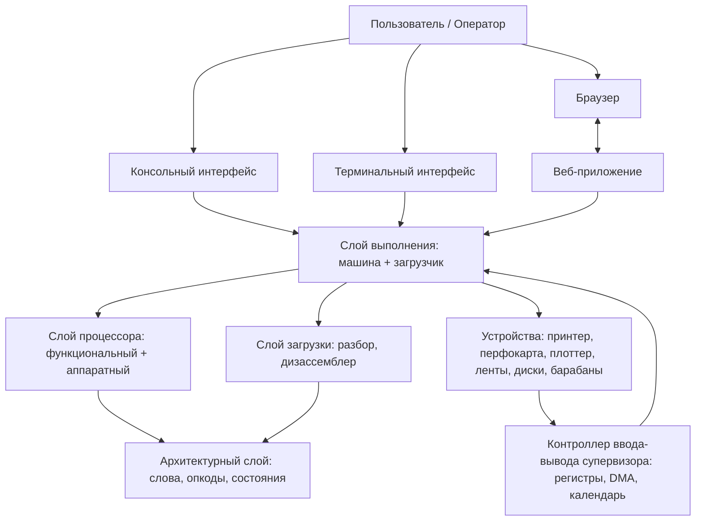
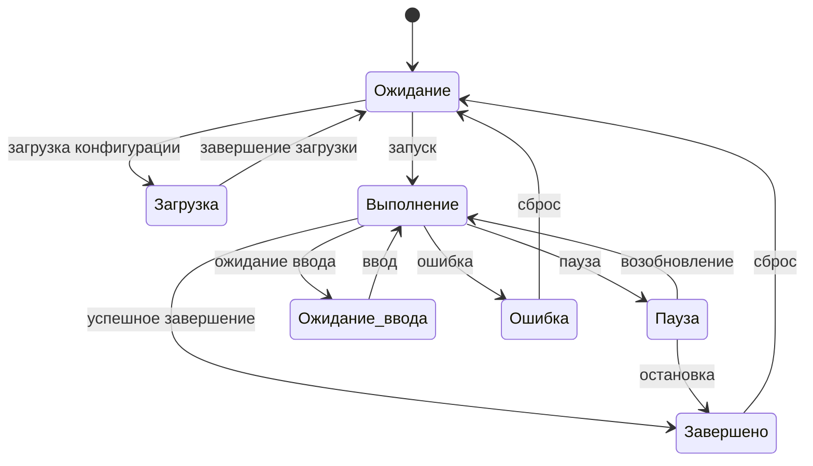
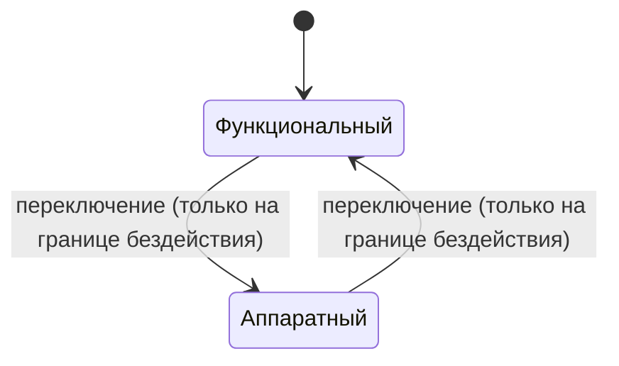

# Спецификация проектирования программного обеспечения (SDD)
# Симулятор ЭВМ БЭСМ-6

## 1. Введение

### 1.1 Назначение документа

Настоящий документ является полной спецификацией проектирования программного обеспечения симулятора ЭВМ БЭСМ-6. Документ описывает архитектуру, компоненты, интерфейсы, модели данных, порядок исполнения, режимы работы (включая режим супервизора), веб-приложение, стратегию тестирования и развертывания.

Спецификация абстрактна от конкретного языка программирования и платформы реализации. Все описания компонентов, интерфейсов и протоколов приведены в функциональной форме, не зависящей от выбранного стека технологий. Документ достаточен для независимой реализации системы на любом языке программирования.

### 1.2 Область применения

SDD охватывает все функциональные компоненты системы:

- Архитектурный слой — представление слов, команд, опкодов, состояний процессора.
- Слой процессора — семантика выполнения команд, выборка, декодирование, адресная модификация, арифметико-логическое устройство.
- Слой загрузки — ассемблирование, дизассемблирование, загрузка программ.
- Слой выполнения — композиция машины, владельцы исполнения, модель памяти, устройства, загрузка задач.
- Консольный интерфейс — интерфейс командной строки.
- Терминальный интерфейс — текстовый интерфейс пользователя.
- Веб-приложение — веб-консоль с удалённым управлением, загрузкой примеров и конфигураций.
- Графический визуализатор — представление чисел и команд.
- Инструментальные средства — бенчмарки, проверки пользовательского интерфейса, генераторы, скрипты приёмки.

### 1.3 Термины и определения

| Термин | Определение |
|--------|-------------|
| БЭСМ-6 | Большая Электронная Счетная Машина модели 6 — советская мэйнфрейм-машина 1960-х годов |
| Dubna | Программная система и язык программирования «Дубна» для БЭСМ-6 |
| Супервизор | Режим процессора с привилегированными регистрами, прерываниями и системными функциями |
| Режим исполнения | Функциональный (тактовый симулятор) или аппаратный (поэтапный драйвер с наносекундным временем) |
| Конфигурация машины | Описание образа супервизор-машины, включающее программу, параметры времени и устройства |
| Пресет веб-запуска | Набор параметров запуска с программой и режимами выполнения |
| Исполнительный цикл | Цикл выполнения с ограничением по инструкциям, статистикой и контрольными точками |
| Аппаратная модель процессора | Поэтапная модель с наносекундным календарём и устройствами |
| Функциональная симуляция | Тактовое моделирование выполнения команд |
| Dhrystone | Бенчмарк производительности 2.1, перенесённый на БЭСМ-6 |
| Модельные часы | Внутренние часы системы в тиках инструкций |
| Аппаратная временная шкала | Время в наносекундах для аппаратного режима исполнения |
| БРЗ | Буфер чтения операндов |
| БРС | Буфер чтения инструкций |
| БРЧ | Аппаратные буферы чтения устройств |
| M17 | Регистр управления режимом процессора |
| Статус управляющего устройства | Флаги блокировки и признаки состояния процессора |
| K | Счётчик команд (указатель инструкций) |
| A, Y, R, C | Арифметические регистры |
| M[0-15] | Индексные регистры |
| STOP | Команда остановки процессора |
| Экстракод | Системная команда, обрабатываемая специальным образом |

### 1.4 Источники требований

1. ТО-8, система команд БЭСМ-6. — [Энциклопедия БЭСМ-6 (besm6.org)](https://www.besm6.org/), [Документация (besm6.org)](https://www.besm6.org/doc/), [Система команд (mailcom.com)](http://www.mailcom.com/besm6/instset_ru.shtml), [Краткий перечень команд (besm6.org)](https://www.besm6.org/wiki/CmdSheet.html).
2. Салтыков А.И., Макаренко Г.И., «Программирование на языке Фортран», «Наука», 1976. — [libex.ru](https://www.libex.ru/detail/book805964.html), [sovietime.ru](https://sovietime.ru/informatika-i-vychislitelnaya-tekhnika/programmirovanie-na-yazyke-fortran-1976).
3. Документация по архитектуре БЭСМ-6, доступная в открытых источниках. — [Википедия: БЭСМ-6](https://ru.wikipedia.org/wiki/%D0%91%D0%AD%D0%A1%D0%9C-6), [Энциклопедия БЭСМ-6 (web.archive.org)](https://web.archive.org/web/20221104123210/https:/www.besm6.org/), [Музей вычислительной техники: БЭСМ-6](https://www.computer-museum.ru/biblioteka/publication/1422/), [BESM-6 Instruction Set (github.com/besm6)](https://github.com/besm6/v7besm/blob/main/doc/Besm6_Instruction_Set.md).
4. Материалы по Dhrystone 2.1 — описание бенчмарка. — [ACM: Dhrystone 2.1 rationale](https://dlnext.acm.org/doi/10.1145/47907.47911), [GitHub: dhrystone v2.1](https://github.com/Keith-S-Thompson/dhrystone/tree/master/v2.1).

---

## 2. Архитектурное описание

### 2.1 Общая схема компонентов

Система следует строгой иерархии зависимостей без циклов:

```
Архитектурный слой → Слой процессора → Слой загрузки → Слой выполнения → Интерфейсы пользователя
```

| Компонент | Назначение | Граница ответственности |
|-----------|------------|------------------------|
| Архитектурный слой | Представление 48-битных слов, 50-битных слов памяти, форматов команд, архитектурных состояний | Не выполняет загрузку, ввод-вывод или ожидание времени |
| Слой процессора | Выборка, декодирование, адресная модификация, диспетчеризация, арифметико-логическое устройство, фиксация результатов | Не владеет календарём устройств или системными лентами |
| Слой загрузки | Преобразование текстовых представлений команд и машинных слов | Не запускает машину |
| Слой выполнения | Композиция машины, владельцы исполнения, модель памяти, устройства, загрузка задач, системные обработчики | Не содержит независимой копии семантики команд |
| Консольный интерфейс | Ввод параметров, вызов слоя выполнения, представление результатов и диагностики | Не подменяет вычисления гостевой программы вычислениями хоста |
| Терминальный интерфейс | Текстовое взаимодействие поверх слоя выполнения | Аналогично консольному интерфейсу |
| Веб-приложение | Веб-консоль, удалённое управление, загрузка примеров и конфигураций, управление сессиями | Не меняет семантику исполнения |
| Графический визуализатор | Представление чисел и команд | Визуализация, не исполнение |

### 2.2 Диаграмма контейнеров



### 2.3 Основные архитектурные принципы

1. **Разделение владельцев исполнения**: одна машина поддерживает два взаимоисключающих владельца исполнения — функциональный и аппаратный. Переключение разрешено только на границе бездействия процессора.
2. **Единая семантика команд**: процессор использует общую семантику для функционального и аппаратного режимов; отличие только в механизме продвижения времени (тики против наносекунд).
3. **Изоляция загрузки**: загрузчик не смешивается с семантикой процессора; он только подготавливает состояние машины.
4. **Явное время**: функциональное время (тики инструкций) и аппаратное время (наносекунды) являются независимыми доменами.
5. **Отсутствие полного холодного сброса машины**: сброс процессора сохраняет память, часы, устройства и очередь событий.
6. **Валидация ресурсов**: ресурсы времени выполнения валидируются по контрольным суммам перед запуском процессора.


---

## 3. Детальное описание компонентов

### 3.1 Архитектурный слой

#### 3.1.1 Типы данных

**Слово 48 бит** — машинное слово с представлением мантиссы и порядка:
- Знак: 1 бит (старший)
- Порядок: 8 бит (смещённый)
- Мантисса: 39 бит (включая скрытую единицу)

**Слово памяти 50 бит**:
- Младшие 48 бит: данные или команда
- Старшие 2 бита: контрольные разряды (приписка, защита)

**Декодированная инструкция** — 24-битное полуслово:
- Регистр: номер индексного регистра M0–M15
- Операция: код операции
- Адрес: 15-битный адрес
- Формат: короткий или длинный

**Опкоды** — все коды операций БЭСМ-6 (000–0377 восьмерично):
- Короткий формат (000–037): арифметика, логика, индексные регистры
- Длинный формат (0200–0377): модификаторы, переходы, служебные команды, цикл
- Специальные: модификация индексного регистра, безусловный переход, останов, организация цикла, экстракоды 050–077

**Профили процессора**:
- Стандартный пользовательский профиль (по умолчанию)
- Профиль супервизора — с привилегированными регистрами, M17, прерываниями, экстракодами 050–077

#### 3.1.2 Интерфейсы архитектурного слоя

| Интерфейс | Назначение |
|-----------|------------|
| Процессор | Выполнение шага, старт по адресу, регистры, флаги |
| Состояние процессора | Только чтение состояния процессора |
| Регистры | Доступ к регистрам A, Y, R, C, M, K |
| Арифметико-логическое устройство | Выполнение арифметических и логических операций |
| Память хоста | Главная память системы |
| Память команд | Память для хранения команд |
| Память | Общий контракт доступа к памяти |
| Память операндов | Память для операндов |
| Управление супервизором | Специальные регистры, прерывания |
| Ввод-вывод супервизора | Регистры устройств, обмен данными |

#### 3.1.3 Регистры процессора

БЭСМ-6 имеет следующие основные регистры процессора:

| Регистр | Обозначение | Разрядность | Назначение |
|---------|-------------|-------------|------------|
| Счетчик команд | K | 15 бит | Адрес текущей выполняемой инструкции |
| Аккумулятор | A | 48 бит | Арифметический регистр, операнд и результат |
| Квотиент | Y | 48 бит | Регистр для умножения и деления |
| Результат | R | 48 бит | Регистр результатов АЛУ |
| Код операции | C | 8 бит | Код последней выполненной операции (совпадает с опкодом команды) |
| Индексные регистры | M0–M15 | 15 бит каждый | 16 регистров для адресной модификации |
| Режим процессора | M17 | особый | Регистр управления режимом (блокировки, режим супервизора) |
| Буфер чтения операндов | BRZ | — | Буфер для операндов |
| Буфер чтения инструкций | BRS | — | Буфер для инструкций |
| Аппаратные буферы чтения | BRC | 4 слота | Буферы для устройств ВВО |

**Флаги процессора**:
- Флаги условий: переполнение, ноль, знаковое сравнение
- Флаги защиты: маска защиты операнда
- Флаги режима: супервизорный/пользовательский режим

#### 3.1.4 Регистры супервизора (Supervisor Mode)

Регистры, доступные только в режиме супервизора:

| Регистр | Обозначение | Битовое разложение | Назначение |
|---------|-------------|-------------------|------------|
| Режимные флаги | M17 | [БлП][БлЗ][БлПр][...остальные биты...] | БлП — блокировка прерываний, БлЗ — блокировка записи, БлПр — блокировка прерываний процессора |
| Вектор прерывания | M23 | 9 бит | Код вектора внешнего прерывания |
| Вектор возврата | M24 | 15 бит | Адрес для возврата из обработчика |
| Счетчик попыток | M25 | 18 бит | Количество попыток выполнения шага (для надежности) |
| Адрес прерывания | M26 | 19 бит | Адрес следующего слова при обработке экстракода |
| Флаг экстракода | M27 | 1 бит | Признак обработки экстракода (0 — не обработан, 1 — обработан) |
| Вход/выход | M28/M29 | M28: 15 бит (адрес команды), M29: 15 бит (адрес операнда) | Адресные сравнения для прерывания по командам/операндам |
| Страницы памяти | M30–M31 | M30: 9 бит (маска страницы 0–511), M31: 9 бит (маска страницы 512–1023) | Маски страниц памяти для расширенной адресации 512K |
| Защита операнда | — | 1 бит валидности + 9 бит маски | Маска защиты доступа к памяти (0 — доступ разрешен, 1 — доступ запрещен с ошибкой) |

### 3.1.5 Регистры ввода-вывода

Регистры конкретных устройств ВВО:

| Устройство | Регистр | Назначение |
|------------|---------|------------|
| Терминал | Status | Флаги готовности, ошибки |
| Принтер | Command | Код команды, адрес буфера, длина |
| Перфокарты | Status | Наличие карты, код операции, колонки |
| Перфолента | Position | Позиция головки, статус EOF/EOD |
| Плоттер | Command | Тип операции, координаты, цвет/толщина |
| Диски | Status | Монтирование, адрес, сектор, защита |
| Барабаны | Position | Позиция головки, количество слов, статус |
| Контроллер ВВО | Mode | Режим устройства (онлайн/оффлайн/ожидание) |
| Контроллер ВВО | Status | Флаги готовности, ошибок, условий завершения |
| Контроллер ВВО | Address | Текущий адрес передачи данных |
| Контроллер ВВО | Counter | Количество слов, переданных с инициализации |
| Контроллер ВВО | Interrupt Mask | Битовая маска разрешения/запрещения прерываний |
| Контроллер ВВО | Event Calendar | Таблица событий с временными метками (наносекунды) |


### 3.2 Слой процессора

#### 3.2.1 Функциональная симуляция

Тактовое моделирование команд. Каждый успешный шаг соответствует одному тику (одна инструкция). Основные операции:
- Выполнение одной инструкции
- Блоковое выполнение с лимитом циклов
- Проверка границы функционального режима

#### 3.2.2 Аппаратная модель процессора

Поэтапная модель с наносекундным временем. Компоненты:
- Этапы арифметико-логического устройства с фиксированными и переменными завершениями
- Наносекундный календарь событий
- Календарь ресурсов устройств
- Порт памяти с банковым циклом и задержками
- Контроллер этапов арифметико-логического устройства

#### 3.2.3 Владелец исполнения

Механизм, гарантирующий взаимоисключение функционального и аппаратного режимов. Переключение разрешено только при:
- Отсутствии подготовленной инструкции
- Отсутствии активных обратных вызовов
- Отсутствии запущенного драйвера
- Отсутствии событий в очереди

#### 3.2.4 Исполнительный цикл

Цикл выполнения с следующими характеристиками:
- Лимит инструкций
- Лимит попыток шага (для профиля супервизора ограничивает попытки включая обработку ошибок)
- Скорость выполнения (максимальная, оригинальная, виртуальная)
- Сбор статистики
- Контрольные точки выполнения
- Лимит времени выполнения (в миллисекундах)
- Ограничение количества ошибок подряд, чтобы предотвратить бесконечное выполнение неудачных шагов


### 3.3 Слой выполнения (runtime)

#### 3.3.1 Ядро машины

Центральный компонент, Composing все части системы в единое целое.

**Публичный интерфейс:**
- Режим исполнения (функциональный / аппаратный)
- Главная память
- Память команд
- Аппаратная математическая память
- Буферная память
- Процессор
- Менеджер устройств
- Перфоратор
- Плоттер
- Контроллер ввода-вывода супервизора
- Выбор аппаратного исполнения с конфигурацией времени
- Выбор функционального исполнения
- Выполнение с лимитом инструкций, скоростью, статистикой, контрольными точками и лимитом времени
- Выполнение одной инструкции
- Непрерывное выполнение до условия остановки
- Проверка расширенного состояния машины

**Результат выполнения:**
- Итог (останов / останов по лимиту / ошибка)
- Статистика (инструкции, циклы, секунды, аллокация)

#### 3.3.2 Конфигурация автономного образа супервизор-машины

Описание образа супервизор-машины включает:
- Режим исполнения (функциональный / аппаратный)
- Скорость выполнения
- Конфигурация памяти (классическая 32K / расширенная 512K)
- Адрес входа
- Флаги управления
- Предел инструкций
- Слова памяти с адресами и исходными значениями
- Конфигурация времени (банковый цикл, задержки чтения/записи, устройства)
- Конфигурация устройств (образы дисков, перфоленты)

#### 3.3.3 Загрузчик программ

Отвечает за:
- Разбор задач в формате загрузчика (FORMAL, FORTRAN, ALGOL, ассемблер)
- Загрузку ресурсов времени выполнения (ленты, диски, барабаны)
- Установку системных обработчиков
- Выполнение скриптов с лимитами и статистикой

**Внутренняя организация загрузчика:**

- Модель загрузчика основана на пошаговом выполнении с сохранением состояния между шагами
- Загрузчик преобразует форматы задач (ассемблер, FORTRAN, FORMAL, алгол) в внутренний вид команды машин
- Экстракоды 050–077 обрабатываются специальным образом загрузчиком как системные команды
- Поддержка пресета веб-запуска: набор параметров запуска с программой и режимами выполнения
- Конфигурация памяти устанавливается при загрузке (классическая 32K или расширенная 512K)
- Адрес входа устанавливается на основе заголовка загружаемой задачи
- Системные обработчики регистрируются для устройств: терминал, принтер, перфокарты, перфолента, диски, барабаны
- Контрольные точки и статистика собираются с начала выполнения для последующего анализа

#### 3.3.4 Фабрика машин

Создание машин из конфигурации:
- Создание машины из конфигурации
- Создание загрузчика из конфигурации и машины
- Проверка ресурсов по контрольным суммам

#### 3.3.5 Конфигурация системы

Параметры конфигурации:
| Поле | Тип | По умолчанию | Описание |
|------|-----|--------------|----------|
| Каталог лент | строка | не задан | Каталог с лентами |
| Образ диска | строка | не задан | Файл образа диска |
| Образ барабана | строка | не задан | Файл образа барабана |
| Предел инструкций run | число | 20 000 000 | Лимит инструкций для команды выполнения |
| Предел инструкций check | число | 5 000 | Лимит инструкций для проверки |
| Базовый адрес загрузки | строка | "1000" | Адрес загрузки (восьмерично) |
| Объём памяти | число | 32768 | Размер ядра памяти в словах |
| Буферная память | булево | ложь | Буферная память БРЗ/БРС |
| Реальное время | булево | истинно | Использование реального системного времени |
| Скорость | перечисление | максимальная | Скорость выполнения |
| Гостевие часы | булево | ложь | Модель гостевых часов |
| Пакетная обработка точек наблюдения | булево | ложь | Пакетное выполнение с точками наблюдения |
| Коэффициент времени originale | число | по умолчанию | Масштаб времени originale |
| Коэффициент математических функций originale | число | по умолчанию | Множитель затрат элементарных функций |
| Перезапись FOREX как FORTRAN | булево | ложь | Рассматривать *forex как *fortran |


### 3.4 Консольный интерфейс

Команды интерфейса командной строки:

| Команда | Описание |
|---------|----------|
| Выполнить программу | Запуск программы из файла |
| Ассемблировать | Преобразование текста команды в машинное слово |
| Дизассемблировать | Преобразование машинного слова в текст |
| Проверить каталог | Пакетная проверка программ в каталоге |
| Запуск образа супервизора | Выполнение автономного образа из файла конфигурации |
| Перфокарты | Генерация перфокарт |

Ключи выполнения программы: скорость, статистика, гостевые часы, буферная память, состояние машины, предел инструкций, отключение реального времени, профилирование, трассировка, дамп памяти, конфигурация.

### 3.5 Веб-приложение

#### 3.5.1 Архитектура

Веб-приложение с поддержкой удалённого взаимодействия. Каждое подключение браузера получает изолированную сессию с собственным рабочим процессом.

**Компоненты:**
- Настройка приложения, endpoints API, центр взаимодействия
- Центр взаимодействия: загрузка файлов, текст, примеры, команды
- Реестр сессий: изоляция пользователей
- Хост рабочего процесса: запуск процесса выполнения
- Сессия выполнения: состояние, регистры, память, устройства
- Автономный запуск супервизор-машины из конфигурации
- Устройства: монтирование носителей, ввод-вывод
- Разрешение веб-пресетов
- Каталог примеров
- Кодирование и декодирование команд

#### 3.5.2 API endpoints

| Endpoint | Метод | Описание |
|----------|-------|----------|
| Список примеров | GET | Перечень доступных примеров |
| Исходный текст примера | GET | Текст конкретного примера |
| Каталог носителей | GET | Доступные носители |
| Шаблон конфигурации машины | GET | JSON шаблон супервизор-машины |
| Каталог опкодов | GET | Перечень операций |
| Декодирование команды | POST | Разбор команды в составные части |
| Кодирование команды | POST | Построение команды из частей |
| Кодбук перфокарт | GET | Таблица кодирования перфокарт |
| Центр взаимодействия | Соединение | Команды и события |

#### 3.5.3 Протокол команд и событий

**Команда от клиента:**
- Тип: запуск, сброс, пауза, возобновление, шаг, остановка, ввод, монтирование, размонтирование, чтение носителя, копирование в память
- Путь к задаче, Режим (отладка / полный запуск), Скорость
- Предел инструкций, Лимит времени
- Модель машины (стандартная / буферная / супервизор-функциональный / супервизор-аппаратный)
- Гостевие часы, Статистика, Декодирование памяти, Идентификатор носителя, Устройство, Единица, Том, ...

**Событие от сервера:**
- Состояние: Ожидание / Загрузка / Выполнение / Пауза / Ожидание ввода / Ошибка / Завершено
- Вывод: терминал, печать, перфокарта, плоттер
- Регистры: регистры процессора, специальные регистры супервизора
- Память: слова памяти с дизассемблированием
- Статистика: инструкции, циклы, секунды, аллокация
- Завершение: успех, останов, превышение лимита

**Единицы измерения в ответах JSON** (применяются ко всем числовым полям протокола):
- **время**: наносекунды (на внутреннем уровне), секунды (для отображения пользователю)
- **инструкции**: количество инструкций (целое число)
- **циклы**: такты процессора (целое число)
- **секунды**: reales execution time (для статистики)
- **память**: слова памяти (32-битные слова БЭСМ-6)
- **аллокация**: выделено слов из 512K или 32K
- **регистры**: значения регистров в формате, соответствующем их битовой ширине (A,Y,R — 48 бит; K — 15 бит; C — 8 бит)
- **адресация**: биты адреса, соответствующие конфигурации памяти (32K = 15 бит, 512K = 19 бит с банкированием)
- **скорость**: максимальная / оригинальная (enum), отношение тактов к реальному времени

**Формат JSON-ответов:**
Все числовые поля протокола должны сопровождаться указанием единиц измерения в документации клиенту. Клиенты могут интерпретировать числовые значения без Units, но для корректного отображения и статистики единицы измерения рекомендуется парсить вместе с значениями.
- Ошибка: сообщение об ошибке
- Хранилище: смонтированные устройства, файлы сессии
- Плоттер: данные разных типов плоттеров

#### 3.5.4 Фронтенд

| Компонент | Назначение |
|-----------|------------|
| Разметка веб-консоли | Панель задачи, устройства, регистры, память |
| Основная логика | Взаимодействие с сервером, команды, загрузка примеров, подбор профиля |
| Каталог примеров | Фильтрация по профилю, загрузка содержимого |
| Редактор команд | Кодирование и декодирование команд |
| Подсветка кода | Отображение исходного кода |
| Носители | Монтирование, чтение, дизассемблирование |
| Плоттеры | Различные типы плоттеров |
| Перфокарты | Генерация и просмотр |
| Стили | Оформление интерфейса |

#### 3.5.5 Обработка примеров

При выборе примера в веб-интерфейсе:
1. Фильтрация примеров по совместимости с профилем машины (конфигурации для супервизора, программы для стандартного режима)
2. Загрузка исходного текста через API
3. Автоподбор профиля машины, если текущий не совпадает с типом файла
4. Автоматическая загрузка текста в сессию в фоне
5. Кнопка запуска становится активной

#### 3.5.6 Шаблон конфигурации машины

Загрузка шаблона конфигурации супервизор-машины через API. Источник — пример конфигурации. После загрузки профиль устанавливается в супервизор-аппаратный режим.

#### 3.5.7 Состояния сессии

| Состояние | Описание | Доступные команды |
|-----------|----------|-------------------|
| Ожидание | Готов к запуску | запуск, сброс, загрузка |
| Загрузка | Загрузка конфигурации | — |
| Выполнение | Процесс выполняется | пауза, останов, шаг (если отладка) |
| Ожидание ввода | Ожидание ввода терминала | ввод, останов, сброс |
| Пауза | Выполнение приостановлено | возобновление, шаг, останов, сброс |
| Ошибка | Произошла ошибка | сброс |


---

## 4. Режим супервизора (Supervisor Mode)

### 4.1 Обзор

Режим супервизора активируется через профиль процессора супервизора. Реализует системный/управляющий режим БЭСМ-6 с привилегированными регистрами, прерываниями, экстракодами 050–077 и отдельными устройствами ввода-вывода.

### 4.2 Ключевые механизмы

| Механизм | Реализованное правило | Источник |
|----------|----------------------|----------|
| Экстракоды 050–077 | Вектор 00500 + код, левая половина; Э20/Э21 = Э060/Э061 | ТО-8 §3.55 |
| Сохранение экстракода | M14 — адрес, M26 — следующее слово; A/Y/R сохраняются | ТО-8 §3.55 |
| Внутреннее/внешнее прерывание | Векторы 00500/00501, M27 и признаки в M23 | ТО-8 §6.16, §6.35 |
| Вход в управляющую программу | Установить БлП, БлЗ, БлПр, сохранив остальные M17 | ТО-8 §§6.16, 7.7–7.10 |
| ВЫПР | Три младших бита: 2/3 выбирают M26/M27 | ТО-8 §3.60 |
| Возврат | Восстановить режим, половину, модификатор; БлП/БлЗ/БлПр | ТО-8 §3.60 |
| M17 | Только гостевая запись; host-снимок допускается | ТО-8 §§7.7–7.8 |
| ПА/СА00 супервизора | Изменить лишь маску 0x403 | ТО-8 §7.8 |
| РЕГ/ОВУ | Раздельное чтение/запись регистров и устройств | ТО-8 §§3.56, 3.59 |
| 032/046/047 | В матрежиме недопустимы; в супервизоре 032 — ОВУ | ТО-8 §§3.62–3.64 |
| STOP | Кнопка останова; при отключении ПоК — NOP или Э063 | ТО-8 §3.61 |
| Адресные сравнения | M28 — команды, M29 — чтение/запись операнда | ТО-8 §§6.5–6.7, 7.19–7.21 |

### 4.3 Регистры супервизора

Наблюдаемые через снимок супервизора:
- Специальные регистры (M-регистры)
- Статус управления
- Внутренние прерывания
- Аппаратные наносекунды (в аппаратном режиме)
- Арифметические команды
- Страницы памяти и маска защиты операнда
- БРЧ (аппаратные буферы чтения, 4 слота)

### 4.4 БРЗ и память в супервизоре

- Отдельная функциональная граница завершения записи
- Заполнение последнего свободного БРЗ публикует старейшую запись
- Не более семи ожидающих публикации значений
- Запись адреса перестраивает старые записи

### 4.5 Исполнение в режиме супервизора

- Использует общий исполнительный цикл
- Для супервизора лимит ограничивает попытки шага (включая доставку ошибок)
- Неуспешный шаг не добавляет тик и счётчик
- Системный обработчик экстракодов не устанавливается
- Режим максимальной скорости без статистики не считает табличные такты ожидания

### 4.6 Аппаратный режим супервизора

Требует полной конфигурации времени:
- Банковый цикл, задержки чтения/записи, задержки устройств
- Переключение разрешено только на границе бездействия процессора
- Конфигурация неизменна после выбора
- Сброс процессора сохраняет выбранный владелец, память, часы, устройства

### 4.7 Пример запуска

```
Создать машину с профилем супервизора
Установить адрес входа процесса
Выполнить с лимитом инструкций, скоростью максимальной, сбором статистики
```

### 4.8 Проверки режима супервизора

- Проверка регистров и достижения остановки (функциональный и аппаратный, полный и отладочный режимы)
- Проверка реальных БРЧ в аппаратном режиме (4 буфера)
- Проверка модели исполнения (функциональный / аппаратный)


---

## 5. Модели памяти

### 5.1 Классическая модель (32K слов)

- Размер ядра памяти: 32768 слов
- Адресация: 15 бит
- Подходит для большинства пользовательских программ и стандартных задач

### 5.2 Расширенная модель (512K слов)

- Размер ядра памяти: 524288 слов
- Адресация: 19 бит (комбинированная: 15 бит базового адреса из регистра K/M + 4 бита банка/страницы из регистра M17/M28–M31)
- Используется для супервизор-программ и больших задач
- Механизм расширенной адресации: старшие 4 бита адреса извлекаются из регистра M17 (битовое поле блокировки прерываний/банка) или из специального регистра страницы, что позволяет адресовать весь объем памяти 512K слов через комбинацию базового регистра и выбора страницы

### 5.3 Буферная память

- БРЗ (буфер чтения операндов)
- БРС (буфер чтения инструкций)
- Буферная память адресуется отдельно от ядра памяти
- Включается/выключается конфигурацией

### 5.4 Математическая память

- Аппаратная математическая память для хранения констант
- Используется для реализации элементарных функций
- Конфигурируется через коэффициент математических функций originale

### 5.5 Адресная модификация

- Базовая модификация через индексные регистры M0–M15
- Длинный формат команды позволяет модифицировать адрес
- Адресные сравнения через M28 (команды) и M29 (чтение/запись операнда)
- Маска защиты операнда для контроля доступа

### 5.6 Семантика памяти

- Каждое слово — 50 бит (48 бит данных + 2 бита контроля)
- Чтение и запись через единый интерфейс
- Порт памяти в аппаратном режиме учитывает банковый цикл и задержки
- Память сохраняется при сбросе процессора

## 5.7 Дубина (Dubna)

**Дубина** — сложившаяся программно-аппаратная система для ЭВМ БЭСМ-6, включающая в себя операционную систему, монитор, компиляторы и языки программирования (включая сам язык Дубина). Разработана Объединенным исследовательским центром г. Дуна в 1960–1980-х годах.

**Компоненты системы:**
- **Операционная система** — управление ресурсами памяти, peripherals, устройства; планирование задач, работа с файловой системой
- **Монитор** — базовый слой для взаимодействия с аппаратурой, обработка прерываний, базовые сервисы
- **Язык программирования Дубина** — алгоритмический язык для численных вычислений, расширение ALGOL с элементами FORTRAN, оптимизированное для архитектуры БЭСМ-6
- **Компиляторы** — системы компиляции FORTRAN, ALGOL, FORMAL и ассемблера с генерацией кода для БЭСМ-6
- **Инструментальные средства** — отладчики, профилировщики, системы пакетной обработки

**Цели и задачи:**
- Унифицированная среда для разработки и выполнения вычислительных программ
- Автоматическое управление ресурсами системы (память, периферия, устройства)
- Поддержка пакетной обработки задач и многократного использования вычислительных ресурсов
- Интерфейс для взаимодействия между пользователем и вычислительной машиной

### 5.7.1 Язык программирования Дубина

**Язык программирования Дубина** — алгоритмический язык, созданный в составе комплекса Дубина для ЭВМ БЭСМ-6. Язык сочетает элементы ALGOL и FORTRAN, оптимизирован для численных вычислений на 48-битной архитектуре.

**Характеристики языка:**
- 6-битный кодовый код системы (соответствует коду БЭСМ)
- Числовые данные: 48-битные слова с плавающей точкой
- Операции: арифметические (+, -, *, /), логические (AND, OR, NOT), сравнения
- Типы данных: целые числа, вещественные числа, символьные строки
- Управление потоком: условные переходы, циклы, подпрограммные вызовы
- Ввод-вывод: работа с терминалом, перфокартами, лентами, дисками, барабанами

**Соответствие БЭСМ-6:**
- Опкоды языка映射 к стандартным опкодам БЭСМ-6 (000–0377 восьмерично)
- Доступны экстракоды 050–077 для расширения функционала
- Непосредственный доступ к регистрам процессора A, Y, R, K, M0–M15, M17
- Флаги процессора (переполнение, ноль, знак) используются для условий переходов

**Примеры операций:**
- Арифметика: ADD, SUB, MUL, DIV с обработкой переполнения
- Логические операции для работы с битами 48-битных слов
- Условные переходы на основе флагов процессора
- Команды ввода-вывода для устройств peripheral equipment

## 5.8 Язык программирования Fornex

**Fornex** — современный алгоритмический язык, предназначенный для вычислительных задач на ЭВМ БЭСМ-6. Язык combines элементы классических языков программирования с специфическими возможностями архитектуры БЭСМ-6.

**Характеристики языка:**
- 6-битный кодовый системой (соответствует коду БЭСМ)
- Поддержка 48-битных слов (аккумулятор A, регистры Y, R)
- Встроенная поддержка арифметических операций с плавающей точкой
- Интеграция с экстракодами 050–077 для системных функций
- Индексная адресация через регистры M0–M15
- Поддержка циклов и ветвлений с опорами на флаги процессора

**Синтаксис:**
- Основан на структурном программировании
- Операции: арифметические (+, -, *, /), логические (AND, OR, NOT), сравнения
- Типы данных: целые числа, вещественные числа, символьные строки
- Команды ввода-вывода: работа с терминалом, перфокартами, лентами, дисками, барабанами

**Соответствие БЭСМ-6:**
- Опкоды Fornex映射 к стандартным опкодам БЭСМ-6 (000–0377 восьмерично)
- Экстракоды 050–077 доступны для расширения функционала
- Регистры процессора A, Y, R, K, M0–M15, M17 напрямую доступны из программ Fornex
- Флаги процессора (переполнение, ноль, знак) используются для условий переходов

**Примеры операций:**
- Арифметика: ADD, SUB, MUL, DIV с автоматическим переполнение-обработкой
- Логика: bitwise операции для работы с 48-битными словами
- Переходы: условные переходы на основе флагов процессора
- Ввод-вывод: команды для работы с устройствами ВВО

### 5.7.3 Язык программирования Dubna

**Синтаксис**: 기반 на алгоритмическом языке с influences от FORTRAN и FORMAL.

**Основные особенности**:
- Числовые типы данных: целые, вещественные (48-битная мантисса БЭСМ-6)
- Символьные строки и массивы
- Массивы с индексами, отображающиеся на индексные регистры M0–M15
- Операции ввода-вывода, подпрограммы, рекурсия (с ограничениями)
- Управляющие структуры: условие, цикл, переход

**Типы данных**:
- **Целые числа**: знак + 39-bit мантисса (в коде БЭСМ-6)
- **Вещественные числа**: знак + 8-bit порядок + 39-bit мантисса (50-bit слово памяти)
- **Логические значения**: истина/ложь
- **Символьныеconstants и переменные**

**Конструкции языка**:
- Объявление переменных и констант
- Арифметические операции: +, -, *, / (с учетом переполнения)
- Операции сравнения: =, ≠, <, >, ≤, ≥
- Присваивание значения переменной
- Условные конструкции: IF, THEN, ELSE
- Циклы: DO, WHILE
- Подпрограммы и функции
- Ввод-вывод: чтение/запись через устройства ВВО

### 5.7.4 Поддерживаемые языки программирования

Симулятор БЭСМ-6 поддерживает следующие языки программирования через соответствующие компиляторы и загрузчики:

| Язык | Компилятор/Преобразующее | Особенности |
|------|-------------------------|-------------|
| **FORTRAN** | Компилятор FORTRAN БЭСМ-6 | Числовые вычисления, матричные операции, подпрограммы; наиболее largement используемый язык科学技术ных вычислений |
| **ALGOL** | Компилятор ALGOL БЭСМ-6 | Структурное программирование, блоки, процедуры; академический и образовательный язык |
| **FORMAL** | Компилятор FORMAL | Математическое моделирование, спецификация, доказательства корректности; используется для критических систем |
| **Ассемблер** | Ассемблер БЭСМ-6 | Прямая работа с опкодами, регистрами, адресным модификацией; полный контроль над железом |
| **Dubna** | Система Dubna | Собственный язык с расширениями ALGOL/FORTRAN, специальные возможности для научных вычислений |

**Форматы задач загрузчика**:
- Поддержка форматов входных данных для каждого языка
- Автоматическое преобразование в внутреннее представление команд машин
- Экстракоды 050–077 обрабатываются специальным образом как системные команды

### 5.8 Форматы задач загрузчика

- **FORMAL** — формат задач, написанных на языке FORMAL
- **FORTRAN** — формат задач, написанных на языке FORTRAN
- **ALGOL** — формат задач, написанных на языке ALGOL
- **Ассемблер** — формат задач, написанных в коде ассемблера БЭСМ-6

**Внутренняя организация загрузчика**:
- Загрузчик преобразует форматы задач (ассемблер, FORTRAN, FORMAL, ALGOL) в внутренний вид команды машины
- Экстракоды 050–077 обрабатываются специальным образом загрузчиком как системные команды
- Поддержка пресета веб-запуска: набор параметров запуска с программой и режимами выполнения
- Конфигурация памяти устанавливается при загрузке (классическая 32K или расширенная 512K)
- Адрес входа устанавливается на основе заголовка загружаемой задачи
- Системные обработчики регистрируются для устройств: терминал, принтер, перфокарты, перфолента, диски, барабаны
- Контрольные точки и статистика собираются с начала выполнения для последующего анализа

---

## 6. Устройства ввода-вывода

### 6.1 Терминал

- Текстовый ввод/вывод — посимвольный и строковый ввод/вывод через контроллер терминала
- Поддержка ввода с клавиатуры и вывода на экран (монитор) в реальном времени
- Используется в режиме супервизора для взаимодействия с пользователем: ввод команд, вывод результатов, отладка
- Кодировка: 6-битный код БЭСМ (обратная связь с ASCII/KOI8 преобразованиями)
- Регистр состояния: флаги готовности к приему/передаче, ошибки переполнения
- Протокол обмена: параллельный пакет данных 6 бит + контрольные разряды
- Подписка на события: хост-приложение может регистрировать callback на ввод символа

### 6.2 Принтер

- Печать текста и данных — посимвольная печать на линии принтера
- Поддержка форматированного вывода: переносы строк, табы, числовой формат с выравниванием
- Используется для отладки и вывода результатов вычислительных программ
- Устройство может работать в режимах: однократная печать, партия распечаток, непрерывная печать
- Кодировка печати: 6-битный код БЭСМ на ленте принтера
- Регистр команд: код команды печати, адрес буфера данных, длина записи
- Сигнал готовности: устройство сообщает о готовности принять следующий пакет символов

### 6.3 Перфокарты

- Чтение и запись перфокарт — устройство ВУ-700 series (ВУ-700, ВУ-701 и compatibles)
- **Кодбук перфокарт (таблица кодирования)**: 80-колоночный формат, кодировка БЭСМ-6 на перфленных картах
  - **Столбцы 1-5**: знак и 5 разрядов мантиссы (бит знака в столбце 1, биты мантиссы 1-5 в столбцах 2-6)
  - **Столбцы 6-11**: порядок (цифры и знаки) — определяет степень сдвига и знак результата
  - **Столбцы 12-79**: данные (6 бит на колонку) — содержит биты мантиссы и порядка данных
  - **Столбец 80**: признак конца записи — маркер, указывающий последний столбец записи
- **Схема кодирования**: каждая колонка перфкарты кодирует 6 бит информации в коде БЭСМ
- **Генерация перфокарт из текста**: автоматическое преобразование памяти машины в формат перфокарт
  - Преобразование 50-битного слова памяти в набор колонок перфокарты
  - Упаковка знака, порядка и мантиссы в соответствующие столбцы
  - Формирование маркера конца записи (столбец 80)
- **Поддержка стандартных форматов**: чтение/запись файловых образов перфокарт (.card, .punch formats)
- **Механизм обработки ошибок**: проверка чек-суммы строки, обнаружение порванных карт
  - Чек-сумма рассчитывается как модульное сложение всех 6-битных кодов колонок
  - Обнаружение ошибок при mismatch суммы
- **Регистр устройства**: статус наличия карты, код последней операции, количество прочитанных колонок
- **Регистр команд**: код команды (чтение/запись), адрес буфера памяти, длина записи в колонках

### 6.4 Перфолента

- Чтение и запись перфолент — магнитные ленты произвольной длины с кодированием БЭСМ-6
- Поддержка лент с различными кодировками: 6-битный код, 9-битный расширенный код, ASCII-совместимый режим
- Используется для загрузки программ: форматы задач загрузчика (FORMAL, FORTRAN, ALGOL, ассемблер) хранятся на ленте
- Каталог лент: директория с файлами лент содержит мета-информацию (название задачи, дата создания, размер, контрольная сумма)
- Форматы файлов лент: .tape, .image, .dub задания с заголовками
- Длина ленты: адресуется по блокам по 50 бит (одно слово памяти) или по 48-битным словам
- Ошибки чтения: дефекты ленты, контрольные суммы, синхронизация
- Регистры устройства: текущая позиция головки, статус конца ленты, код последней ошибки, режим блокировки

### 6.5 Плоттер

- Графический вывод — устройство для построения графиков, диаграмм и технических рисунков
- Различные типы плоттеров с разными форматами данных:
  - Линейные плоттеры: движение пером по линиям (X,Y координаты)
  - Точечные плоттеры: точка в точку, штриховка, закрашивание областей
- Поддержка линейных графиков: построение прямых линий, кривых, множества точек
- Поддержка точечных графиков: растровая графика, сетки, оси координат, подписи
- Форматы данных: векторный формат (массив точек (X,Y)), растровый формат (битапмап 48-bit words)
- Данные передаются через события сервера: изменения изображения генерируются как события, браузер/консоль обновляет отображение
- Регистр команд: тип операции (начать линию, провести линию, переместить перо, закрасить), цвет/толщина, координаты
- Разрешение: зависит от типа плоттера,abstractly: целочисленные координаты в диапазоне слова памяти

### 6.6 Ленты (магнитные)

- Чтение и запись магнитных лент — внешнее запоминающее устройство на магнитной ленте
- Каталог лент — директория с файлами лент, каждая запись содержит:
  - Название задачи/данных
  - Дата создания
  - Объем памяти (количество слов 50-бит)
  - Контрольная сумма заголовка
  - Флаг защиты от записи
- Поддержка стандартных форматов лент БЭСМ-6:
  - Формат FORMAL (ассемблер задачи)
  - Формат FORTRAN (программы и данные)
  - Формат ALGOL
  - Пользовательские форматы
- Способы организации: линейная лента с адресацией по блокам, бэкхоу администрация лент
- Длина ленты: неограниченная (ограничена только емкостью файловой системы хоста)
- Блоковый доступ: операции чтения/записи whole 50-bit words по логическому адресу
- Скорость передачи: зависит от оборудования, abstractly: words per second parameter
- Регистры устройства: текущая позиция, количество прочитанных слов, статус EOF/EOD, код ошибки

### 6.7 Диски

- Образ диска — файл с образом диска на файловой системе хоста, представление диска как коллекции секторов
- Поддержка операций чтения/записи блоков: чтение/запись 50-битных слов по 8-битному или 16-битному адресу блока
- Используется для хранения программ и данных: системы задач, библиотеки, файлы пользователей
- Формат образа диска: последовательность блоков 50-битных слов, заголовок диска с геометрией (треков, секторов)
- Объем диска: зависит от конфигурации,abstractly: количество слов 50-бит (32K = 32768 слов, 512K = 524288 слов и более)
- Файловая структура: поддержка иерархической файловой системы или плоский набор файлов образов
- Дисковые файлы: .disk image files, сохраняющие состояние после выключения
- Справочник дисков: таблица монтированных дисков с путями к файлам и флагами защиты
- Ошибки доступа: файл не найден, диск не монтирован, превышение квоты, защита от записи
- Регистр устройства: текущий диск, текущий адрес, статус монтирования, количество секторов

### 6.8 Барабаны

- Образ барабана — файл с образом барабана, быстрозапамячивающее устройство с быстрым доступом к данным
- Быстрый доступ к данным: барабан имеет меньшую задержку обращения по сравнению с дисками, abstractly: задержка в несколько тактов процессора
- Используется для системных задач: хранение операционной системы, frequent access data, буферы ввода-вывода
- Конструкция: циклическое хранилище с быстрым доступом по адресу (очень быстрая램дом доступ)
- Объем барабана: конфигурируется при запуске,typical: дополнительные 1K–4K слов 50-bit сверх базовой памяти
- Формат: непрерывный массив слов, адресация по:index в барабане (очень быстрая доступность)
- Файл образа барабана: .drum image файл, сохраняющий состояние между сессиями
- Сравнение с дисками: быстрее дисков, медленнее регистров/памяти процессора
- Регистры устройства: текущая позиция головки, количество слов, статус готовности, код последней операции

### 6.9 Контроллер ввода-вывода супервизора

- Регистры устройств — специальные регистры, управляющие всем комплексом устройств ВВО:
  - Регистр режима устройства: текущий режим работы каждого устройства (онлайн, оффлайн, ожидание, ошибка)
  - Регистр статуса: флаги готовности, ошибок, условий завершения операций
  - Регистр адреса: текущий адрес передачи данных для очередной операции
  - Регистр счетчика: количество слов, переданных с последнего инициализирования
  - Регистр маски прерываний: битовая маска разрешения/запрещения прерываний от каждого устройства
  - Регистр календаря событий: таблица событий с временными метками (наносекунды) для аппаратного режима
- Обмен данными через DMA — прямой доступ к памяти без участия процессора при больших объемах данных
  - DMA инициация: процессор или устройство запрашивает DMA-менеджер
  - Область памяти: физический адрес начала блока в памяти хоста
  - Длина блока: количество слов 50-bit для передачи
  - Завершение DMA: установка флага завершения и генерация прерывания (по необходимости)
- Календарь событий для аппаратного режима — хронологическая таблица событий, определяющая порядок исполнения инструкций и реакцию на внешние стимулы
  - Список запланированных событий: время ( nanotik ), тип события, источник, данные
  - Обработка прерываний: при наступлении события происходит переход в обработчик
  - Переключение контекста: сохранение текущего состояния и загрузка следующего
- Поддержка прерываний от устройств — внешние устройства могут генерировать запросы на прерывание
  - Типы прерываний: устройственное, таймер, сбой, запрос от супервизора
  - Очередь прерываний: порядок обработки если несколько устройств запрашивают одновременно
  - Обработчик прерываний: переход по адресу в векторе прерываний, сохранение регистров, выполнение обработки, возврат
  - Флаги блокировки: возможность блокировки определенных классов прерываний регистром M17

### 6.10 Менеджер устройств

- Единый интерфейс управления всеми устройствами — программный слой, абстрагирующий различия между конкретными устройствами
- Монтирование и размонтирование носителей: устройство становится активным/неактивным, файлы образов загружаются/выгружаются
- Чтение и запись данных: унифицированный вызов interface для чтения/записи слов 50-bit независимо от типа устройства
- Копирование данных в память: DMA-операции, инициация с одного устройства на другое или в память хоста
- Управление состоянием: включение/выключение, сброс ошибок, сброс устройства к начальному состоянию
- Запрос конфигурации: возврат информации о всех устройствах (типы, модели, состояние, параметры)
- Список устройств: регистр/таблица всех подключенных устройств с их текущим состоянием и адресами
- Обработка ошибок устройства: кодирование ошибок, диагностика, автоматическое восстановление при возможностях
- Виртуализация: возможность создавать виртуальные устройства на базе физических (например, виртуальная перфолента, виртуальный диск)
- API интерфейс: набор команд для инициализации, конфигурирования, управления и мониторинга всех устройств ВВО в унифицированном виде


---

## 7. Бенчмарки и производительность

### 7.1 Dhrystone 2.1

- Порт бенчмарка Dhrystone 2.1 на БЭСМ-6
- Измерение производительности процессора
- Сравнение с другими машинами
- Поддержка различных режимов выполнения

### 7.2 Метрики производительности

| Метрика | Описание |
|---------|----------|
| Инструкции | Количество выполненных инструкций |
| Циклы | Количество тактов процессора |
| Секунды | Время выполнения в секундах |
| Аллокация | Объём выделенной памяти |
| Скорость | Инструкции в секунду |

### 7.3 Режимы скорости

| Режим | Описание |
|-------|----------|
| Максимальная | Выполнение на максимальной скорости хоста |
| Оригинальная | Скорость, соответствующая оригинальной БЭСМ-6 |
| Виртуальная | Настраиваемая скорость выполнения |

### 7.4 Профилирование

- Сбор статистики выполнения
- Трассировка команд
- Дамп памяти в заданные моменты
- Контрольные точки выполнения

---

## 8. Тестирование

### 8.1 Типы тестов

| Тип | Описание |
|-----|----------|
| Модульные тесты | Проверка отдельных компонентов |
| Интеграционные тесты | Проверка взаимодействия компонентов |
| Приёмочные тесты | Проверка соответствия требованиям |
| Тесты производительности | Измерение времени выполнения |
| Тесты пользовательского интерфейса | Проверка веб-интерфейса |

### 8.2 Стратегия тестирования

1. **Тесты архитектурного слоя**: проверка корректности представления слов, команд, опкодов.
2. **Тесты процессора**: проверка семантики команд, адресной модификации, арифметики.
3. **Тесты загрузчика**: проверка разбора и дизассемблирования.
4. **Тесты выполнения**: проверка исполнительного цикла, владельцев исполнения, памяти.
5. **Тесты устройств**: проверка ввода-вывода, монтирования, чтения.
6. **Тесты супервизора**: проверка экстракодов, прерываний, регистров.
7. **Тесты веб-приложения**: проверка API, сессий, протокола команд/событий.

### 8.3 Тестовые данные

- Примеры программ на языках FORMAL, FORTRAN, ALGOL, ассемблер
- Конфигурации супервизор-машины
- Образы дисков и лент
- Эталонные результаты выполнения

### 8.4 Автоматизация

- Скрипты приёмки для автоматического запуска тестов
- Пакетная проверка программ в каталоге
- Генераторы тестовых данных
- Проверка пользовательского интерфейса через автоматизированные сценарии

---

## 9. Интерфейсы и протоколы

### 9.1 Интерфейс процессора

**Операции:**
- Выполнение шага (возвращает результат)
- Старт по адресу
- Чтение/запись регистров
- Чтение флагов состояния
- Проверка границы функционального режима

### 9.2 Интерфейс памяти

**Операции:**
- Чтение слова по адресу
- Запись слова по адресу
- Получение размера памяти
- Проверка границ

### 9.3 Интерфейс устройства

**Операции:**
- Монтирование носителя
- Размонтирование носителя
- Чтение данных
- Запись данных
- Получение состояния

### 9.4 Протокол веб-взаимодействия

**Транспорт:** двунаправленное соединение (WebSocket или аналог)

**Формат команд:** JSON-объекты с полями:
- Тип команды
- Параметры (зависят от типа)
- Идентификатор сессии

**Формат событий:** JSON-объекты с полями:
- Тип события
- Данные (зависят от типа)
- Временная метка

### 9.5 Формат JSON конфигурации супервизор-машины

```json
{
  "mode": "functional | hardware",
  "speed": "max | original | virtual",
  "memory": {
    "size": 32768,
    "buffered": false
  },
  "entryPoint": "01000",
  "flags": {
    "guestClocks": false,
    "statistics": true,
    "realTime": true
  },
  "instructionLimit": 20000000,
  "memoryWords": [
    {
      "address": "01000",
      "value": "000000000000000000000000"
    }
  ],
  "timeConfig": {
    "bankCycle": 1000,
    "readDelay": 500,
    "writeDelay": 500,
    "deviceDelays": {}
  },
  "devices": {
    "disks": [],
    "tapes": []
  }
}
```

---

## 10. Жизненный цикл выполнения

### 10.1 Создание машины

1. Загрузка конфигурации
2. Создание машины из конфигурации
3. Инициализация памяти
4. Инициализация процессора
5. Инициализация устройств
6. Создание загрузчика

### 10.2 Загрузка программы

1. Чтение файла программы
2. Разбор задачи (FORMAL, FORTRAN, ALGOL, ассемблер)
3. Загрузка ресурсов (ленты, диски, барабаны)
4. Установка системных обработчиков
5. Валидация ресурсов по контрольным суммам

### 10.3 Выполнение

1. Выбор режима исполнения (функциональный / аппаратный)
2. Запуск исполнительного цикла
3. Выполнение инструкций до условия остановки
4. Сбор статистики
5. Обработка событий ввода-вывода

### 10.4 Остановка

1. Достижение лимита инструкций
2. Команда STOP
3. Ошибка выполнения
4. Пользовательская остановка (пауза/остановка)
5. Истечение лимита времени

### 10.5 Сброс

1. Сброс процессора (сохранение памяти, часов, устройств)
2. Сброс состояния выполнения
3. Подготовка к повторному запуску

### 10.6 Очистка

1. Освобождение ресурсов
2. Закрытие файлов
3. Отключение устройств


---

## 11. Конфигурация и развертывание

### 11.1 Конфигурация системы

Параметры конфигурации:
| Поле | Тип | По умолчанию | Описание |
|------|-----|--------------|----------|
| Каталог лент | строка | не задан | Каталог с лентами |
| Образ диска | строка | не задан | Файл образа диска |
| Образ барабана | строка | не задан | Файл образа барабана |
| Предел инструкций run | число | 20 000 000 | Лимит инструкций для команды выполнения |
| Предел инструкций check | число | 5 000 | Лимит инструкций для проверки |
| Базовый адрес загрузки | строка | "1000" | Адрес загрузки (восьмерично) |
| Объём памяти | число | 32768 | Размер ядра памяти в словах |
| Буферная память | булево | ложь | Буферная память БРЗ/БРС |
| Реальное время | булево | истинно | Использование реального системного времени |
| Скорость | перечисление | максимальная | Скорость выполнения |
| Гостевие часы | булево | ложь | Модель гостевых часов |
| Пакетная обработка точек наблюдения | булево | ложь | Пакетное выполнение с точками наблюдения |
| Коэффициент времени originale | число | по умолчанию | Масштаб времени originale |
| Коэффициент математических функций originale | число | по умолчанию | Множитель затрат элементарных функций |
| Перезапись FOREX как FORTRAN | булево | ложь | Рассматривать *forex как *fortran |

### 11.2 Развертывание консольного приложения

1. Сборка исполняемого файла
2. Установка конфигурационного файла
3. Размещение каталогов с лентами, дисками, барабанами
4. Запуск через командную строку

### 11.3 Развертывание веб-приложения

1. Сборка серверной части
2. Сборка клиентской части (статические файлы)
3. Настройка порта и адреса
4. Запуск сервера
5. Доступ через браузер

### 11.4 Требования к окружению

- Операционная система: любая, поддерживающая выбранный язык программирования
- Доступ к файловой системе для лент, дисков, барабанов
- Сетевой доступ для веб-приложения (если требуется)


---

## 12. Ограничения и допущения

### 12.1 Ограничения

1. **Точность аппаратной модели**: аппаратная модель приближает поведение реальной БЭСМ-6, но не воспроизводит её на наносекундном уровне с полной точностью.
2. **Поддержка устройств**: не все устройства БЭСМ-6 реализованы; поддерживаются только перечисленные в разделе 6.
3. **Совместимость**: программы, использующие недокументированные особенности, могут работать некорректно.
4. **Производительность**: аппаратный режим работает медленнее функционального.
5. **Память**: классическая модель ограничена 32K слов; расширенная — 512K слов.

### 12.2 Допущения

1. **Изоляция сессий**: каждая веб-сессия изолирована и не влияет на другие.
2. **Валидация ресурсов**: ресурсы проверяются по контрольным суммам перед запуском.
3. **Сохранение состояния**: сброс процессора сохраняет память и устройства.
4. **Единая семантика**: функциональный и аппаратный режимы используют общую семантику команд.

---

## 13. План разработки

### 13.1 Этапы

1. **Этап 1**: Архитектурный слой — слова, команды, опкоды.
2. **Этап 2**: Слой процессора — функциональная симуляция.
3. **Этап 3**: Слой загрузки — ассемблер, дизассемблер.
4. **Этап 4**: Слой выполнения — машина, память, устройства.
5. **Этап 5**: Режим супервизора — регистры, экстракоды, прерывания.
6. **Этап 6**: Аппаратная модель — поэтапное моделирование.
7. **Этап 7**: Консольный и терминальный интерфейсы.
8. **Этап 8**: Веб-приложение — API, сессии, протокол.
9. **Этап 9**: Тестирование и бенчмарки.
10. **Этап 10**: Документация и развертывание.

### 13.2 Критерии приёмки

1. Все примеры программ выполняются корректно.
2. Режим супервизора проходит все проверки.
3. Веб-приложение доступно и функционально.
4. Бенчмарк Dhrystone выполняется и даёт результаты.
5. Тесты проходят без ошибок.

---

## 14. Ссылки на внешние документы

1. ТО-8, система команд БЭСМ-6. — Основной источник информации о системе команд. — [Энциклопедия БЭСМ-6 (besm6.org)](https://www.besm6.org/), [Документация (besm6.org)](https://www.besm6.org/doc/), [Система команд (mailcom.com)](http://www.mailcom.com/besm6/instset_ru.shtml), [Краткий перечень команд (besm6.org)](https://www.besm6.org/wiki/CmdSheet.html).
2. Салтыков А.И., Макаренко Г.И., «Программирование на языке Фортран», «Наука», 1976. — Описание языка Фортран для БЭСМ-6. — [libex.ru](https://www.libex.ru/detail/book805964.html), [sovietime.ru](https://sovietime.ru/informatika-i-vychislitelnaya-tekhnika/programmirovanie-na-yazyke-fortran-1976).
3. Документация по архитектуре БЭСМ-6, доступная в открытых источниках. — Общая информация об архитектуре. — [Википедия: БЭСМ-6](https://ru.wikipedia.org/wiki/%D0%91%D0%AD%D0%A1%D0%9C-6), [Энциклопедия БЭСМ-6 (web.archive.org)](https://web.archive.org/web/20221104123210/https:/www.besm6.org/), [Музей вычислительной техники: БЭСМ-6](https://www.computer-museum.ru/biblioteka/publication/1422/), [BESM-6 Instruction Set (github.com/besm6)](https://github.com/besm6/v7besm/blob/main/doc/Besm6_Instruction_Set.md).
4. Материалы по Dhrystone 2.1 — описание бенчмарка. — [ACM: Dhrystone 2.1 rationale](https://dlnext.acm.org/doi/10.1145/47907.47911), [GitHub: dhrystone v2.1](https://github.com/Keith-S-Thompson/dhrystone/tree/master/v2.1).

---

## 15. История версий

| Версия | Дата | Изменения |
|--------|------|-----------|
| 1.0 | 2026-10-23 | Первоначальная версия SDD |
| 2.0 | 2026-10-23 | Полная переработка в абстрактном виде, убрана привязка к C#/.NET |
| 3.0 | 2026-10-23 | Добавлены ссылки на внешние интернет-источники, финальная верификация |


---

## Приложение А. Глоссарий опкодов

### А.1 Короткий формат (000–037)

| Опкод | Название | Мнемоника БЕМШ | Мнемоника Madlen | Описание | Группа | Тактов |
|-------|----------|----------------|-----------------|----------|--------|--------|
| 000 | ЗЧ (ЗП) | atx | atx | Запись числа (X := A) | — | 2 |
| 001 | ЗПМ | stx | stx | Запись магазинная (pop stack → X) | Л | 2 |
| 002 | РЕГ | mod | mod | Обращение к спец. регистрам (привилегированная) | Л, П | 2 |
| 003 | СЧМ | xts | xts | Считывание магазинное (push stack) | Л | 2 |
| 004 | СЛ | a+x | s+l | Сложение (A := A + X) | С | 2 |
| 005 | ВЧ | a-x | s-x | Вычитание (A := A - X) | С | 2 |
| 006 | ВЧОБ | x-a | s-o | Обратное вычитание (A := X - A) | С | 2 |
| 007 | ВЧАБ | amx | s-m | Вычитание модулей (A := \|A\| - \|X\|) | С | 2 |
| 010 | СЧ | xta | xta | Считывание числа (A := X) | Л | 2 |
| 011 | И | aax | aax | Логическое умножение (AND) | Л | 1 |
| 012 | НТЖ | aex | aex | Сравнение (исключающее ИЛИ) | Л | 1 |
| 013 | СЛЦ | arx | s+c | Циклическое сложение (сложение с циклическим переносом) | У | 4 |
| 015 | ИЛИ | aox | s+o | Логическое сложение (OR) | Л | 1 |
| 020 | СБР | apx | s+p | Сборка (упаковка битов) | Л | 2 |
| 021 | РЗБ | aux | s+u | Разборка (распаковка битов) | Л | 2 |
| 022 | ЧЕД | acx | acx | Выдача числа единиц (popcount) | Л | 4 |
| 023 | НЕД | anx | anx | Выдача номера старшей единицы | Л | 4 |
| 026 | СД | asx | s+d | Сдвиг по коду (A := A >> n) | Л | 2 |
| 036 | СДА | asn | s+n | Сдвиг по адресу (A := A >> n) | Л | 2 |
| 040 | УИ | ati | ati | Установка индекс-регистра (I := A) | — | 1 |
| 041 | УИМ | sti | sti | Установка магазинная (pop stack → I) | Л | 1 |
| 042 | СЧИ | ita | ita | Выдача индекс-регистра (A := I) | Л | 1 |
| 043 | СЧИМ | its | its | Выдача магазинная (push I) | Л | 1 |
| 044 | ПИ | mtj | mtj | Передача индекс-регистра (J := M) | — | 1 |
| 045 | СЛИ | j+m | j+m | Сложение индекс-регистров (J += M) | — | 1 |
| 026 | УТЦ | wtc | wtc | Установка C-регистра (базового адреса) | — | 1 |
| 024 | УТА | utc | utc | Установка C-регистра из адреса | — | 1 |
| 025 | УИА | vtm | vtm | Установка индекс-регистра немедленно (M := V) | — | 1 |
| 027 | УИМ | utm | utm | Сложение с индекс-регистром немедленно (M += V) | — | 1 |
| 030 | ПБ | uj | uj | Безусловный переход (K := U) | — | 2 |
| 031 | ПП | vjm | vjm | Переход к подпрограмме (M := K+1; K := V) | — | 2 |
| 034 | ППМ | vzm | vzm | Переход, если индекс-регистр равен нулю | — | 2 |
| 035 | ПИНМ | v1m | v1m | Переход, если индекс-регистр не равен нулю | — | 2 |
| 037 | ПЦ | vlm | vlm | Организация цикла (if M≠0 then M--; K := V) | — | 2 |
| 002 | РЕГ | mod | mod | Обращение к спец. регистрам (привилегированная) | Л, П | 2 |
| 027 | РЖ | xtr | xtr | Установка режима по коду (R := X) | С, У, Л | 1 |
| 030 | СЧРЖ | rte | rte | Выдача режима (E := R) | — | 1 |
| 031 | СЧМР | yta | yta | Выдача младших разрядов (A := Y) | — | 1 |
| 032 | УВВ | ext | ext | Управление вводом-выводом (привилегированная) | П | 2 |
| 033 | ОСТ | stop | stop | Останов | — | — |
| 037 | РЖА | ntr | ntr | Установка режима по адресу (R := N) | С, У, Л | 1 |

### А.2 Длинный формат (0200–0377)

| Опкод | Название | Мнемоника БЕМШ | Мнемоника Madlen | Описание | Группа |
|-------|----------|----------------|-----------------|----------|--------|
| 0200 | ПА | сч | xta | Передача адреса | — |
| 0201 | СА | а+x | a+x | Сложение адресов | С |
| 0202 | ВЫПР | ВЫПР | ВЫПР | Вызов прерывания/подпрограммы | Л,П |
| 0203 | ВОЗВ | ВОЗВ | ВОЗВ | Возврат | — |
| 0204 | ЭКСТ | ЭКСТ | ЭКСТ | Экстракод | — |
| 0205 | СИСТ | СИСТ | СИСТ | Системная команда | П |
| 0206 | ОВУ | ОВУ | ОВУ | Обмен с устройством | П |
| 0207 | РЕГС | РЕГС | РЕГС | Чтение/запись регистров супервизора | П |
| 0210 | ПЕЧ | ПЕЧ | ПЕЧ | Печать | П |
| 0211 | ПЛ | ПЛ | ПЛ | Плоттер | П |
| 0212 | ПК | ПК | ПК | Перфокарта | П |
| 0213 | ЛЕНТ | ЛЕНТ | ЛЕНТ | Лента | П |
| 0214 | ДИСК | ДИСК | ДИСК | Диск | П |
| 0215 | БАР | БАР | БАР | Барабан | П |
| 0216 | ТЕРМ | ТЕРМ | ТЕРМ | Терминал | П |
| 0217 | ПРЕР | ПРЕР | ПРЕР | Прерывание | П |
| 0220 | МАСК | МАСК | МАСК | Маска | — |
| 0221 | СТР | СТР | СТР | Страница | — |
| 0222 | ЗАЩ | ЗАЩ | ЗАЩ | Защита | — |
| 0223 | БРЗ | БРЗ | БРЗ | Буфер чтения | — |
| 0224 | БРС | БРС | БРС | Буфер инструкций | — |
| 0225 | БРЧ | БРЧ | БРЧ | Буфер устройства | — |
| 0226 | М17 | М17 | M17 | Регистр M17 | — |
| 0227 | СТАТ | СТАТ | СТАТ | Статус | — |
| 0230 | ВРЕМ | ВРЕМ | ВРЕМ | Время | П |
| 0231 | ЧАСЫ | ЧАСЫ | ЧАСЫ | Часы | П |
| 0232 | МОДС | МОДС | МОДС | Модификация супервизора | П |
| 0233 | АДРС | АДРС | АДРС | Адресные сравнения | П |
| 0234 | ПРОВ | ПРОВ | ПРОВ | Проверка | П |
| 0235 | ОТЛ | ОТЛ | ОТЛ | Отладка | П |
| 0236 | ТРАС | ТРАС | ТРАС | Трассировка | П |
| 0237 | ДАМП | ДАМП | ДАМП | Дамп памяти | П |

### А.3 Экстракоды (050–077)

| Опкод | Название | Мнемоника БЕМШ | Мнемоника Madlen | Описание | Группа |
|-------|----------|----------------|-----------------|----------|--------|
| 050 | Э050 | загрузка пресета | инициализация машины | Загрузка пресета — инициализация машины из сохраненного состояния (альтернатива командному формату загрузки) | — |
| 051 | Э051 | выход из симуляции | завершение работы | Выход из симуляции — завершение работы симулятора с возвратом к хост-операционной системе | — |
| 052 | Э052 | сброс и инициализация | полный сброс состояния | Сброс и инициализация — полный сброс состояния процессора, памяти и устройств к начальным значениям | — |
| 053 | Э053 | переключение режима | переход режимов | Переключение режима — переход между функциональным и аппаратным режимами исполнения | — |
| 054 | Э054 | чтение регистров состояния | возврат состояния | Чтение регистров состояния — возврат текущего состояния процессора (регистры A, Y, R, C, M[0-15], K, M17, флаги) | — |
| 055 | Э055 | запись в регистры состояния | установка регистров | Запись в регистры состояния — установка регистров процессора из переданных значений | П |
| 056 | Э056 | запрос статистики | возврат метрик | Запрос статистики — возврат метрик выполнения (инструкции, циклы, секунды, аллокация памяти) | — |
| 057 | Э057 | очистка статистики | сброс счетчиков | Очистка статистики — сброс всех счетчиков производительности к нулю | — |
| 060 | Э060 | управление устройствами | команды управления | Управление устройствами — команды управления всеми подключенными устройствами (отключение, перезагрузка) | П |
| 061 | Э061 | прерывание | генерация прерывания | Прерывание — генерация программного прерывания с указанным кодом | П |
| 062 | Э062 | дамп памяти | вывод содержимого | Дамп памяти — вывод содержимого памяти в указанный выходной поток/файл | — |
| 063 | Э063 | загрузка дампа | восстановление памяти | Загрузка дампа — восстановление памяти из файла дампа (резервное восстановление) | — |
| 064 | Э064 | поиск команды | поиск по маске | Поиск команды — поиск следующей инструкции с поиском по маске | — |
| 065 | Э065 | маскировка прерываний | настройка блокировки | Маскировка прерываний — настройка блокировки/разблокировки источников прерываний | — |
| 066 | Э066 | чтение календаря | возврат значения | Чтение календаря — возврат текущего значения наносекундного таймера системы | — |
| 067 | Э067 | установка календаря | установка таймера | Установка календаря — установка наносекундного таймера системы | — |
| 068 | Э068 | чтение конфигурации памяти | возврат информации | Чтение конфигурации памяти — возврат информации о конфигурации (32K или 512K, банки) | — |
| 069 | Э069 | загрузка конфигурации | изменение конфигурации | Загрузка конфигурации памяти — изменение конфигурации памяти на лету | — |
| 070 | Э070 | тестирование памяти | диагностический тест | Тестирование памяти — диагностический тест основной памяти | — |
| 071 | Э071 | тестирование устройств | диагностический тест | Тестирование устройств — диагностический тест всех подключенных устройств ВВО | — |
| 072 | Э072 | виртуальная скорость | настраиваемая скорость | Виртуальная скорость — установка настраиваемой скорости выполнения (для тестирования) | — |
| 073 | Э073 | максимальная скорость | скорость хоста | Максимальная скорость — установка максимальной скорости исполнения хоста | — |
| 074 | Э074 | оригинальная скорость | скорость БЭСМ-6 | Оригинальная скорость — восстановление скорости, соответствующей оригинальной БЭСМ-6 | — |
| 075 | Э075 | трассировка включения/выключения | включение/выключение | Трассировка включения/выключения — включение/выключение трассировки выполнения команд | — |
| 076 | Э076 | контрольные точки | управление списком | Контрольные точки — управление списком контрольных точек выполнения | — |
| 077 | Э077 | специальное завершение | особая команда завершения | Специальное завершение — особая команда завершения с сохранением полного состояния для отладки | — |

### А.5 Книга перфокарт (Codebook)

Таблица кодирования символов на перфокартах для БЭСМ-6:

| Столбец | Символ | Код (битовая маска) | Примечание |
|---------|--------|--------------------|------------|
| 0 (слевой) | Переполнение | 000001 | Мета-разряд |
| 1 | Отрицательная цифра | 000010 | Со знаком |
| 2 | Цифра 1 | 000100 | |
| 3 | Цифра 2 | 001000 | |
| 4 | Цифра 3 | 010000 | |
| 5 | Цифра 4 | 100000 | |
| 6 | Цифра 5 | 000001 | Перезапись старшего полуслова |
| 7 | Цифра 6 | 000010 | |
| 8 | Цифра 7 | 000100 | |
| 9 | Цифра 8 | 001000 | |
| 10 | Цифра 9 | 010000 | |
| 11 | Буква А | 100000 | |
| 12 | Буква В | 000001 | |
| 13 | Буква Г | 000010 | |
| 14 | Буква Д | 000100 | |
| 15 | Буква Е | 001000 | |
| 16–79 | Неиспользуемые | — | Пустые столбцы |

**Формат перфокарты:**
- 80 столбцов стандартной карты
- каждый столбец кодирует один символ из набора БЭСМ-6
- команды устройства (ПК, ЛЕНТ, БАР) кодируются специфическими комбинациями столбцов

**Команды перфокарт (опкоды из Прил. А.2):**
- **0212 (ПК) — Чтение перфокарты**: инициирует чтение с текущей позиции головки
- **0213 (ЛЕНТ) — Чтение ленты**: аналог для магнитной ленты
- **0215 (БАР) — Барабан**: адресация через позицию головки на барабане

**Пример кодирования числа -123:**
столбцы: 1 (знак -), 2 (цифра 1), 4 (цифра 2), 5 (цифра 3) → 80-столбцовая карта

---

## Приложение Б. Схемы данных

### Б.1 Слово 48 бит

```
[1 бит знак][8 бит порядок][39 бит мантисса]
```

### Б.2 Слово памяти 50 бит

```
[2 бита контроль][48 бит данные]
```

### Б.3 Декодированная инструкция 24 бит

Декодированная 24-битная инструкция имеет следующий構造:

- **Код операции**: 8 бит (перечислены в §3.1.1, опкоды 000–0377 восьмерично)
- **Адрес**: 15 бит (обеспечивает адресацию регистра K и индексных регистров M0–M15)
- **Код регистра**: 4 старших бита используются для кода индексного регистра при коротком формате инструкции; в длинном формате старшие биты предназначены для других модификаторов

Где:
- Формат *короткий*: опкоды 000–037, адресация через регистры M0–M15
- Формат *длинный*: опкоды 0200–0377, включает модификаторы и расширенные функции

Сравнение с форматом в Прил. Б.4 показывает, что отдельные биты регистра могут интерпретироваться по-разному в зависимости от типа команды.

### Б.4 Регистр M17 (управление режимом)

```
[БлП][БлЗ][БлПр][...остальные биты...]
```

Где:
- БлП — блокировка прерываний
- БлЗ — блокировка записи
- БлПр — блокировка прерываний процессора


---

## Приложение В. Диаграммы состояний

### В.1 Состояния сессии веб-приложения



### В.2 Владелец исполнения



---

*Конец документа*

### 6.11 Форматы задач загрузчика

Загрузчик поддерживает следующие форматы задач, которые преобразуются в внутренний вид команды машины:

**Формат FORMAL** (оригинальный ассемблер БЭСМ-6):
- Заголовочная строка: начальный адрес задача, длина, контрольная сумма
- Команды: опкод (8 бит) + адрес (15 бит) в восьмеричном формате
- Маркеры: метки переходов, equate-directives
- Директивы: org, end, EQU, literals
- Поддерживаемые операции: арифметические, логические, переходы, работа с регистрами

**Формат FORTRAN**:
- Заголовочная карта: номер задачи, подпрограмма/программа, библиотечные вызовы
- Арифметические операции: ADD, SUB, MUL, DIV в映射 к опкодам 002-004
- Функциональные операции: sin, cos, sqrt и др. через экстракоды
- Переходы и ветвления: IF, GO TO, CALL
- Формат чисел: 48-битный формат АК (аккумулятор) с плавающей точкой

**Формат ALGOL**:
- Блок структуры: begin/end, команды между блоками
- Присваивание: переменные и выражения
- Вызовы подпрограмм: процедурные вызовы
- Условные переходы: if/then/else
- Циклы: for, while
- Функции и функции высшего порядка

**Ассемблер** (современный):
- Гибкий опкод формат с поддержкой всех кодов 000–0377
- Макрооперации и инлайн-экстракоды
- Поддержка пользовательских расширений
- Интеграция с веб-пресетами и веб-запуском

**Общий заголовок задачи**:
 Любой формат задачи начинается с общего заголовка, содержащего:
- Имя задачи (до 6 символов)
- Начальный адрес загрузки (восьмерично, typically 1000–7777)
- Объем памяти (32K или 512K)
- Конфигурация устройств (ленты, диски, барабаны)
- Контрольная сумма заголовка

**Пресет веб-запуска**:
 Набор параметров запуска с программой и режимами выполнения, передаваемый через веб-API endpoint `/api/preset`. Содержит:
- Выбранный формат задачи
- Путь к файлу задачи
- Режим исполнения (функциональный/аппаратный)
- Скорость выполнения
- Параметры статистики и трассировки

