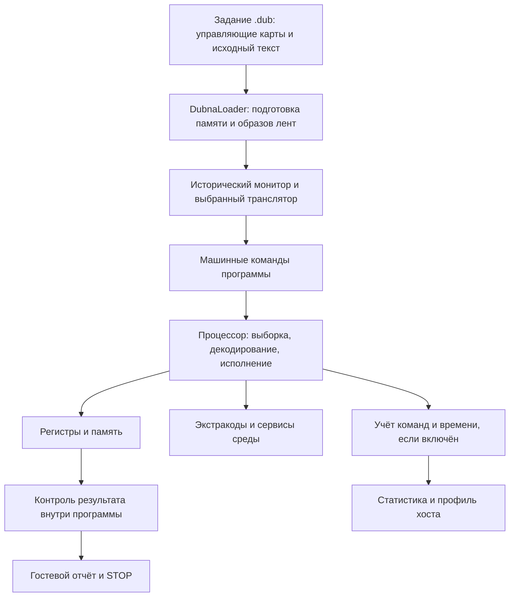

# БЭСМ-6: устройство, бенчмарки и измерение производительности

Этот документ объясняет путь от задания на Фортране до проверенного результата:
что исполняет машина, где начинается измеряемый интервал, откуда берётся время
и как вычисляется рейтинг. Описание сверено с исходниками на **19 октября
2026 года**, коммит `2791341`. Команды ниже предназначены для запуска из корня
репозитория; это инструкция, а не отчёт о новой серии измерений.

**Производительность — объём полезной работы, делённый на время её выполнения.**
В Besm6.Net нужно указать, какое именно время использовано: измеренное на хосте
или рассчитанное моделью. Для производительности физической БЭСМ-6 необходимы
измерения на физической машине либо независимые исторические журналы запусков.

## Содержание

- [Как устроена машина](#machine)
- [Как задание выполняется в симуляторе](#execution)
- [Что делают бенчмарки](#benchmarks)
- [Какие часы и интервалы используются](#time)
- [Как собираются статистика и профиль](#statistics)
- [Как проверяются результаты](#validation)
- [Как посчитать производительность](#formulas)
- [Как провести воспроизводимый эксперимент](#experiment)
- [Как оценивать скорость физической БЭСМ-6](#historical)
- [Карта исходников и документации](#sources)

<a id="machine"></a>

## Как устроена машина

БЭСМ-6 — машина с общей памятью команд и данных. Программно доступное слово
содержит 48 бит; в одном слове помещаются две команды по 24 бита. Аппаратное
слово имеет ещё два контрольных разряда. Команда задаёт операцию, адрес и номер
индексного регистра. Адресация — по словам, а не по байтам. Форматы и мнемокоды
приведены в [перечне команд БЭСМ-6](https://www.besm6.org/wiki/CmdSheet.html).

Основные части машины:

| Узел | Назначение | Как влияет на время программы |
| --- | --- | --- |
| Устройство управления, УУ | Выбирает команды, вычисляет адреса, организует переходы | Работа с индексами и переходами может перекрываться с арифметикой |
| Арифметическое устройство, АУ | Выполняет арифметические и логические операции | Следующая зависимая операция ждёт готовности результата |
| Оперативная память, МОЗУ | Хранит команды и данные | Доступ зависит от банков, буферов и предшествующих обращений |
| Буферы команд, чтения и записи | Сокращают ожидание памяти и связывают устройства | Повторное обращение и последовательный поток могут иметь разные задержки |
| Устройства ввода-вывода | Читают задания, печатают результат, обслуживают внешнюю память | Время полного задания может включать ожидание устройств |

Состояние процессора включает сумматор `A`, регистр младших разрядов `Y`,
индексные регистры `M`, счётчик команд `K` с признаком левого/правого полусловия,
регистр режима арифметики `R` и модификатор адреса `C`. Команда меняет это
состояние и, при необходимости, память. Регистры и адресные правила подробно
разобраны в [описании машины](besm6-machine.md).

В базовой памяти 32 768 слов — 196 608 байт полезных данных, или 192 КиБ.
Приписка адресов, защита и аппаратные контрольные разряды относятся к отдельным
механизмам; их нельзя вывести из размера массива, которым симулятор хранит слова.
Гостевой `REAL` занимает 48-разрядное слово со своим форматом числа. Это не
IEEE 754 `float` или `double`; точность, округление и поведение компилятора
влияют на результат вычислений.

УУ, АУ и память работают с перекрытием. Поэтому историческое время программы
нельзя в общем случае получить простым сложением длительностей всех команд.
Нужны зависимости по данным, занятость устройств и задержки памяти. В то же
время быстродействие хоста определяется стоимостью интерпретации этих действий
в C# и работой среды .NET.

<a id="execution"></a>

## Как задание выполняется в симуляторе



Команда `run` запускает задание в среде «Дубна». Монитор и трансляторы выполняют
гостевой машинный код; часть системных услуг обслуживают обработчики экстракодов
на хосте. В частности, математический сервис может вычислять результат в коде
симулятора, а время `original` назначается ему моделью. В таком случае счётчик
гостевых инструкций не включает команды исторической библиотечной подпрограммы,
которую заменил сервис.

Одна исполненная команда — одно полусловие, а не всё 48-разрядное слово.
Программный кеш декодирования в процессоре ускоряет повторную обработку
команд; это отдельный механизм от буферов исторической БЭСМ-6. Проверка
содержимого полусловия позволяет учитывать самомодифицирующийся код.

Для машинных заданий есть отдельный путь `machine --execution
functional|hardware`. В аппаратном варианте используется самостоятельная
шкала наносекунд и модель взаимодействия устройств. Следующие разделы о
`CTIME` и режимах `original`, `virtual`, `max` описывают **hosted-запуск `run`**.
Контракт машинного запуска описан в [руководстве по исполнению](besm6-machine-execution.md).

### Компилятор — часть эксперимента

Карта `*ftn` выбирает Фортран-ГДР, `*fortran` — Фортран-Дубна, `*forex` —
настоящий ФОРЕКС. Прежняя подмена `*forex` на `*fortran` теперь включается
только настройкой `forexAsFortran: true`. Поэтому имя файла с суффиксом
`-forex` само по себе не доказывает, каким компилятором получен старый результат.
Нужны конфигурация и баннер транслятора в листинге. Подробности — в
[описании языков «Дубны»](dubna-languages.md) и [происхождении образов лент](runtime-assets.md).

Текущие задания на ФОРЕКС и старые задания на Фортране-ГДР различаются
представлением строк, проверками и измерительным кодом. Их рейтинги нельзя
объединять в одну серию без указания этих различий.

<a id="benchmarks"></a>

## Что делают бенчмарки

Ниже описаны задания, которые сами измеряют время и печатают рейтинг.
Все они выполняют последовательные вычисления.

| Тест и исходник | Полезная работа | Основной показатель |
| --- | --- | --- |
| [Dhrystone](../examples/dhrystone-forex.dub) | Процедуры, условия, целочисленная арифметика, массивы, копирование и сравнение строк | DMIPS |
| [Whetstone](../examples/whetstone-longbottom-forex.dub) | Восемь секций: арифметика, переходы, целые числа, математические функции, присваивания и вызовы процедур | MWIPS; отдельно MFLOPS секций N1, N2, N6 |
| [Memspeed](../examples/memspeed-forex.dub) | Копирование, сложение массивов, умножение на скаляр со сложением | Логические MB/s |
| [MP-MFLOPS](../examples/mpmflops-forex.dub) | Три арифметических ядра с разным числом операций на элемент | MFLOPS |

### Dhrystone

Один проход исполняет фиксированный набор операций. В текущем порте ФОРЕКС
записи представлены массивами полей, связи между ними — индексами, строки —
`CHARACTER`. Это адаптация алгоритма; число машинных команд на проход зависит
от транслятора. После цикла проверяются 18 основных контрольных значений
и четыре строки. Рейтинг нормирован на 1757 проходов в секунду — опорный
результат VAX-11/780. DMIPS не означает фактическое число миллионов команд
БЭСМ-6 в секунду.

### Whetstone

Каждая из восьми секций измеряется отдельно. В этом задании фиксированы
восемь проходов и масштаб 100. Секция N1 исполняется в десять раз дольше,
после чего её измеренное время делится на десять. Поэтому напечатанное
`GUEST CPU SECONDS` — **сумма нормализованных времён секций**, а не длительность
всего задания и даже не простая сумма всех фактически измеренных интервалов.

N1 и N2 нагружают арифметику, N3 — условия, N4 — целочисленные вычисления,
N5 — тригонометрические функции, N6 — арифметику с вызовами процедуры,
N7 — индексируемые присваивания, N8 — `EXP`, `ALOG`, `SQRT`.
Сводный MWIPS полезно сопровождать таблицей секций: одинаковый итог может
скрывать разные задержки. История семейства и исходные материалы собраны
в [коллекции Роя Лонгботтома](https://roylongbottom.github.io/royRepository/).

### Memspeed

Два массива содержат по 4096 слов; каждое слово данных занимает шесть байт.
Выполняется 1000 проходов выбранного ядра:

| Часть | Выражение | Логический обмен на элемент |
| --- | --- | ---: |
| 1 | `X(i) = Y(i)` | 6 байт чтения + 6 байт записи = 12 байт |
| 2 | `X(i) = X(i) + Y(i)` | 12 байт чтения + 6 байт записи = 18 байт |
| 3 | `X(i) = X(i) + scalar * Y(i)` | 12 байт чтения + 6 байт записи = 18 байт |

Время включает управление циклом и вычисление адресов. Объём обмена в формуле
не включает выборку команд, служебные обращения и фактический трафик памяти
хоста. Полученный MB/s характеризует гостевое ядро обработки массивов.

### MP-MFLOPS

Массив содержит 9000 элементов; ядро повторяется 30 раз. Части 1, 2 и 3
содержат соответственно 2, 8 и 32 арифметические операции на элемент.
Например, `(X + A) * B` — одно сложение и одно умножение, всего две операции.
Полезная работа равна 540 000, 2 160 000 или 8 640 000 операций.

В счёт FLOP не входят переходы, индексация, загрузки и записи, хотя их время
входит в измеренный интервал. `MP` в названии семейства не означает, что этот
порт использует несколько процессоров.

<a id="time"></a>

## Какие часы и интервалы используются

### Гостевой таймер

Измеряемое ядро окружено вызовами:

```fortran
      CALL CTIME(CT0,RT0)
C     Здесь находится измеряемый цикл.
      CALL CTIME(CT1,RT1)
      SECS=RT1-RT0
```

В этих заданиях используется второй аргумент `CTIME`. Инициализация массивов,
компиляция, проверки и печать результата находятся за границами этого
интервала. Для ненулевого таймера нужен `--guest-clock`.

| `--speed` | Что возвращает гостевой таймер | Как выполняется код на хосте |
| --- | --- | --- |
| `original` | Статистическое время: зависимости УУ/АУ, модель памяти и стоимости сервисов | С ожиданиями для соблюдения модельного темпа, если хост успевает |
| `virtual` | Реальное прошедшее время на хосте | С доступной скоростью хоста |
| `max` | Сумма табличных стоимостей команд, один табличный такт — 100 нс | С доступной скоростью хоста |

В `virtual` это прошедшее время (`Stopwatch`), включающее вытеснение процесса
другими задачами. Надпись программы `GUEST CPU SECONDS` не превращает его
в процессорное время потока, измеренное ОС.

Таймер округляет показания вниз с шагом **20 мс**. Без `--guest-clock` он
возвращает ноль. `--no-wall-clock` фиксирует календарные данные `DATE*`;
он не выключает гостевой счётный таймер и не выбирает источник его времени.
Основание этих правил — [ExecutionLoop](../src/Besm6.Runtime/Execution/ExecutionLoop.cs).

### Три границы измерения

| Время | Что входит | Для чего использовать |
| --- | --- | --- |
| Внешнее время процесса | Запуск .NET, подготовка задания, исполнение, вывод и завершение | Скорость выполнения задания для пользователя |
| `statistics.elapsedSeconds` | Исполнительный цикл, включая гостевую компиляцию, если она выполняется в этом цикле, сервисы и ожидания | Скорость движка при данной конфигурации наблюдения |
| Разность двух `CTIME` | Код между вызовами таймера | Рейтинг вычислительного ядра |

Отдельный `--runtime-probe` в скрипте сравнения сборок измеряет `RunLoaded`
после `LoadScript`, включая вход, выход и завершение буферизованного вывода.
Его границы немного шире `ExecutionStatistics`, а наблюдателей на каждой
инструкции нет. Подготовка загрузчика исключена; исполняемые гостевые монитор
и транслятор всё ещё могут входить в этот интервал.

### Четыре величины, которые нельзя называть одним «тактом»

- `ClockTicks` — тики функционального исполнения и планировщика. Для обычного
  исполнения это шкала шагов; универсального перевода в секунды нет.
- `modelCycles` — табличный счётчик `Besm6Timing`, с ценой такта 100 нс.
- В таблицах компонентов УУ/АУ из учебника используются такты по 110 нс.
  Они служат исходными данными более подробной модели.
- `HardwareTimeline` — отдельная шкала наносекунд аппаратного исполнения.

В `original` итоговое `modelSeconds` берётся из `statisticalModelSeconds`.
Умножение `modelCycles` на 100 нс даст другое, табличное время. В аппаратном
машинном запуске используется `hardwareModelSeconds`, а `modelCycles` может
быть `null`. Порядок выбора закреплён в
[ExecutionStatistics](../src/Besm6.Runtime/Execution/ExecutionStatistics.cs).

<a id="statistics"></a>

## Как собираются статистика и профиль

`--stats` включает учёт исполненных команд, табличных тактов, прошедшего
времени и части расходов .NET. После завершения CLI печатает строку
`Execution stats: {JSON}`. Внешние скрипты могут прочитать её без разбора
человекочитаемого профиля.

| Поле JSON | Значение |
| --- | --- |
| `statistics.completedInstructions` | Число завершённых команд по механизму учёта |
| `statistics.modelCycles` | Сумма табличных стоимостей завершённых команд |
| `statistics.elapsedSeconds` | Прошедшее время исполнительного цикла |
| `statistics.modelSeconds` | Время выбранной модели с учётом приоритета источников |
| `statistics.statisticalModelSeconds` | Время статистической модели hosted `original`; в других hosted-режимах поле отсутствует |
| `statistics.instructionsPerSecond` | `completedInstructions / elapsedSeconds` |
| `statistics.modelToWallRatio` | `modelSeconds / elapsedSeconds` |
| `statistics.allocatedBytes` | Изменение счётчика выделенных байтов текущего потока |
| `statistics.gen0Collections` | Изменение числа сборок поколения 0 в процессе |
| `statistics.originalTempoMet` | Для `original`: отставание от модели не превышает `max(0,020 с; 2% modelSeconds)`; для других режимов — `true` |
| `finalState` | Конечные регистры и тики |
| `memorySha256` | SHA-256 содержимого памяти, по шесть байт на слово |

Хеширование памяти и оформление JSON выполняются после измеряемого цикла.
Хеш охватывает программно доступные слова, но не является снимком всей системы
с очередями устройств и аппаратными контрольными разрядами.
`allocatedBytes` — не пиковый размер памяти, `gen0Collections` — не число сборок
только измеряемого потока. Формат отчёта задаёт
[RunOutput](../src/Besm6.Cli/RunOutput.cs).

Строка `Halted by STOP ... after N instructions` использует счётчик результата
загрузчика. Его границы при завершении через экстракод и исключениях могут
отличаться от `completedInstructions`. Для показателя `instructionsPerSecond`
нужно брать число команд и время из одной структуры статистики.

`--profile` собирает частоты опкодов и их табличные стоимости. Профиль объясняет,
какие команды исполнялись часто, но его доля модельных тактов не равна доле
реального времени C#-кода. Для последней нужен профилировщик хоста. Оба вида
наблюдения создают накладные расходы; время с `--profile` или `--trace` нельзя
выдавать за скорость исполнения без диагностики.

<a id="validation"></a>

## Как проверяются результаты

Проверка должна завершиться до включения запуска в сводную статистику.

1. **Проверить завершение.** Нужны успешный код возврата CLI и `Halted by STOP`.
   Лимит инструкций, тайм-аут и аварийный останов не являются измерением
   завершённого ядра. При этом один только `STOP` недостаточен: программа
   может остановиться после сообщения об ошибке контроля.
2. **Проверить объём работы и транслятор.** Сопоставить баннер, число проходов,
   размер массива, выбранную часть и конфигурацию с планом эксперимента.
3. **Прочитать проверки из результата выполнения.** Строка `ALL ... MATCH`
   внутри листинга исходника или оператора `FORMAT` не доказывает, что проверка
   прошла. Проверять нужно блок фактического вывода после компиляции.
4. **Сопоставить числа с независимым эталоном.** Однообразный, но неправильный
   массив тоже может напечатать `ALL SAME: YES`.
5. **Пересчитать рейтинг.** Проверить положительность времени, достаточную
   длительность интервала и формулу по напечатанным параметрам.

### Встроенные численные проверки

| Тест | Что проверяется в текущем задании |
| --- | --- |
| Dhrystone на ФОРЕКС | Основные значения, индексы связей, четыре строки; `BAD CONTROL VALUES=0`, оба сообщения о совпадении |
| Whetstone | Восемь результатов секций против `REFVAL`; абсолютный допуск `5 × 10⁻⁶` |
| Memspeed | Каждый элемент против аналитического результата, абсолютный допуск `10⁻⁸`; дополнительно печатаются первый, последний элементы и сумма |
| MP-MFLOPS | Равенство элементов, первый элемент против отдельного эталона с абсолютным допуском `10⁻⁹`, размер и число повторов |

Допуски относятся к этим заданиям. Они не доказывают побитовую правильность
каждой арифметической инструкции. Для такой проверки используются отдельные
векторы, тесты округления, нормализации и исключений.

### Внешняя проверка и сравнение сборок

[benchmark_speed.py](../tools/benchmark_speed.py) проверяет старый набор на
Фортране-ГДР: Dhrystone, MP-MFLOPS и, при выборе соответствующих заданий,
Memspeed. Он проверяет численные поля, а для MP-MFLOPS вычисляет независимый
эталон через `Decimal` с точностью 80 десятичных цифр. Это проверка численного
ответа с допуском; она не имитирует каждое округление БЭСМ-6.

Функция `parity` сравнивает число команд в сообщении об останове и хеш
гостевого вывода. Если оба запуска содержат снимки, она также сравнивает
регистры и память; если оба содержат статистику — число завершённых команд
и табличные такты. При обычном запуске без статистики полного снимка в отчёте
нет. `--runtime-probe` позволяет проверить состояние после измерения без
счётчиков на каждой инструкции.

Для таймированных заданий побитовое совпадение всей памяти между `virtual`
и `original` обычно не требуется: программа сохраняет разные показания часов
и рейтинги. Здесь сравнивают вычислительные результаты, параметры нагрузки
и формулы отдельно от зависящих от времени полей.

Общие скрипты `benchmark_speed.py` и `benchmark_processor_stages.py` не являются
универсальным проверяющим инструментом для текущих файлов `*-forex.dub`:
они генерируют собственные задания на Фортране-ГДР и ожидают их формат вывода.
Whetstone в этот набор не входит. Текущий Dhrystone на ФОРЕКС дополнительно
печатает символы и строки, которые нужно проверять по его собственному формату.

<a id="formulas"></a>

## Как посчитать производительность

Во всех формулах `T` выражено в секундах и относится к тому же интервалу,
в котором выполнен указанный объём работы. Миллион — `10⁶`, MB — `10⁶` байт;
для MiB используется `2²⁰` байт и другое обозначение единицы.

### Скорость интерпретатора

```text
Гостевых команд/с = completedInstructions / elapsedSeconds
Гостевых MIPS    = completedInstructions / (elapsedSeconds × 10⁶)
```

Это скорость обработки команд БЭСМ-6 на данном хосте, с выбранными сервисами
и диагностикой. Для оценки максимальной скорости движка измеряют `max`
без ожиданий. В `original` время включает намеренное замедление.

### Dhrystone

```text
Dhrystones/с = N / T
DMIPS        = N / (1757 × T)
```

Пример: 5000 проходов за 4,98 с дают `5000 / (1757 × 4,98) = 0,571438 DMIPS`.
DMIPS не пересчитывается в фактические MIPS через постоянный коэффициент.

### MP-MFLOPS

```text
F      = число элементов × число проходов × операций на элемент
MFLOPS = F / (T × 10⁶)
```

В ранее предоставленном запуске части 1:

```text
F = 9000 × 30 × 2 = 540 000 операций
T = 1,1000 с
MFLOPS = 540 000 / (1,1 × 10⁶) = 0,490909
```

Напечатанное `FLOPS=539999.999998690327` — представление количества операций
гостевой программой; точное целое восстанавливается из параметров циклов.
В этом поле `FLOPS` означает объём работы, а скорость напечатана отдельно.
Число `6 893 148` из строки останова относится ко всему запуску, включая
служебный код. Делить его на время одного ядра 1,1 с для получения MIPS нельзя.
Без сведений о режиме часов это вычисление подтверждает формулу рейтинга,
но ещё не устанавливает физический смысл времени.

### Memspeed

```text
B    = число элементов × число проходов × байт на элемент
MB/s = B / (T × 10⁶)
```

Для копирования `B = 4096 × 1000 × 12 = 49 152 000` байт.
При `T = 8,68 с` рейтинг равен `5,662673 MB/s`. Для сложения и умножения
со сложением объём равен 73 728 000 байт. Это логический обмен алгоритма;
по нему нельзя напрямую вычислить пропускную способность ферритовой памяти.

### Whetstone

Для текущего задания:

```text
Tnorm = T1raw / 10 + T2 + T3 + T4 + T5 + T6 + T7 + T8
MWIPS = 800 / (10 × Tnorm) = 80 / Tnorm
```

При нормализованном времени 98,85 с получается `0,809307 MWIPS`.
Для арифметических секций используются отдельные числители:

```text
F1 = 153 600; F2 = 1 075 200; F6 = 4 315 200
R1 = F1 / (T1norm × 10⁶)
R2 = F2 / (T2 × 10⁶)
R6 = F6 / (T6 × 10⁶)
MFLOPS geomean = (R1 × R2 × R6)^(1/3)
```

Геометрическое среднее секционных MFLOPS и MWIPS — разные показатели.
Оно также отличается от отношения суммы операций к сумме времён.
Приведённые численные примеры объясняют старые журналы; они не заявляют
результат текущего настоящего ФОРЕКС после исправления выбора компилятора.

### Вычитание пустого задания

Если внутри старой программы нет таймера, скрипты исполняют рабочий вариант
и вариант без ядра: `dh0`, `mp0` или `mem0`. Затем вычитают времена:

```text
Twork = median(Tfull) − median(Tzero)
P     = объём полезной работы / Twork
```

Это оценка добавочного времени ядра. Компиляция, JIT, инициализация и проверка
в двух процессах могут стоить по-разному. Если разность неположительна или
сопоставима с разбросом запусков, рейтинг не определён надёжно. Вычитание
пустого задания повторно из интервала `CTIME` не является частью текущей
методики гостевых бенчмарков.

**Особенность существующих скриптов:** функции `model_metrics` и
`workload_metrics` используют разность `modelCycles`, умноженную на `10⁻⁷` с.
Их `model_score` — рейтинг по табличному времени. Он не становится рейтингом
статистического `original`, даже если калибровочный запуск выполнялся в этом
режиме. Для рейтинга нового `original` следует использовать его `CTIME`
либо разность именно `statisticalModelSeconds` для одинаково ограниченных
интервалов.

### Ускорение и точность

Для одной нагрузки и одинаковых границ измерения:

```text
Ускорение          = Tbefore / Tafter
Сокращение времени = (1 − Tafter / Tbefore) × 100%
```

Сокращение времени на 20% соответствует ускорению в 1,25 раза.
`modelToWallRatio` имеет иной смысл: отношение назначенного моделью времени
к прошедшему времени хоста. Само по себе оно не показывает, во сколько раз
симулятор быстрее физической БЭСМ-6.

При шаге таймера `q = 0,02 с` ошибка разности двух округлённых показаний
может приближаться к одному кванту. Для интервала 0,08 с масштаб ошибки —
25%; для 2 с — 1%. Это только квантование, без шума ОС и ошибок модели.
Минимальный порог 0,04 с в программах предотвращает часть бессмысленных
делений, но не обеспечивает точного измерения.

Повторяйте запуски, сообщайте медиану и диапазон. Для короткого ядра лучше
увеличить нагрузку, сохранив смысл теста, и обновить эталон результата:
например, в MP-MFLOPS изменение числа проходов меняет само вычисленное число.
Пять одинаковых модельных времён показывают воспроизводимость, но ничего
не говорят об ошибке модели относительно реальной машины.

<a id="experiment"></a>

## Как провести воспроизводимый эксперимент

### 1. Зафиксировать условия

Сохраните коммит и локальные изменения, исходное задание, конфигурацию,
версии .NET, модель процессора хоста и ОС. Укажите транслятор, параметры
нагрузки, режим часов, коэффициенты `originalTimeFactor` и `originalMathFactor`,
наличие статистики и профиля. Для сопоставления старых результатов нужны также
хеши используемых DLL и образов лент.

Конфигурацию проекта и пользовательские настройки нельзя оставлять
неявной частью отчёта. Для запуска настоящего ФОРЕКС можно создать отдельный
файл в каталоге результатов:

```powershell
$resultDir = 'tests-run/performance-guide'
New-Item -ItemType Directory -Force $resultDir | Out-Null
$configPath = Join-Path $resultDir 'config.json'
@{
    tapes = (Resolve-Path 'tapes').Path
    useWallClock = $false
    forexAsFortran = $false
    originalTimeFactor = 0.670839
    originalMathFactor = 1.769005
} | ConvertTo-Json | Set-Content -Encoding utf8 $configPath

dotnet build src/Besm6.Cli/Besm6.Cli.csproj -c Release -t:Rebuild
if ($LASTEXITCODE -ne 0) { throw 'Сборка не завершилась успешно' }
$besmDll = 'src/Besm6.Cli/bin/Release/net8.0/besm6.dll'
```

Полная пересборка особенно полезна после замены исходников копией с прежними
датами файлов. Числа коэффициентов здесь фиксируют конкретную калибровку;
они не являются аппаратными константами БЭСМ-6.

### 2. Проверить один гостевой запуск

```powershell
dotnet $besmDll run examples/mpmflops-forex.dub --config $configPath --speed virtual --guest-clock --stats --limit 1000000000 --no-wall-clock 2>&1 |
    Tee-Object -FilePath (Join-Path $resultDir 'mp1-virtual-check.out')
if ($LASTEXITCODE -ne 0) { throw 'Гостевой запуск завершился с ошибкой' }
```

Проверьте фактический вывод по правилам раздела о контроле результатов.
`--stats` здесь нужен для разборки границ времени; измерительную серию
гостевого рейтинга проводите без него. Для модельного времени замените
`virtual` на `original`. Для других семейств используйте исходники из таблицы
выше. Части Memspeed и MP-MFLOPS выбираются `KPART` в копии задания;
в CLI нет параметра выбора части.

### 3. Собрать повторы

Для каждой комбинации задания и режима выполните один прогревочный запуск
и не менее пяти измеряемых. Сохраните stdout, stderr и код возврата каждого
запуска в отдельный файл; прогрев не включайте в медиану. Выполняйте процессы
последовательно. При сравнении сборок чередуйте порядок запуска.

Прогрев отдельного процесса прогревает прежде всего файловые и системные кеши.
Он не сохраняет JIT-код для следующего нового процесса .NET. Это ещё одна
причина различать время полного процесса и длительность гостевого ядра.

Для штатного набора на Фортране-ГДР сбор и проверка уже автоматизированы:

```powershell
python tools/benchmark_speed.py --dll $besmDll --modes max --jobs dh0 dh5000 dh10000 mp0 mp1 mp2 mp3 mem0 mem1 mem2 mem3 --warmups 1 --repeats 5 --output tests-run/performance-ftn
```

Скрипт создаёт задания и конфигурацию, сохраняет `results.json`,
`results.csv` и сырые журналы в `logs/`. Он отдельно измеряет `max` без
статистики и с ней. Это серия Фортрана-ГДР с внешним измерением и вычитанием
пустого задания; она не воспроизводит напрямую гостевую серию ФОРЕКС.

Для сравнения двух уже собранных версий движка:

```powershell
python tools/benchmark_processor_stages.py --variant before=path/to/baseline/besm6.dll --variant after=src/Besm6.Cli/bin/Release/net8.0/besm6.dll --jobs dh0 dh5000 dh10000 mp0 mp1 mp2 mp3 --runtime-probe --warmups 1 --repeats 5 --output tests-run/performance-comparison
```

Замените `path/to/baseline` реальным каталогом полной исходной сборки.
Не смешивайте DLL разных версий. `--runtime-probe` и `--stats` взаимоисключающие:
первый измеряет `RunLoaded` без покомандного наблюдения, второй — цикл
с инструментированием. Без обоих параметров сравнивается время процесса.

### 4. Проверить и опубликовать сводку

В `results.json` скрипта `benchmark_processor_stages.py` проверьте
`validated: true`; сохраните и файлы отдельных запусков. Этот флаг подтверждает
предусмотренные скриптом проверки корректности, но не историческую точность
времени и не наличие статистически значимого ускорения.

У `benchmark_speed.py` итоговое поле называется `accepted`. Оно учитывает
проверки темпа и, при наличии baseline-сборки, порог сокращения времени
не менее 5% на каждом основном задании. При запуске только `max` без
baseline-сборки `accepted: true` не подтверждает ускорение относительно
другой версии: такого сравнения в серии нет.

Для собственной гостевой серии составьте таблицу:

| Поле | Что записать |
| --- | --- |
| Нагрузка | Файл и хеш, компилятор, размер, число повторов, часть теста |
| Часы и интервал | `virtual`/`original`/`max`; `CTIME`, цикл или процесс |
| Корректность | Останов, контрольные значения, допуски и независимый эталон |
| Время | Все измерения, медиана, минимум и максимум |
| Рейтинг | Формула, числитель, единица и результат пересчёта |
| Окружение | Сборка, .NET, хост, конфигурация, коэффициенты модели |

Имена `original.out` или `virtual.out` не заменяют запись полной команды.
Если сырые журналы или параметры окружения утрачены, старый результат можно
использовать как иллюстрацию, но воспроизводимость такой серии ограничена.

<a id="historical"></a>

## Как оценивать скорость физической БЭСМ-6

Для реального измерения нужны тот же алгоритм, известный объём работы и
измеренное время на БЭСМ-6. Следует зафиксировать конфигурацию машины,
ОС, транслятор, библиотеки, числовой формат, границы таймера и постороннюю
нагрузку. После проверки ответа применяются те же формулы `работа / время`.
Если измерено полное время задания, его так и следует назвать; нельзя
объявлять его чистым временем арифметического ядра.

Если физическая машина недоступна, результат `original` — оценка выбранной
модели. Её можно проверять по независимым историческим программам и журналам:

1. Сопоставить исходный текст, транслятор и контрольные ответы.
2. Сравнить времена отдельных секций и полных заданий.
3. Вычислить относительную ошибку `(Tmodel − Tmachine) / Tmachine`.
4. Проверить задачи с разной долей арифметики, обращений к памяти и сервисов.

Используемая в hosted `original` модель содержит эмпирические коэффициенты
и оценки стоимости математических сервисов. Калибровочный результат
Whetstone 2017 года, описанный в [документе о времени original](original-timing.md),
тоже получен на модели. Совпадение с ним не является независимым измерением
физической БЭСМ-6. Для проверки нужны данные, не использованные при настройке.

Паспортный «миллион операций в секунду», гостевые MIPS, DMIPS, MWIPS,
MFLOPS и MB/s измеряют разные свойства. Для практического ответа лучше
сообщить время конкретной задачи и несколько проверенных рейтингов с
указанием источника времени. Это позволяет сравнивать результаты без
подмены измеренной скорости оценкой модели.

<a id="sources"></a>

## Карта исходников и документации

| Вопрос | Где смотреть |
| --- | --- |
| Историческая архитектура | [Салтыков А. И., Макаренко Г. И. «Программирование на языке Фортран», 1976](https://publ.lib.ru/ARCHIVES/B/%27%27Bibliotechka_programmista%27%27_%28seriya%29/_BP.html#0039); [разбор машины](besm6-machine.md) |
| Процессор и общая машина | [Processor.cs](../src/Besm6.Processor/Cpu/Processor.cs), [MachineCore.cs](../src/Besm6.Runtime/Machine/MachineCore.cs) |
| Загрузка задания | [DubnaLoader.cs](../src/Besm6.Runtime/Loading/DubnaLoader.cs) |
| Выбор часов, начало и конец измерения | [ExecutionLoop.cs](../src/Besm6.Runtime/Execution/ExecutionLoop.cs) |
| Табличные счётчики | [ExecutionAccountingSession.cs](../src/Besm6.Runtime/Execution/ExecutionAccountingSession.cs) |
| Поля статистики и формулы | [ExecutionStatistics.cs](../src/Besm6.Runtime/Execution/ExecutionStatistics.cs), [RunOutput.cs](../src/Besm6.Cli/RunOutput.cs) |
| Профиль команд | [OpcodeProfiler.cs](../src/Besm6.Runtime/Profiling/OpcodeProfiler.cs) |
| Статистическая модель | [HostedOriginalTiming.cs](../src/Besm6.Runtime/Timing/HostedOriginalTiming.cs), [допущения и калибровка](original-timing.md) |
| Аппаратное время | [Машинное исполнение](besm6-machine-execution.md), [границы модели](besm6-stage5-model-boundaries.md) |
| Автоматизация измерений | [benchmark_speed.py](../tools/benchmark_speed.py), [benchmark_processor_stages.py](../tools/benchmark_processor_stages.py) |
| Проверка таймера и модели | [GuestClockTests.cs](../tests/Besm6.Runtime.Tests/GuestClockTests.cs), [HostedOriginalTimingTests.cs](../tests/Besm6.Runtime.Tests/HostedOriginalTimingTests.cs) |
| Проверка внешнего сборщика | [test_benchmark_speed.py](../tools/tests/test_benchmark_speed.py) |

В старых примерах и сводных документах могут встречаться прежняя табличная
модель `original` и удалённые флаги `--mflops`, `--passes`, `--baseline-cycles`.
Текущий CLI их отклоняет: полезную работу и рейтинг считают гостевые программы,
а общая диагностика доступна через `--stats` и `--profile`.
