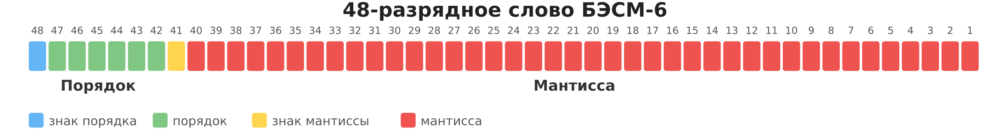

УДК 004.3

# Раздельное измерение времени трансляции, счёта и вывода в программной модели машины БЭСМ-6 на примере алгоритмов искусственного интеллекта

**А. В. Солопий¹, Р. Ф. Гибадуллин²**

¹ Казанский национальный исследовательский технический университет им. А. Н. Туполева — КАИ, ул. К. Маркса, 10, Казань, 420111, Россия; artem.solopiy@gmail.com

² Казанский национальный исследовательский технический университет им. А. Н. Туполева — КАИ, ул. К. Маркса, 10, Казань, 420111, Россия; RFGibadullin@kai.ru

## Аннотация

Рассматривается исполнение одиннадцати небольших программ, реализующих классические алгоритмы искусственного интеллекта, на трёх платформах: программной модели электронной вычислительной машины БЭСМ-6 с калиброванной моделью времени, интерпретаторе CPython и современном компиляторе GNU Fortran, которому подаётся тот же исходный текст на Фортране. Предложена методика раздельного измерения времени трансляции, счёта и вывода пакетного задания: тело программы повторяется заданное число раз, а время одного прохода оценивается наклоном линейной регрессии; время вывода определяется по варианту программы без печати. Показано, что оценка времени счёта вычитанием времени пустого задания некорректна, поскольку в полном времени задания преобладает трансляция. Дискретные результаты совпадают на всех платформах, вещественные — в пределах точности печати. По времени счёта модель БЭСМ-6 уступает интерпретатору CPython в 139–397 раз, а скомпилированному коду — в 5–14 тысяч раз. Отношение полных времён процессов CPython и Фортрана, близкое к восьми, отражает стоимость запуска, а не скорость вычислений. Результаты перекрёстно проверены на независимом эмуляторе.

**Ключевые слова:** БЭСМ-6; эмуляция вычислительных машин; модель времени; измерение производительности; Фортран; Python; алгоритмы искусственного интеллекта.

## 1. Введение

Программные модели исторических вычислительных машин позволяют сохранять программное наследие и количественно сопоставлять технологические уровни вычислительной техники. Для машины БЭСМ-6, созданной под руководством С. А. Лебедева и выпускавшейся серийно с 1968 по 1987 г. [1], сохранились мониторная система «Дубна» [2] и её трансляторы с языка Фортран [3]. Поэтому на модели машины можно исполнять программы на языке, который поддерживают и современные компиляторы.

Цель работы — проверить, что набор классических алгоритмов искусственного интеллекта корректно исполняется на модели БЭСМ-6, и оценить, как соотносятся время исполнения и точность одной и той же программы на этой модели и на современных средствах: интерпретаторе CPython и компиляторе GNU Fortran. Современный компилятор получает тот же исходный текст, что и транслятор системы «Дубна», так что сопоставляется один язык на двух технологических уровнях. Интерпретатор добавлен как распространённое средство разработки.

Основная методическая трудность состоит в том, что пакетное задание БЭСМ-6 включает трансляцию исходного текста, загрузку, счёт и печать, а вычислительное ядро рассматриваемых программ занимает от долей миллисекунды до нескольких секунд модельного времени. Вклад работы составляют: методика раздельного измерения времени трансляции, счёта и вывода в модели машины; согласованные оценки времени счёта и полного времени на трёх платформах; перекрёстная проверка результатов на независимом эмуляторе.

## 2. Объект и методика исследования

### 2.1. Модель БЭСМ-6

Использован эмулятор besm6.net [4] — функциональная модель процессора, памяти, супервизора и внешних устройств БЭСМ-6, исполняющая задания мониторной системы «Дубна». Слово машины содержит 48 разрядов, мантисса вещественного числа — 40 разрядов (около 12 десятичных знаков), быстродействие составляет около 1 млн одноадресных операций в секунду [3].

[](https://github.com/EntityFX/besm6.net/blob/main/docs/articles/besm6-performance/images/48-bit.svg)

**Рисунок 1.** Формат 48-разрядного машинного слова: знак порядка, шесть разрядов порядка, знак мантиссы и 40 разрядов мантиссы [3].

В режиме `original` эмулятор переводит команды и обращения к устройствам в модельное время по таблицам длительностей операций из [3]. Модельное время детерминировано и не зависит от быстродействия хоста. Модель калибрована по тесту Whetstone [5]: два коэффициента подобраны по одному опорному значению, которое само получено симуляцией, а не измерением на машине [6]. Длительности математических функций, в частности 60 мкс для экспоненты, приняты как допущения. Поэтому абсолютные значения модельного времени следует рассматривать как оценки порядка величины.

Дополнительно проверены исполнение заданий с буферной памятью (`--buffered-memory`) и отдельный режим, приближённый к аппаратуре («к железу»), — `machine --execution hardware`. Эти варианты различаются по способу загрузки программ и модели времени; условия и результаты проверок приведены в разделе 4.1.

### 2.2. Тестовые программы

Набор включает одиннадцать программ (табл. 1): перцептрон [7], метод k ближайших соседей [8], метод k-средних [9], наивный байесовский классификатор [10], решающий пень [11], генетический алгоритм [12], имитацию отжига [13], Q-обучение [14], поиск A* [15], многослойный перцептрон с обратным распространением ошибки [16] и поиск мата в один ход [17]. Данные и параметры обучения заданы в исходном тексте.

Все программы детерминированы. В генетическом алгоритме скрещивание и приращения заданы однозначно, а имитация отжига и Q-обучение используют линейный конгруэнтный генератор `x ← (75x + 74) mod 65537` с начальным значением 12 345, одинаковый на всех платформах. Реализации на языке Python повторяют логику программ на Фортране и используют только стандартную библиотеку.

**Таблица 1. Тестовые программы**

| № | Программа | Размер экземпляра задачи | Команд за проход, тыс. |
|---:|---|---|---:|
| 1 | Перцептрон | 20 эпох, 4 примера, 2 признака | 47,0 |
| 2 | Метод k ближайших соседей | 3 запроса, 6 примеров, k = 3 | 19,7 |
| 3 | Метод k-средних | 10 итераций, 6 точек, 2 кластера | 42,0 |
| 4 | Наивный байесовский классификатор | 8 примеров, 2 признака, 2 класса | 22,2 |
| 5 | Решающий пень | 7 порогов × 2 направления, 8 примеров | 14,5 |
| 6 | Генетический алгоритм | 8 поколений, популяция 4 | 10,5 |
| 7 | Имитация отжига | 30 итераций | 19,0 |
| 8 | Q-обучение | 20 эпизодов, до 10 шагов, 2 действия | 76,2 |
| 9 | Поиск A* | сетка 5 × 5 клеток | 62,0 |
| 10 | Многослойный перцептрон | структура 2–2–1, 2000 эпох, 4 примера | 1378 |
| 11 | Поиск мата в один ход | до 14 ходов ладьи, 4 хода короля | 53,4 |

### 2.3. Измерение времени в модели БЭСМ-6

Полное время задания включает трансляцию, загрузку, счёт и печать. Оценивать время счёта вычитанием времени пустого задания (0,711 с) нельзя: объём работы транслятора растёт с длиной исходного текста, и число исполненных команд задания почти не зависит от алгоритма (2 523 927 для перцептрона и 2 524 427 для метода k ближайших соседей).

Использован дифференциальный метод. Исполняемая часть программы, включая инициализацию данных, заключается в цикл с числом повторений N. Длина исходного текста при изменении N не меняется, поэтому время трансляции и загрузки постоянно. Задание исполняется при N = 1,…,6, и по точкам T(N) методом наименьших квадратов строится прямая. Её наклон равен времени одного прохода. Те же измерения выполняются для варианта программы, в котором операторы печати заменены комментариями той же длины: наклон для этого варианта даёт время счёта, а разность наклонов — время вывода. Время трансляции и загрузки оценивается как разность полного времени исходного задания и времени одного прохода. Стандартная ошибка наклона для времени счёта (варианта без печати) не превышает 2,51 %.

### 2.4. Измерение времени на современных платформах

Измерения выполнены на одном хосте: процессор Intel Xeon E3-1230 v6 (3,5 ГГц), Windows 10, CPython 3.14.10, GNU Fortran 16.2.0. Время вызова функции Python измерялось в пяти сериях по пять замеров со случайным порядком алгоритмов; приводится медиана 25 значений. Полное время процесса (запуск интерпретатора, импорт модулей, счёт и вывод) измерялось прямым запуском 50 раз.

Исходный текст на Фортране извлекался из задания без изменений и компилировался с оптимизацией `-O2`; полное время процесса определялось как медиана 200 запусков (50 для многослойного перцептрона). Для измерения времени счёта главная программа преобразуется во внешнюю подпрограмму без операторов печати, которую отдельно скомпилированная управляющая программа вызывает многократно между двумя отсчётами системного таймера. Эта подпрограмма компилируется без оптимизации (`-O0`), так как при `-O2` часть программ с постоянными исходными данными свёртывается компилятором до константы. Приводимое время счёта является поэтому оценкой сверху.

### 2.5. Критерии совпадения результатов

Для дискретных результатов (классы, кластеры, порог, найденный путь, ход) требовалось точное совпадение. Вещественные результаты сравнивались по напечатанным значениям: программы печатают три-четыре знака после запятой, поэтому совпадением считалось расхождение меньше половины единицы последнего разряда. Разрядность мантиссы на платформах различна: 40 двоичных разрядов в БЭСМ-6, 53 в CPython и 24 для типа `REAL` в GNU Fortran.

## 3. Результаты

### 3.1. Время исполнения

Результаты измерений приведены в таблице 2. В модели БЭСМ-6 трансляция и загрузка занимают 1,4–3,5 с, тогда как счёт — от 0,67 до 25 мс для десяти программ и 2,7 с для многослойного перцептрона. Печать нескольких строк результата (4–86 мс) для девяти программ продолжительнее счёта. Таким образом, время, получаемое вычитанием пустого задания, характеризует главным образом транслятор.

В CPython полный процесс занимает 65–75 мс, из которых 31 мс приходится на запуск интерпретатора; полный процесс программы на Фортране — 8,2–9,4 мс. Для всех программ, кроме многослойного перцептрона, эти величины на порядки превышают время счёта.

**Таблица 2. Время исполнения программ**

| Программа | БЭСМ-6: задание, с | БЭСМ-6: трансляция и загрузка, с | БЭСМ-6: счёт, мс | БЭСМ-6: вывод, мс | CPython: счёт, мкс | CPython: процесс, мс | GNU Fortran: счёт, мкс | GNU Fortran: процесс, мс |
|---|---:|---:|---:|---:|---:|---:|---:|---:|
| Перцептрон | 1,464 | 1,430 | 3,31 | 30,3 | 23,8 | 67,1 | 0,567 | 8,20 |
| Метод k ближайших соседей | 1,457 | 1,443 | 1,50 | 12,2 | 7,01 | 65,3 | 0,190 | 8,21 |
| Метод k-средних | 1,486 | 1,457 | 2,17 | 27,2 | 10,9 | 65,9 | 0,266 | 8,21 |
| Наивный байесовский классификатор | 1,782 | 1,766 | 0,67 | 15,3 | 3,24 | 65,5 | 0,086 | 8,46 |
| Решающий пень | 1,413 | 1,403 | 3,15 | 7,00 | 12,0 | 66,1 | 0,298 | 8,32 |
| Генетический алгоритм | 1,667 | 1,661 | 2,25 | 4,32 | 10,3 | 66,6 | 0,258 | 8,38 |
| Имитация отжига | 1,527 | 1,512 | 5,24 | 9,45 | 20,4 | 66,7 | 0,571 | 8,35 |
| Q-обучение | 1,946 | 1,894 | 10,2 | 41,8 | 47,1 | 67,6 | 0,932 | 8,42 |
| Поиск A* | 2,609 | 2,568 | 12,8 | 27,6 | 52,2 | 66,6 | 1,77 | 8,24 |
| Многослойный перцептрон | 4,694 | 1,909 | 2699 | 85,9 | 9691 | 75,2 | 530 | 9,38 |
| Поиск мата в один ход | 3,539 | 3,505 | 25,0 | 8,94 | 63,1 | 66,7 | 1,81 | 8,65 |

### 3.2. Отношения времён

Отношения времён приведены в таблице 3. По времени счёта модель БЭСМ-6 медленнее CPython в 139–397 раз (медиана 219) и медленнее скомпилированного кода в 5,1·10³–1,4·10⁴ раза (медиана 8,2·10³). Код, скомпилированный без оптимизации, быстрее CPython в 18–51 раз (медиана 38).

Отношения полных времён существенно меньше: 21–62 для CPython и 170–501 для Фортрана, поскольку в них входят трансляция в модели БЭСМ-6 и запуск процесса на хосте. Отношение полных времён процессов CPython и Фортрана (7,7–8,2) практически одинаково для всех программ и характеризует стоимость запуска интерпретатора, а не скорость вычислений.

**Таблица 3. Отношения времён исполнения**

| Программа | Счёт: БЭСМ-6/CPython | Счёт: БЭСМ-6/Fortran | Счёт: CPython/Fortran† | Полное время: БЭСМ-6/CPython | Полное время: БЭСМ-6/Fortran | Полное время: CPython/Fortran |
|---|---:|---:|---:|---:|---:|---:|
| Перцептрон | 139 | 5829 | 42,0 | 21,8 | 178 | 8,2 |
| Метод k ближайших соседей | 214 | 7910 | 36,9 | 22,3 | 177 | 8,0 |
| Метод k-средних | 199 | 8176 | 41,1 | 22,6 | 181 | 8,0 |
| Наивный байесовский классификатор | 208 | 7842 | 37,7 | 27,2 | 211 | 7,7 |
| Решающий пень | 262 | 10558 | 40,3 | 21,4 | 170 | 7,9 |
| Генетический алгоритм | 219 | 8695 | 39,7 | 25,1 | 199 | 7,9 |
| Имитация отжига | 257 | 9179 | 35,7 | 22,9 | 183 | 8,0 |
| Q-обучение | 215 | 10894 | 50,6 | 28,8 | 231 | 8,0 |
| Поиск A* | 245 | 7216 | 29,5 | 39,2 | 317 | 8,1 |
| Многослойный перцептрон | 279 | 5091 | 18,3 | 62,4 | 501 | 8,0 |
| Поиск мата в один ход | 397 | 13807 | 34,8 | 53,0 | 409 | 7,7 |

† Для отношения времени счёта CPython/Fortran значение больше единицы означает, что GNU Fortran быстрее CPython.

### 3.3. Совпадение результатов

Дискретные результаты всех одиннадцати программ на трёх платформах совпали: веса и выходы перцептрона, классы трёх запросов, центры и состав кластеров, оценки и предсказанный класс байесовского классификатора, порог и направление решающего пня, найденные максимумы, стратегия Q-обучения, путь из девяти клеток на сетке и матующий ход. Элементы таблицы Q-обучения совпадают после округления до трёх знаков. Выходы многослойного перцептрона совпадают в пределах 3,4·10⁻⁵ при пределе точности печати 5·10⁻⁵: модель БЭСМ-6 и GNU Fortran печатают 0,0029; 0,9969; 0,9969; 0,0047, а CPython даёт 0,00287; 0,99693; 0,99690; 0,00467.

### 3.4. Перекрёстная проверка

Те же программы исполнены на независимом эмуляторе SIMH [18] под управлением операционной системы «Диспак» с транслятором «Фортран-ГДР». Результаты десяти программ из одиннадцати совпали с результатами besm6.net. Семь программ исполнены без изменений, три (метод k-средних, байесовский классификатор, поиск мата) — после правок исходного текста, не затрагивающих алгоритм. В первых двух программах константы в списках печати заменены переменными; в шахматной программе условная печать `IF (MATE .GT. 0) PRINT 210, MR, MC` развёрнута в эквивалентный переход, отдельный `PRINT` и `CONTINUE`. Для поиска A* программа, скомпилированная «Фортраном-ГДР» версии 1984 г. в SIMH, печатает `NO PATH` («путь не найден»), тогда как версия 1981 г. в besm6.net, транслятор системы «Дубна», GNU Fortran и CPython находят один и тот же путь. Причина расхождения не установлена; предположительно она связана с транслятором.

## 4. Обсуждение

Отношение времён счёта модели БЭСМ-6 и скомпилированного кода (10³–10⁴) можно рассматривать как оценку совокупного прогресса аппаратуры и трансляторов при неизменном исходном тексте. Меньший разрыв с CPython объясняется накладными расходами интерпретации.

Результат для многослойного перцептрона существенно зависит от допущения о длительности экспоненты: 24 012 обращений при принятых 60 мкс и коэффициентах калибровки 1,769 и 0,671 дают около 1,71 с, то есть примерно две трети времени счёта (2,70 с). Средний темп исполнения команд, вычисленный по числу команд и времени одного прохода с выводом, составляет 1,3–1,6 млн команд в секунду для десяти программ и 0,49 млн для многослойного перцептрона, что по порядку величины согласуется с быстродействием машины [3].

Работа имеет следующие ограничения. Модель времени является калиброванной статистической моделью, а не физической машиной. Экземпляры задач малы, и полученные отношения не переносятся на задачи практического размера. Время счёта программ на Фортране получено без оптимизации. Измерения выполнены на одном хосте и с одним компилятором. Вещественные результаты сравниваются с точностью печати.

### 4.1. Режим исполнения, приближённый к аппаратуре

Режим, приближённый к аппаратуре («к железу»), реализован в автономной супервизорной машине `machine --execution hardware`. В ней явно моделируются память, буферы команд, буферы операндов и буфер записи, временная шкала в наносекундах и арбитраж банков. Полные задания `.dub` в этом режиме не исполняются: команда `machine` принимает конфигурацию машины в формате JSON с явно перечисленными 50-разрядными словами памяти (`memoryWords[].raw50`) и временными параметрами; загрузчик мониторной системы «Дубна» и экстракоды, выполняемые средствами хоста, в супервизорной машине отсутствуют.

Поэтому все одиннадцать алгоритмов повторно проверены в варианте исполнения заданий с поддержкой хоста (hosted) с включённой буферной памятью. Это дополнительная структурная проверка, а не запуск заданий в режиме `hardware`:

```bash
dotnet src/Besm6.Cli/bin/Release/net8.0/besm6.dll run <job> \
  --speed original --buffered-memory --stats --guest-clock --no-wall-clock
```

Все одиннадцать заданий завершились по `STOP`. Число исполненных команд совпало с обычным прогоном без `--buffered-memory`; печатные результаты совпали построчно, а модельное время точно совпало с исходными неокруглёнными данными таблицы 2: буферная память относится к функциональному пути, тогда как время в `original` вычисляется отдельной статистической моделью. Таблица 4 относится к исходным заданиям без измерительной обёртки; поле `instructions_n1` дифференциальных данных относится к заданиям с добавленным циклом повторения при N = 1, поэтому напрямую сравнивать эти счётчики нельзя. Суммарно одиннадцать заданий исполнили 36 760 360 команд за 23,585 с модельного времени; отношение суммарного модельного времени к суммарному времени исполнения, измеренному эмулятором, составило 0,9999. Последнее характеризует выдерживание заданного темпа исполнения, а не точность воспроизведения исторических задержек.

**Таблица 4. Повторный прогон одиннадцати программ с буферной памятью**

| Программа | Команд | Модельное время, с |
|---|---:|---:|
| Перцептрон | 2 523 927 | 1,464 |
| Метод k ближайших соседей | 2 524 427 | 1,457 |
| Метод k-средних | 2 570 349 | 1,486 |
| Наивный байесовский классификатор | 3 018 329 | 1,782 |
| Решающий пень | 2 453 312 | 1,413 |
| Генетический алгоритм | 2 848 752 | 1,667 |
| Имитация отжига | 2 632 145 | 1,527 |
| Q-обучение | 3 273 769 | 1,946 |
| Поиск A* | 4 314 538 | 2,609 |
| Многослойный перцептрон | 4 663 925 | 4,694 |
| Поиск мата в один ход | 5 936 887 | 3,539 |

Для непосредственной проверки режима `hardware` была собрана машина с явными командами `VTM`, `UTM`, `VLM` и `STOP`, выполняющая 1001 проход счётного цикла. Программа исполнила 2005 команд, в ячейке `M[2]` получено значение 1001; время аппаратной модели составило 804 400 нс (0,8044 мс), то есть около 2,49 млн команд в секунду в модели. Тот же образ в функциональном исполнении дал 2005 команд и 3007 модельных тактов. Структура аппаратной модели подробнее функциональной, но её задержки заданы конфигурацией (`bankCycleNs`, `readLatencyNs`, `bufferHitNs` и другие): это явная логическая модель, а не измеренные характеристики машины. Проверка короткого цикла не переносится на время исполнения полного набора алгоритмов и не доказывает историческую точность времени.

## 5. Заключение

Модель БЭСМ-6 корректно исполняет все одиннадцать программ: результаты совпадают с результатами современных платформ и с результатами независимого эмулятора для десяти программ, включая три с описанной адаптацией исходного текста. Предложенный дифференциальный метод позволяет отделить время счёта от времени трансляции и вывода со стандартной ошибкой не более 2,51 %; без такого разделения время задания характеризует транслятор, а не алгоритм. По времени счёта модель БЭСМ-6 медленнее CPython в 139–397 раз и медленнее скомпилированного кода в 5,1·10³–1,4·10⁴ раза. Исходные тексты программ, сценарии измерений и первичные данные доступны в репозитории [4].

Сравнение с GNU Fortran особенно существенно, поскольку исторический и современный трансляторы получают один и тот же исходный текст на Фортране. Время счёта современного кода составило 0,086–530 мкс, а полное время запуска скомпилированных программ — 8,2–9,4 мс против 1,4–4,7 с для полного задания в модели БЭСМ-6. Время счёта измерялось без оптимизации (`-O0`), а время полного процесса — для программы, собранной с `-O2`. Разделение этих показателей позволяет не смешивать ускорение вычислений со стоимостью трансляции и запуска.

Повторный прогон всех одиннадцати заданий с буферной памятью подтвердил неизменность печатных результатов и модельного времени. Режим, приближённый к аппаратуре, проверен отдельно на счётном цикле; его результаты не заменяют измерения алгоритмов в режиме `original`.

## Вклад авторов

**А. В. Солопий** — разработка эмулятора, тестирование, проведение запусков и расчётов.

**Р. Ф. Гибадуллин** — вычитка, редактирование и верификация.

<!-- Конфликт интересов и финансирование: заполнить после подтверждения авторами. -->

## Литература

- **[1]** БЭСМ-6 // Большая российская энциклопедия. https://bigenc.ru/c/besm-6-4f8e4d (дата обращения: 18.11.2026).
- **[2]** Говорун Н. Н., Силин И. Н. и др. Мониторная система «Дубна» для ЭВМ БЭСМ-6 // Тр. второй Всесоюзной конф. по программированию. — Новосибирск: ВЦ СО АН СССР, 1970.
- **[3]** Салтыков А. И., Макаренко Г. И. Программирование на языке фортран / Под ред. Н. Н. Говоруна. — М.: Наука, 1976. 256 с.
- **[4]** besm6.net — эмулятор ЭВМ БЭСМ-6. https://github.com/EntityFX/besm6.net (дата обращения: 18.11.2026).
- **[5]** Curnow H. J., Wichmann B. A. A synthetic benchmark // Comput. J., 1976. Vol. 19. No. 1. P. 43–49. doi: 10.1093/comjnl/19.1.43.
- **[6]** How to compute performance of a CPU in FLOPS // Retrocomputing Stack Exchange, 2017. https://retrocomputing.stackexchange.com/questions/3267/how-to-compute-performance-of-a-cpu-in-flops (дата обращения: 18.11.2026).
- **[7]** Rosenblatt F. The perceptron: A probabilistic model for information storage and organization in the brain // Psychol. Rev., 1958. Vol. 65. No. 6. P. 386–408. doi: 10.1037/h0042519.
- **[8]** Cover T. M., Hart P. E. Nearest neighbor pattern classification // IEEE T. Inform. Theory, 1967. Vol. 13. No. 1. P. 21–27. doi: 10.1109/TIT.1967.1053964.
- **[9]** Lloyd S. P. Least squares quantization in PCM // IEEE T. Inform. Theory, 1982. Vol. 28. No. 2. P. 129–137. doi: 10.1109/TIT.1982.1056489.
- **[10]** Domingos P., Pazzani M. On the optimality of the simple Bayesian classifier under zero-one loss // Mach. Learn., 1997. Vol. 29. P. 103–130. doi: 10.1023/A:1007413511361.
- **[11]** Holte R. C. Very simple classification rules perform well on most commonly used datasets // Mach. Learn., 1993. Vol. 11. P. 63–90. doi: 10.1023/A:1022631118932.
- **[12]** Holland J. H. Adaptation in natural and artificial systems. — Ann Arbor, MI, USA: University of Michigan Press, 1975.
- **[13]** Kirkpatrick S., Gelatt C. D., Vecchi M. P. Optimization by simulated annealing // Science, 1983. Vol. 220. No. 4598. P. 671–680. doi: 10.1126/science.220.4598.671.
- **[14]** Watkins C. J. C. H., Dayan P. Q-learning // Mach. Learn., 1992. Vol. 8. P. 279–292. doi: 10.1007/BF00992698.
- **[15]** Hart P. E., Nilsson N. J., Raphael B. A formal basis for the heuristic determination of minimum cost paths // IEEE T. Syst. Sci. Cyb., 1968. Vol. 4. No. 2. P. 100–107. doi: 10.1109/TSSC.1968.300136.
- **[16]** Rumelhart D. E., Hinton G. E., Williams R. J. Learning representations by back-propagating errors // Nature, 1986. Vol. 323. P. 533–536. doi: 10.1038/323533a0.
- **[17]** Shannon C. E. Programming a computer for playing chess // Philos. Mag., 1950. Vol. 41. No. 314. P. 256–275. doi: 10.1080/14786445008521796.
- **[18]** SIMH. https://github.com/simh/simh (дата обращения: 18.11.2026).

---

# Separate measurement of translation, computation, and output times in a software model of the BESM-6 computer: a case study of artificial intelligence algorithms

**A. V. Solopiy and R. F. Gibadullin**

*Kazan National Research Technical University named after A. N. Tupolev-KAI, 10 K. Marx Str., Kazan 420111, Russian Federation*

## Abstract

The paper studies how eleven small programs implementing classical artificial intelligence algorithms run on three platforms: a software model of the BESM-6 mainframe with a calibrated timing model, the CPython interpreter, and the GNU Fortran compiler, which is given the same Fortran source text as the historical translator. A procedure is proposed for measuring the translation, computation, and output times of a batch job separately: the program body is repeated a given number of times and the time of one pass is estimated as the slope of a linear regression; the output time is obtained from a variant of the program without print statements. Subtracting the time of an empty job is shown to be misleading because translation dominates the total job time. Discrete results coincide on all platforms and real-valued results agree to within the printed precision. In computation time, the BESM-6 model is 139–397 times slower than CPython and 5–14 thousand times slower than compiled code. The ratio of full process times of CPython and Fortran, close to eight, reflects start-up cost rather than computation speed. The results were cross-checked on an independent emulator.

**Keywords:** BESM-6; computer emulation; timing model; performance measurement; Fortran; Python; artificial intelligence algorithms.

## References

- **[1]** BESM-6. Bol’shaya rossiyskaya entsiklopediya [Great Russian Encyclopedia]. Available at: https://bigenc.ru/c/besm-6-4f8e4d (accessed November 18, 2026).
- **[2]** Govorun, N. N., I. N. Silin, et al. 1970. Monitornaya sistema «Dubna» dlya EVM BESM-6 [The Dubna monitor system for the BESM-6 computer]. Trudy vtoroy Vsesoyuznoy konferentsii po programmirovaniyu [2nd All-Union Conference on Programming Proceedings]. Novosibirsk.
- **[3]** Saltykov, A. I., and G. I. Makarenko. 1976. Programmirovanie na yazyke fortran [Programming in Fortran]. Ed. N. N. Govorun. Moscow: Nauka. 256 p.
- **[4]** besm6.net — emulyator EVM BESM-6 [besm6.net: An emulator of the BESM-6 computer]. Available at: https://github.com/EntityFX/besm6.net (accessed November 18, 2026).
- **[5]** Curnow, H. J., and B. A. Wichmann. 1976. A synthetic benchmark. Comput. J. 19(1):43–49. doi: 10.1093/comjnl/19.1.43.
- **[6]** How to compute performance of a CPU in FLOPS. 2017. Retrocomputing Stack Exchange. Available at: https://retrocomputing.stackexchange.com/questions/3267/how-to-compute-performance-of-a-cpu-in-flops (accessed November 18, 2026).
- **[7]** Rosenblatt, F. 1958. The perceptron: A probabilistic model for information storage and organization in the brain. Psychol. Rev. 65(6):386–408. doi: 10.1037/h0042519.
- **[8]** Cover, T. M., and P. E. Hart. 1967. Nearest neighbor pattern classification. IEEE T. Inform. Theory 13(1):21–27. doi: 10.1109/TIT.1967.1053964.
- **[9]** Lloyd, S. P. 1982. Least squares quantization in PCM. IEEE T. Inform. Theory 28(2):129–137. doi: 10.1109/TIT.1982.1056489.
- **[10]** Domingos, P., and M. Pazzani. 1997. On the optimality of the simple Bayesian classifier under zero-one loss. Mach. Learn. 29:103–130. doi: 10.1023/A:1007413511361.
- **[11]** Holte, R. C. 1993. Very simple classification rules perform well on most commonly used datasets. Mach. Learn. 11:63–90. doi: 10.1023/A:1022631118932.
- **[12]** Holland, J. H. 1975. Adaptation in natural and artificial systems. Ann Arbor, MI: University of Michigan Press.
- **[13]** Kirkpatrick, S., C. D. Gelatt, and M. P. Vecchi. 1983. Optimization by simulated annealing. Science 220(4598):671–680. doi: 10.1126/science.220.4598.671.
- **[14]** Watkins, C. J. C. H., and P. Dayan. 1992. Q-learning. Mach. Learn. 8:279–292. doi: 10.1007/BF00992698.
- **[15]** Hart, P. E., N. J. Nilsson, and B. Raphael. 1968. A formal basis for the heuristic determination of minimum cost paths. IEEE T. Syst. Sci. Cyb. 4(2):100–107. doi: 10.1109/TSSC.1968.300136.
- **[16]** Rumelhart, D. E., G. E. Hinton, and R. J. Williams. 1986. Learning representations by back-propagating errors. Nature 323:533–536. doi: 10.1038/323533a0.
- **[17]** Shannon, C. E. 1950. Programming a computer for playing chess. Philos. Mag. 41(314):256–275. doi: 10.1080/14786445008521796.
- **[18]** SIMH. Available at: https://github.com/simh/simh (accessed November 18, 2026).

## Contributors

**Solopiy Artem V.** (b. 1989) — assistant lecturer, Department of Computer Systems, Kazan National Research Technical University named after A. N. Tupolev-KAI, 10 K. Marx Str., Kazan 420111, Russian Federation; artem.solopiy@gmail.com

**Gibadullin Ruslan F.** (b. 1984) — Candidate of Science (PhD) in technology, associate professor, Department of Computer Systems, Kazan National Research Technical University named after A. N. Tupolev-KAI, 10 K. Marx Str., Kazan 420111, Russian Federation; RFGibadullin@kai.ru

## Сведения об авторах

**Солопий Артём Валерьевич** (р. 1989) — ассистент кафедры компьютерных систем Казанского национального исследовательского технического университета им. А. Н. Туполева — КАИ, ул. К. Маркса, 10, Казань, 420111, Россия; artem.solopiy@gmail.com

**Гибадуллин Руслан Фаршатович** (р. 1984) — кандидат технических наук, доцент кафедры компьютерных систем Казанского национального исследовательского технического университета им. А. Н. Туполева — КАИ, ул. К. Маркса, 10, Казань, 420111, Россия; RFGibadullin@kai.ru
