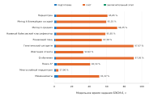
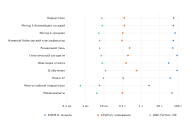
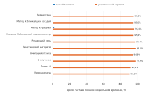

# Раздельная оценка времени подготовки, счёта и завершения заданий в модели БЭСМ-6 на примере алгоритмов искусственного интеллекта

**А. В. Солопий, Р. Ф. Гибадуллин**

Казанский национальный исследовательский технический университет им. А. Н. Туполева — КАИ, Казань, Россия

## Аннотация

Разработана и применена методика раздельной оценки времени подготовки, счёта и заключительного этапа пакетных заданий в программной модели БЭСМ-6. Заключительный этап включает вывод и завершение задания. Набор включает 11 тестовых программ с классическими алгоритмами искусственного интеллекта. Для десяти программ подготовлено по четыре размера задачи, для многослойного перцептрона — одна контрольная задача XOR. Всего исследовано 41 задание.

В десяти увеличенных задачах счёт занимает 91,2–98,0 % полного модельного времени. Преобладание подготовки в коротких тестах объясняется малым объёмом вычислений, а не свойством выбранных алгоритмов. Все прогоны выполнены на одном Linux-компьютере. Для БЭСМ-6 используется модельное время, для современных реализаций — измеренное процессорное время. В итоговом наборе из одиннадцати программ модельное время счёта превышает время CPython в 156–678 раз, кода GNU Fortran без оптимизации — примерно в 4–13 тысяч раз.

Дискретные контрольные результаты совпали точно, вещественные согласуются с заданным допуском. Все задания дополнительно проверены на независимом эмуляторе SIMH с транслятором Фортран-Дубна.

**Ключевые слова:** БЭСМ-6; эмуляция вычислительных машин; модель времени; измерение производительности; Фортран; Python; алгоритмы искусственного интеллекта

## 1. Введение

Программные модели (эмуляторы) ЭВМ прошлых поколений позволяют сохранять программное наследие и исследовать выполнение программ, когда исходная аппаратура недоступна для эксперимента. Советская ЭВМ БЭСМ-6 была создана под руководством С. А. Лебедева и выпускалась серийно с 1968 по 1987 г. [1]. Для неё сохранились мониторная система «Дубна» [2], управляющая выполнением заданий, и трансляторы с языка Фортран [3]. Это позволяет запускать в эмуляторе программы на языке, который поддерживают и современные компиляторы.

Исследование выполнено в ходе разработки программной модели БЭСМ-6 на языке C# [4]. Первоначальные небольшие программы позволили проверить вычислительные результаты, но в большинстве заданий время подготовки значительно превышало время счёта. Поэтому подготовлена новая серия с увеличением числа примеров, признаков, состояний и других естественных параметров задач. Средства профилирования, счётчики команд и модельные часы использованы для исследования распределения времени между этапами выполнения задания.

В работе исследуется, из чего складывается время выполнения таких программ в восстановленной программной среде БЭСМ-6. Цель работы — разработать и применить методику раздельной оценки трёх этапов: подготовки пакетного задания, вычислений (счёта) и заключительного этапа. Подготовка включает трансляцию и загрузку, заключительный этап — вывод и завершение задания. Полученные оценки времени счёта сопоставляются с временем выполнения тех же алгоритмов в CPython и в программах, скомпилированных GNU Fortran.

Под пакетным заданием понимается исходный текст программы с управляющими строками, который система обрабатывает без участия пользователя. Программа транслируется (переводится в машинные команды), загружается в память и выполняется, после чего печатаются результаты. GNU Fortran получает тот же исходный текст, что и транслятор системы «Дубна». Таким образом, сравнивается выполнение программ на одном языке в среде советской ЭВМ и на современном компьютере. CPython включён в сравнение как распространённое средство выполнения программ на Python.

При сравнении необходимо различать модельное и фактическое время выполнения. Для БЭСМ-6 время рассчитывается по выполненным командам и принятым длительностям операций, независимо от скорости эмулятора на современном компьютере (хосте). Для современных реализаций время измеряется на хосте непосредственно. Совпадение результатов вычислений служит проверкой сопоставимости реализаций, но само по себе не доказывает корректность эмулятора.

Тест Whetstone [5] характеризует вычислительную нагрузку, но не выделяет время подготовки пакетного задания. В данной работе затраты разделяются по границам исполнения в восстановленной программной среде. Вклад работы состоит в следующем:

- разработан стенд для раздельного учёта подготовки, счёта и завершения задания без изменения гостевой программы;
- проверено, что ускоренный режим измерений сохраняет модельное время, результаты и конечную память обычного режима;
- подготовлен набор из 41 варианта задач для исследования роста вычислительной нагрузки и сопоставления контрольных результатов в разных средах исполнения.

С современными реализациями сравниваются одиннадцать итоговых программ на одном хосте. Предмет сравнения — затраты времени; качество обучения и поиска выходит за рамки работы.

## 2. Объект и методика исследования

### 2.1. Модель БЭСМ-6

Использован эмулятор besm6.net [4], разработанный на языке C#. Он представляет собой функциональную модель процессора, памяти, управляющей программы (супервизора) и внешних устройств БЭСМ-6 и позволяет выполнять задания мониторной системы «Дубна». Слово БЭСМ-6 содержит 48 разрядов, мантисса вещественного числа — 40 разрядов (около 12 десятичных знаков). Быстродействие советской ЭВМ составляет около 1 млн одноадресных операций в секунду [3]. Для измерений использованы встроенный счётчик выполненных команд, модельные часы и статистика, выводимая по завершении задания.

![Формат 48-разрядного машинного слова: знак порядка, шесть разрядов порядка, знак мантиссы и 40 разрядов мантиссы [3].](48-bit.png)

*Рис. 1. Формат 48-разрядного машинного слова: знак порядка, шесть разрядов порядка, знак мантиссы и 40 разрядов мантиссы [3].*

В модели времени *original* учитываются выполненные команды, обращения к памяти и системные вызовы. Основой служат длительности компонентов команд из [3]. Одинаковая последовательность операций даёт одинаковое модельное время независимо от быстродействия хоста. Помимо исходных длительностей, приняты следующие допущения:

- независимые команды управления могут выполняться одновременно с арифметикой; задержка выборки команды перекрывается с работой устройства управления на величину до 900 нс;
- память разделена на восемь банков; буферы команд, операндов и ожидающих записей содержат по восемь слов. Команды и операнды вытесняются в порядке поступления. Для ряда арифметических команд при отключённой нормализации используется минимальная, а не средняя длительность из исходной таблицы;
- математические функции и часть системных вызовов выполняются средствами хоста, а их время задаётся отдельно. Базовая оценка для экспоненты составляет 60 мкс, для обычного системного вызова — 5 мкс.

Два эмпирических коэффициента подобраны по двум показателям одного опубликованного прогона Whetstone [5, 6]: сумме времён секций и сумме секций N5 и N8. Общий коэффициент времени равен 0,670839; дополнительный коэффициент для математических функций — 1,769005. Опорный прогон также выполнен на модели. Полное описание правил расчёта приведено в `docs/original-timing.md` репозитория [4].

Под полным модельным временем далее понимается сумма затрат трёх этапов в этой модели. Время механической печати и ожидания физических внешних устройств отдельно не восстанавливается. Заключительный этап характеризует выполнение процедур вывода и завершения задания.

Точность учёта времени следует отличать от достоверности принятых длительностей операций. Модель суммирует время воспроизводимо, однако исходные длительности известны приближённо. Поэтому абсолютные значения рассматриваются как оценки порядка величины. Настройка по Whetstone не является независимой проверкой соответствия времени действующей советской ЭВМ.

### 2.2. Тестовые программы

Набор включает перцептрон [7], метод $k$ ближайших соседей [8], метод $k$-средних [9], наивный байесовский классификатор [10], решающий пень (decision stump) [11], генетический алгоритм [12], имитацию отжига [13], Q-обучение [14], поиск A$^*$ [15], многослойный перцептрон [16] и поиск мата в один ход в упрощённой минишахматной модели [17]. Для десяти алгоритмов сформированы по четыре размера задачи, для многослойного перцептрона сохранена сеть 2–2–1 на четырёх примерах XOR. Всего проверен 41 вариант; итоговое сравнение производительности использует десять больших вариантов и контрольный многослойный перцептрон (табл. 1).

Данные формируются короткими циклами по фиксированным правилам, без развёртывания в тысячи присваиваний. При увеличении размеров структура исходного текста не меняется. Программы детерминированы. В тестах с генератором используется одна последовательность $x \leftarrow (75x + 74) \bmod 65 537$ с начальным значением 12 345. Реализации на Python воспроизводят логику и порядок обхода данных и используют только стандартную библиотеку; для вещественных массивов применяются значения типа `float`.

Размеры выбраны с учётом памяти БЭСМ-6 и достаточной длительности счёта. Для каждой программы параметры одинаковы на сравниваемых платформах. Использованы синтетические нагрузки; число эпох и поколений задаёт объём вычислений. Наибольший загруженный образ программы с данными и библиотеками занимает 17 806 слов, или около 104 КиБ. Этот объём относится к готовой программе; пиковое рабочее пространство транслятора отдельно не измерялось.

У отжига увеличены размерность квадратичной целевой функции и число шагов. Положительная температура задаётся гиперболическим расписанием от значения, близкого к 5, до 0,1. В минишахматном тесте растёт набор разных допустимых позиций. Размер доски и глубина поиска сохраняются. В этой упрощённой модели чёрный король рассматривает только четыре ортогональных хода; правила отличаются от полных правил шахмат.

**Таблица 1. Итоговые размеры задач и число команд вычислительного участка без печати**

| № | Программа | Размер задачи | Команд счёта, млн |
|---|---|---|---|
| 1 | Перцептрон | 512 примеров, 24 признака,<br>100 эпох | 89,860 |
| 2 | Метод $k$ ближайших<br>соседей | 1024 примера, 12 признаков,<br>128 запросов, $k=3$ | 85,563 |
| 3 | Метод $k$-средних | 512 точек, 16 признаков,<br>8 кластеров, 20 итераций | 99,935 |
| 4 | Наивный байесовский<br>классификатор | 256 примеров, 16 признаков,<br>8 классов, 8192 запроса | 73,036 |
| 5 | Решающий пень | 1024 примера, 1023 порога,<br>2 направления | 82,844 |
| 6 | Генетический алгоритм | Популяция 512, 1024 поколения,<br>целые числа от 0 до 1023 | 164,217 |
| 7 | Имитация отжига | 64 координаты, 30 000 шагов | 48,092 |
| 8 | Q-обучение | 128 состояний, 4000 эпизодов,<br>до 512 шагов, 2 действия | 145,228 |
| 9 | Поиск A$^*$ | Сетка $45\times45$, 2025 узлов | 67,789 |
| 10 | Многослойный<br>перцептрон | Сеть 2–2–1, 2000 эпох,<br>4 примера XOR | 1,336 |
| 11 | Минишахматы | Набор из 2048 позиций | 79,797 |

### 2.3. Измерение времени в модели БЭСМ-6

Полное модельное время разделяется по наблюдаемым границам исполнения. Подготовка начинается с исполнения монитора и заканчивается перед первой командой программы по адресу `01000`, указанному в карте загрузки. Она включает работу монитора, трансляцию, листинг, подключение библиотек и размещение программы. Счёт измеряется от входа в программу до первого вызова процедуры форматированного вывода `BCDWRIT*`. Во всех вариантах результаты печатаются только после окончания вычислений. Заключительный этап продолжается от этого вызова до остановки задания.

В счёт включены инициализация и генерация данных, выполнение алгоритма и формирование контрольных итогов. Стенд наблюдает исполнение без изменения гостевой памяти и потока команд. На всех границах используется единая модель времени, формирующая показатель `statisticalModelSeconds`. Сумма трёх этапов даёт полное модельное время. Время работы самого эмулятора на хосте учитывается отдельно.

Для ускорения серии отключено ожидание, ограничивающее скорость эмуляции темпом БЭСМ-6, но сохранён тот же алгоритм расчёта модельного времени. На Linux выполнено парное сравнение с обычным режимом *original* для одиннадцати малых вариантов и большого варианта Q-обучения. Во всех 12 парах точно совпали модельное время, число команд, печатный вывод и SHA-256 конечной памяти. Это проверка измерительного стенда, а не точности оценки времени советской ЭВМ.

Прямое наблюдение границ позволяет обойтись без вычитания времени пустого задания: затраты на его трансляцию и загрузку отличаются от подготовки исследуемой программы. Для увеличения нагрузки изменяются параметры самой задачи.

### 2.4. Измерение времени на современных платформах

Все окончательные прогоны выполнены на одном Linux-компьютере: Intel Xeon E5-2680 v3 (базовая частота 2,50 ГГц), CPython 3.12.7, GNU Fortran 13.2.1, .NET 8.0.21. Замеры современных реализаций выполнялись последовательно, отдельно от функциональных проверок; Python и дочерние процессы Фортрана закреплены за одним логическим процессором. Частота не фиксировалась. Результаты характеризуют работу указанной конфигурации при этих условиях.

В Python измеряется процессорное время функции с помощью `process_time_ns`, без подготовки исходного текста на Фортране. В программах GNU Fortran используется `CPU_TIME`. Число вызовов выбирается так, чтобы серия занимала около 0,15 с или больше; приводится медиана пяти серий. Повторение повышает точность отсчёта таймера при неизменном размере задачи.

GNU Fortran получает тот же исходный текст, что и транслятор системы «Дубна». Для измерения счёта главная программа преобразуется в подпрограмму без печати; отдельно скомпилированный драйвер вызывает её и использует возвращаемый контрольный скаляр. Все измерения Фортрана выполнены с *-O0*, без межмодульной оптимизации: это не оценка предельного быстродействия компилятора. Для проверки результатов отдельно применялись проверки границ массивов и целочисленного переполнения, отключённые в измерительной сборке. Полные времена процессов измерены по десяти запускам, время компиляции и связывания Фортрана — по трём; для этих показателей используется реальное время хоста, а не процессорное время ядра.

### 2.5. Критерии совпадения результатов

Для целочисленных итогов и контрольных сумм требовалось точное совпадение. Для вещественного результата $x$ использован допуск $10^{-5}+10^{-7}|x|$ относительно независимого расчёта на Python; выводятся шесть знаков после запятой. Допуск задаёт критерий сравнения итогов и отличается от шага печати. Полная численная точность отдельно не оценивалась. Мантисса содержит 40 двоичных разрядов в БЭСМ-6, 53 в CPython и 24 для `REAL` GNU Fortran. Для почти равных вероятностей в наивном Байесе явно задано единое относительное правило ничьей с порогом $10^{-5}$; в остальных случаях сохраняется первый элемент при равенстве.

## 3. Результаты

### 3.1. Время исполнения

Результаты Linux-серии приведены в табл. 2. Для одиннадцати итоговых программ подготовка занимает 1,415–4,507 с модельного времени, счёт — 2,731–89,014 с, заключительный этап — 4,979–9,506 мс. В десяти увеличенных нагрузках доля счёта составляет 91,2–98,0 %; у контрольной сети XOR — 58,0 %. С увеличением параметров задач счёт стал основным этапом во всех десяти нагрузках.



*Рис. 2. Длительности подготовки, счёта и заключительного этапа итоговых заданий. Полосы показывают модельное время в секундах; числа справа — долю счёта в процентах.*

Процессорное время функций Python составляет 5,685–571,015 мс, время кода GNU Fortran с *-O0* — 0,523–12,114 мс. Все указанные интервалы счёта включают инициализацию данных и контрольные итоги, но не печать. Загруженные образы увеличенных программ помещаются в памяти машины.

Разброс современных измерений оценён по пяти сериям для каждой программы. Разность максимального и минимального времени, делённая на медиану, составляет 0,13–0,48 % для Python и 0,03–0,78 % для GNU Fortran. Эти значения характеризуют повторяемость измерений на выбранном хосте, но не погрешность временной модели БЭСМ-6.

**Таблица 2. Времена итоговых программ: модель БЭСМ-6 и процессорное время современных реализаций**

| Программа | Подготовка БЭСМ-6, с | Счёт БЭСМ-6, с | Заключительный этап, мс | CPython: счёт, мс | GNU Fortran: счёт, мс | Доля счёта, % |
|---|---|---|---|---|---|---|
| Перцептрон | 2,518 | 58,242 | 6,622 | 126,707 | 7,652 | 95,85 |
| Метод $k$ ближайших<br>соседей | 2,633 | 56,701 | 5,702 | 126,653 | 8,015 | 95,55 |
| Метод $k$-средних | 2,612 | 69,232 | 9,506 | 102,179 | 5,291 | 96,35 |
| Наивный байесовский<br>классификатор | 2,534 | 55,853 | 6,568 | 94,208 | 5,763 | 95,65 |
| Решающий пень | 1,415 | 52,890 | 5,819 | 242,145 | 5,871 | 97,38 |
| Генетический алгоритм | 1,832 | 88,684 | 5,882 | 196,457 | 7,003 | 97,97 |
| Имитация отжига | 1,677 | 31,509 | 8,299 | 152,404 | 7,897 | 94,92 |
| Q-обучение | 1,857 | 89,014 | 6,736 | 571,015 | 12,114 | 97,95 |
| Поиск A$^*$ | 3,199 | 37,837 | 4,979 | 111,004 | 9,271 | 92,19 |
| Многослойный<br>перцептрон | 1,973 | 2,731 | 7,703 | 5,685 | 0,523 | 57,96 |
| Минишахматы | 4,507 | 46,896 | 5,034 | 98,527 | 4,079 | 91,22 |

Для БЭСМ-6 показано модельное время; для CPython и GNU Fortran — измеренное процессорное время. Все измерения Фортрана выполнены с -O0. Доля счёта относится к полному модельному времени задания.

### 3.2. Отношения времён

Модельное время счёта превышает время CPython в 156–678 раз (медиана около 451), время кода GNU Fortran с *-O0* — в $3{,}99\cdot10^3$–$1{,}31\cdot10^4$ раза (медиана около $7{,}61\cdot10^3$). Отношения рассчитаны по неокруглённым исходным временам, поэтому деление округлённых ячеек таблицы 2 может дать немного другие значения.



*Рис. 3. Время счёта итоговых задач на логарифмической шкале. Для БЭСМ-6 показана модельная оценка, для CPython и GNU Fortran — измеренное процессорное время на одном Linux-хосте.*

**Таблица 3. Отношения времён счёта и отдельные затраты современного запуска**

| Программа | БЭСМ-6/CPython | БЭСМ-6/Fortran | CPython/Fortran | Процесс CPython, мс | Процесс Fortran, мс | Компиляция Fortran, мс |
|---|---|---|---|---|---|---|
| Перцептрон | 460 | 7 611 | 16,6 | 171,774 | 8,625 | 48,008 |
| Метод $k$ ближайших<br>соседей | 448 | 7 074 | 15,8 | 172,203 | 8,943 | 48,003 |
| Метод $k$-средних | 678 | 13 084 | 19,3 | 147,592 | 6,213 | 49,136 |
| Наивный байесовский<br>классификатор | 593 | 9 691 | 16,3 | 136,650 | 6,792 | 50,116 |
| Решающий пень | 218 | 9 009 | 41,2 | 292,556 | 6,729 | 45,646 |
| Генетический алгоритм | 451 | 12 664 | 28,1 | 249,645 | 9,461 | 48,229 |
| Имитация отжига | 207 | 3 990 | 19,3 | 202,659 | 8,810 | 47,251 |
| Q-обучение | 156 | 7 348 | 47,1 | 616,148 | 13,070 | 47,815 |
| Поиск A$^*$ | 341 | 4 081 | 12,0 | 158,899 | 10,162 | 48,434 |
| Многослойный<br>перцептрон | 480 | 5 226 | 10,9 | 54,896 | 1,429 | 47,834 |
| Минишахматы | 476 | 11 497 | 24,2 | 147,762 | 4,965 | 55,025 |

Время процесса Фортрана относится к уже скомпилированной программе и не включает компиляцию. Время компиляции включает связывание. Эти показатели измерены отдельно и не выдаются за одинаковый полный цикл подготовки задания на всех платформах.

Полные времена современных процессов составляют 54,896–616,148 мс для Python и 1,429–13,070 мс для Фортрана. Компиляция и связывание Фортрана занимают отдельно 45,646–55,025 мс. Отношение времени процесса к времени счёта зависит от нагрузки, поэтому стоимость запуска нельзя представлять как универсальный коэффициент ускорения языка.

Для десяти серий увеличение размеров меняет соотношение подготовки и счёта на противоположное (рис. 4). Например, в малой задаче перцептрона счёт составляет около 0,013 с, в большой — 58,242 с; подготовка возрастает гораздо слабее. Её доля снижается за счёт роста объёма вычислений. Сама подготовка может занимать больше времени из-за констант размеров и размещения данных при том же числе строк программы.



*Рис. 4. Доля счёта для малых и увеличенных вариантов десяти алгоритмов. Показаны крайние размеры каждой серии; все значения получены на одном Linux-хосте.*

### 3.3. Совпадение результатов

Для всех 41 варианта контрольные результаты БЭСМ.NET и GNU Fortran согласовались с независимым расчётом на Python по принятым критериям. У перцептрона проверялись число верных классификаций и взвешенная сумма весов с учётом смещения. У kNN и Байеса — сумма предсказаний и их взвешенная контрольная сумма. Для $k$-средних сравнивались сумма меток кластеров и две координаты центров: первая координата первого центра и последняя координата последнего. Все метки и координаты центров по отдельности не проверялись.

У решающего пня проверялись порог, направление и число ошибок; у генетического алгоритма — лучший элемент, его приспособленность и сумма элементов популяции. Для отжига сравнивались лучшее и конечное значения целевой функции, контрольная сумма координат и конечная температура. В Q-обучении проверялись число выполненных шагов, число состояний с предпочтением правого действия и сумма элементов Q-таблицы. Для A$^*$ контролировались наличие пути, его длина и контрольная сумма, для минишахмат — число позиций, ходов и матов, а также контрольная сумма набора. Сравнение ограничено перечисленными итогами: контрольные суммы могут совпадать при разных состояниях массивов.

Для многослойного перцептрона проверены все четыре выхода и сумма квадратов ошибок. Значения согласуются с приблизительными выходами 0,002870; 0,996934; 0,996904; 0,004670 и ошибкой $4{,}90\cdot10^{-5}$.

### 3.4. Перекрёстная проверка

Все 41 вариант выполнены на SIMH [18] под управлением ОС «Диспак». В основной проверке использована карта `*FORTRAN`, выбирающая Фортран-Дубна, как и в БЭСМ.NET. Тело программы совпадает с телом, передаваемым GNU Fortran. Все контрольные результаты согласовались с принятыми допусками. В SIMH моделируются начальная загрузка ОС и аппаратная среда; в БЭСМ.NET часть системных функций исполняется на хосте. Перекрёстная проверка сопоставляет результаты вычислений. В таблицах время БЭСМ-6 относится только к БЭСМ.NET.

Отдельная серия с картой `*FTN` использовала другой транслятор — Фортран-ГДР от 10.06.84. В ней совпали 27 вариантов, а 14 вариантов перцептрона, kNN, Байеса и A$^*$ дали иные результаты. Смена только управляющей карты на `*FORTRAN` устранила эти расхождения без изменения алгоритмов. Дополнительные малые тесты подтвердили генератор чисел, целочисленную степень, простой поиск минимума и контроль исходных массивов. Причина расхождений в связке Фортран-ГДР/SIMH без анализа машинного кода не установлена; приписывать их одному эмулятору или одному компилятору преждевременно. Листинги обеих серий сохранены отдельно.

## 4. Обсуждение

Увеличение задач позволило сделать вычислительные участки основой сравнения. Полученные отношения характеризуют сочетание выбранных программ, разрядностей, компиляторов и настроек. На языки и оборудование в целом эти оценки напрямую не переносятся. Особенно важно, что код GNU Fortran измерен без оптимизации.

Рост доли счёта при увеличении нагрузки ожидаем: объём вычислений растёт быстрее затрат подготовки. Основной результат работы — способ раздельного учёта этапов и его проверка в восстановленной среде.

Зависимость от параметров времени особенно заметна у многослойного перцептрона. Его 24 012 вызовов экспоненты при базовой длительности 60 мкс и указанных коэффициентах дают около 1,71 с, или 62,6 % времени счёта. Если изменить только базовую длительность экспоненты на 20 % в каждую сторону, оценка времени счёта составит примерно 2,39–3,07 с вместо 2,731 с, то есть изменится примерно на 12,5 %. Это аналитическая оценка чувствительности по числу вызовов. Историческая погрешность модели остаётся неизвестной.

Общий коэффициент времени одинаково масштабирует все этапы: он изменяет отношения с современными реализациями, сохраняя доли этапов внутри модельного времени. Чувствительность к остальным правилам модели в этой серии не исследовалась. Темп, рассчитанный по числу команд вычислительного участка, составляет примерно 1,31–1,85 млн команд в секунду для десяти больших задач и 0,49 млн для сети XOR. Эти значения определяются принятой временной моделью и составом команд.

Главное ограничение — отсутствие независимой проверки времени на действующей БЭСМ-6; абсолютная погрешность модели остаётся неизвестной. Наибольшие размеры синтетических задач выбраны после предварительной оценки времени и памяти. Поэтому высокая доля счёта характеризует отобранные нагрузки. Проверка вычислений ограничена контрольными итогами.

Современные измерения выполнены на одном хосте, с одной версией CPython и GNU Fortran, без фиксации частоты процессора. Расхождения дополнительной серии Фортран-ГДР ограничивают переносимость программ между трансляторами.

## 5. Заключение

Выполнена серия из 41 варианта на одной Linux-машине. Разработанный стенд позволил раздельно учесть подготовку, счёт и заключительный этап задания БЭСМ-6. Для десяти увеличенных задач счёт занимает 91,2–98,0 % полного модельного времени и определяет основную часть затрат. Контрольная сеть XOR имеет долю счёта около 58 %.

В итоговом наборе модельное время счёта превышает процессорное время CPython в 156–678 раз, кода GNU Fortran с *-O0* — примерно в 4–13 тысяч раз. Эти отношения характеризуют конкретные реализации и принятую модель задержек.

Все 41 вариант согласовались по контрольным результатам между БЭСМ.NET, Python и GNU Fortran, а также с SIMH при выборе Фортрана-Дубна. Отдельно зафиксированы расхождения серии с Фортраном-ГДР. Исходные тексты, параметры, контрольные суммы, числовые серии современных измерений и сводки проверок доступны в репозитории [4]. Полные консольные выводы и листинги сохранены авторами отдельно и в опубликованный набор не входят. Материалы Linux-серии отделены от архивных малых тестов.

## Приложение

### П.1 Материалы и пример запуска

Материалы новой Linux-серии размещены в репозитории [4]. Базовый код модели соответствует коммиту `737349e`; новые сценарии и задания сопровождаются контрольными суммами исходников. Доступны следующие материалы:

- задания всех размеров — каталог `examples/ai/scaled/`;
- генерация задач и независимые реализации — `tools/ai_scaling_cases.py`;
- измерительный стенд — `tools/AiScalingProbe/`;
- прогоны модели — `tools/benchmark_ai_scaling.py`;
- современные измерения — `tools/benchmark_ai_scaling_host.py`;
- проверки GNU Fortran и SIMH — сценарии `tools/check_ai_scaling_native.py` и `tools/check_ai_scaling_simh.py`;
- числовые серии, параметры и итоговые проверки — каталог `reports/ai-scaling-linux-2026-11-23/`; сводная таблица — `reports/ai-comparison.json`.

Файл `all-sizes.json` содержит времена, счётчики, ожидаемые результаты и признаки успешной проверки всех вариантов. Фактически полученные контрольные значения GNU Fortran и SIMH приведены в отдельных файлах результатов. Полные выводы БЭСМ.NET и листинги SIMH в опубликованный набор не входят; для их независимой проверки нужен повторный запуск. Порядок запуска описан в `README.md` каталога Linux-серии.

Пример запуска опубликованного задания в обычном режиме модели:

```bash
dotnet src/Besm6.Cli/bin/Release/net8.0/besm6.dll run \
    examples/ai/scaled/perceptron-l3.dub --speed original --stats \
    --guest-clock --no-wall-clock
```

Режим `--speed original` включает временную модель БЭСМ-6 и ограничение темпа. Ключ `--stats` выводит общие счётчики. Параметр `--guest-clock` включает модельные часы, а `--no-wall-clock` фиксирует дату.

Границы подготовки, счёта и заключительного этапа измеряются отдельным стендом. Общая статистика CLI содержит только итоговые показатели задания.

### П.2 Условия дополнительной проверки

SIMH собран из коммита `698dc8a1`; для ОС «Диспак» использованы опубликованные образы `sbor2048.bin`, `sbor2053.bin`, `svs2048.bin` и `alt2048.bin`. Контрольные суммы образов и конфигурации запуска сохранены с результатами. Каждый запуск использует отдельные копии дисков, чтобы изменения ОС не переходили к следующему тесту. В основной серии выбирается `*FORTRAN`; серия `*FTN` хранится как отдельная проверка переносимости.

Все 41 задание завершаются `STOP` в БЭСМ.NET, GNU Fortran и основной серии SIMH. Для измерительного стенда сохранены 12 пар обычного и ускоренного исполнения с проверкой модельного времени, счётчиков, вывода и конечной памяти. Современные тайминги сопровождаются исходными пятью сериями, числом повторений, десятью временами процессов и тремя временами компиляции. Архивные малые тесты и прежние измерения на Windows не включены в числа новой Linux-серии.

## Вклад авторов

**А. В. Солопий** — разработка эмулятора, тестирование, проведение запусков и расчётов.

**Р. Ф. Гибадуллин** — вычитка, редактирование и верификация.

## Литература

1. БЭСМ-6 // Большая российская энциклопедия. `https://bigenc.ru/c/besm-6-4f8e4d` (дата обращения: 18.11.2026).
2. *Говорун Н. Н., Силин И. Н. и др.* Мониторная система «Дубна» для ЭВМ БЭСМ-6 // Тр. второй Всесоюзной конф. по программированию. — Новосибирск: ВЦ СО АН СССР, 1970.
3. *Салтыков А. И., Макаренко Г. И.* Программирование на языке фортран / Под ред. Н. Н. Говоруна. — М.: Наука, 1976. 256 с.
4. besm6.net — эмулятор ЭВМ БЭСМ-6. `https://github.com/EntityFX/besm6.net` (дата обращения: 18.11.2026).
5. *Curnow H. J., Wichmann B. A.* A synthetic benchmark // Comput. J., 1976. Vol. 19. No. 1. P. 43–49. doi: 10.1093/comjnl/19.1.43.
6. How to compute performance of a CPU in FLOPS // Retrocomputing Stack Exchange, 2017. `https://retrocomputing.stackexchange.com/questions/3267/how-to-compute-performance-of-a-cpu-in-flops` (дата обращения: 18.11.2026).
7. *Rosenblatt F.* The perceptron: A probabilistic model for information storage and organization in the brain // Psychol. Rev., 1958. Vol. 65. No. 6. P. 386–408. doi: 10.1037/h0042519.
8. *Cover T. M., Hart P. E.* Nearest neighbor pattern classification // IEEE T. Inform. Theory, 1967. Vol. 13. No. 1. P. 21–27. doi: 10.1109/TIT.1967.1053964.
9. *Lloyd S. P.* Least squares quantization in PCM // IEEE T. Inform. Theory, 1982. Vol. 28. No. 2. P. 129–137. doi: 10.1109/TIT.1982.1056489.
10. *Domingos P., Pazzani M.* On the optimality of the simple Bayesian classifier under zero-one loss // Mach. Learn., 1997. Vol. 29. P. 103–130. doi: 10.1023/A:1007413511361.
11. *Holte R. C.* Very simple classification rules perform well on most commonly used datasets // Mach. Learn., 1993. Vol. 11. P. 63–90. doi: 10.1023/A:1022631118932.
12. *Holland J. H.* Adaptation in natural and artificial systems. — Ann Arbor, MI, USA: University of Michigan Press, 1975.
13. *Kirkpatrick S., Gelatt C. D., Vecchi M. P.* Optimization by simulated annealing // Science, 1983. Vol. 220. No. 4598. P. 671–680. doi: 10.1126/science.220.4598.671.
14. *Watkins C. J. C. H., Dayan P.* Q-learning // Mach. Learn., 1992. Vol. 8. P. 279–292. doi: 10.1007/BF00992698.
15. *Hart P. E., Nilsson N. J., Raphael B.* A formal basis for the heuristic determination of minimum cost paths // IEEE T. Syst. Sci. Cyb., 1968. Vol. 4. No. 2. P. 100–107. doi: 10.1109/TSSC.1968.300136.
16. *Rumelhart D. E., Hinton G. E., Williams R. J.* Learning representations by back-propagating errors // Nature, 1986. Vol. 323. P. 533–536. doi: 10.1038/323533a0.
17. *Shannon C. E.* Programming a computer for playing chess // Philos. Mag., 1950. Vol. 41. No. 314. P. 256–275. doi: 10.1080/14786445008521796.
18. SIMH. `https://github.com/simh/simh` (дата обращения: 18.11.2026).

# Separate estimation of job preparation, computation, and termination times in a BESM-6 software model: a case study of artificial intelligence algorithms

## Abstract

A method for the separate estimation of job preparation, computation, and termination (output and job completion) times is developed and applied to a BESM-6 software model. The test suite comprises 11 programs implementing classical artificial intelligence algorithms. Ten programs are tested at four problem sizes each; the multilayer perceptron uses a single XOR control task. This gives 41 test jobs in total.

In the ten enlarged workloads, computation accounts for 91.2–98.0% of total model time. Preparation dominates the small tests because of their limited computational volume, rather than an inherent property of the selected algorithms. All experiments are run on one Linux computer. BESM-6 times are model estimates, while modern implementation times are measured as process CPU time. In the final set of eleven programs, model computation time exceeds CPython time by factors of 156–678 and unoptimized GNU Fortran time by a factor of approximately 4,000–13,000.

Integer control results agree exactly, and real-valued results agree within the specified tolerance. All jobs are additionally checked using the independent SIMH emulator with the Dubna Fortran translator.

**Keywords:** BESM-6; computer emulation; timing model; performance measurement; Fortran; Python; artificial intelligence algorithms

## References

1. BESM-6. *Bol'shaya rossiyskaya entsiklopediya* [Great Russian Encyclopedia]. Available at: `https://bigenc.ru/c/besm-6-4f8e4d` (accessed November 18, 2026).
2. Govorun, N. N., I. N. Silin, et al. 1970. Monitornaya sistema «Dubna» dlya EVM BESM-6 [The Dubna monitor system for the BESM-6 computer]. *Trudy vtoroy Vsesoyuznoy konferentsii po programmirovaniyu* [2nd All-Union Conference on Programming Proceedings]. Novosibirsk.
3. Saltykov, A. I., and G. I. Makarenko. 1976. *Programmirovanie na yazyke fortran* [Programming in Fortran]. Ed. N. N. Govorun. Moscow: Nauka. 256 p.
4. besm6.net — emulyator EVM BESM-6 [besm6.net: An emulator of the BESM-6 computer]. Available at: `https://github.com/EntityFX/besm6.net` (accessed November 18, 2026).
5. Curnow, H. J., and B. A. Wichmann. 1976. A synthetic benchmark. *Comput. J.* 19(1):43–49. doi: 10.1093/comjnl/19.1.43.
6. How to compute performance of a CPU in FLOPS. 2017. *Retrocomputing Stack Exchange*. Available at: `https://retrocomputing.stackexchange.com/questions/3267/how-to-compute-performance-of-a-cpu-in-flops` (accessed November 18, 2026).
7. Rosenblatt, F. 1958. The perceptron: A probabilistic model for information storage and organization in the brain. *Psychol. Rev.* 65(6):386–408. doi: 10.1037/h0042519.
8. Cover, T. M., and P. E. Hart. 1967. Nearest neighbor pattern classification. *IEEE T. Inform. Theory* 13(1):21–27. doi: 10.1109/TIT.1967.1053964.
9. Lloyd, S. P. 1982. Least squares quantization in PCM. *IEEE T. Inform. Theory* 28(2):129–137. doi: 10.1109/TIT.1982.1056489.
10. Domingos, P., and M. Pazzani. 1997. On the optimality of the simple Bayesian classifier under zero-one loss. *Mach. Learn.* 29:103–130. doi: 10.1023/A:1007413511361.
11. Holte, R. C. 1993. Very simple classification rules perform well on most commonly used datasets. *Mach. Learn.* 11:63–90. doi: 10.1023/A:1022631118932.
12. Holland, J. H. 1975. *Adaptation in natural and artificial systems*. Ann Arbor, MI: University of Michigan Press.
13. Kirkpatrick, S., C. D. Gelatt, and M. P. Vecchi. 1983. Optimization by simulated annealing. *Science* 220(4598):671–680. doi: 10.1126/science.220.4598.671.
14. Watkins, C. J. C. H., and P. Dayan. 1992. Q-learning. *Mach. Learn.* 8:279–292. doi: 10.1007/BF00992698.
15. Hart, P. E., N. J. Nilsson, and B. Raphael. 1968. A formal basis for the heuristic determination of minimum cost paths. *IEEE T. Syst. Sci. Cyb.* 4(2):100–107. doi: 10.1109/TSSC.1968.300136.
16. Rumelhart, D. E., G. E. Hinton, and R. J. Williams. 1986. Learning representations by back-propagating errors. *Nature* 323:533–536. doi: 10.1038/323533a0.
17. Shannon, C. E. 1950. Programming a computer for playing chess. *Philos. Mag.* 41(314):256–275. doi: 10.1080/14786445008521796.
18. SIMH. Available at: `https://github.com/simh/simh` (accessed November 18, 2026).
